# CaDA CJV1010 – 4-Channel 2.4 GHz Receiver / Battery Box

> Source: product page at klemmshop.de – [CaDA CJV1010 Klemmbaustein 4 Kanal Empfänger / Akkubox 2,4 GHz](https://www.klemmshop.de/CaDA-CJV1010-Klemmbaustein-4-Kanal-Empfaenger-/-Akkubox-24-GHz) (retrieved 2026-11-14).
> The radio protocol has **not been captured yet**; everything below the product data is an open question or marked as interpretation.
> Own observations in use (2026-11-14): pairing mode, three-state ports, channel numbering (see [CJV8011 §1.4](CJV8011.md#14-operation-own-observations)).
> Last updated: 2026-11-14 (first own observations: pairing mode, channels 1 … 4)

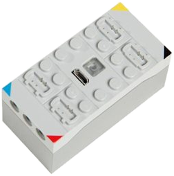
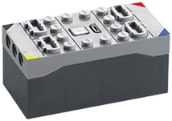

*Images: product photos from [klemmshop.de](https://www.klemmshop.de), scaled down to 400 × 400 px, background removed; see "Image credits" in the [main README](../README.md#image-credits).*

## Overview

| Property | Value |
|---|---|
| Device | CaDA CJV1010 – building-block receiver with built-in rechargeable battery ("Empfänger / Akkubox") |
| Article number | CJV1010 (manufacturer number), GTIN 4260636471711 (shop data) |
| Radio | 2.4 GHz, **original CaDA handset only** – [CJV8011](CJV8011.md) required |
| Channels | 4 output ports: **1 = red**, **2 = blue**, **3 = black**, **4 = yellow** (corner colour marks, own observation) |
| Speed control | **none** – each port has only three states: **neutral, plus, minus** (own observation; product page: "Keine stufenlose Regelung möglich") |
| Pairing | **pairing mode** with the [CJV8011](CJV8011.md) handset (own observation; procedure not yet documented) |
| Power | built-in rechargeable battery (Li-ion 2S, 7.4 V / 500 mAh, see section 1.4), charged via **Micro USB** (USB cable not included) |
| Controls | illuminated on/off button |
| Compatibility | only with the **EU** CaDA 2.4 GHz handset (oval "2.4GHz" sticker); **not** compatible with the Chinese CaDA handset variant |
| Distributor (EU) | freakware GmbH, Kerpen (shop data, product safety information) |
| Price (shop, 2026-11-14) | 23.00 € |

Not to be confused with the [CaDA RaceCar](RaceCar.md), which is controlled by the app via BLE
advertising. The CJV1010 is a plain 2.4 GHz receiver for the CaDA handset; nothing on the product
page indicates an app or BLE interface.

---

## 1. Hardware

Product photos:

| Feature | Observation |
|---|---|
| Housing | brick-built box, studs on top, Technic holes on the short sides; two colour variants on the photos (light grey, and light grey top with dark grey bottom) |
| Ports | **4** connectors on top, one per corner, each corner marked with a colour: **blue**, **red**, **yellow**, **black** |
| Centre | Micro USB socket (charging) and a transparent square button (illuminated on/off switch) |

The colours of the port markings match the colour marks on the controls of the
[CJV8011 handset](CJV8011.md) (red / blue on the two levers, black / yellow on the shoulder buttons):
each colour links one handset control to one receiver port – channel 1 red (left lever), 2 blue
(right lever), 3 black (left shoulder buttons), 4 yellow (right shoulder buttons), see
[CJV8011 §1.4](CJV8011.md#14-operation-own-observations).

Part identifications from SMD markings (read from own photos of an opened receiver) are best
guesses unless stated otherwise.

### 1.1 Housing

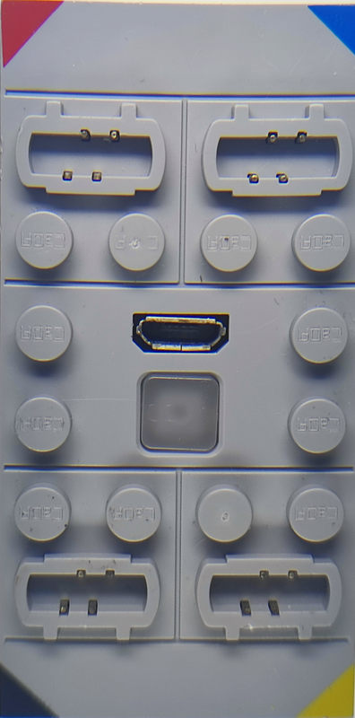
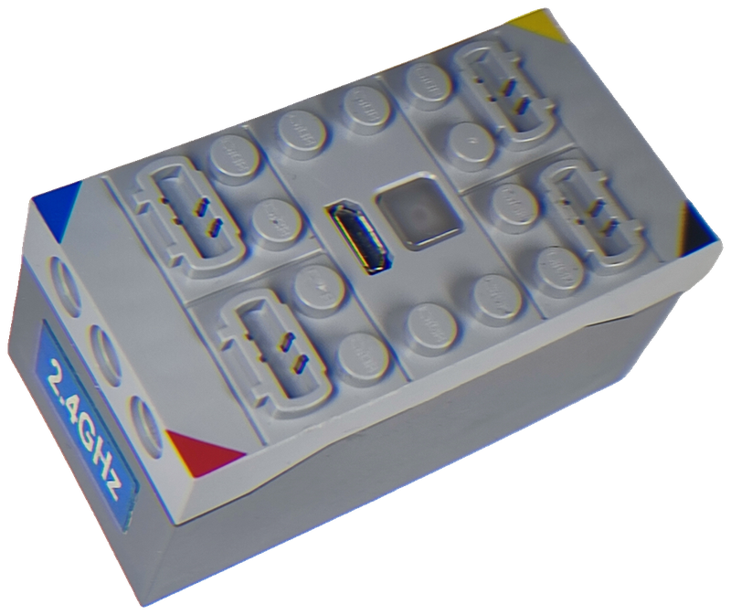

*Own photos. Left: top view with the colour marks **red** (top left), **blue** (top right),
**black** (bottom left) and **yellow** (bottom right), the Micro USB socket and the transparent
square button in the centre, studs with the `CaDA` logo. Right: housing at an angle, short side
with three Technic holes and a blue `2.4GHz` sticker.*

Observation from the photos: every port socket has 4 pins (2 + 2), like the
[MK4.0](../MouldKing/MK4.0.md#8-hardware-receiver-board) receiver. This matches the 8 × 2-pin headers on the
board (two headers per port).

### 1.2 Board

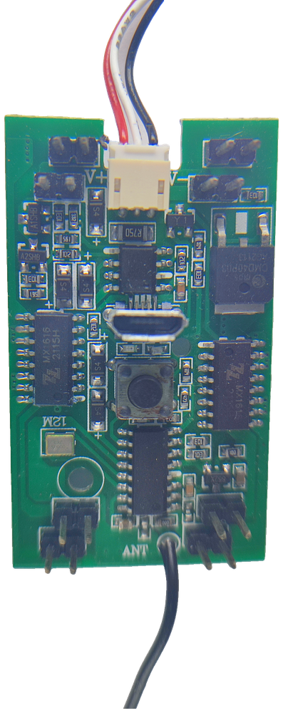
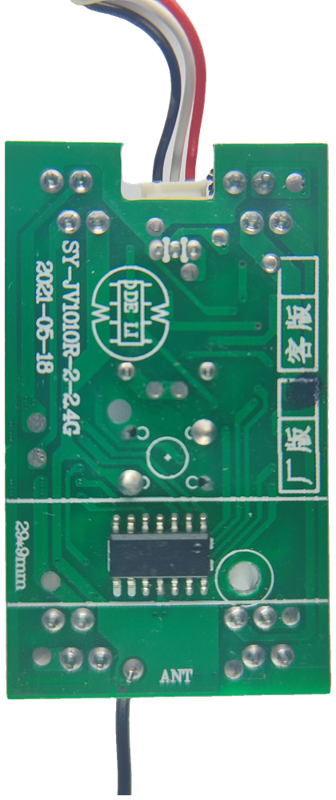

*Front (left) and back (right) of the receiver board. Front: battery connector (red / white /
black) at the top between the silkscreen marks `V+` and `V-`, Micro USB socket, push button and
2 SMD LEDs in the centre, two SOP-16 `MX616` left and right, SOP-16 (RF, unmarked) with the
12.000 MHz crystal at the bottom, DPAK MOSFET at the top right, wire antenna `ANT` at the bottom
edge, 2-pin headers in the four corners. Back: silkscreen `SY-JV1010R-2-2.4G`, `2021-05-18`,
`29*9mm`, a `厂版` / `客版` ("factory version" / "customer version") box with the `厂版`
field marked, one SOP-14 IC. Own photos.*

| Property | Value |
|---|---|
| Board name | `SY-JV1010R-2-2.4G` (back) |
| Date code | `2021-05-18` (back) |
| Antenna | single wire antenna at the bottom edge (`ANT`) |
| Crystal | **12.000 MHz** (SMD 3225, marking `CXE 12.000`, silkscreen `12M`) |
| User interface | 1 push button (on/off, under the transparent housing button), 2 SMD LEDs next to the USB socket |
| Charging | Micro USB socket, SOP-8 IC with an `R750` (0.75 Ω) resistor next to it |
| Battery | 3-wire cable red / white / black, silkscreen `V+` / `V-` |
| Motor outputs | 8 × 2-pin headers: two in each of the four corners (presumably one pair per port) |

*Interpretation:* XN297L-class transceivers (Mould King, JIESTAR) and the nRF24L01 use a 16 MHz
crystal. The **12 MHz** crystal points to a different RF chip family, e.g. the LT8900 / LT8910
class (12 MHz reference). Not verified. The [CJV8011 handset](CJV8011.md#12-boards) also has a 12 MHz crystal and a board from the same maker (`SY-JV…`, `DE LI` logo).

### 1.3 Components

| Marking | Package | Probable function |
|---|---|---|
| (no readable marking) | SOP-16, bottom centre, next to the 12 MHz crystal and the antenna | RF transceiver / RF SoC, exact part unknown |
| (no readable marking) | SOP-14, back side | unknown; MCU or second part of the RF circuit |
| `ZZ` logo, `MX616`, `2115H` | 2 × SOP-16 (second one probably also `MX616`, marking blurred) | motor driver, *interpretation:* dual H-bridge, two ports per IC → 4 ports |
| (no readable marking) | SOP-8, next to the USB socket, with `R750` sense resistor | Li-ion charger IC (2-cell, see battery) |
| `xMD40P03`, `AE2113` | DPAK (TO-252) | P-channel MOSFET 30 V (`40P03`), *interpretation:* main power switch |
| `A1SHB` | SOT-23 | P-channel MOSFET (SI2301) |
| `A2SHB` | SOT-23 | N-channel MOSFET (SI2302) |
| `S4` | 6 × SMA | Schottky diode (SS14) |
| `Y1` | SOT-23 | unknown (transistor) |
| `65ZX` (rotated, hard to read) | SOT-23, near the RF chip | unknown, possibly an LDO regulator |

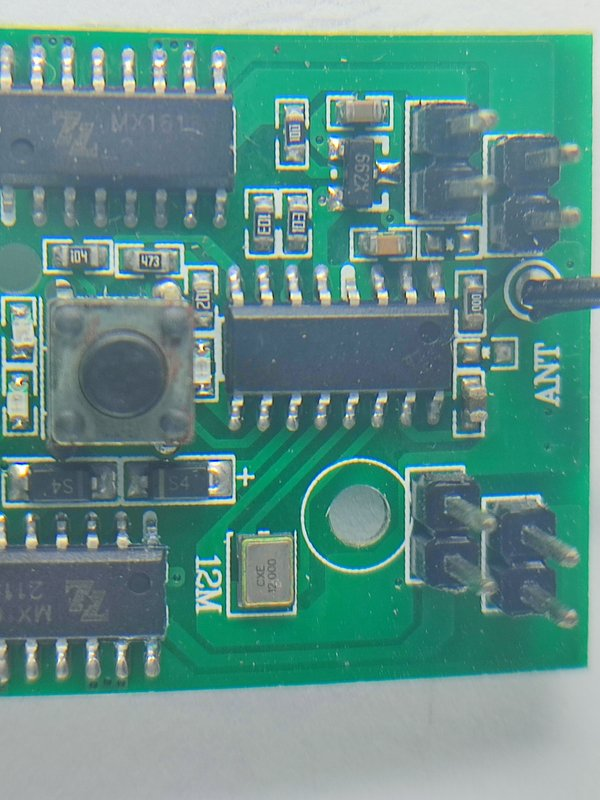
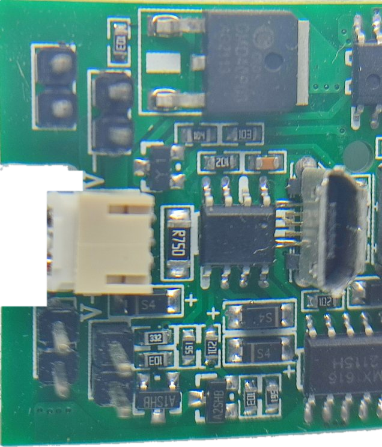

*Left: RF section with the unmarked SOP-16, the 12.000 MHz crystal (`12M`), the antenna wire
(`ANT`), the push button and two port headers. Right: power section with the battery connector
(`V+` / `V-`), SOP-8 with `R750` next to the Micro USB socket, `A1SHB` / `A2SHB` SOT-23 parts,
`S4` diodes and the DPAK MOSFET. Own photos.*

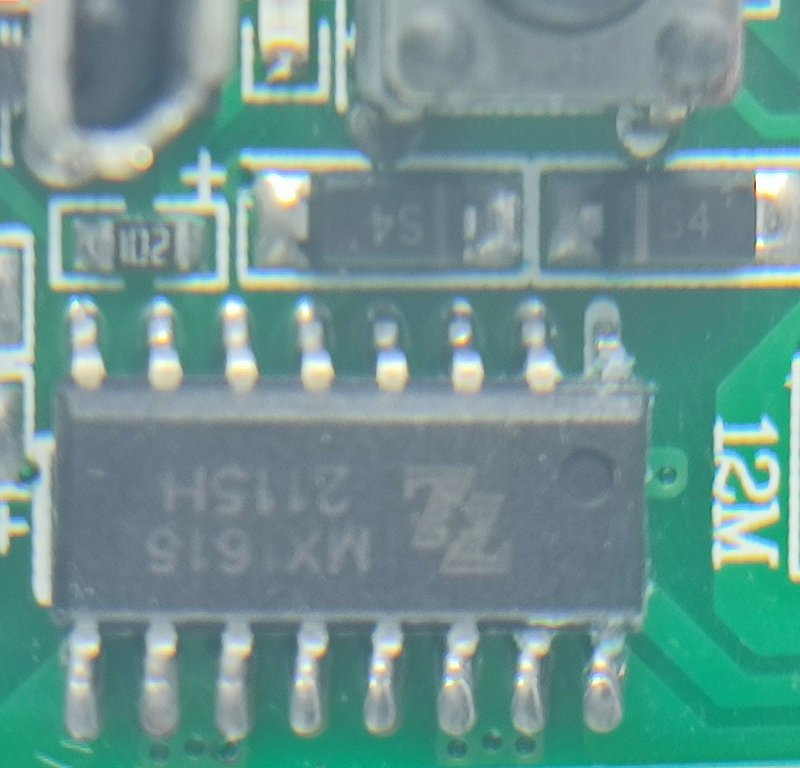
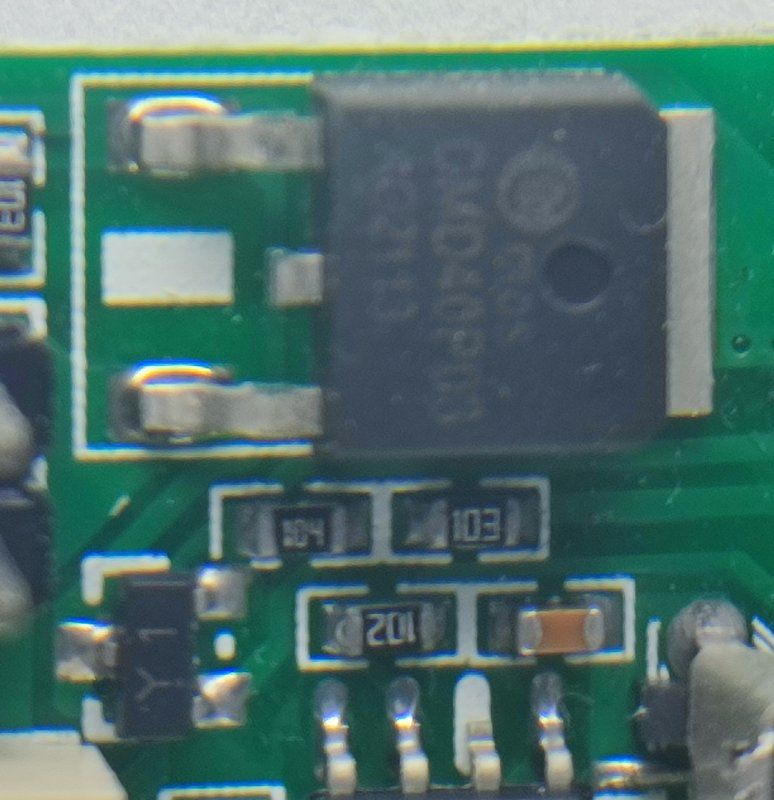

*Left: SOP-16 motor driver `ZZ` / `MX616` / `2115H`. Right: DPAK MOSFET `xMD40P03` / `AE2113`.
Own photos.*

### 1.4 Battery

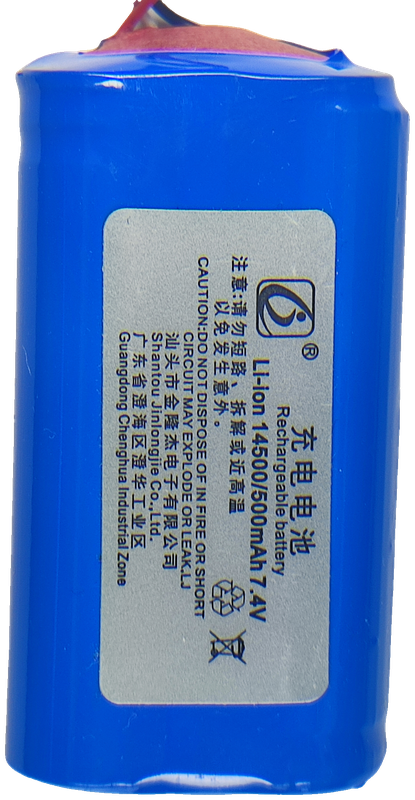

*Own photo of the built-in battery pack.*

| Property | Value |
|---|---|
| Type | Li-ion, 2 × 14500 cells in series |
| Label | `Li-ion 14500/500mAh 7.4V` |
| Capacity / voltage | 500 mAh, 7.4 V nominal |
| Manufacturer (label) | Shantou Jinlongjie Co., Ltd., Chenghua Industrial Zone, Guangdong |
| Cable | 3 wires red / white / black; *interpretation:* white = middle tap between the two cells (balancing) |

---

## 2. Radio protocol

Not yet measured. The product page only states 2.4 GHz. Planned approach, analogous to the
[MK4.0 handset](../MouldKing/MK4.0-Remote.md) and the [SCM8 handset](../JieStar/SCM8-Remote.md):
capture the [CJV8011](CJV8011.md) with the [XN297L sniffer](../Tools/xn297l-sniffer/README.md)
and, if no XN297L frames are found, with a wide-band SDR scan of 2400 … 2483 MHz.

---

## Open questions

- Which radio chip and frame format does the receiver use? The board has a **12 MHz** crystal (see section 1.2), so XN297L / nRF24L01 (16 MHz) are less likely; LT8900-class chips are a candidate.
- Exact part numbers of the unmarked SOP-16 (RF), SOP-14 (back side) and SOP-8 (charger) ICs.
- Pairing mode: how is it entered on the receiver side (on/off button, power-on sequence)? After pairing, does the receiver only react to this one handset (ID) or to every CaDA handset in range?
- Bind and operating frequencies, frequency hopping?
- Port output in the plus / minus state: fixed full battery voltage or a fixed PWM duty cycle?
- What is the technical difference between the EU and the Chinese CaDA variant (different frequency, address or protocol)?
- Port output voltage (battery is 7.4 V / 500 mAh, see section 1.4; the drop across the `MX616` drivers is not measured).
- Does the receiver send anything (telemetry, acknowledgement)?
