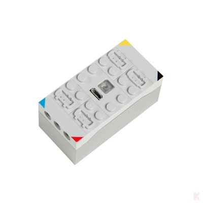
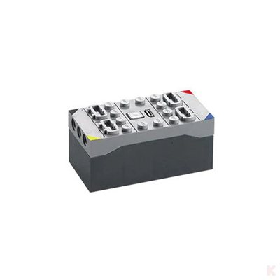

# CaDA CJV1010 – 4-Channel 2.4 GHz Receiver / Battery Box

> Source: product page at klemmshop.de – [CaDA CJV1010 Klemmbaustein 4 Kanal Empfänger / Akkubox 2,4 GHz](https://www.klemmshop.de/CaDA-CJV1010-Klemmbaustein-4-Kanal-Empfaenger-/-Akkubox-24-GHz) (retrieved 2026-11-14).
> The radio protocol has **not been captured yet**; everything below the product data is an open question or marked as interpretation.
> Last updated: 2026-11-14

*Images: product photos from [klemmshop.de](https://www.klemmshop.de), scaled down to 400 × 400 px; see "Image credits" in the [main README](../README.md#image-credits).*

## Overview

| Property | Value |
|---|---|
| Device | CaDA CJV1010 – building-block receiver with built-in rechargeable battery ("Empfänger / Akkubox") |
| Article number | CJV1010 (manufacturer number), GTIN 4260636471711 (shop data) |
| Radio | 2.4 GHz, **original CaDA handset only** – [CJV8011](CJV8011.md) required |
| Channels | 4 output ports |
| Speed control | **none** – "Keine stufenlose Regelung möglich" (no proportional control, the ports are only switched on/off/reverse) |
| Power | built-in rechargeable battery, charged via **Micro USB** (USB cable not included) |
| Controls | illuminated on/off button |
| Compatibility | only with the **EU** CaDA 2.4 GHz handset (oval "2.4GHz" sticker); **not** compatible with the Chinese CaDA handset variant |
| Distributor (EU) | freakware GmbH, Kerpen (shop data, product safety information) |
| Price (shop, 2026-11-14) | 23.00 € |

Not to be confused with the [CaDA RaceCar](RaceCar.md), which is controlled by the app via BLE
advertising. The CJV1010 is a plain 2.4 GHz receiver for the CaDA handset; nothing on the product
page indicates an app or BLE interface.

---

## 1. Hardware (from the product photos)

| Feature | Observation |
|---|---|
| Housing | brick-built box, studs on top, Technic holes on the short sides; two colour variants on the photos (light grey, and light grey top with dark grey bottom) |
| Ports | **4** connectors on top, one per corner, each corner marked with a colour: **blue**, **red**, **yellow**, **black** |
| Centre | Micro USB socket (charging) and a transparent square button (illuminated on/off switch) |

The colours of the port markings match the colour marks on the controls of the
[CJV8011 handset](CJV8011.md) (red / blue on the two levers, black / yellow on the shoulder buttons)
– *interpretation:* each colour links one handset control to one receiver port.

---

## 2. Radio protocol

Not yet measured. The product page only states 2.4 GHz. Planned approach, analogous to the
[MK4.0 handset](../MouldKing/MK4.0-Remote.md) and the [SCM8 handset](../JieStar/SCM8-Remote.md):
capture the [CJV8011](CJV8011.md) with the [XN297L sniffer](../Tools/xn297l-sniffer/README.md)
and, if no XN297L frames are found, with a wide-band SDR scan of 2400 … 2483 MHz.

---

## Open questions

- Which radio chip and frame format does the receiver use (XN297L-compatible like Mould King / JIESTAR, or something else, e.g. nRF24L01 or a proprietary chip)?
- Bind procedure: does the receiver bind to one handset (ID) or react to every CaDA handset in range?
- Bind and operating frequencies, frequency hopping?
- How are the 4 ports mapped to the handset controls (colour coding, see section 1)?
- Port output: fixed full voltage (forward / off / reverse only, as the product page suggests) or PWM steps?
- What is the technical difference between the EU and the Chinese CaDA variant (different frequency, address or protocol)?
- Battery capacity, voltage and port output voltage (not stated on the product page).
- Does the receiver send anything (telemetry, acknowledgement)?
