# CaDA CJV8011 – 4-Channel 2.4 GHz Handset

> Source: product page at klemmshop.de – [CaDA CJV8011 Klemmbaustein 4 Kanal Fernsteuerung 2,4 GHz](https://www.klemmshop.de/CaDA-CJV8011-Klemmbaustein-4-Kanal-Fernsteuerung-24-GHz_2?lang=eng) (English page; [German page](https://www.klemmshop.de/CaDA-CJV8011-Klemmbaustein-4-Kanal-Fernsteuerung-24-GHz_2), retrieved 2026-11-14).
> The radio protocol has **not been captured yet**; everything below the product data is an open question or marked as interpretation.
> Last updated: 2026-11-14 (own housing and board photos added)

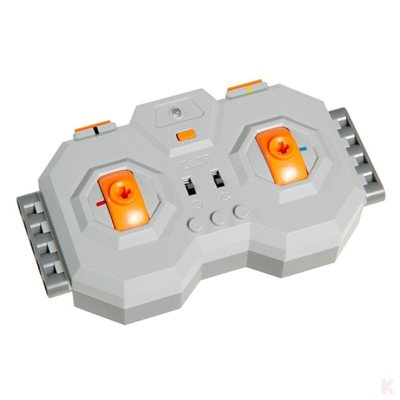
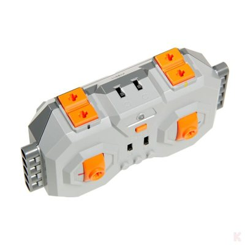
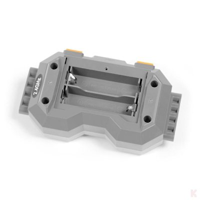

*Images: product photos from [klemmshop.de](https://www.klemmshop.de), scaled down to 400 × 400 px; see "Image credits" in the [main README](../README.md#image-credits).*

## Overview

| Property | Value |
|---|---|
| Device | CaDA CJV8011 – building-block 2.4 GHz handset ("Fernsteuerung") |
| Article number | CJV8011 (manufacturer number); the shop lists the same GTIN as the [CJV1010](CJV1010.md) (4260636471711) – probably a shop data error |
| Radio | 2.4 GHz, **original CaDA receiver only** – [CJV1010](CJV1010.md) required |
| Channels | 4 control channels |
| Speed control | **none** – "Keine stufenlose Regelung möglich" (no proportional control) |
| Controls (product page) | on/off switch, direction switch (forward / reverse, "Rechts-/Linkslauf Umschalter") |
| Power | 2 × AA (not included), battery compartment on the back |
| Compatibility | only with **EU** CaDA 2.4 GHz modules (oval "2.4GHz" sticker); **not** compatible with the Chinese CaDA battery-module variant |
| Variant | with an attachable **steering wheel** (building parts included): the channel is then operated left / right instead of up / down |
| Distributor (EU) | freakware GmbH, Kerpen (shop data, product safety information) |
| Price (shop, 2026-11-14) | 14.00 € |

---

## 1. Handset

From the product photos, corrected with own photos (section 1.1):

| Control | Observation |
|---|---|
| Two levers | one orange lever in each octagonal field on the front, with a Technic axle hole; colour mark **red** (left) and **blue** (right) |
| Four shoulder buttons | two orange buttons on each side of the top edge, with Technic axle holes; colour mark **black** (left pair) and **yellow** (right pair) |
| Two slide switches | in the centre, marked with rotation symbols – *interpretation:* direction reversal ("Rechts-/Linkslauf Umschalter") |
| Three round studs | below the slide switches, with the `CaDA` logo – **no buttons**, only decorative studs (own photos) |
| Centre top | small LED and an orange button with power symbol (*interpretation:* power / bind, switch `K5` on the board) |
| Sides | Technic beams with axle / pin holes, used to mount the steering wheel |
| Back | battery compartment for 2 × AA, oval sticker "2.4GHz" (marks the EU variant) |

*Interpretation:* the 4 channels are the 2 levers plus the 2 pairs of shoulder buttons; the colour
marks (red, blue, black, yellow) match the colour-marked corners of the four ports of the
[CJV1010](CJV1010.md) receiver.

### 1.1 Own photos of the housing

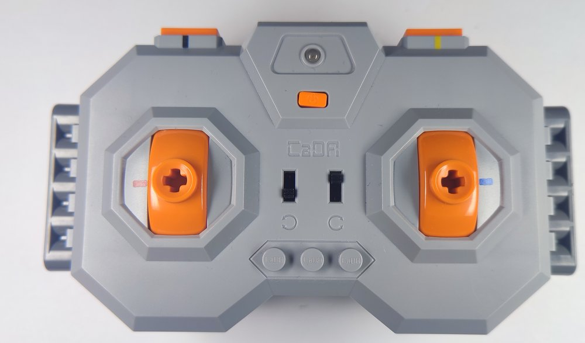
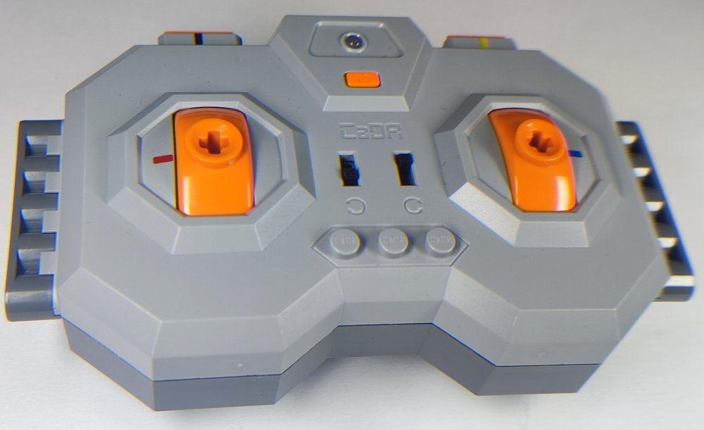

*Own photos. Left: front with the levers (colour mark **red** left, **blue** right), the two
slide switches with rotation symbols, three `CaDA` studs, the orange power button and the LED at
the top; the shoulder buttons at the top edge carry the marks **black** (left) and **yellow**
(right). Right: the same at an angle.*

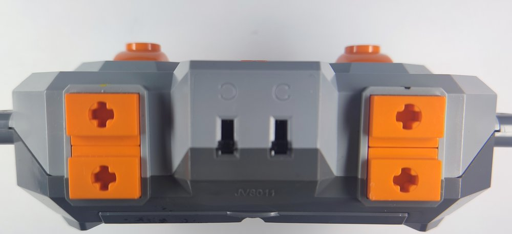
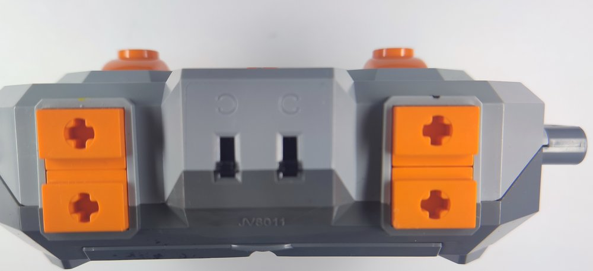

*Own photos of the top edge: two pairs of orange shoulder buttons with Technic axle holes, the two
slide switches between them, moulded type marking `JV8011` below.*

### 1.2 Boards

The handset contains two boards connected by a 7-wire ribbon cable: a green **main board**
parallel to the front (lever mechanics, SOP-16 IC) and a yellow **switch board** along the top
edge (shoulder buttons, slide switches, crystal, antenna).

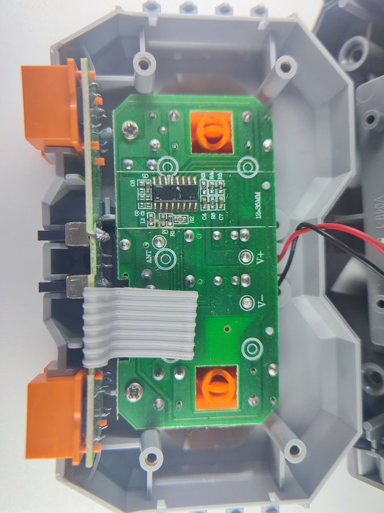
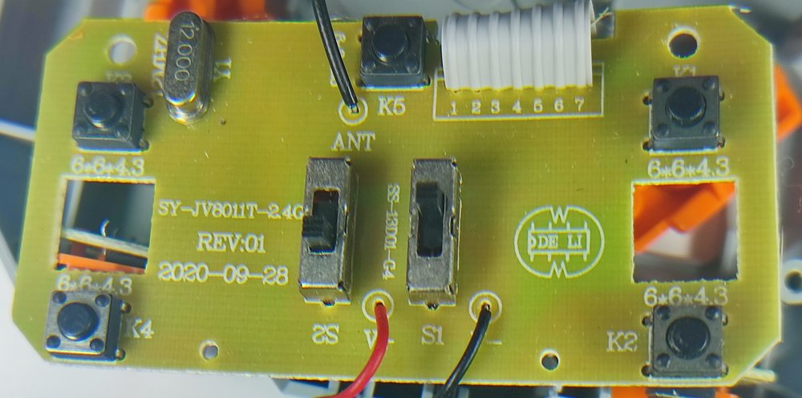

*Own photos. Left: opened housing, green main board with the SOP-16 in the centre, the two orange
lever mechanisms in square cut-outs, battery wires red / black at `V+` / `V-`, the 7-wire ribbon
cable to the switch board at the left edge (seen edge-on, with the orange shoulder buttons and
the slide switches). Right: switch board with silkscreen `SY-JV8011T-2.4G`, `REV:01`,
`2020-09-28`, `DE LI` logo (the same logo as on the back of the [CJV1010](CJV1010.md#12-board)
board), 12.000 MHz crystal `Y1`, push buttons `K1` … `K5`, slide switches `S1` / `S2`, antenna
wire `ANT`, ribbon cable pads `1` … `7`.*

| Property | Main board (green) | Switch board (yellow) |
|---|---|---|
| Silkscreen | `12*35MM`, `ANT`, `V+`, `V-`, part labels `C1` … `C8`, `R1` … `R8`, `L1` | `SY-JV8011T-2.4G`, `REV:01`, `2020-09-28`, `DE LI` logo |
| Material | FR-4 (green) | FR-1 / paper (yellow) |
| Parts | SOP-16 IC (no marking), SMD passives (`302` = 3 kΩ at `R2`, `432` = 4.3 kΩ, `474`), square cut-outs for the two lever mechanisms | crystal **12.000 MHz** (HC-49/S, `Y1`, `12MHZ`), 5 × push button 6 × 6 × 4.3 mm (`K1` … `K5`), 2 × slide switch `SS-12D01-G4` (`S1`, `S2`) |
| Connections | battery `V+` / `V-` (red / black), pad `ANT` | battery `V+` / `V-` (red / black), antenna wire at `ANT`, 7-pin ribbon cable `1` … `7` |

*Interpretation:* `K1` … `K4` are the four shoulder buttons (two at each end of the switch
board), `K5` next to the antenna is the orange power button, `S1` / `S2` are the two direction
slide switches. How the lever positions are sensed (switch contacts on the back of the main
board?) is not visible on the photos.

The handset uses a **12 MHz** crystal like the [CJV1010](CJV1010.md#12-board) receiver – both
boards come from the same maker (`SY-JV…` board names, `DE LI` logo). See the radio-chip question
below.

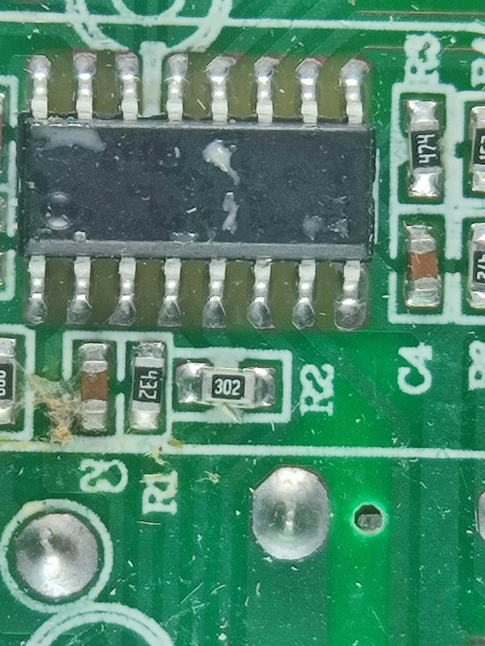

*Own photo: close-up of the SOP-16 on the main board – no readable marking, resistors `302` (`R2`)
and `432` below it. Probably the RF SoC / encoder of the handset.*

### 1.3 Steering-wheel variant

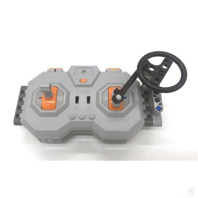
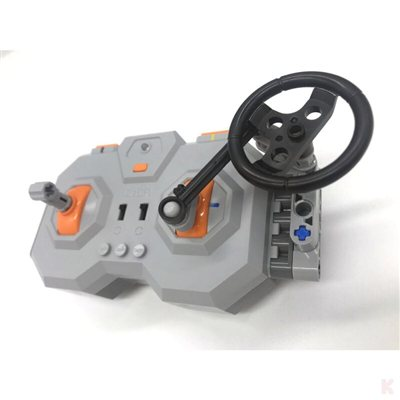

A steering wheel mounted on the side beam drives the right lever via a crank; a short Technic
lever is plugged into the left lever. The radio telegram is presumably the same (*interpretation*)
– only the mechanical operation changes.

---

## 2. Radio protocol

Not yet measured. Planned approach, analogous to the
[MK4.0 handset](../MouldKing/MK4.0-Remote.md) and the [SCM8 handset](../JieStar/SCM8-Remote.md):

1. Capture with the [XN297L sniffer](../Tools/xn297l-sniffer/README.md) on all channels 2400 … 2483 MHz (1 Mbps and 250 kbps / 2 Mbps), first while switching on (bind), then during operation.
2. If no XN297L frames are found: wide-band SDR scan to find the occupied frequencies, then try nRF24L01 / Beken / other common 2.4 GHz toy-RC chips.
3. Telegram layout: one control at a time (levers, shoulder buttons, slide switches, round buttons), as in the SCM8 capture plan.

---

## Open questions

- Radio chip, data rate, frame format, address, CRC? The **12 MHz** crystal (section 1.2) makes XN297L / nRF24L01 (16 MHz) less likely; LT8900-class chips are a candidate. The SOP-16 on the main board has no marking.
- Is the RF chip the SOP-16 on the main board (the crystal and the antenna sit on the switch board, connected by the 7-wire ribbon cable), or is there a chip on the unphotographed back of the switch board?
- Bind procedure, handset ID, bind and operating frequencies, hopping?
- Telegram layout: are the levers sent as on/off/reverse states or as analog values that the receiver only switches (product page: no proportional control)?
- Function of the two slide switches – direction reversal per channel (rotation symbols) or channel group selection?
- How are the lever positions sensed?
- Can one handset control several CJV1010 receivers (channel / group selection)?
- Difference between the EU and the Chinese variant on the radio layer.
- Are the CaDA app-controlled modules (e.g. the [RaceCar](RaceCar.md)) related on the radio layer?
