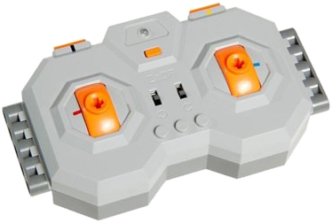
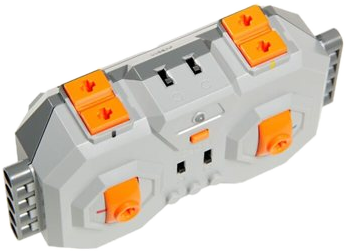
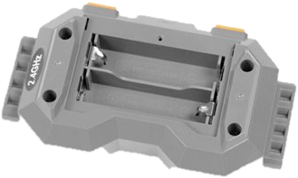
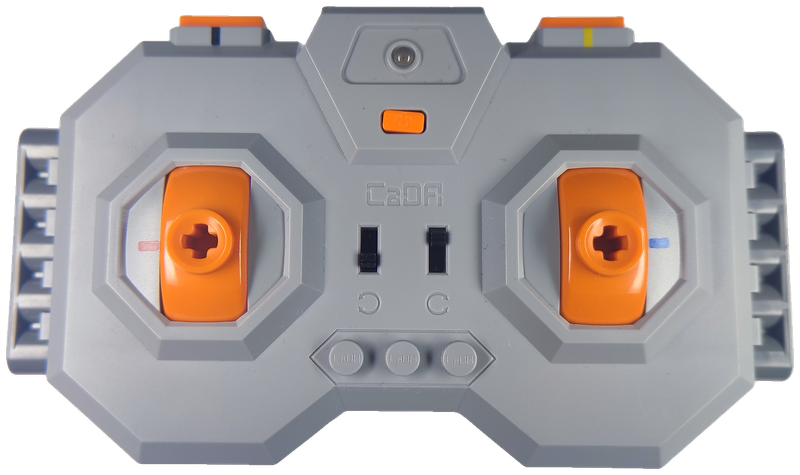
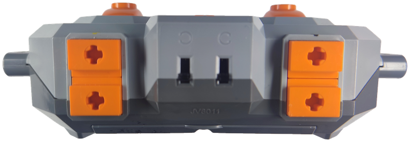
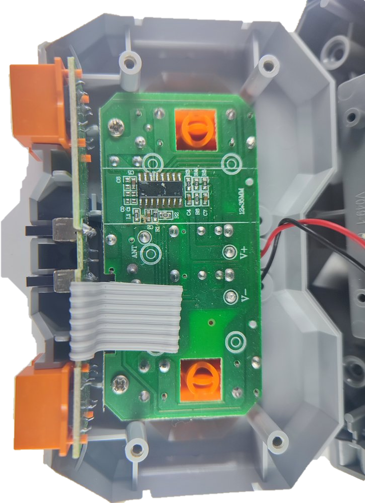
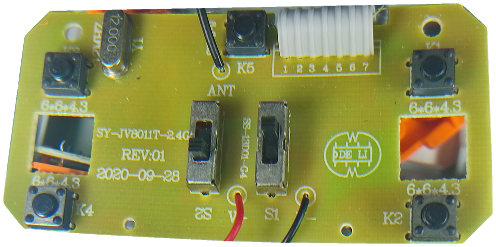
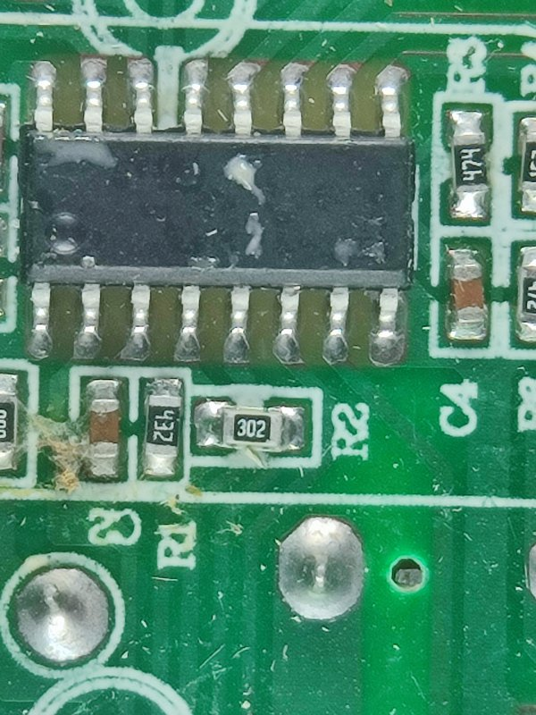
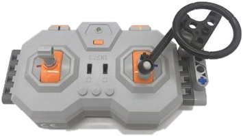
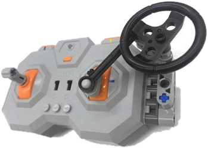

# CaDA CJV8011 – 4-Channel 2.4 GHz Handset

> Source: product page at klemmshop.de – [CaDA CJV8011 Klemmbaustein 4 Kanal Fernsteuerung 2,4 GHz](https://www.klemmshop.de/CaDA-CJV8011-Klemmbaustein-4-Kanal-Fernsteuerung-24-GHz_2?lang=eng) (English page; [German page](https://www.klemmshop.de/CaDA-CJV8011-Klemmbaustein-4-Kanal-Fernsteuerung-24-GHz_2), retrieved 2026-11-14).
> Radio protocol: own captures with the [XN297L sniffer](../Tools/xn297l-sniffer/README.md) in raw mode, 2026-11-14 … 15 ([capture plan](CJV8011-Capture-Plan.md)) – telegram decoded (section 2); feasibility of a smartphone / own transmitter: section 3. **Investigation stopped** on 2026-11-15.
> Own observations of handset and receiver in use (2026-11-14): pairing mode, three-state channels, channel numbering, direction switches (section 1.4).
> Last updated: 2026-11-15 (telegram decoded, assessment smartphone / own transmitter, investigation stopped)

<table>
<tr><td align="center" valign="top"></td><td align="center" valign="top"></td></tr>
<tr><td align="center" valign="top" colspan="2"></td></tr>
</table>

*Images: product photos from [klemmshop.de](https://www.klemmshop.de), scaled down to 400 × 400 px, background removed; see "Image credits" in the [main README](../README.md#image-credits).*

## Overview

| Property | Value |
|---|---|
| Device | CaDA CJV8011 – building-block 2.4 GHz handset ("Fernsteuerung") |
| Article number | CJV8011 (manufacturer number); the shop lists the same GTIN as the [CJV1010](CJV1010.md) (4260636471711) – probably a shop data error |
| Radio | 2.4 GHz, **original CaDA receiver only** – [CJV1010](CJV1010.md) required |
| Channels | 4 control channels: **1 = red**, **2 = blue**, **3 = black**, **4 = yellow** (own observation, section 1.4) |
| Speed control | **none** – each channel has only three states: **neutral, plus, minus** (own observation; product page: "Keine stufenlose Regelung möglich") |
| Direction reversal | one switch **per channel** on the handset reverses its direction (own observation) |
| Pairing | the handset has a **pairing mode** (own observation; procedure not yet documented) |
| Controls (product page) | on/off switch, direction switch (forward / reverse, "Rechts-/Linkslauf Umschalter") |
| Power | **2 × AA** (not included), battery compartment on the back (product page; confirmed with both own handsets H1, H2) |
| Compatibility | only with **EU** CaDA 2.4 GHz modules (oval "2.4GHz" sticker); **not** compatible with the Chinese CaDA battery-module variant |
| Variant | with an attachable **steering wheel** (building parts included): the channel is then operated left / right instead of up / down |
| Distributor (EU) | freakware GmbH, Kerpen (shop data, product safety information) |
| Price (shop, 2026-11-14) | 14.00 € |

---

## 1. Handset

From the product photos, corrected with own photos (section 1.1):

| Control | Observation |
|---|---|
| Two levers | one orange lever in each octagonal field on the front, with a Technic axle hole; colour mark **red** (left) and **blue** (right) |
| Four shoulder buttons | two orange buttons on each side of the top edge, with Technic axle holes; colour mark **black** (left pair) and **yellow** (right pair) |
| Two slide switches | in the centre, marked with rotation symbols – direction reversal ("Rechts-/Linkslauf Umschalter"); own observation: one reversal switch per channel, see section 1.4 and the open questions |
| Three round studs | below the slide switches, with the `CaDA` logo – **no buttons**, only decorative studs (own photos) |
| Centre top | small LED and an orange button with power symbol (*interpretation:* power / bind, switch `K5` on the board) |
| Sides | Technic beams with axle / pin holes, used to mount the steering wheel |
| Back | battery compartment for 2 × AA, oval sticker "2.4GHz" (marks the EU variant) |

The 4 channels are the 2 levers plus the 2 pairs of shoulder buttons; the colour marks (red, blue,
black, yellow) match the colour-marked corners of the four ports of the [CJV1010](CJV1010.md)
receiver. Channel numbers and states: section 1.4.

### 1.1 Own photos of the housing



*Own photos. Left: front with the levers (colour mark **red** left, **blue** right), the two
slide switches with rotation symbols, three `CaDA` studs, the orange power button and the LED at
the top; the shoulder buttons at the top edge carry the marks **black** (left) and **yellow**
(right).*



*Own photo of the top edge: two pairs of orange shoulder buttons with Technic axle holes, the two
slide switches between them, moulded type marking `JV8011` below.*

### 1.2 Boards

The handset contains two boards connected by a 7-wire ribbon cable: a green **main board**
parallel to the front (lever mechanics, SOP-16 IC) and a yellow **switch board** along the top
edge (shoulder buttons, slide switches, crystal, antenna).

<table>
<tr><td align="center" valign="top"></td><td align="center" valign="top"></td></tr>
</table>

*Own photos. Left: opened housing, green main board with the SOP-16 in the centre, the two orange
lever mechanisms in square cut-outs, battery wires red / black at `V+` / `V-`, the 7-wire ribbon
cable to the switch board at the left edge (seen edge-on, with the orange shoulder buttons and
the slide switches). Right: switch board with silkscreen `SY-JV8011T-2.4G`, `REV:01`,
`2020-09-28`, `DE LI` logo (the same logo as on the back of the [CJV1010](CJV1010.md#12-board)
board), 12.000 MHz crystal `Y1`, push buttons `K1` … `K5`, slide switches `S1` / `S2`, antenna
wire `ANT`, ribbon cable pads `1` … `7`.*

| Property | Main board (green) | Switch board (yellow) |
|---|---|---|
| Silkscreen | `12*35MM`, `ANT`, `V+`, `V-`, part labels `C1` … `C8`, `R1` … `R8`, `L1` | `SY-JV8011T-2.4G`, `REV:01`, `2020-09-28`, `DE LI` logo |
| Material | FR-4 (green) | FR-1 / paper (yellow) |
| Parts | SOP-16 IC (no marking), SMD passives (`302` = 3 kΩ at `R2`, `432` = 4.3 kΩ, `474`), square cut-outs for the two lever mechanisms | crystal **12.000 MHz** (HC-49/S, `Y1`, `12MHZ`), 5 × push button 6 × 6 × 4.3 mm (`K1` … `K5`), 2 × slide switch `SS-12D01-G4` (`S1`, `S2`) |
| Connections | battery `V+` / `V-` (red / black), pad `ANT` | battery `V+` / `V-` (red / black), antenna wire at `ANT`, 7-pin ribbon cable `1` … `7` |

*Interpretation:* `K1` … `K4` are the four shoulder buttons (two at each end of the switch
board), `K5` next to the antenna is the orange power button, `S1` / `S2` are the two direction
slide switches. How the lever positions are sensed (switch contacts on the back of the main
board?) is not visible on the photos.

The handset uses a **12 MHz** crystal like the [CJV1010](CJV1010.md#12-board) receiver – both
boards come from the same maker (`SY-JV…` board names, `DE LI` logo). See the radio-chip question
below.



*Own photo: close-up of the SOP-16 on the main board – no readable marking, resistors `302` (`R2`)
and `432` below it. Probably the RF SoC / encoder of the handset.*

### 1.3 Steering-wheel variant

<table>
<tr><td align="center" valign="top"></td><td align="center" valign="top"></td></tr>
</table>

A steering wheel mounted on the side beam drives the right lever via a crank; a short Technic
lever is plugged into the left lever. The radio telegram is presumably the same (*interpretation*)
– only the mechanical operation changes.

### 1.4 Operation (own observations)

First observations with handset and [CJV1010](CJV1010.md) receiver, not yet backed by radio
captures.

| Channel | Colour | Control (from the colour marks) | Receiver port |
|---|---|---|---|
| 1 | **red** | left lever | red corner (top left) |
| 2 | **blue** | right lever | blue corner (top right) |
| 3 | **black** | left pair of shoulder buttons | black corner (bottom left) |
| 4 | **yellow** | right pair of shoulder buttons | yellow corner (bottom right) |

- **Three states per channel:** neutral, plus, minus – no proportional (stepless) control, also on
  the levers.
- **Direction reversal:** for each channel there is a switch on the handset that reverses the
  direction of rotation (plus ↔ minus) of that channel.
- **Pairing mode:** handset and receiver have a pairing (bind) mode. How it is entered and whether
  the receiver then only reacts to this one handset is not yet documented.

*Interpretation:* with only three states per channel, a control telegram needs 2 bits per
channel (8 bits for all four), unless the handset sends full analog values and the receiver
quantises them – to be checked with radio captures.

---

## 2. Radio protocol

Measurements 2026-11-14 … 15 ([capture plan](CJV8011-Capture-Plan.md) sessions 0 … 2 and 4, details in
[§6.1](CJV8011-Capture-Plan.md#61-results-r10--r16-2026-11-14),
[§7.1](CJV8011-Capture-Plan.md#71-results-r21--r24-2026-11-15),
[§7.3](CJV8011-Capture-Plan.md#73-results-r25--r27-2026-11-15) and
[§9.1](CJV8011-Capture-Plan.md#91-results-r41--r43-2026-11-15) of the plan). All values are
measured unless marked as interpretation.

### 2.1 Radio layer

| Property | Value |
|---|---|
| Frame layer | **not XN297L** – no frame with the XN297L preamble `71 0F 55` and valid CRC (R0.3, R0.4) |
| Chip rate | **1 Mchip/s** GFSK (received with `nrf1m` and `ble1m`, not with `nrf2m`) |
| Bind (receiver off) | **2466 MHz** and a handset-specific channel (H1 **2446**, H2 **2443 MHz**), one frame every 29.6 ms per channel, all frames identical, controls not transmitted |
| Pairing | automatic after every power-on: bind frames until the receiver answers, ≈ 0.3 s link frames, then operation (R3.2); the receiver accepts any handset without explicit pairing (H2, R3.3a) |
| Operation channels | handset-specific: H1 2406 / 2427 / 2446 / 2462 MHz, H2 includes 2443 MHz (R3.3a) |
| Operation (paired) | **2406 → 2427 → 2446 → 2462 MHz**, frames 7.2 ms apart, then 12.2 ms pause; cycle 33.6 ms |
| Preamble | `AA AA …` (alternating, ≥ 4 bytes) |
| Frame | header (512 chips) + `1101` + **30 symbols × 64 chips** + `1001` = 2440 chips ≈ 2.44 ms after the preamble |

### 2.2 Symbols: 64 chips = 4 bits

Every symbol is one of **16 codewords of 64 chips**; each codeword stands for one **4-bit value**
(R4.1 … R4.3). The codewords are pairwise at least 21 chips apart, so a few chip errors are
corrected by choosing the nearest codeword. 5093 frames of R2.1, R2.4, R4.1 … R4.3 decode with
only 7 frames containing an unknown symbol.

| Value | 64-bit codeword (on air, MSB first) | Earlier label |
|---|---|---|
| `0` | `93 88 B0 CA D0 19 F2 E6` | K0 |
| `1` | `B5 2B E1 01 83 8E E2 C9` | K1 |
| `2` | `A7 E0 31 71 41 0A 77 2C` | K8 |
| `3` | `63 31 24 02 8D 10 5F 97` | K3 |
| `4` | `C4 F3 03 04 A5 EC D5 5C` | K5 |
| `5` | `A0 0C 1E D3 88 8E 90 2E` | K9 |
| `6` | `8A 27 C0 39 D2 C6 C8 44` | K6 |
| `7` | `93 03 5E 1B 43 95 C4 02` | K14 |
| `8` | `A2 E1 F4 02 A4 2E F3 9A` | K13 |
| `9` | `F0 20 76 4C A1 56 56 72` | new in R4.3 |
| `A` | `81 C0 51 4D 66 CA 15 F8` | K4 |
| `B` | `0B 18 AA 98 6C 33 02 DE` | K11 |
| `C` | `A4 71 7A 73 02 5C 45 16` | K2 |
| `D` | `C5 3A D4 11 2D 89 E1 97` | K7 |
| `E` | `CC 18 FE 2A 95 64 52 52` | K12 |
| `F` | `8C B0 A4 8A 7E 24 46 38` | K10 |

The values follow from the control telegram (section 2.4): single channels give 1, 2, 4, 8,
combinations 3, 5 … 7, 9, A, C, and the check symbols give 15 − value.

The header consists of the codewords `0 1 C 0′ 0 1 C 0′` (0′ = codeword 0 with the first chip
inverted) – *interpretation:* a start-of-packet code, not data.

### 2.3 Frame content as nibbles

Symbol positions 0 … 29 as 4-bit values (hex):

```
pos        0 1 2 3 4 5 6 7  8 9 10 11 12 13  14 15  16 17  18 19 20 21 22  23 24 25 26 27 28 29
bind       3 0 0 0 0 0 0 0  3 3 A  4  0  0   0  0   0  0   6  D  D  6  2   C  0  0  8  3  D  A
operation  3 0 2 5 5 1 1 1  3 3 A  4  0  0   A  B   ~A ~B  D  6  6  D  B   6  0  0  B  6  D  0
```

| Positions | Content |
|---|---|
| 0, 1 | `3 0`, constant |
| 2 … 7 | **link value**, 24 bits: bind `000000`, link and operation `255111` – the same after every power-on and for both handsets H1 and H2 (R3.2, R3.3a); *interpretation:* receiver ID (or a constant) |
| 8 … 13 | **handset ID**, 24 bits: H1 `33A400`, H2 `572444` |
| 14, 15 | control masks A and B (section 2.4); bind: `0 0` |
| 16, 17 | 15 − A, 15 − B (check symbols); bind: `0 0` |
| 18 … 29 | H1 bind `6DD62 C0083DA`, H2 bind `6DD68 …`, link `6DD64 …`, operation `D66DB 600B6D0`; position 22 = frame type or check (bind `2` / `8`, link `4`, operation `B`) – constant within each mode (positions 23 … 29 only measured with neutral controls); *interpretation:* checksum or second ID block |

### 2.4 Control telegram

The four channels are sent as **two 4-bit masks**: position 14 (mask A) contains the channels that
run in one direction, position 15 (mask B) the channels in the other direction. Neutral channels
are in neither mask.

| Bit | Value | Channel |
|---|---|---|
| 0 | `1` | 1 red |
| 1 | `2` | 2 blue |
| 2 | `4` | 3 black |
| 3 | `8` | 4 yellow |

Examples (R4.1 … R4.3): all neutral `0 0 | F F`; red in direction B `0 1 | F E`; red in
direction A `1 0 | E F`; red + blue B `0 3 | F C`; black + yellow B `0 C | F 3`.

- Direction B is the "plus" direction of the levers with the reversal switch in normal position
  (R4.1). Yellow "plus" gave direction A in R4.1 / R4.2 only because its reversal switch jams and
  was in the reversed position – all four channels are encoded the same way.
- The **direction-reversal switches** (one per channel, R4.3) act **in the handset**: a reversed
  channel simply moves its bit from mask A to mask B or vice versa (e.g. all channels "plus" with
  the red switch reversed: `9 6 | 6 9`). There is no separate flag in the telegram.
- The telegram has no proportional values – each channel is neutral, A or B (three states, as
  observed on the receiver).

*Interpretation (not verified):* DSSS transceiver of the **Cypress CYRF6936 / CYRF7936** class
(64-chip PN codewords at 1 Mchip/s, long preamble, start-of-packet code, 12 MHz crystal – as in the
handset and in the [CJV1010](CJV1010.md) receiver).

Step-by-step measurement guide and all runs: [CJV8011-Capture-Plan.md](CJV8011-Capture-Plan.md).

---

## 3. Control by smartphone or an own transmitter (assessment)

Assessment of 2026-11-15, based on the measurements in section 2. Nothing of this has been tried.

### 3.1 Smartphone via Bluetooth LE: not practical

The [MK4.0](../MouldKing/MK4.0.md) trick – a BLE advertising packet whose bits form a complete
foreign frame on air ([MK4.0 handset vs. app](../MouldKing/MK4.0-Remote-vs-BLE.md)) – does not
carry over:

| Obstacle | MK4.0 | CaDA CJV8011 / CJV1010 |
|---|---|---|
| Frame length | ≈ 25 bytes | **≈ 2440 chips ≈ 305 bytes**, one continuous frame; legacy advertising carries 31 bytes, one extended-advertising PDU ≈ 254 bytes, chained PDUs have gaps and headers |
| Frequency | 2402 MHz = BLE advertising channel 37 | operation 2406 / 2427 / 2446 / 2462 MHz, bind 2466 MHz plus a handset-specific channel; none of them is an advertising channel, the secondary channels of extended advertising are chosen by the controller, not by the app; **2427 and 2443 MHz are no BLE channels at all** (BLE uses even MHz values only) |
| Protocol flow | transmit only | the handset waits for an answer of the receiver before it leaves the bind mode (section 2.3); a phone cannot receive foreign frames; whether the receiver accepts operation frames without this exchange is unknown |

### 3.2 Own transmitter as a bridge: feasible

The telegram is known well enough (16 codewords of 4 bits, two direction masks, check symbols
15 − x, channel sequence and timing). A small transmitter could act as a bridge that the phone
controls via a BLE GATT service (like the [MKH4.0](../MouldKing/MKH4.0.md) hub); BrickController2
could address it as a device of its own.

| Variant | Pros | Cons / open |
|---|---|---|
| **nRF52840** (e.g. the MDK USB dongle of the [sniffer](../Tools/xn297l-sniffer/README.md)) as transmitter | arbitrary 1 Mbps GFSK bits on every 1 MHz channel (also 2427 MHz), exact timing, hardware already available | one radio packet holds only ≈ 2100 controllable bits; the frame has to be split into two back-to-back packets, a few chips of one symbol are lost at the seam – the DSSS receiver probably tolerates some chip errors per 64-chip symbol, not tested |
| **CYRF6936 module** (if the chip hypothesis is confirmed; such modules are used e.g. in multiprotocol RC transmitter modules) | native DSSS frames, no tricks, most robust | the measured codewords have to be mapped to the chip's code registers first |

### 3.3 Open before building

- Are symbol positions 23 … 29 constant also with moving controls (so far only measured in neutral)?
  If yes, a frame consists of fixed table values only, there is no checksum over the data.
- Does the receiver need the bind exchange? Simplest approach: clone H1 (its handset ID and
  channels). Test 1: connect the receiver with H1, switch H1 off, let the bridge send H1 operation
  frames. Test 2: switch the receiver on and play bind → link → operation blind, without listening
  for an answer.
- For both tests the dongle firmware needs a transmit mode (send a given frame on a given channel).

### 3.4 Status

**The investigation was stopped on 2026-11-15** after the telegram had been decoded (section 2).
Not done: identification of the receiver's transmission (C8), meaning of the constant symbol
positions, derivation of the handset-specific channels from the handset ID, the transmit tests of
section 3.3. The [capture plan](CJV8011-Capture-Plan.md) keeps the open runs (R3.11 … R3.13).

---

## Open questions

- Radio chip: CYRF6936 / CYRF7936 class (section 2.4) is a hypothesis; the SOP-16 on the main board has no marking.
- Is the RF chip the SOP-16 on the main board (the crystal and the antenna sit on the switch board, connected by the 7-wire ribbon cable), or is there a chip on the unphotographed back of the switch board?
- Pairing mode (section 1.4): how is it entered (power button `K5`, button combination, receiver button)? Handset ID, bind and operating frequencies, hopping?
- Meaning of the constant symbol positions 0, 1, 8 … 13 and 18 … 29 (ID, checksum?); do positions 23 … 29 change with the controls?
- Direction reversal: one switch per channel (R4.3), but the photos only show **two** slide switches (`S1`, `S2`) – where are the other two?
- Receiver frames: not yet identified; candidates are weak frames seen right after the receiver was switched on ([plan §8.5](CJV8011-Capture-Plan.md#85-results-r38--r310-2026-11-15--no-second-codeword-set)). Is `255111` the receiver ID (test with a second receiver)?
- How are the lever positions sensed?
- Can one handset control several CJV1010 receivers (channel / group selection)?
- Difference between the EU and the Chinese variant on the radio layer.
- Are the CaDA app-controlled modules (e.g. the [RaceCar](RaceCar.md)) related on the radio layer?
