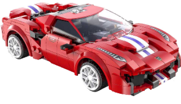
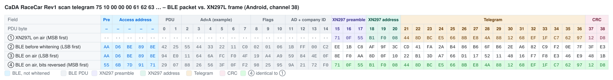
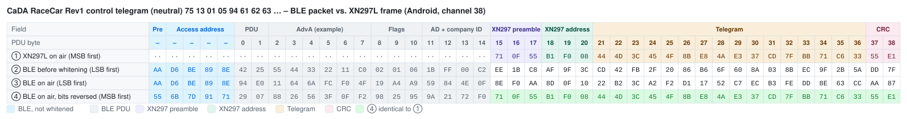

# CaDA RaceCar – Bluetooth Protocol

> Source: [J0EK3R/brickcontroller2](https://github.com/J0EK3R/brickcontroller2) – `DeviceManagement/CaDA/CaDARaceCar.cs`, `CaDADeviceManager.cs`, `MessageEncoderFactory.cs`, `RaceCarMessageEncoder.cs`, `RaceCarMessageEncoderRev2.cs`, `Protocols/CaDAProtocol.cs`, `Protocols/CryptTools.cs`, the platform `CaDAPlatformService.cs` and `BluetoothLEAdvertiserDevice.cs` files, `UI/Controls/Devices/CaDARaceCarChannelSelectorView.xaml` and the unit tests `CaDAProtocolTests.cs`, `CaDADeviceManagerTests.cs`, `MessageEncoderFactoryTests.cs`, `RaceCarMessageEncoderTests.cs`, `RaceCarMessageEncoderRev2Tests.cs`.
> Last updated: 2026-11-06



*Image: BrickController2 (`UI/Images/cada_racecar_image.png`, MIT License).*

## Overview

| Property | Value |
|---|---|
| Device | CaDA RaceCar (remote-controlled brick race car with lights) |
| Transport | **BLE advertising** (broadcast) app → car; the car itself sends **BLE advertisements** (used for discovery) |
| Direction | app → car for control; car → app only during discovery (no battery voltage) |
| Manufacturer ID (app) | `0xC200` |
| Manufacturer ID (car) | Rev1 `0xFFF0`, Rev2 `0x11AA` |
| Revisions | **Rev1** (original) and **Rev2** (new protocol), detected automatically from the car's advertisement |
| Channels | 4: throttle, steering (analog **byte**), front lights, rear lights (on/off) |
| Pairing | **yes** – the car is bound to the app identifier (unlike Mould King, JIESTAR and PowerBox) |
| Encoding | Rev1: CaDA encryption + XN297L-compatible frame on **BLE channel 38**; Rev2: plain 16-byte manufacturer data |

### Revisions at a glance

| Topic | Rev1 | Rev2 |
|---|---|---|
| Car advertisement | company `0xFFF0`, 18 bytes, starts with `75` | company `0x11AA`, 16 bytes, starts with `11` |
| Discovery | app advertises a **scan telegram** with its app ID, car answers with the same app ID | car advertises on its own (app ID `00 00`, flag `0x85` = not paired) |
| App identifier | 3 bytes | 2 bytes |
| Car identifier | 3-byte device address | 2-byte device ID + default sequence value |
| Control telegram | 16 bytes, channel block encrypted (random key) | 16 bytes, header `AA`/`BB`, checksum, sequence counter |
| Radio encoding | XN297L frame (preamble `71 0F 55`, address `43 41 52` = "CAR", CRC16, scrambler) + BLE whitening compensation for **channel 38** | none – plain BLE manufacturer data |

BrickController2 selects the encoder from the length of the stored manufacturer data of the car (`MessageEncoderFactory`): 18 bytes → Rev1, 16 bytes → Rev2.

---

## 1. Sequence

```
App starts scanning ───► (Rev1) app advertises the scan telegram with its app ID
        │
        ▼
 Car advertisement received ──► Rev1: same app ID echoed back  /  Rev2: not paired (app ID 00 00, flag 0x85)
        │
        ▼
 App starts advertising
        │
        ├── Rev1: control telegrams (no separate connect telegram)
        └── Rev2: one connect telegram (header 0xAA), then command telegrams (header 0xBB)
        │
        ▼
 Stop: end advertising
```

### 1.1 Implementation notes (BrickController2, not part of the protocol)

- Vendor `CaDA`, device type `CaDA_RaceCar`. Rev1 cars appear as `CaDA xx-xx-xx` (the 3-byte device address from the car's advertisement is used as BC2 device address, because the BLE address of the car changes on every scan response). Rev2 cars keep their BLE name and address.
- The stored manufacturer data of the car (incl. company ID) is passed to the device as `deviceData` and configures the encoder.
- `ReconnectTimeSpan` = `TimeSpan.MaxValue`: the connect telegram is only sent once when advertising starts.
- New data is only advertised when a channel value changed (`OutputValuesGroup`).
- Advertising parameters: minimum interval, maximum TX power (also during scanning).
- Channel mapping in BC2:

| Channel | Function | Conversion |
|---|---|---|
| 0 | throttle (icons: arrow up/down) | analog, **inverted**: `byte = clamp(0x80 − v·0x80)` |
| 1 | steering (icons: turn left/right) | analog: `byte = clamp(0x80 + v·0x80)` |
| 2 | front lights | on if `|v| > 0.5` |
| 3 | rear lights | on if `|v| > 0.5` |

The calculation uses `System.Half` (16-bit float), `clamp` limits to `0x00 … 0xFF` and truncates. Results:

| `v` | +1.0 | +0.5 | 0 | −0.5 | −1.0 |
|---|---|---|---|---|---|
| throttle byte | `00` | `40` | `80` | `C0` | `FF` |
| steering byte | `FF` | `C0` | `80` | `40` | `00` |

---

## 2. App identifier and pairing

Unlike the Mould King, JIESTAR and PowerBox modules, the CaDA RaceCar **uses** the app identifier:

- Rev1: 3-byte app ID (`CaDADeviceManager`, `AppIdentifierLength = 3`). It is sent in the scan telegram; a car only counts as found if its advertisement contains the **same** app ID (bytes 7 … 9). The control telegram contains both the car's device address and the app ID.
- Rev2: the first 2 bytes of the same app ID. A car advertising app ID `00 00` and flag `0x85` is unpaired and is accepted; a car with another app ID (flag `0x86` in the unit test) is ignored. The connect telegram (`0xAA`) carries the app ID and the car's device ID.

---

## 3. Rev1 telegrams

### 3.1 Scan telegram (16 bytes, app → car, raw)

Advertised (XN297L-encoded, see section 4) while BC2 is scanning (`CaDADeviceManager.CreateScanData`):

| Offset | Value | Meaning |
|---|---|---|
| 0 | `0x75` | constant |
| 1 | `0x10` | status: scanning / pairing request (comment: `0x17` = *STATUS_UNPAIRING*) |
| 2 … 4 | `00 00 00` | device address (unknown yet) |
| 5 … 7 | `AppId[0..2]` | app identifier |
| 8, 9 | `00 00` | |
| 10, 11 | `80 80` | throttle / steering neutral |
| 12 … 15 | `00 00 00 00` | |

### 3.2 Car advertisement (Rev1, car → app)

BLE advertisement with manufacturer data of **18 bytes** (including the company ID `0xFFF0`):

| Offset | Value | Meaning |
|---|---|---|
| 0, 1 | `F0 FF` | company ID `0xFFF0` (little endian) |
| 2 | `0x75` | constant |
| 3 | `0x4?` | status, bit 6 must be set (e.g. `0x40`, `0x49`) |
| 4 … 6 | device address | 3 bytes, identify the car |
| 7 … 9 | `AppId[0..2]` | echo of the app identifier from the scan telegram |
| 10 … 17 | … | further data (e.g. `00 00 81 82 00 00 00 00` in the unit test) |

### 3.3 Control telegram (16 bytes, raw)

| Offset | Content | Meaning |
|---|---|---|
| 0 | `0x75` | constant |
| 1 | `0x13` | status: control (*STATUS_CONTROL*) |
| 2 … 4 | device address | from the car advertisement (bytes 4 … 6) |
| 5 … 7 | `AppId[0..2]` | app identifier |
| 8 … 15 | channel block | **encrypted**, see 3.4 |

Channel block before encryption:

| Offset | Content |
|---|---|
| 8, 9 | 16-bit random value (little endian), **new for every telegram** |
| 10 | throttle byte (inverted) |
| 11 | steering byte |
| 12 | lights: bit 0 = front, bit 1 = rear |
| 13 … 15 | `00 00 00` |

The Rev1 encoder ignores the connect flag: the "connect telegram" is a normal control telegram.

### 3.4 CaDA encryption (`CaDAProtocol.Encrypt`)

Applied to the 8-byte channel block `d[0..7]` (= telegram bytes 8 … 15). The random value in `d[0]`/`d[1]` is the key and is transmitted with the telegram.

1. **Nibble swaps**, selected by the bits of `d[0]` (in this order):

| Bit of `d[0]` | Swap |
|---|---|
| `0x01` | low nibble `d[2]` ↔ low nibble `d[6]` |
| `0x02` | high nibble `d[2]` ↔ low nibble `d[5]` |
| `0x04` | low nibble `d[3]` ↔ high nibble `d[4]` |
| `0x08` | high nibble `d[3]` ↔ low nibble `d[4]` |
| `0x10` | high nibble `d[5]` ↔ high nibble `d[7]` |
| `0x20` | high nibble `d[6]` ↔ low nibble `d[7]` |
| `0x40` | low nibble `d[2]` ↔ high nibble `d[3]` |
| `0x80` | high nibble `d[2]` ↔ low nibble `d[3]` |

2. **XOR:** `d[2..7] ^= d[1] ^ 0x69`
3. **Substitution** of all 8 bytes: `d[i] = SwitchSheet[d[i] >> 2] + (d[i] & 3)` (64-entry table, see section 6).

Test vector from `CaDAProtocolTests.cs`: `AA BB 12 34 56 78 9A BC` → `8A FB 50 FA DD 73 44 CB`. BC2 also contains the inverse (`CaDATools.Decrypt` in `BrickController2.Tools`).

### 3.5 Examples (device address `01 05 94`, AppId `61 62 63`, random `0x4032`)

| Throttle, steering, lights | Channel block (clear) | Control telegram (encrypted) |
|---|---|---|
| 0, 0, off | `32 40 80 80 00 00 00 00` | `75 13 01 05 94 61 62 63 D6 A4 25 89 25 6D 25 25` |
| +1, 0, off | `32 40 00 80 00 00 00 00` | `75 13 01 05 94 61 62 63 D6 A4 25 89 25 25 25 25` |
| −1, 0, off | `32 40 FF 80 00 00 00 00` | `75 13 01 05 94 61 62 63 D6 A4 4A 89 25 4A 25 25` |
| 0, +1, off | `32 40 80 FF 00 00 00 00` | `75 13 01 05 94 61 62 63 D6 A4 25 4E 25 6D 25 25` |
| 0, −1, off | `32 40 80 00 00 00 00 00` | `75 13 01 05 94 61 62 63 D6 A4 25 25 25 6D 25 25` |
| 0, 0, front + rear | `32 40 80 80 03 00 00 00` | `75 13 01 05 94 61 62 63 D6 A4 25 89 26 6D 25 25` |

With random `0x4032` the key bits select the swaps `0x02`, `0x10` and `0x20`, so the throttle and steering nibbles end up in different bytes; with another random value the same channel values give completely different bytes.

---

## 4. Rev1 encoding into BLE advertising data

Same algorithm as for Mould King (`CryptTools.GetRfPayload`, see [MK4.0 §5](../MouldKing/MK4.0.md#5-encoding-into-ble-advertising-data) and [XN297L §6](../Chips/XN297L.md#6-emulation-with-other-radios)), but with different constants (`CaDAProtocol`):

| Item | Value |
|---|---|
| Manufacturer ID | `0xC200` |
| Preamble | `71 0F 55` |
| RF address (`TX_ADDR`) | **3 bytes** `43 41 52` = ASCII "CAR" (on air `52 41 43`) |
| CRC | CRC-16/CCITT, init `0xFFFF`, over address + telegram (bit-reversed), little endian in the buffer |
| Scrambling 1 | `CTX = 0x3F` (XN297L scrambler) over address + telegram + CRC |
| Scrambling 2 | **`CTX = 0x26`** = BLE whitening of advertising **channel 38** (2426 MHz) |
| `headerOffset` / length | Android 15 / 24 bytes (exactly the frame, no padding), iOS 13 / 26 bytes (padding `0x18, 0x19`), Windows 15 / 27 bytes (frame at offset 3) |

Frame length: 3 (preamble) + 3 (address) + 16 (telegram) + 2 (CRC) = 24 bytes. Because of `CTX = 0x26` the valid XN297L frame only appears on BLE channel 38, i.e. the car listens on 2426 MHz (same mechanism as the [JIESTAR SCM4](../JieStar/SCM4.md#special-feature-device-slot--ble-channel) device slots).

### 4.1 Byte-by-byte comparison: BLE packet vs. XN297L frame (Android, channel 38)

`headerOffset` = 15, company ID `0xC200`, BLE whitening of channel 38. Same layout as [MK4.0 §5.5](../MouldKing/MK4.0.md#55-byte-by-byte-comparison-ble-packet-vs-xn297l-frame-android), but with the 3-byte XN297 address `CAR` and a 16-byte telegram.

**How to read the tables:** each column is one byte in transmission order, each row is one view of the same packet. The coloured image shows the table with field colours (legend below each image; light and dark mode); the Markdown table under it contains the same bytes as text, with bold marking the bytes that match.

| Row | Meaning |
|---|---|
| ① | What an XN297L-compatible transmitter would send for this telegram with `TX_ADDR = 43 41 52`: preamble, address, telegram, CRC – scrambled, MSB first. `··` = the XN297L sends nothing there. |
| ② | The BLE advertising packet as the phone's BLE stack assembles it, before whitening (LSB first). From PDU byte 15 on this is the manufacturer data from `GetRfPayload()` – it looks completely different from ①, because it is scrambled twice (XN297 scrambler + pre-compensated BLE whitening). |
| ③ | The same packet after BLE whitening (channel 38) – the bytes the radio actually sends, LSB first. Preamble and access address are not whitened. The XN297 preamble shows up as `8E F0 AA` = `71 0F 55` with reversed bit order. |
| ④ | Row ③ with every byte bit-reversed, i.e. read MSB first like an XN297L receiver does. **Bold** bytes are identical to row ①. |
| ④ = ① | ✓ = byte matches the XN297L frame. |

Field abbreviations: `Pre` BLE preamble, `AA` access address, `Hdr` PDU header, `AdvA` advertiser address, `Flg` Flags AD, `AD` AD length/type, `CID` company ID `0xC200`; **Pre** XN297 preamble, **Adr** XN297 address, **T0 …** raw telegram bytes, **CRC** XN297 CRC.

The BLE part (PDU bytes 0 … 14) does not match – there is nothing to match: for the XN297L receiver it is just noise in front of its preamble `71 0F 55`. Only the *length* of this part (`headerOffset` = 15) matters for the encoding, not its content; the header values are examples (see [XN297L §6.1](../Chips/XN297L.md#61-example-ble-advertising-packet-vs-xn297l-frame)). Padding and the 3-byte BLE CRC after the XN297 CRC are omitted; the receiver stops reading after its CRC.

#### Scan telegram `75 10 00 00 00 61 62 63 00 00 80 80 00 00 00 00`



| PDU byte | – | – | – | – | – | 0 | 1 | 2 | 3 | 4 | 5 | 6 | 7 | 8 | 9 | 10 | 11 | 12 | 13 | 14 | 15 | 16 | 17 | 18 | 19 | 20 | 21 | 22 | 23 | 24 | 25 | 26 | 27 | 28 | 29 | 30 | 31 | 32 | 33 | 34 | 35 | 36 | 37 | 38 |
|---|:-:|:-:|:-:|:-:|:-:|:-:|:-:|:-:|:-:|:-:|:-:|:-:|:-:|:-:|:-:|:-:|:-:|:-:|:-:|:-:|:-:|:-:|:-:|:-:|:-:|:-:|:-:|:-:|:-:|:-:|:-:|:-:|:-:|:-:|:-:|:-:|:-:|:-:|:-:|:-:|:-:|:-:|:-:|:-:|
| Field | Pre | AA | AA | AA | AA | Hdr | Hdr | AdvA | AdvA | AdvA | AdvA | AdvA | AdvA | Flg | Flg | Flg | AD | AD | CID | CID | **Pre** | **Pre** | **Pre** | **Adr** | **Adr** | **Adr** | **T0** | **T1** | **T2** | **T3** | **T4** | **T5** | **T6** | **T7** | **T8** | **T9** | **T10** | **T11** | **T12** | **T13** | **T14** | **T15** | **CRC** | **CRC** |
| ① XN297L on air (MSB first) | ·· | ·· | ·· | ·· | ·· | ·· | ·· | ·· | ·· | ·· | ·· | ·· | ·· | ·· | ·· | ·· | ·· | ·· | ·· | ·· | `71` | `0F` | `55` | `B1` | `F0` | `08` | `44` | `8D` | `BC` | `E5` | `66` | `8B` | `E8` | `4A` | `88` | `12` | `68` | `EF` | `1F` | `C7` | `62` | `97` | `12` | `D8` |
| ② BLE before whitening (LSB first) | `AA` | `D6` | `BE` | `89` | `8E` | `42` | `25` | `55` | `44` | `33` | `22` | `11` | `C0` | `02` | `01` | `06` | `1B` | `FF` | `00` | `C2` | `EE` | `1B` | `C8` | `AF` | `9F` | `3C` | `CD` | `41` | `FA` | `2A` | `B4` | `86` | `B6` | `6F` | `B6` | `2E` | `A6` | `82` | `C9` | `F2` | `0E` | `7F` | `3F` | `E3` |
| ③ BLE on air (LSB first) | `AA` | `D6` | `BE` | `89` | `8E` | `94` | `E0` | `11` | `64` | `6A` | `FC` | `F0` | `4F` | `19` | `A4` | `A9` | `59` | `84` | `4E` | `0F` | `8E` | `F0` | `AA` | `8D` | `0F` | `10` | `22` | `B1` | `3D` | `A7` | `66` | `D1` | `17` | `52` | `11` | `48` | `16` | `F7` | `F8` | `E3` | `46` | `E9` | `48` | `1B` |
| ④ BLE on air, bits reversed (MSB first) | `55` | `6B` | `7D` | `91` | `71` | `29` | `07` | `88` | `26` | `56` | `3F` | `0F` | `F2` | `98` | `25` | `95` | `9A` | `21` | `72` | `F0` | **`71`** | **`0F`** | **`55`** | **`B1`** | **`F0`** | **`08`** | **`44`** | **`8D`** | **`BC`** | **`E5`** | **`66`** | **`8B`** | **`E8`** | **`4A`** | **`88`** | **`12`** | **`68`** | **`EF`** | **`1F`** | **`C7`** | **`62`** | **`97`** | **`12`** | **`D8`** |
| ④ = ① |  |  |  |  |  |  |  |  |  |  |  |  |  |  |  |  |  |  |  |  | ✓ | ✓ | ✓ | ✓ | ✓ | ✓ | ✓ | ✓ | ✓ | ✓ | ✓ | ✓ | ✓ | ✓ | ✓ | ✓ | ✓ | ✓ | ✓ | ✓ | ✓ | ✓ | ✓ | ✓ |

#### Control telegram, neutral `75 13 01 05 94 61 62 63 D6 A4 25 89 25 6D 25 25`



| PDU byte | – | – | – | – | – | 0 | 1 | 2 | 3 | 4 | 5 | 6 | 7 | 8 | 9 | 10 | 11 | 12 | 13 | 14 | 15 | 16 | 17 | 18 | 19 | 20 | 21 | 22 | 23 | 24 | 25 | 26 | 27 | 28 | 29 | 30 | 31 | 32 | 33 | 34 | 35 | 36 | 37 | 38 |
|---|:-:|:-:|:-:|:-:|:-:|:-:|:-:|:-:|:-:|:-:|:-:|:-:|:-:|:-:|:-:|:-:|:-:|:-:|:-:|:-:|:-:|:-:|:-:|:-:|:-:|:-:|:-:|:-:|:-:|:-:|:-:|:-:|:-:|:-:|:-:|:-:|:-:|:-:|:-:|:-:|:-:|:-:|:-:|:-:|
| Field | Pre | AA | AA | AA | AA | Hdr | Hdr | AdvA | AdvA | AdvA | AdvA | AdvA | AdvA | Flg | Flg | Flg | AD | AD | CID | CID | **Pre** | **Pre** | **Pre** | **Adr** | **Adr** | **Adr** | **T0** | **T1** | **T2** | **T3** | **T4** | **T5** | **T6** | **T7** | **T8** | **T9** | **T10** | **T11** | **T12** | **T13** | **T14** | **T15** | **CRC** | **CRC** |
| ① XN297L on air (MSB first) | ·· | ·· | ·· | ·· | ·· | ·· | ·· | ·· | ·· | ·· | ·· | ·· | ·· | ·· | ·· | ·· | ·· | ·· | ·· | ·· | `71` | `0F` | `55` | `B1` | `F0` | `08` | `44` | `4D` | `3C` | `45` | `4F` | `8B` | `E8` | `4A` | `E3` | `37` | `CD` | `7F` | `BB` | `71` | `C6` | `33` | `55` | `E1` |
| ② BLE before whitening (LSB first) | `AA` | `D6` | `BE` | `89` | `8E` | `42` | `25` | `55` | `44` | `33` | `22` | `11` | `C0` | `02` | `01` | `06` | `1B` | `FF` | `00` | `C2` | `EE` | `1B` | `C8` | `AF` | `9F` | `3C` | `CD` | `42` | `FB` | `2F` | `20` | `86` | `B6` | `6F` | `60` | `8A` | `03` | `8B` | `EC` | `9F` | `2B` | `5A` | `DD` | `7F` |
| ③ BLE on air (LSB first) | `AA` | `D6` | `BE` | `89` | `8E` | `94` | `E0` | `11` | `64` | `6A` | `FC` | `F0` | `4F` | `19` | `A4` | `A9` | `59` | `84` | `4E` | `0F` | `8E` | `F0` | `AA` | `8D` | `0F` | `10` | `22` | `B2` | `3C` | `A2` | `F2` | `D1` | `17` | `52` | `C7` | `EC` | `B3` | `FE` | `DD` | `8E` | `63` | `CC` | `AA` | `87` |
| ④ BLE on air, bits reversed (MSB first) | `55` | `6B` | `7D` | `91` | `71` | `29` | `07` | `88` | `26` | `56` | `3F` | `0F` | `F2` | `98` | `25` | `95` | `9A` | `21` | `72` | `F0` | **`71`** | **`0F`** | **`55`** | **`B1`** | **`F0`** | **`08`** | **`44`** | **`4D`** | **`3C`** | **`45`** | **`4F`** | **`8B`** | **`E8`** | **`4A`** | **`E3`** | **`37`** | **`CD`** | **`7F`** | **`BB`** | **`71`** | **`C6`** | **`33`** | **`55`** | **`E1`** |
| ④ = ① |  |  |  |  |  |  |  |  |  |  |  |  |  |  |  |  |  |  |  |  | ✓ | ✓ | ✓ | ✓ | ✓ | ✓ | ✓ | ✓ | ✓ | ✓ | ✓ | ✓ | ✓ | ✓ | ✓ | ✓ | ✓ | ✓ | ✓ | ✓ | ✓ | ✓ | ✓ | ✓ |

---

## 5. Rev2 protocol

### 5.1 Car advertisement (Rev2, car → app)

BLE advertisement with manufacturer data of **16 bytes** (including the company ID `0x11AA`):

| Offset | Value | Meaning |
|---|---|---|
| 0, 1 | `AA 11` | company ID `0x11AA` (little endian) |
| 2 | `0x11` | product / model identifier (RaceCar) |
| 3, 4 | app ID | `00 00` = not paired |
| 5, 6 | device ID | 2 bytes, e.g. `20 B9` (stored and used in the telegrams) |
| 7 | flag | `0x85` = not paired (accepted by BC2); `0x86` in the unit test = paired with another app |
| 8 … 10 | `00 00 00` | |
| 11 | default sequence | e.g. `0xA1`, start value of the sequence counter |
| 12 … 15 | `CC B8 92 A0` | footer |

### 5.2 Connect and command telegram (16 bytes, app → car)

| Offset | Content | Meaning |
|---|---|---|
| 0 | `0xAA` / `0xBB` | header: `0xAA` = connect (pairing), `0xBB` = command |
| 1 | `0x11` | constant |
| 2 | `0x11` | product / model identifier (RaceCar) |
| 3, 4 | device ID | from bytes 5, 6 of the car advertisement |
| 5, 6 | `AppId[0..1]` | app identifier (2 bytes) |
| 7 | throttle **XOR checksum** | throttle byte (inverted), XORed with byte 10 |
| 8 | steering **XOR checksum** | steering byte, XORed with byte 10 |
| 9 | lights | bit 0 = front, bit 1 = rear |
| 10 | checksum | sum of all 16 **clear** bytes (with byte 10 = 0) mod 256 |
| 11 | sequence | see 5.3 |
| 12 … 14 | `CC B8 92` | footer |
| 15 | `0xA0` / `0xB0` | footer: high nibble of the header |

Note that the car advertisement has the app ID at offset 3/4 and the device ID at offset 5/6, while the app telegram has them the other way round.

### 5.3 Sequence counter

- Connect telegram, or throttle **and** steering neutral (`0x80`): byte 11 = default sequence value from the car advertisement.
- Otherwise: the counter is incremented and sent. It is not reset when returning to neutral (only on a new connect), so the next movement continues with the next value.

### 5.4 Examples (device ID `20 B9`, AppId `76 40`, default sequence `0xA1`)

| Telegram | Bytes |
|---|---|
| connect | `AA 11 11 20 B9 76 40 32 32 00 B2 A1 CC B8 92 A0` |
| neutral | `BB 11 11 20 B9 76 40 53 53 00 D3 A1 CC B8 92 B0` |
| neutral, front + rear lights | `BB 11 11 20 B9 76 40 56 56 03 D6 A1 CC B8 92 B0` |
| full forward (1st) | `BB 11 11 20 B9 76 40 54 D4 00 54 A2 CC B8 92 B0` |
| full forward (2nd) | `BB 11 11 20 B9 76 40 55 D5 00 55 A3 CC B8 92 B0` |
| full left | `BB 11 11 20 B9 76 40 D6 56 00 56 A4 CC B8 92 B0` |
| neutral again | `BB 11 11 20 B9 76 40 53 53 00 D3 A1 CC B8 92 B0` |

Example "full forward (1st)": clear bytes `BB 11 11 20 B9 76 40 00 80 00 00 A2 CC B8 92 B0`, sum = `0x654` → checksum `0x54`; throttle `00 ^ 54 = 54`, steering `80 ^ 54 = D4`.

### 5.5 Encoding into BLE advertising data

Rev2 uses **no** XN297L emulation:

| Platform | Advertising data |
|---|---|
| Android / Windows | manufacturer data with company ID `0xC200` + the 16 telegram bytes (default `ICaDAPlatformService.TryGetRfPayloadV2`) |
| iOS | 26 bytes advertised as 13 16-bit service UUIDs: prefix `C0 00` + 16 telegram bytes + 8-byte random **session** (generated once per app start) |

---

## 6. Reference implementation (Python)

The Rev1 part is verified against `CaDAProtocolTests.cs` (encryption) and `RaceCarMessageEncoderTests.cs` (control telegram); the XN297L encoder is the Mould King reference with the CaDA constants (verified against the MK4.0 test vectors). The Rev2 part is verified against all cases of `RaceCarMessageEncoderRev2Tests.cs`.

### 6.1 Rev1

```python
# CaDA RaceCar Rev1 - reference encoder for BLE advertising payloads.
# Re-implementation of BrickController2 CaDAProtocol.Encrypt(), RaceCarMessageEncoder
# and CryptTools.GetRfPayload() with the CaDA constants.

# --- Protocol constants (CaDAProtocol.cs) -------------------------------------
SEED   = [0x43, 0x41, 0x52]              # 3-byte RF address "CAR" (CaDAProtocol.SeedArray)
HEADER = [0x71, 0x0F, 0x55]                 # XN297L preamble
CTX1   = 0x3F                               # scrambler seed (address+data+CRC)
CTX2   = 0x26                               # BLE whitening seed (channel 38)


def rev8(b: int) -> int:
    """Reverse the bit order of one byte (0b00000001 -> 0b10000000)."""
    return int(f"{b:08b}"[::-1], 2)


def rev16(w: int) -> int:
    """Reverse the bit order of a 16-bit word."""
    return int(f"{w:016b}"[::-1], 2)


def crc16(seed: list[int], data: list[int]) -> int:
    """CRC16-CCITT as used by the protocol.

    - seed is processed in reverse order, bytes as-is
    - data is processed in forward order, each byte bit-reversed
    - result is bit-reversed and inverted
    """
    crc = 0xFFFF
    for b in list(reversed(seed)) + [rev8(x) for x in data]:
        crc ^= b << 8
        for _ in range(8):
            # shift left, apply polynomial 0x1021 when the MSB falls out
            crc = ((crc << 1) ^ 0x1021) if crc & 0x8000 else (crc << 1)
            crc &= 0xFFFF
    return rev16(crc) ^ 0xFFFF


def whitening_init(value: int) -> list[int]:
    """7-bit LFSR state: fixed 1 followed by bits 5..0 of value."""
    return [1] + [(value >> s) & 1 for s in (5, 4, 3, 2, 1, 0)]


def whitening_next(ctx: list[int]) -> int:
    """Advance the LFSR by one step and return the output bit."""
    v3, v6 = ctx[3], ctx[6]
    ctx[3], ctx[2], ctx[1], ctx[0] = ctx[2], ctx[1], ctx[0], ctx[6]
    ctx[6], ctx[5] = ctx[5], ctx[4]
    ctx[4] = v3 ^ v6
    return ctx[0]


def whitening(buf: list[int], start: int, length: int, value: int) -> None:
    """XOR buf[start:start+length] in place with the LFSR bit stream (LSB first)."""
    ctx = whitening_init(value)
    for i in range(start, start + length):
        out = 0
        for bit in range(8):
            out |= (whitening_next(ctx) ^ ((buf[i] >> bit) & 1)) << bit
        buf[i] = out


def get_rf_payload(data: list[int], platform: str = "android", total_len: int | None = None,
                   ctx2: int = CTX2) -> list[int]:
    """Convert a raw telegram into advertising manufacturer data.

    platform "android": header_offset 15, padding index + 1
    platform "ios":     header_offset 13, padding 0x18, 0x19, ...
    total_len:          payload length of the platform (see section 5)
    ctx2:               BLE whitening seed = BLE advertising channel index (0x26 = 38)
    """
    header_offset = 13 if platform == "ios" else 15

    # leading dummy bytes keep the whitening stream aligned with the real BLE PDU
    buf = [0] * header_offset
    # preamble + address (reversed order), every byte bit-reversed
    buf += [rev8(b) for b in HEADER + SEED[::-1]]
    # raw telegram unchanged
    buf += list(data)
    # CRC16, little endian
    crc = crc16(SEED, data)
    buf += [crc & 0xFF, crc >> 8]

    # scrambling 1: address + data + CRC (skips the 3 preamble bytes)
    whitening(buf, header_offset + len(HEADER), len(SEED) + len(data) + 2, CTX1)
    # scrambling 2: pre-compensates the BLE whitening over the whole PDU
    whitening(buf, 0, len(buf), ctx2)

    out = buf[header_offset:]
    if total_len is None:
        return out
    # fill up to the platform specific length
    if platform == "ios":
        return out + [0x18 + i for i in range(total_len - len(out))]
    return out + [i + 1 for i in range(len(out), total_len)]

# --- CaDA RaceCar Rev1: telegram builder + CaDA encryption -------------------
import random
import struct

CADA_MANUFACTURER_ID = 0xC200               # company ID used by the app for advertising
CADA_SEED = [0x43, 0x41, 0x52]              # 3-byte RF address "CAR"
CADA_CTX2 = 0x26                            # BLE whitening seed = advertising channel 38 (2426 MHz)

# substitution table (CaDAProtocol.SwitchSheet): index = byte / 4, low 2 bits are kept
SWITCH_SHEET = [
    0xF4, 0xA8, 0xA0, 0x8C, 0x28, 0xEC, 0x44, 0x00, 0x6C, 0x48, 0x24, 0x98, 0xD4, 0x9C, 0x0C, 0xAC,
    0xA4, 0xBC, 0xCC, 0x80, 0x38, 0xE8, 0x5C, 0x1C, 0x94, 0xB0, 0xC8, 0x54, 0x34, 0x08, 0x74, 0xF0,
    0xDC, 0x14, 0xC4, 0xC0, 0x50, 0x18, 0x64, 0x7C, 0x70, 0x78, 0x88, 0x90, 0x58, 0x2C, 0xF8, 0x84,
    0x30, 0x68, 0x60, 0x04, 0x40, 0x4C, 0xE0, 0xB8, 0xD8, 0xFC, 0x20, 0x10, 0xE4, 0x3C, 0xD0, 0xB4,
]


def half(x: float) -> float:
    """Round a value to IEEE 754 half precision (C# System.Half)."""
    return struct.unpack("<e", struct.pack("<e", x))[0]


def clamp_byte(x: float) -> int:
    """CaDAProtocol.Clamp(): clamp to 0..255 and truncate to byte."""
    return int(min(255.0, max(0.0, x)))


def _swap(d: list[int], a: int, a_hi: bool, b: int, b_hi: bool) -> None:
    """Swap one nibble of d[a] with one nibble of d[b] (hi = high nibble)."""
    na = (d[a] >> 4) if a_hi else (d[a] & 0x0F)
    nb = (d[b] >> 4) if b_hi else (d[b] & 0x0F)
    d[a] = ((nb << 4) | (d[a] & 0x0F)) if a_hi else ((d[a] & 0xF0) | nb)
    d[b] = ((na << 4) | (d[b] & 0x0F)) if b_hi else ((d[b] & 0xF0) | na)


def cada_encrypt(d: list[int]) -> None:
    """CaDAProtocol.Encrypt() for the 8-byte channel block (in place).

    1. bits of d[0] select nibble swaps between d[2..7]
    2. d[2..7] are XORed with d[1] ^ 0x69
    3. every byte d[0..7] is substituted: SWITCH_SHEET[b >> 2] + (b & 3)
    """
    k = d[0]
    if k & 0x01: _swap(d, 2, False, 6, False)     # low(2)  <-> low(6)
    if k & 0x02: _swap(d, 2, True,  5, False)     # high(2) <-> low(5)
    if k & 0x04: _swap(d, 3, False, 4, True)      # low(3)  <-> high(4)
    if k & 0x08: _swap(d, 3, True,  4, False)     # high(3) <-> low(4)
    if k & 0x10: _swap(d, 5, True,  7, True)      # high(5) <-> high(7)
    if k & 0x20: _swap(d, 6, True,  7, False)     # high(6) <-> low(7)
    if k & 0x40: _swap(d, 2, False, 3, True)      # low(2)  <-> high(3)
    if k & 0x80: _swap(d, 2, True,  3, False)     # high(2) <-> low(3)
    for i in range(2, 8):
        d[i] ^= d[1] ^ 0x69
    for i in range(8):
        d[i] = SWITCH_SHEET[d[i] >> 2] + (d[i] & 0x03)


def scan_telegram(app_id: tuple[int, int, int]) -> list[int]:
    """Pairing request advertised while scanning (CaDADeviceManager.CreateScanData)."""
    return [0x75, 0x10, 0x00, 0x00, 0x00, *app_id, 0x00, 0x00, 0x80, 0x80, 0x00, 0x00, 0x00, 0x00]


def control_telegram(device_address: tuple[int, int, int], app_id: tuple[int, int, int],
                     throttle: float, steering: float, front: bool, rear: bool,
                     rnd: int | None = None) -> list[int]:
    """Control telegram (16 bytes, before XN297 encoding).

    throttle, steering: -1.0..+1.0 (C# Half arithmetic, throttle is inverted)
    rnd:                16-bit random value (new for every telegram), drives the encryption
    """
    if rnd is None:
        rnd = random.randrange(0x10000)
    block = [
        rnd & 0xFF, rnd >> 8,                                             # [8],[9]  random
        clamp_byte(half(128 - half(throttle * 128))),                     # [10] throttle, inverted
        clamp_byte(half(128 + half(steering * 128))),                     # [11] steering
        (0x01 if front else 0) | (0x02 if rear else 0),                   # [12] lights
        0x00, 0x00, 0x00,                                                 # [13..15]
    ]
    cada_encrypt(block)
    return [0x75, 0x13, *device_address, *app_id, *block]

if __name__ == "__main__":
    hexs = lambda a: " ".join(f"{x:02X}" for x in a)
    app_id = (0x61, 0x62, 0x63)
    print(hexs(get_rf_payload(scan_telegram(app_id), "android", 24)))
    # -> EE 1B C8 AF 9F 3C CD 41 FA 2A B4 86 B6 6F B6 2E A6 82 C9 F2 0E 7F 3F E3
    telegram = control_telegram((0x01, 0x05, 0x94), app_id, 0.0, 0.0, False, False, rnd=0x4032)
    print(hexs(telegram))
    # -> 75 13 01 05 94 61 62 63 D6 A4 25 89 25 6D 25 25
    print(hexs(get_rf_payload(telegram, "android", 24)))
    # -> EE 1B C8 AF 9F 3C CD 42 FB 2F 20 86 B6 6F 60 8A 03 8B EC 9F 2B 5A DD 7F
```

### 6.2 Rev2

```python
# CaDA RaceCar Rev2 - reference encoder (plain manufacturer data, no XN297L emulation).
# Re-implementation of BrickController2 RaceCarMessageEncoderRev2.

# --- CaDA RaceCar Rev2: plain 16-byte manufacturer data ----------------------
import struct

CADA_MANUFACTURER_ID = 0xC200               # company ID used by the app for advertising
FOOTER = [0xCC, 0xB8, 0x92]                 # constant footer bytes 12..14


def half(x: float) -> float:
    """Round a value to IEEE 754 half precision (C# System.Half)."""
    return struct.unpack("<e", struct.pack("<e", x))[0]


def clamp_byte(x: float) -> int:
    """CaDAProtocol.Clamp(): clamp to 0..255 and truncate to byte."""
    return int(min(255.0, max(0.0, x)))


class Rev2Encoder:
    """Mirrors RaceCarMessageEncoderRev2 (including the sequence counter)."""

    def __init__(self, device_id: tuple[int, int], app_id: tuple[int, int], default_sequence: int):
        self.device_id = list(device_id)            # bytes 5..6 of the car's advertisement
        self.app_id = list(app_id)                  # 2-byte app identifier
        self.default_sequence = default_sequence    # byte 11 of the car's advertisement
        self.sequence = default_sequence

    def encode(self, throttle: float, steering: float, front: bool, rear: bool,
               connect: bool = False) -> list[int]:
        """Build one 16-byte telegram (connect = pairing telegram with header 0xAA)."""
        t = clamp_byte(half(128 - half(throttle * 128)))     # throttle, inverted
        s = clamp_byte(half(128 + half(steering * 128)))     # steering
        header = 0xAA if connect else 0xBB
        if connect or (t == 0x80 and s == 0x80):
            seq = self.default_sequence                      # neutral: no increment
        else:
            self.sequence = (self.sequence + 1) & 0xFF       # moving: increment
            seq = self.sequence
        d = [header, 0x11, 0x11, *self.device_id, *self.app_id,
             t, s, (0x01 if front else 0) | (0x02 if rear else 0),
             0x00, seq, *FOOTER, header & 0xF0]
        d[10] = sum(d) & 0xFF                                # checksum over all 16 clear bytes
        d[7] ^= d[10]                                        # throttle XOR checksum
        d[8] ^= d[10]                                        # steering XOR checksum
        return d

if __name__ == "__main__":
    hexs = lambda a: " ".join(f"{x:02X}" for x in a)
    enc = Rev2Encoder(device_id=(0x20, 0xB9), app_id=(0x76, 0x40), default_sequence=0xA1)
    print(hexs(enc.encode(0, 0, False, False, connect=True)))
    # -> AA 11 11 20 B9 76 40 32 32 00 B2 A1 CC B8 92 A0
    print(hexs(enc.encode(1.0, 0, False, False)))
    # -> BB 11 11 20 B9 76 40 54 D4 00 54 A2 CC B8 92 B0
```

---

## 7. Test vectors (Rev1)

Device address `01 05 94`, AppId `61 62 63`, random `0x4032`. Generated with the reference implementation above; BC2 has no encoded CaDA vectors in `CryptToolsTests.cs`.

| Raw telegram | CRC16 | Platform | Encoded data (`0xC200`) |
|---|---|---|---|
| `75 10 00 00 00 61 62 63 00 00 80 80 00 00 00 00` (scan) | `0xCBE3` | Android | `EE 1B C8 AF 9F 3C CD 41 FA 2A B4 86 B6 6F B6 2E A6 82 C9 F2 0E 7F 3F E3` (no padding) |
| | | iOS | `C0 3D CA 66 6D 32 B2 9D D2 57 A1 5C C5 05 B0 75 B1 91 48 96 77 F8 00 8D` + padding `18 19` |
| `75 13 01 05 94 61 62 63 D6 A4 25 89 25 6D 25 25` (control, neutral) | `0x5701` | Android | `EE 1B C8 AF 9F 3C CD 42 FB 2F 20 86 B6 6F 60 8A 03 8B EC 9F 2B 5A DD 7F` (no padding) |
| | | iOS | `C0 3D CA 66 6D 32 B2 9E D3 52 35 5C C5 05 66 D1 14 98 6D FB 52 DD E2 11` + padding `18 19` |
| `75 13 01 05 94 61 62 63 D6 A4 25 89 26 25 25 25` (control, full forward + lights) | `0xB278` | Android | `EE 1B C8 AF 9F 3C CD 42 FB 2F 20 86 B6 6F 60 8A 03 8B EF D7 2B 5A A4 9A` (no padding) |
| | | iOS | `C0 3D CA 66 6D 32 B2 9E D3 52 35 5C C5 05 66 D1 14 98 6E B3 52 DD 9B F4` + padding `18 19` |

Rev2 telegrams are sent unchanged (Android/Windows), see section 5.4 for vectors.

---

## 8. Hardware

No board analysis yet. The BC2 image shows the assembled red race car (brick set with remote-controlled drive, steering and lights).


---

## 9. Open questions

- How the Rev1 car sends its BLE advertisement (company `0xFFF0`) – real BLE radio, or an XN297L transmission crafted to look like BLE (the reverse of the app's trick).
- Meaning of the status bits in byte 3 of the Rev1 car advertisement (`0x40`, `0x49`) and of bytes 10 … 17.
- Meaning of status `0x17` (*STATUS_UNPAIRING*) in the Rev1 scan telegram; how a Rev1 car is unpaired.
- Rev2: meaning of the footer `CC B8 92` and of the flag values `0x85` / `0x86`; how a Rev2 car is unpaired.
- Rev2 on iOS: meaning of the prefix `C0 00` and of the random 8-byte session.
- Whether the Rev1 car checks the device address and app ID in every control telegram.
- Hardware details (section 8).
