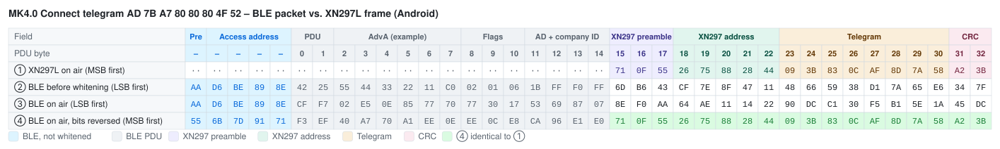

# XN297L – 2.4 GHz GFSK Transceiver

> Sources: Panchip XN297L datasheet / DKL1613 module manual (FCC ID 2APYU-DKL1613), Panchip XN297 datasheet, DeviationTX / DIY-Multiprotocol-TX-Module (`iface_xn297`), [J0EK3R/brickcontroller2](https://github.com/J0EK3R/brickcontroller2) (`CryptTools.cs`, `MKProtocol.cs`).
> Frame format (section 5) verified by script against the BrickController2 test vectors and the Multiprotocol CRC tables.
> Last updated: 2026-11-01

## Overview

| Property | Value |
|---|---|
| Manufacturer | Panchip Microelectronics (Shanghai), second source Vollgo |
| Type | single-chip 2.4 GHz GFSK transceiver, nRF24L01-like register set |
| Frequency range | 2400 … 2483 MHz, 1 MHz channel raster (`RF_CH + 2400`) |
| Data rates | 1 Mbps, 250 kbps (the older XN297: 1 / 2 Mbps) |
| Modulation | GFSK, deviation ≈ 160–250 kHz @ 1 Mbps, 125 kHz @ 250 kbps |
| TX power | −35 … +13 dBm |
| RX sensitivity | ≈ −87 dBm @ 1 Mbps, −93 dBm @ 250 kbps (0.1 % BER) |
| Supply | 2.2 … 3.3 V (abs. max 3.6 V), I/O tolerant up to 5 V input |
| Current | TX 16 mA @ 0 dBm, 66 mA @ 13 dBm; RX ≈ 15 mA; sleep 2 µA |
| Crystal | 16 MHz, ±20 ppm |
| Host interface | SPI slave, max 8 Mbps |
| Payload | 1 … 32 bytes, or 1 … 64 bytes in 64-byte mode (`FEATURE.DATA_LEN_SEL`) |
| Address | 3, 4 or 5 bytes |
| CRC | none or 16 bit (fixed polynomial, see 5.4) |
| Extras | scrambler (data whitening), auto-ACK, auto-retransmit, 6 data pipes, dynamic payload length, RSSI |
| Packages | QFN-20 3×3 mm (XN297LBW), SOP-16 (XN297LAV), others |

The XN297L is the low-power successor of the XN297. It is used in countless cheap 2.4 GHz products: toy drones and RC cars, wireless mice/keyboards, LED controllers – and the **Mould King** receivers (see [MK4.0](../MouldKing/MK4.0.md)).

---

## 1. Relationship to the nRF24L01

The SPI command set and most registers (0x00 … 0x17, 0x1C, 0x1D) follow the Nordic nRF24L01 layout, so nRF24 drivers are a good starting point. The important differences:

| Topic | nRF24L01 | XN297L |
|---|---|---|
| Preamble | 1 byte `0xAA`/`0x55` | **3 bytes `71 0F 55`** |
| Scrambler | none | 7-bit LFSR whitening, on by default (`DEMOD_CAL.Scramble_en`) |
| CRC | 8 or 16 bit, init `0xFFFF` | 16 bit only (`EN_CRC`, `CRCO` bit unused) |
| Payload bit order | MSB first | **payload LSB first** (address MSB first) |
| Data rates | 250k / 1M / 2M | 250k / 1M |
| Payload size | 32 bytes | 32 or 64 bytes |
| Enhanced mode PCF | 9 bits | 10 bits (7-bit length, 2-bit PID, 1-bit NO_ACK) |
| Analog setup | internal | registers `0x19`, `0x1A`, `0x1B`, `0x1E`, `0x1F` must be written after reset |
| CE | pin only | pin or SPI command (`CE_FSPI_ON` / `CE_FSPI_OFF`) |

Because of the different preamble, scrambler and bit order, an nRF24L01 cannot talk to an XN297L directly, but it can **emulate** it in software (section 6).

---

## 2. Operating modes

The state machine is controlled by `CONFIG.PWR_UP`, `CONFIG.EN_PM`, `CE` and `CONFIG.PRIM_RX`:

| Mode | PWR_UP | EN_PM | CE | PRIM_RX | Description |
|---|---|---|---|---|---|
| Power down | 0 | 0 | 0 | x | SPI and registers only, ≈ 2 µA |
| Standby I | 1 | 0 | 0 | x | crystal running, ≈ 30 µA |
| Standby III | 1 | 1 | 0 | x | main power management on, ≈ 650 µA |
| Standby II | 1 | 1 | 1 | 0 | crystal output on, TX FIFO empty |
| RX | 1 | 1 | 1 | 1 | receiving |
| TX | 1 | 1 | 1 | 0 | transmitting (FIFO not empty) |

Notes:

- Wait > 50 µs in Standby III before switching to another mode.
- `IRQ` is active low; `TX_DS`, `RX_DR`, `MAX_RT` are cleared by writing 1 to `STATUS`.
- `W_REGISTER` only works in power down / standby.

---

## 3. SPI interface

Standard SPI (mode 0), `CSN` active low, max 8 Mbps. Every transaction starts with a command byte; `STATUS` is shifted out on MISO during the command byte. Multi-byte registers are written **LSByte first**.

Some small packages (e.g. SOP-8 variants) have only a bidirectional data pin / no MISO, so the host can write but not read.

### 3.1 Commands

| Command | Binary | Data bytes | Function |
|---|---|---|---|
| `R_REGISTER` | `000A AAAA` | 1–5 | read register `AAAAA` |
| `W_REGISTER` | `001A AAAA` | 1–5 | write register (power down / standby only) |
| `R_RX_PAYLOAD` | `0110 0001` | 1–32/64 | read RX payload |
| `W_TX_PAYLOAD` | `1010 0000` | 1–32/64 | write TX payload |
| `FLUSH_TX` | `1110 0001` | 0 | clear TX FIFO |
| `FLUSH_RX` | `1110 0010` | 0 | clear RX FIFO |
| `REUSE_TX_PL` | `1110 0011` | 0 | resend last payload while CE is high |
| `ACTIVATE` | `0101 0000` | 1 | `0x73` enables / `0x8C` disables `R_RX_PL_WID`, `W_TX_PAYLOAD_NOACK`, `W_ACK_PAYLOAD` |
| `R_RX_PL_WID` | `0110 0000` | 0 (+1) | read width of top RX payload |
| `W_ACK_PAYLOAD` | `1010 1PPP` | 1–32/64 | payload for the ACK on pipe `PPP` |
| `W_TX_PAYLOAD_NOACK` | `1011 0000` | 1–32/64 | TX payload without auto-ACK |
| `CE_FSPI_ON` | `1111 1101` | 1 (`0x00`) | internal CE = 1 (needs `FEATURE.CE_SEL = 1`) |
| `CE_FSPI_OFF` | `1111 1100` | 1 (`0x00`) | internal CE = 0 |
| `RST_FSPI` | `0101 0011` | 1 | `0x5A` = hold in reset, `0xA5` = release reset |
| `NOP` | `1111 1111` | 0 | read `STATUS` only |

---

## 4. Register map

Registers marked `*` differ from the nRF24L01 or must be initialised by the host.

| Addr | Name | Size | Content / notes |
|---|---|---|---|
| `0x00`* | `CONFIG` | 1 | `EN_PM`(7), `MASK_RX_DR`(6), `MASK_TX_DS`(5), `MASK_MAX_RT`(4), `EN_CRC`(3, 16-bit CRC), bit 2 reserved (write 1), `PWR_UP`(1), `PRIM_RX`(0) |
| `0x01` | `EN_AA` | 1 | auto-ACK per pipe; any bit set on the receiver = **enhanced mode** |
| `0x02` | `EN_RXADDR` | 1 | enable RX pipes 0–5 |
| `0x03` | `SETUP_AW` | 1 | address width: `01` = 3, `10` = 4, `11` = 5 bytes |
| `0x04` | `SETUP_RETR` | 1 | `ARD`(7:4) = 250 µs × (n+1), `ARC`(3:0) = retransmit count |
| `0x05` | `RF_CH` | 1 | channel 0–127, f = 2400 + n MHz (default 78) |
| `0x06`* | `RF_SETUP` | 1 | `RF_DR`(7:6): `00` = 1 Mbps, `11` = 250 kbps; `PA_GC`(5:3), `PA_PWR`(2:0) = TX power |
| `0x07` | `STATUS` | 1 | `RX_DR`(6), `TX_DS`(5), `MAX_RT`(4), `RX_P_NO`(3:1), `TX_FULL`(0) |
| `0x08` | `OBSERVE_TX` | 1 | `PLOS_CNT`(7:4), `ARC_CNT`(3:0) |
| `0x09`* | `DATAOUT` | 1 | RSSI (7:4) and test data (when `RF_CAL2.DATAOUT_SEL = 0`) |
| `0x0A` | `RX_ADDR_P0` | 5 | default `E7 E7 E7 E7 E7` |
| `0x0B` | `RX_ADDR_P1` | 5 | default `C2 C2 C2 C2 C2` |
| `0x0C`–`0x0F` | `RX_ADDR_P2…P5` | 1 | LSByte only, rest from P1 (defaults `C3`, `C4`, `C5`, `C6`) |
| `0x10` | `TX_ADDR` | 5 | default `E7 E7 E7 E7 E7` |
| `0x11`–`0x16` | `RX_PW_P0…P5` | 1 | static payload width per pipe (0 = unused) |
| `0x17`* | `FIFO_STATUS` | 1 | `TX_REUSE`(6), `TX_FULL`(5), `TX_EMPTY`(4), `RX_FULL`(1), `RX_EMPTY`(0) |
| `0x19`* | `DEMOD_CAL` | 1 | test mode, carrier mode, `GAUS_CAL`(4:1) = modulation deviation, **`Scramble_en`(0)** |
| `0x1A`* | `RF_CAL2` | 6 | analog/RF trimming, filter bandwidth, pin options, clock output, VCO, LNA |
| `0x1B`* | `DEM_CAL2` | 3 | demodulator: preamble threshold `PTH`, `DECOD_INV`, loop gains |
| `0x1C` | `DYNPD` | 1 | dynamic payload length per pipe |
| `0x1D`* | `FEATURE` | 1 | `MUX_PA_IRQ`(6), `CE_SEL`(5), `DATA_LEN_SEL`(4:3) `11` = 64 bytes, `EN_DPL`(2), `EN_ACK_PAY`(1), `EN_NOACK`(0) |
| `0x1E`* | `RF_CAL` | 3 | RF parameters: RSSI enable, LNA/mixer gain, PA bias, VCO current |
| `0x1F`* | `BB_CAL` | 5 | baseband timing: `TRX_TIME`, `TX_SETUP_TIME`, `RX_SETUP_TIME`, `RX_ACK_TIME` |

The calibration registers (`0x19`–`0x1B`, `0x1E`, `0x1F`) have to be written with the vendor's recommended values after reset; they are not described in enough detail to tune them freely.

---

## 5. On-air frame format

All byte sequences in this section are shown **in on-air order, MSB first** – i.e. what a 1 Mbps GFSK demodulator (SDR, nRF24L01, …) sees.

### 5.1 Normal mode

```
┌──────────────┬──────────────┬─────────────────────┬──────────┐
│ Preamble 3 B │ Address 3–5 B│ Payload 1–32/64 B   │ CRC 0/2 B│
│ 71 0F 55     │ MSByte first │ each byte LSB first │ big end. │
│ not scrambled│ ◄────────────── scrambled ────────────────────►│
└──────────────┴──────────────┴─────────────────────┴──────────┘
```

### 5.2 Enhanced mode (auto-ACK)

```
Preamble 3 B │ Address 3–5 B │ PCF 10 bit │ Payload 1–32/64 B │ CRC 2 B
                               │
                               ├─ payload length  7 bit
                               ├─ PID             2 bit
                               └─ NO_ACK          1 bit
```

The ACK packet has the same structure without payload. Because the PCF is 10 bits long, the payload is not byte-aligned on air.

### 5.3 Byte and bit order

| Field | Byte order on air | Bit order |
|---|---|---|
| Preamble | `71`, `0F`, `55` | MSB first |
| Address | **reverse** of the SPI write order (`TX_ADDR` is written LSByte first, sent MSByte first) | MSB first |
| Payload | same as written to the FIFO | **LSB first** |
| CRC | high byte first | MSB first |

Example: `TX_ADDR` written as `C1 C2 C3 C4 C5` → on air `C5 C4 C3 C2 C1`. Payload byte `0xAD` (`1010 1101`) → on air `1011 0101` = `0xB5` in MSB-first notation.

### 5.4 CRC

- CRC-16/CCITT: polynomial `0x1021`, initial value `0xFFFF`, final XOR `0xFFFF` (this parameter set is known as **CRC-16/GENIBUS**).
- Calculated over **address + payload in on-air form** (address reversed, payload bytes bit-reversed), **before** scrambling.
- Transmitted big endian and then scrambled together with address and payload.

**Equivalent formulation** used by DeviationTX / Multiprotocol (CRC over the *scrambled* bytes):

```
crc = CRC16_CCITT(init = 0xB5D2, data = scrambled address + scrambled payload)
crc ^= XOROUT[address_len + payload_len - 3]
```

Both forms give identical results because CRC and scrambler are linear. `XOROUT` (scrambler on, index = total length − 3):

```
0x925E, 0xE348, 0x9BA7, 0x8BBB, 0x85E1, 0x3E8C, 0x451E, 0x18E6,
0x6B24, 0xE7AB, 0x3828, 0x814B, 0xD461, 0xF494, 0x2503, 0x691D,
0xFE8B, 0x9BA7, 0x8B17, 0x2920, 0x8B5F, 0x61B1, 0xD391, 0x7401,
0x2138, 0x129F, 0xB3A0, 0x2988, 0x23CA, 0xC0CB, 0x0C6C, 0xB329,
0xA0A1, 0x0A16, 0xA9D0, 0xEA54, 0x165D, 0x3142
```

(Entries 2 … 27 match the Multiprotocol table; entries 0, 1 and ≥ 28 were derived with the script in section 7.)

### 5.5 Scrambler

- 7-bit LFSR, polynomial **x⁷ + x⁴ + 1** – the same generator as BLE data whitening.
- Initial state: all ones (`0x7F`). In the BrickController2 / BLE notation this is `whitening_init(0x3F)` (`[1, 1, 1, 1, 1, 1, 1]`), which is why `MKProtocol.CTXValue1 = 0x3F`.
- Applied to address, PCF, payload and CRC; **not** to the preamble.
- Resulting byte sequence (MSB-first, XOR onto the on-air bytes):

```
E3 B1 4B EA 85 BC E5 66 0D AE 8C 88 12 69 EE 1F
C7 62 97 D5 0B 79 CA CC 1B 5D 19 10 24 D3 DC 3F
8E C5 2F AA 16 F3 95 ...
```

- Enabled by default (`DEMOD_CAL.Scramble_en = 1`); both sides must use the same setting.

### 5.6 Example (Mould King MK4.0 Connect telegram)

`TX_ADDR` = `C1 C2 C3 C4 C5`, payload = `AD 7B A7 80 80 80 4F 52`:

| Step | Bytes |
|---|---|
| Address on air (clear) | `C5 C4 C3 C2 C1` |
| Payload on air (clear, bit-reversed) | `B5 DE E5 01 01 01 F2 4A` |
| CRC-16/GENIBUS (clear) | `CB D5` (= BC2 value `0xABD3` in on-air bit order) |
| **Complete frame (scrambled)** | `71 0F 55 26 75 88 28 44 09 3B 83 0C AF 8D 7A 58 A2 3B` |

Neutral MK4.0 Command telegram (`7D 7B A7 88 88 88 88 88 88 82`) → `71 0F 55 26 75 88 28 44 02 3B 83 1C BF 9D 99 03 78 AF A7 CE`.

---

## 6. Emulation with other radios

Because the XN297L uses plain 1 Mbps GFSK, other transceivers can produce or receive its frames when the framing is done in software:

| Radio | Approach |
|---|---|
| **nRF24L01** | Use the nRF24 without its own CRC; set the nRF24 address to the last preamble/address bytes and put the (scrambled) XN297 address, payload and CRC into the nRF24 payload. Used by DeviationTX and Multiprotocol (`XN297_SetTXAddr`, `XN297_WritePayload`). |
| **CC2500** | Same idea, raw 1 Mbps GFSK packet with software framing (Multiprotocol "XN297L emulation layer"). |
| **BLE advertising** | The phone's BLE stack whitens the whole PDU. The app pre-whitens the manufacturer data with the BLE whitening sequence of the advertising channel (seed `0x25` = channel 37), so that after the stack's whitening the exact XN297 frame (preamble, address, payload, CRC) appears on air. The XN297 receiver ignores the BLE header in front of it and synchronises on its own preamble. Used by BrickController2 for Mould King (see [MK4.0 §5](../MouldKing/MK4.0.md#5-encoding-into-ble-advertising-data)). |

BLE advertising only covers channels 37/38/39 (2402, 2426, 2480 MHz). The receiver therefore has to listen on one of these frequencies (the MK protocols use channel 37 = 2402 MHz).

### 6.1 Example: BLE advertising packet vs. XN297L frame

The table shows the complete BLE advertising packet that BrickController2 (Android) sends for the Mould King MK4.0 Connect telegram `AD 7B A7 80 80 80 4F 52`, next to the XN297L frame it emulates. Further tables (MK4.0 Command, MK6.0) are in [MK4.0 §5.5](../MouldKing/MK4.0.md#55-byte-by-byte-comparison-ble-packet-vs-xn297l-frame-android) and [MK6.0 §5.1](../MouldKing/MK6.0.md#51-byte-by-byte-comparison-ble-packet-vs-xn297l-frame-android).

Assumed BLE header (the content is irrelevant for the receiver, only its length counts):

| PDU bytes | Value | Meaning |
|---|---|---|
| preamble | `AA` | BLE 1M preamble (alternating bits, matching the first access address bit) |
| access address | `D6 BE 89 8E` | advertising access address `0x8E89BED6`, LSB first |
| 0 … 1 | `42 25` | PDU type `ADV_NONCONN_IND` (`0x2`), TxAdd = random; length 37 (AdvA 6 + Flags 3 + manufacturer AD 28) |
| 2 … 7 | `55 44 33 22 11 C0` | AdvA (example random static address `C0:11:22:33:44:55`, LSB first) – changes regularly on Android |
| 8 … 10 | `02 01 06` | Flags AD (as counted by BC2's `headerOffset`) |
| 11 … 12 | `1B FF` | AD length 27, type Manufacturer Specific Data |
| 13 … 14 | `F0 FF` | company ID `0xFFF0`, little endian |
| 15 … | manufacturer data | output of `GetRfPayload()` (24 bytes) |

If the stack builds a header of a different length (e.g. without Flags, or iOS with service UUIDs → `headerOffset` 13), the whitening sequence is shifted and the XN297L frame is destroyed; this is why `headerOffset` is platform specific.

**How to read the tables:** each column is one byte in transmission order, each row is one view of the same packet. The coloured image shows the table with field colours (legend below each image; light and dark mode); the Markdown table under it contains the same bytes as text, with bold marking the bytes that match.

| Row | Meaning |
|---|---|
| ① | What an XN297L (the original handset chip) would transmit for this telegram with `TX_ADDR = C1 … C5`: preamble, address, telegram, CRC – scrambled, MSB first. `··` = the XN297L sends nothing there. |
| ② | The BLE advertising packet as the phone's BLE stack assembles it, before whitening (LSB first). From PDU byte 15 on this is the manufacturer data from `GetRfPayload()` – it looks completely different from ①, because it is scrambled twice (XN297 scrambler + pre-compensated BLE whitening). |
| ③ | The same packet after BLE whitening (channel 37) – the bytes the radio actually sends, LSB first. Preamble and access address are not whitened. The XN297 preamble shows up as `8E F0 AA` = `71 0F 55` with reversed bit order. |
| ④ | Row ③ with every byte bit-reversed, i.e. read MSB first like an XN297L receiver does. **Bold** bytes are identical to row ①. |
| ④ = ① | ✓ = byte matches the XN297L frame. |

Field abbreviations: `Pre` BLE preamble, `AA` access address, `Hdr` PDU header, `AdvA` advertiser address, `Flg` Flags AD, `AD` AD length/type, `CID` company ID `0xFFF0`; **Pre** XN297 preamble, **Adr** XN297 address, **T0 …** raw telegram bytes, **CRC** XN297 CRC.

The BLE part (PDU bytes 0 … 14) does not match – there is nothing to match: for the XN297L receiver it is just noise in front of its preamble `71 0F 55`. Only the *length* of this part (`headerOffset` = 15) matters for the encoding, not its content; the header values are examples (see table above). Padding and the 3-byte BLE CRC after the XN297 CRC are omitted; the receiver stops reading after its CRC.

#### Mould King MK4.0 Connect telegram `AD 7B A7 80 80 80 4F 52`



| PDU byte | – | – | – | – | – | 0 | 1 | 2 | 3 | 4 | 5 | 6 | 7 | 8 | 9 | 10 | 11 | 12 | 13 | 14 | 15 | 16 | 17 | 18 | 19 | 20 | 21 | 22 | 23 | 24 | 25 | 26 | 27 | 28 | 29 | 30 | 31 | 32 |
|---|:-:|:-:|:-:|:-:|:-:|:-:|:-:|:-:|:-:|:-:|:-:|:-:|:-:|:-:|:-:|:-:|:-:|:-:|:-:|:-:|:-:|:-:|:-:|:-:|:-:|:-:|:-:|:-:|:-:|:-:|:-:|:-:|:-:|:-:|:-:|:-:|:-:|:-:|
| Field | Pre | AA | AA | AA | AA | Hdr | Hdr | AdvA | AdvA | AdvA | AdvA | AdvA | AdvA | Flg | Flg | Flg | AD | AD | CID | CID | **Pre** | **Pre** | **Pre** | **Adr** | **Adr** | **Adr** | **Adr** | **Adr** | **T0** | **T1** | **T2** | **T3** | **T4** | **T5** | **T6** | **T7** | **CRC** | **CRC** |
| ① XN297L on air (MSB first) | ·· | ·· | ·· | ·· | ·· | ·· | ·· | ·· | ·· | ·· | ·· | ·· | ·· | ·· | ·· | ·· | ·· | ·· | ·· | ·· | `71` | `0F` | `55` | `26` | `75` | `88` | `28` | `44` | `09` | `3B` | `83` | `0C` | `AF` | `8D` | `7A` | `58` | `A2` | `3B` |
| ② BLE before whitening (LSB first) | `AA` | `D6` | `BE` | `89` | `8E` | `42` | `25` | `55` | `44` | `33` | `22` | `11` | `C0` | `02` | `01` | `06` | `1B` | `FF` | `F0` | `FF` | `6D` | `B6` | `43` | `CF` | `7E` | `8F` | `47` | `11` | `48` | `66` | `59` | `38` | `D1` | `7A` | `65` | `E6` | `34` | `7F` |
| ③ BLE on air (LSB first) | `AA` | `D6` | `BE` | `89` | `8E` | `CF` | `F7` | `02` | `E5` | `0E` | `85` | `77` | `70` | `77` | `30` | `17` | `53` | `69` | `87` | `07` | `8E` | `F0` | `AA` | `64` | `AE` | `11` | `14` | `22` | `90` | `DC` | `C1` | `30` | `F5` | `B1` | `5E` | `1A` | `45` | `DC` |
| ④ BLE on air, bits reversed (MSB first) | `55` | `6B` | `7D` | `91` | `71` | `F3` | `EF` | `40` | `A7` | `70` | `A1` | `EE` | `0E` | `EE` | `0C` | `E8` | `CA` | `96` | `E1` | `E0` | **`71`** | **`0F`** | **`55`** | **`26`** | **`75`** | **`88`** | **`28`** | **`44`** | **`09`** | **`3B`** | **`83`** | **`0C`** | **`AF`** | **`8D`** | **`7A`** | **`58`** | **`A2`** | **`3B`** |
| ④ = ① |  |  |  |  |  |  |  |  |  |  |  |  |  |  |  |  |  |  |  |  | ✓ | ✓ | ✓ | ✓ | ✓ | ✓ | ✓ | ✓ | ✓ | ✓ | ✓ | ✓ | ✓ | ✓ | ✓ | ✓ | ✓ | ✓ |

---

## 7. Reference implementation (Python)

Builds a normal-mode frame in on-air form. Verified against the BrickController2 encoder (same frames before BLE whitening compensation) and the Multiprotocol scramble/XOROUT tables.

```python
# XN297L - reference model of the on-air frame (normal mode, scrambler on, 2-byte CRC).
# All bytes returned by build_frame() are in on-air order and MSB-first bit order,
# i.e. exactly what a 1 Mbps GFSK receiver (e.g. nRF24L01 or SDR) would demodulate.

PREAMBLE = [0x71, 0x0F, 0x55]       # fixed 3-byte XN297 preamble (never scrambled)


def rev8(b: int) -> int:
    """Reverse the bit order of one byte (0b00000001 -> 0b10000000)."""
    return int(f"{b:08b}"[::-1], 2)


def scramble_table(length: int) -> list[int]:
    """Generate the XN297 scramble sequence (MSB-first bytes).

    7-bit LFSR, polynomial x^7 + x^4 + 1 (same as BLE data whitening),
    initialised to all ones. Output bits are collected LSB-first and the
    byte is bit-reversed so it can be XORed onto MSB-first on-air bytes.
    Result starts with E3 B1 4B EA 85 BC E5 66 ...
    """
    lfsr = [1, 1, 1, 1, 1, 1, 1]     # 7 state bits, all ones
    out = []
    for _ in range(length):
        byte = 0
        for bit in range(8):
            # same shift/feedback structure as the BLE whitening LFSR
            v3, v6 = lfsr[3], lfsr[6]
            lfsr[3], lfsr[2], lfsr[1], lfsr[0] = lfsr[2], lfsr[1], lfsr[0], lfsr[6]
            lfsr[6], lfsr[5] = lfsr[5], lfsr[4]
            lfsr[4] = v3 ^ v6
            byte |= lfsr[0] << bit
        out.append(rev8(byte))
    return out


def crc16_genibus(data: list[int]) -> int:
    """CRC-16/CCITT, poly 0x1021, init 0xFFFF, MSB-first, final XOR 0xFFFF."""
    crc = 0xFFFF
    for b in data:
        crc ^= b << 8
        for _ in range(8):
            # shift left, apply polynomial when the MSB falls out
            crc = ((crc << 1) ^ 0x1021) if crc & 0x8000 else (crc << 1)
            crc &= 0xFFFF
    return crc ^ 0xFFFF


def build_frame(tx_addr: list[int], payload: list[int], scramble: bool = True) -> list[int]:
    """Build a normal-mode XN297L frame as it appears on air.

    tx_addr: address as written to TX_ADDR via SPI (LSByte first, 3..5 bytes)
    payload: payload bytes as written with W_TX_PAYLOAD
    """
    # address goes out MSByte first -> reverse the SPI byte order
    addr = list(reversed(tx_addr))
    # payload bytes go out LSB first -> bit-reverse each byte for the MSB-first view
    data = [rev8(b) for b in payload]
    clear = addr + data
    # CRC over the *unscrambled* address + payload, transmitted big endian
    crc = crc16_genibus(clear)
    clear += [crc >> 8, crc & 0xFF]
    if scramble:
        # scrambler covers address, payload and CRC, but not the preamble
        table = scramble_table(len(clear))
        clear = [b ^ t for b, t in zip(clear, table)]
    return PREAMBLE + clear


if __name__ == "__main__":
    hexs = lambda a: " ".join(f"{x:02X}" for x in a)
    print("scramble:", hexs(scramble_table(16)))
    # -> E3 B1 4B EA 85 BC E5 66 0D AE 8C 88 12 69 EE 1F
    # Mould King MK4.0 Connect telegram, address C1..C5 (see MouldKing/MK4.0.md)
    frame = build_frame([0xC1, 0xC2, 0xC3, 0xC4, 0xC5],
                        [0xAD, 0x7B, 0xA7, 0x80, 0x80, 0x80, 0x4F, 0x52])
    print("frame:   ", hexs(frame))
    # -> 71 0F 55 26 75 88 28 44 09 3B 83 0C AF 8D 7A 58 A2 3B
```

### 7.1 Mapping to BrickController2 `CryptTools`

| BC2 step | XN297L meaning |
|---|---|
| `HeaderArray` `71 0F 55`, bit-reversed | preamble (BC2 buffer is LSB first, so every MSB-first byte is bit-reversed) |
| `SeedArray` reversed + bit-reversed | address `TX_ADDR = C1 … C5`, sent MSByte first |
| raw telegram unchanged | payload is sent LSB first – matches the LSB-first BLE buffer directly |
| `check_crc16` (init `0xFFFF`, result reversed and inverted) | CRC-16/GENIBUS in on-air form |
| whitening with `CTXValue1 = 0x3F` | XN297 scrambler (LFSR all ones) |
| whitening with `CTXValue2 = 0x25` | compensation of the BLE whitening on channel 37 (not part of XN297) |

---

## 8. Open questions

- Exact bit layout of the enhanced-mode PCF on air (the XN297 datasheet and emulators differ between 9 and 10 bits) and the resulting payload alignment.
- Whether the CRC in enhanced mode also covers the PCF (very likely, as in nRF24 ESB).
- Recommended init values for `0x19`–`0x1F` differ between datasheet revisions and chip versions (XN297L-A/B/C).
- 250 kbps: datasheet limits the payload to 16 bytes because of frequency drift in open-loop TX.
- Sensitivity on channels at multiples of 16 MHz (2416, 2432, … MHz) is ≈ 2 dB worse.
