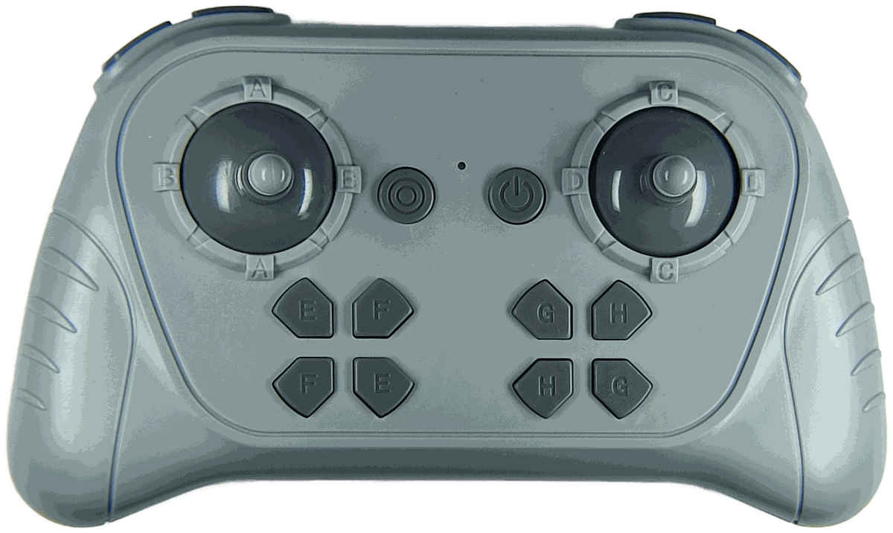
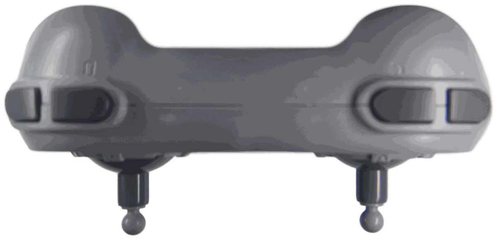

# JIESTAR SCM8 – Original 2.4 GHz Remote Control

> Source: own captures with the [XN297L sniffer](../Tools/xn297l-sniffer/README.md) (nRF52840 dongle), two SCM8 handsets (H1, H2) and one SCM8 receiver, 2026-11-13 … 14 (runs R1.a, R1.b, R2.1 … R2.4c, R3.1, R4.1, R4.2 of the [capture plan](SCM8-Capture-Plan.md)).
> All values in this document are **measured**; interpretations are marked as such.
> Last updated: 2026-11-14 (R4.2: mapping controls → bytes → ports, stick mixing)

## Overview

| Property | Value |
|---|---|
| Device | original 2.4 GHz handset of the JIESTAR SCM8 receiver ([SCM8](SCM8.md)) |
| Radio | XN297L-compatible frame: preamble `71 0F 55`, scrambler on, CRC-16, normal mode (no PCF) |
| Data rate | 1 Mbps (received with the nRF52840 in `Nrf_1Mbit` mode) |
| Bind channel | **2411 MHz** only, fixed (same as the [MK4.0 handset](../MouldKing/MK4.0-Remote.md)); no bind frames on any other channel 2400 … 2483 MHz (R2.2) |
| Operating channels | **2416, 2433, 2450, 2469 MHz** (frequency hopping) |
| Handset identity | 3 bytes: identity byte + 2-byte ID (H1: `E4` + `22 5B`, H2: `80` + `00 63`), **fixed** – unchanged over 9 power-ons (R2.3), see section 3 |
| Bind telegram | 3 bytes: ID + `00` |
| Control telegram | 8 bytes: ID + 4 analog channels (one byte each) + 8 momentary buttons (bit mask) + 4 toggle states (bit mask) |

The handset uses a completely different radio configuration than the app (BLE advertising on
2402 MHz with address `C1 … C5`, see [SCM8 §5](SCM8.md#5-encoding-into-ble-advertising-data)).
Only the XN297L frame layer (preamble, scrambler, CRC) is the same. The structure is very close to
the [MK4.0 handset](../MouldKing/MK4.0-Remote.md) (interpretation): same bind channel, a bind and an
operating address that share one identity byte, a 2-byte ID at the start of every payload, 4
operating channels, full-byte stick values with neutral `0x80`.

---

## Handset




*Photos: own pictures of the handset (front, and top edge with the four shoulder buttons); straightened, background removed.*

Controls printed on the handset:

| Control | Marking | Number |
|---|---|---|
| Left stick | **A** (up / down), **B** (left / right) | 2 axes |
| Right stick | **C** (up / down), **D** (left / right) | 2 axes |
| Left button group | **E**, **F** (two buttons each) | 4 buttons |
| Right button group | **G**, **H** (two buttons each) | 4 buttons |
| Shoulder buttons | 2 left, 2 right (markings not readable on the photo) | 4 buttons |
| Centre | power button, round button with ring symbol, status LED | – |

**Confirmed by R4.2** (section 5.3): the telegram fields match the controls one to one – 4 axes
A … D → CH1 … CH4 → ports A … D, 8 buttons E / F / G / H → 8 bits of B6 → ports E … H (two
directions each), 4 shoulder buttons → 4 latching bits of B7. The marking of each control is the
port it drives.

---

## 1. Sequence

```
Handset switched on (no bound receiver)
        │
        ▼
 Bind phase: Bind telegram on 2411 MHz, bind address     ← every 20.083 ms
        │
        │   SCM8 switched on → bind frames stop
        ▼
 Operation: Control telegrams, operating address,
            hopping over 2416 / 2433 / 2450 / 2469 MHz
```

- Without a receiver, the handset stays in the bind phase (observed for 53.7 s without a gap in R2.1).
- In R3.1 the last bind frame was received at t = 8.422 s and the first control frame at
  t = 8.651 s: the switch to operation happened within these 230 ms.
- After the switch, nothing more was received on 2411 MHz (R1.b).
- As with the MK4.0, the handset must receive something from the receiver to leave the bind
  phase (interpretation). No frame of the receiver has been captured yet.

---

## 2. Radio parameters

| Phase | Frequency | Address on air (descrambled, MSB first) | Payload |
|---|---|---|---|
| Bind | 2411 MHz | `34 58 4A 83` + `E4` | 3 bytes |
| Operation | 2416, 2433, 2450, 2469 MHz | `90 56 54 8C` + `E4` | 8 bytes |

- Frame format, scrambler and CRC exactly as described in [XN297L §5](../Chips/XN297L.md).
- The operating channels are 17 / 17 / 19 MHz apart (MK4.0 handset: 2423 / 2441 / 2458 / 2466 MHz).
- No weak copies on neighbouring channels were seen in R3.1 (the frames on 2407, 2418, 2467 and
  2474 MHz were noise hits at −99 … −101 dBm without a valid CRC).

### 2.1 Timing

| Phase | Observation |
|---|---|
| Bind | fixed **20.083 ms** grid on 2411 MHz (R2.1, address mode, 53.7 s: 2673 of 2673 slots received, 2670 with valid CRC, std. dev. 61 µs); in promiscuous mode (R1.a) only ~46 % of the slots were received – reception losses of the promiscuous mode, not gaps of the handset |
| Operation | on 2416 MHz alone (R4.1, address mode, 152 s): one frame every **16.07 ms** (std. dev. 65 µs), 62 frames/s, 99.8 % of the slots received |

Interpretation: the handset transmits on **each** of the four channels every 16.07 ms – either a
burst over all four channels per period, or one frame every ~4 ms rotating over the channels.
Order and spacing within the 16 ms period are not determined yet.

---

## 3. Address and identity

| Item | H1 | H2 |
|---|---|---|
| Identity byte (last byte on air, first byte of `TX_ADDR`) | `E4` | `80` |
| ID (first two payload bytes) | `22 5B` | `00 63` |
| Bind address (`TX_ADDR`) | `E4 83 4A 58 34` | `80 83 4A 58 34` |
| Operating address (`TX_ADDR`) | `E4 8C 54 56 90` | not measured yet |

For H1 the identity byte and the ID are the same in both phases. The bind address prefix
`83 4A 58 34` (`TX_ADDR` order) is the same for both handsets (R2.4a).

`TX_ADDR` is given in SPI write order (LSByte first), i.e. reversed compared with the on-air order
in section 2. Calling `E4` + `22 5B` the handset identity is an interpretation by analogy with the
MK4.0 handset; it is confirmed by the 2nd handset H2 (R2.4a), which differs from H1 in exactly
these bytes and nowhere else in the bind telegram.

**The identity is fixed (R2.3):** in 9 power-ons of the same handset, the bind address
`E4834A5834` and the bind payload `22 5B 00` were identical every time (2019 frames, all with
valid CRC). The values are therefore stored in the handset (or derived from a fixed chip ID), not
generated at power-on (interpretation).

**Address length is not certain** (same situation as the MK4.0): the CRC covers address and payload
together, so 3-, 4- and 5-byte addresses all give a valid CRC. This document uses a 5-byte address.

| Address length | Bind payload | Control payload (neutral) |
|---|---|---|
| 5 bytes (used here) | `22 5B 00` | `22 5B 80 80 80 80 00 04` |
| 4 bytes | `27 22 5B 00` | `27 22 5B 80 80 80 80 00 04` |
| 3 bytes | `C1 27 22 5B 00` | `C1 27 22 5B 80 80 80 80 00 04` |

(`27` and `C1` are the on-air address bytes `E4` and `83` read as LSB-first payload bytes.)

---

## 4. Bind telegram (3 bytes)

| Offset | Value | Meaning |
|---|---|---|
| 0 | `ID0` = `22` | handset ID, byte 0 |
| 1 | `ID1` = `5B` | handset ID, byte 1 |
| 2 | `0x00` | constant |

The bind telegram was identical in all 5043 frames with valid CRC of R1.a, R1.b, R2.1, R2.3 and R3.1, including
while sticks and buttons were moved (R1.b).

## 5. Control telegram (8 bytes)

| Offset | Content | Observed values (R3.1) | Interpretation |
|---|---|---|---|
| 0 | `ID0` | `22` | handset ID, byte 0 |
| 1 | `ID1` | `5B` | handset ID, byte 1 |
| 2 | CH1 | `00` … `80` … `FF` | stick **A** (up = `FF`) → port A |
| 3 | CH2 | `00` … `80` … `FF` | stick **B** (left = `FF`) → port B |
| 4 | CH3 | `00` … `80` … `FF` | stick **C** (up = `FF`) → port C |
| 5 | CH4 | `00` … `80` … `FF` | stick **D** (left = `FF`) → port D |
| 6 | B6 | `00`; one bit set while a button is held: `01`, `02`, `04`, `08`, `10`, `20`, `40`, `80` | 8 momentary buttons → ports E … H, see section 5.3 |
| 7 | B7 | `03`, `04`, `05`, `06`, `07`, `0B`, `0F` | 4 latching states (bits 0 … 3), see section 5.2 |

- **Neutral** = `0x80` for CH1 … CH4. Neutral control telegram: `22 5B 80 80 80 80 00 04`
  (with B7 = `04`).
- Analog channels use the full byte (`00` … `FF`), like the MK4.0 handset and unlike the app
  telegram with one nibble per channel.
- Mapping of controls, bytes and ports: section 5.3 (R4.2).

### 5.1 Stick channels (R4.1)

Each axis was moved to both end positions, one after the other (handset values only, port
reaction not recorded):

| Order | Byte | End positions reached | Remark |
|---|---|---|---|
| 1 | CH1 | `FF`, then `00` | during `00` CH2 moved briefly to `96 … 9B` (same stick, interpretation) |
| 2 | CH2 | `FF`, then `00` | |
| 3 | CH3 | `FF`, then `00` | |
| 4 | CH4 | `FF`, then `00` | during `00` CH3 moved briefly to `53` / `00` (same stick, interpretation) |

- Intermediate values occur while the stick moves (e.g. CH1 `A9 B8 C7 C9 CC D1 D8 F1 FF`
  within ~130 ms): the axes are proportional, with the full byte range `00` … `FF`.
- Interpretation: CH1 / CH2 are the two axes of one stick, CH3 / CH4 those of the other.

### 5.2 Buttons and toggle states (R4.1)

**B6** – each held button sets exactly one bit; observed in this order: `01`, `02`, `08`, `04`,
`10`, `20`, `80`, `40` (each for ~2.5 … 3 s, then `00` again). 8 buttons, 8 bits, no two at once.

**B7** – the value changes at single moments and then stays (latching). Observed sequence:

| t (s) | B7 | Binary (bit 3 … 0) | Changed bit |
|---|---|---|---|
| R3.1 | `0F` | `1111` | – |
| R3.1, ~17 | `04` | `0100` | – (several changes not seen, scan mode) |
| 68.2 | `05` | `0101` | bit 0 set |
| 74.8 | `07` | `0111` | bit 1 set |
| 81.1 | `03` | `0011` | bit 2 cleared |
| 87.1 | `0B` | `1011` | bit 3 set |
| 123.8 | `03` | `0011` | bit 3 cleared |
| 129.8 | `07` | `0111` | bit 2 set |
| 134.1 | `06` | `0110` | bit 0 cleared |
| 137.7 | `04` | `0100` | bit 1 cleared |

In R4.1 every change flipped **exactly one bit**; in R4.2 one change flipped two bits (`01` → `04`,
section 5.3). Interpretation: four independent on/off states (latching
switches, or buttons that toggle a state in the handset). Their function (e.g. direction reversal,
speed limit, port group E … H) is unknown.

### 5.3 Mapping controls → bytes → ports (R4.2)

Procedure: each control held for ~3 s, ~3 s neutral in between, in a fixed order; a motor on each
port. Result as reported: **every control drives the port with its own letter**.

| Control | Byte / bit | Value while held | Port |
|---|---|---|---|
| Stick A up / down | CH1 | `FF` / `00` | A |
| Stick B left / right | CH2 | `FF` / `00` | B |
| Stick C up / down | CH3 | `FF` / `00` | C |
| Stick D left / right | CH4 | `FF` / `00` | D |
| E, button 1 / 2 | B6 bit 0 / bit 1 | `01` / `02` | E |
| F, button 1 / 2 | B6 bit 3 / bit 2 | `08` / `04` | F |
| G, button 1 / 2 | B6 bit 4 / bit 5 | `10` / `20` | G |
| H, button 1 / 2 | B6 bit 7 / bit 6 | `80` / `40` | H |
| Shoulder buttons 1 … 4 (left outer → right outer) | B7 bit 0 … 3 (toggle) | `04` → `05` → `07` → `03` → `0B` | – (see below) |
| Round button with ring symbol | – | **no change** of address or payload, no missing frame | – |

(Button 1 / 2 = the order in which the two buttons of a group were pressed. Interpretation: the
two buttons of a group are the two directions of the port.)

**Stick mixing.** After the four shoulder buttons (B7 = `0B`, later `0F`) the sticks were moved
again. The handset then no longer sent single axes but coupled values – only four patterns
occurred, each twice:

| Pattern CH1 CH2 CH3 CH4 | Interpretation (differential drive, left motors A / B, right motors C / D mounted mirrored) |
|---|---|
| `FF FF 00 00` | forward |
| `00 00 FF FF` | backward |
| `00 00 00 00` | turn one way |
| `FF FF FF FF` | turn the other way |

Measured: with B7 = `04` (start of R4.2, and R4.1) each stick axis changed only its own byte; with
B7 = `0B` / `0F` one movement changed all four bytes. Which B7 bit (or the ring button) switches the
mixing on, and which ports react in this mode, is not yet known (section 9). The mixing is done in
the handset; the receiver only gets the mixed values.

**B7 details:**

- At the start of R4.2 B7 was `01` (R3.1: `0F`, R4.1: `04`).
- Two changes happened while a stick was held and no shoulder button was intended: `01` → `04`
  (two bits at once) at t = 16.7 s while stick C was up, `0B` → `0F` at t = 74.5 s.
- At **each** of the 6 B7 changes exactly one frame on 2416 MHz is missing (no frame with bad CRC
  either). Elsewhere in the 102 s only 3 frames were missing, each received with a bit error.
  Interpretation: in the slot of a toggle the handset sends something else (other channel, address
  or length) or nothing.

---

## 6. Example frames

Complete frames on air (MSB first, scrambled). They were reproduced **bit-exactly** with the
reference model of the sniffer tests (`Tools/xn297l-sniffer/tests/test_decoder.py`, 5-byte address);
the bind frame matches 2 of 2, the neutral control frame with B7 = `04` matches 22 of 22 captured frames.

| Frame | Preamble | Address | Payload | CRC |
|---|---|---|---|---|
| Bind `22 5B 00` | `71 0F 55` | `D7 E9 01 69 61` | `F8 3F 66` | `A6 6E` |
| Control, neutral `22 5B 80 80 80 80 00 04` | `71 0F 55` | `73 E7 1F 66 61` | `F8 3F 67 0C AF 8D 88 32` | `A5 30` |
| Control, neutral `22 5B 80 80 80 80 00 0F` | `71 0F 55` | `73 E7 1F 66 61` | `F8 3F 67 0C AF 8D 88 E2` | `6E 4D` |

## 7. Comparison

| | SCM8 handset | [MK4.0 handset](../MouldKing/MK4.0-Remote.md) | App ([SCM8](SCM8.md)) |
|---|---|---|---|
| Transport | native XN297L | native XN297L | BLE advertising emulating XN297L |
| Bind channel | 2411 MHz | 2411 MHz | – |
| Operating channels | 2416 / 2433 / 2450 / 2469 MHz | 2423 / 2441 / 2458 / 2466 MHz | 2402 MHz |
| Bind address (`TX_ADDR`) | `<id> 83 4A 58 34` | `<id> 03 4B 44 48` | – |
| Operating address (`TX_ADDR`) | `<id> 8C 54 56 90` | `<id> 6C DB 6E 0E` | `C1 C2 C3 C4 C5` |
| Bind telegram | 3 bytes (ID + `00`) | 5 bytes (ID + `00 00 00`) | Connect, 8 bytes |
| Control telegram | 8 bytes: ID + 4 × byte + 2 bytes | 8 bytes: ID + 6 × byte | Command, 8 bytes: 8 nibbles per device |
| Bind period | 20.083 ms | ~14 ms | – |

## 8. Capturing with the XN297L sniffer

| Purpose | Sync mode | Address | RF channels | Dwell | Payload length |
|---|---|---|---|---|---|
| Find the handset | promiscuous | – | `0-83` | 50 ms | 0 (auto) |
| Bind phase | known address | `E4834A5834` | `11` | 0 | 3 (or 0) |
| Operation | known address | `E48C545690` | `16`, `33`, `50` or `69` (or `16,33,50,69`) | 0 or short | 8 (or 0) |

Data rate `1 Mbps (nRF)` in all cases.

**RF channels.** The sniffer numbers channels as *MHz − 2400*, so `11` = 2411 MHz (bind) and
`16`, `33`, `50`, `69` = 2416, 2433, 2450, 2469 MHz – the four operating channels the handset hops over.
There are two ways to capture the operation phase:

- **One channel** (`16`, `33`, `50` **or** `69`, dwell `0`): the sniffer stays on that channel and
  receives the handset every time its hopping sequence passes it. This gives a complete, regular
  capture of that channel (R4.1 on 2416 MHz: one frame every 16.07 ms, 99.8 % of the slots).
  Recommended for decoding.
- **All four channels** (`16,33,50,69`, short dwell): the sniffer hops itself. Dwell must be > 0,
  otherwise it stays on the first channel of the list. Sniffer and handset hop independently, so
  frames are caught only at random; useful to confirm that all four channels are in use.

---

## 9. Open questions

Planned captures: [SCM8-Capture-Plan.md](SCM8-Capture-Plan.md).

- **B7:** function of each of the four latching bits; which one switches the stick mixing on
  (section 5.3); why did B7 change twice without an intended shoulder button press; is the state
  kept over a power cycle of the handset (start values `0F`, `04`, `01` seen)?
- **Missing frame at a B7 toggle:** what does the handset send in that slot?
- **Ring button:** no visible effect on the telegram – function unknown.
- **Identity:** how the identity byte and the 2-byte ID are related (only 2 handsets measured).
- **Address length:** 3, 4 or 5 bytes (not decidable passively).
- **Hopping:** order of the four channels within the 16.07 ms period.
- **Receiver response** that ends the bind phase (not captured).
- Does the handset return to the bind phase when the SCM8 is switched off?
- Does the SCM8 lock into handset or app mode after power-on (like the MK4.0)?
