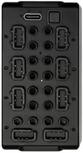
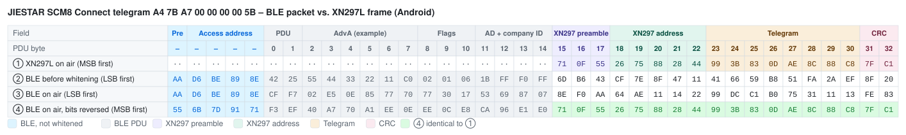
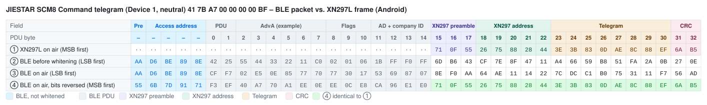
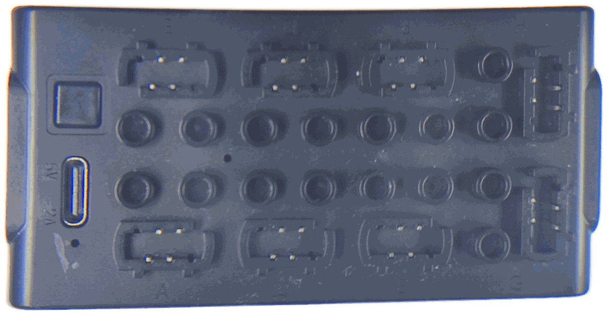
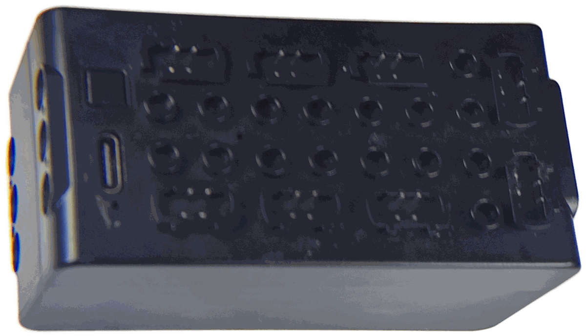

# JIESTAR SCM8 – Bluetooth Protocol

> Source: [J0EK3R/brickcontroller2](https://github.com/J0EK3R/brickcontroller2) – `DeviceManagement/JieStar/JieStarSCM8.cs`, `JieStarBase.cs`, `JieStar.cs`, `JieStarDeviceManager.cs`, `Protocols/JieStarProtocol.cs`, `Protocols/CryptTools.cs`, the platform `JieStarPlatformService.cs` files, `UI/Controls/Devices/JieStarSCM8ChannelSelectorView.xaml` and `JieStarSCM8DatagramTests.cs`.
> Last updated: 2026-11-14 (operating instructions: device slot, indicator, charging)



*Image: BrickController2 (`UI/Images/jiestarscm8_image.png`, MIT License).*

## Overview

| Property | Value |
|---|---|
| Device | JIESTAR SCM8 – 8-channel *Smart Creative Module*, "J101" in the [operating instructions](SCM8-Manual.md) |
| Transport | **BLE advertising** (broadcast), no GATT connection |
| Direction | app → receiver only (no back channel, no battery voltage) |
| Manufacturer ID | `0xFFF0` (same as Mould King) |
| Devices | 3 slots (Device 1, 2, 3), **one telegram per device** (identifier `0x41` / `0x42` / `0x43`) |
| Channels per device | 8 (port A … H), one **nibble** each, bidirectional analog |
| Raw telegrams | Connect (8 bytes), Command (8 bytes) |
| Encoding | XN297L-compatible frame + BLE whitening compensation, same algorithm as [Mould King MK4.0](../MouldKing/MK4.0.md#5-encoding-into-ble-advertising-data) (see [XN297L](../Chips/XN297L.md)) |

The SCM8 uses the same radio layer as the Mould King modules: the phone builds the advertising data so that, after BLE whitening on channel 37, an XN297L frame (preamble `71 0F 55`, address `C1 … C5`, CRC16, scrambler) appears on air.

### Differences to SCM4 at a glance

| Topic | [SCM4](SCM4.md) | SCM8 |
|---|---|---|
| Channels | 4 | **8** |
| Device selection | BLE channel (whitening seed `0x25`…`0x27`) | **telegram identifier** `0x41`…`0x43`, always channel 37 |
| Connect telegram | `A4 … 80 80 80 80 5B` | `A4 … 00 00 00 00 5B` |
| Command identifiers | `40` / `BF` | `41…43` / `BF…BD` |
| Start/end relation | `start + end = 0xFF` | `start + end = 0x100` |

---

## 1. Sequence

```
App starts advertising (one advertiser per device slot)
        │
        ▼
 Send Connect telegram        → receiver (freshly powered on) selects Bluetooth mode
        │
        ▼
 Send Command telegram(s)     → channel values for ONE device (1, 2 or 3)
        │
        ▼
 Stop: end advertising
```

- When advertising starts, the **Connect telegram** is sent first. There is **no pairing** (see section 4).
- Afterwards the **Command telegram** of the respective device carries its eight channel values (section 3).
- The sender has to transmit continuously; BLE advertising repeats the current data at every advertising interval.

Mode selection and a failsafe timeout are documented for the [MK4.0](../MouldKing/MK4.0.md#1-sequence); whether the SCM8 behaves the same is **not verified** (see section 9).

### 1.1 Implementation notes (BrickController2, not part of the protocol)

- Vendor `JIESTAR`, device type `SCM 8`; the devices appear as `SCM 8 Device 1` … `SCM 8 Device 3` (device address strings `Device1` … `Device3`, no real BLE address).
- Each device slot gets its own `BluetoothAdvertisingDeviceHandler` (*JIESTAR SCM 8 needs a BluetoothAdvertiser per module*).
- If all channels stay at 0 for longer than `ReconnectTimeSpan` = **3 s**, BC2 sends the Connect telegram again.
- The app identifier is managed by `JieStarDeviceManager` (2 bytes).
- Default channel letters A … H (`DeviceChannelLabel._jieStarChannelLetters`); in the channel selector the even channels 0/2/4 are on the left, 1/3/5 on the right and 6/7 below the module image.

---

## 2. Connect telegram (8 bytes, raw)

| Offset | Value | Meaning |
|---|---|---|
| 0 | `0xA4` | telegram identifier (start) |
| 1 | `AppId[0]` | app identifier byte 0 (ignored by the receiver) |
| 2 | `AppId[1]` | app identifier byte 1 (ignored by the receiver) |
| 3 … 6 | `0x00` | constant (meaning unknown) |
| 7 | `0x5B` | telegram identifier (end) |

Same identifiers as the SCM4 Connect telegram, but with `0x00` instead of `0x80` in bytes 3 … 6. The Connect telegram is the same for all three device slots.

---

## 3. Command telegram (8 bytes, raw)

| Offset | Content | Meaning |
|---|---|---|
| 0 | `0x41` / `0x42` / `0x43` | telegram identifier (start) = Device 1 / 2 / 3 |
| 1 | `AppId[0]` | app identifier byte 0 (ignored by the receiver) |
| 2 | `AppId[1]` | app identifier byte 1 (ignored by the receiver) |
| 3 | `A │ B` | channel 0 / port A (high nibble), channel 1 / port B (low nibble) |
| 4 | `C │ D` | channel 2 / port C, channel 3 / port D |
| 5 | `E │ F` | channel 4 / port E, channel 5 / port F |
| 6 | `G │ H` | channel 6 / port G, channel 7 / port H |
| 7 | `0xBF` / `0xBE` / `0xBD` | telegram identifier (end) = `0x100 − start` |

```
start      = 0x40 + d          // d = 1..3 -> 0x41, 0x42, 0x43
end        = 0x100 - start     // 0xBF, 0xBE, 0xBD
byteOffset = 3 + (c / 2)       // c = 0..7, even c -> high nibble
```

Unlike most other modules, start and end identifier are **not** bitwise complements but sum up to `0x100` (two's complement).

### 3.1 Channel value (nibble)

Identical to the [SCM4](SCM4.md#31-channel-value-nibble):

| Nibble | Meaning |
|---|---|
| `0x0` | **stop / neutral** (default) |
| `0x1` … `0x7` | reverse, `0x1` = slowest, `0x7` = full |
| `0x8` | not used by BC2 |
| `0x9` … `0xF` | forward, `0x9` = slowest, `0xF` = full |

```
v ≥ +1/7  →  nibble = min(0xF, (int)(v * 7) + 8)     // 0x9 … 0xF
v ≤ -1/7  →  nibble = min(0x7, (int)(-v * 7))        // 0x1 … 0x7
else      →  nibble = 0x0                            // stop
```

### 3.2 Examples (AppId = `7B A7`)

| Device | Channels (A … H) | Raw telegram |
|---|---|---|
| 1 | all 0 | `41 7B A7 00 00 00 00 BF` |
| 1 | +1, 0, 0, 0, 0, 0, 0, 0 | `41 7B A7 F0 00 00 00 BF` |
| 1 | 0, −1, 0, 0, 0, 0, 0, 0 | `41 7B A7 07 00 00 00 BF` |
| 1 | 0, 0, 0, 0, 0, 0, 0, +1 | `41 7B A7 00 00 00 0F BF` |
| 2 | all +1 | `42 7B A7 FF FF FF FF BE` |
| 3 | all −1 | `43 7B A7 77 77 77 77 BD` |

---

## 4. App identifier

- Bytes 1 and 2 of both telegrams contain a **2-byte app identifier** (random, generated on first launch, stored in the app settings, managed by `JieStarDeviceManager`).
- **The receiver ignores these bytes.** There is no pairing between app and receiver: any app ID is accepted, and a receiver reacts to every SCM8 telegram in range on its selected device slot.
- Consequence: two phones controlling SCM8 receivers with the same device slot nearby will interfere with each other.

---

## 5. Encoding into BLE advertising data

Same algorithm as for Mould King – see [MK4.0 §5](../MouldKing/MK4.0.md#5-encoding-into-ble-advertising-data) and [XN297L §6](../Chips/XN297L.md#6-emulation-with-other-radios).

| Item | Value |
|---|---|
| Manufacturer ID | `0xFFF0` |
| Preamble | `71 0F 55` |
| RF address (`TX_ADDR`) | `C1 C2 C3 C4 C5` (on air `C5 … C1`) |
| CRC | CRC-16/CCITT, init `0xFFFF`, over address + telegram (bit-reversed), little endian in the buffer |
| Scrambling 1 | `CTX = 0x3F` (XN297L scrambler) over address + telegram + CRC |
| Scrambling 2 | `CTX = 0x25` (BLE whitening, channel 37) for all device slots |
| `headerOffset` / length | Android 15 / 24 bytes (padding `index + 1`), iOS 13 / 26 bytes (padding `0x12, 0x13, …`), Windows 15 / 27 bytes (payload at offset 3) |

Result length before padding: Connect 18 bytes, Command 18 bytes.

### 5.1 Byte-by-byte comparison: BLE packet vs. XN297L frame (Android)

AppId = `7B A7`, `headerOffset` = 15. Same layout as [MK4.0 §5.5](../MouldKing/MK4.0.md#55-byte-by-byte-comparison-ble-packet-vs-xn297l-frame-android).

**How to read the tables:** each column is one byte in transmission order, each row is one view of the same packet. The coloured image shows the table with field colours (legend below each image; light and dark mode); the Markdown table under it contains the same bytes as text, with bold marking the bytes that match.

| Row | Meaning |
|---|---|
| ① | What an XN297L (the original handset chip) would transmit for this telegram with `TX_ADDR = C1 … C5`: preamble, address, telegram, CRC – scrambled, MSB first. `··` = the XN297L sends nothing there. |
| ② | The BLE advertising packet as the phone's BLE stack assembles it, before whitening (LSB first). From PDU byte 15 on this is the manufacturer data from `GetRfPayload()` – it looks completely different from ①, because it is scrambled twice (XN297 scrambler + pre-compensated BLE whitening). |
| ③ | The same packet after BLE whitening (channel 37) – the bytes the radio actually sends, LSB first. Preamble and access address are not whitened. The XN297 preamble shows up as `8E F0 AA` = `71 0F 55` with reversed bit order. |
| ④ | Row ③ with every byte bit-reversed, i.e. read MSB first like an XN297L receiver does. **Bold** bytes are identical to row ①. |
| ④ = ① | ✓ = byte matches the XN297L frame. |

Field abbreviations: `Pre` BLE preamble, `AA` access address, `Hdr` PDU header, `AdvA` advertiser address, `Flg` Flags AD, `AD` AD length/type, `CID` company ID `0xFFF0`; **Pre** XN297 preamble, **Adr** XN297 address, **T0 …** raw telegram bytes, **CRC** XN297 CRC.

The BLE part (PDU bytes 0 … 14) does not match – there is nothing to match: for the XN297L receiver it is just noise in front of its preamble `71 0F 55`. Only the *length* of this part (`headerOffset` = 15) matters for the encoding, not its content; the header values are examples (see [XN297L §6.1](../Chips/XN297L.md#61-example-ble-advertising-packet-vs-xn297l-frame)). Padding and the 3-byte BLE CRC after the XN297 CRC are omitted; the receiver stops reading after its CRC.

#### Connect telegram `A4 7B A7 00 00 00 00 5B`



| PDU byte | – | – | – | – | – | 0 | 1 | 2 | 3 | 4 | 5 | 6 | 7 | 8 | 9 | 10 | 11 | 12 | 13 | 14 | 15 | 16 | 17 | 18 | 19 | 20 | 21 | 22 | 23 | 24 | 25 | 26 | 27 | 28 | 29 | 30 | 31 | 32 |
|---|:-:|:-:|:-:|:-:|:-:|:-:|:-:|:-:|:-:|:-:|:-:|:-:|:-:|:-:|:-:|:-:|:-:|:-:|:-:|:-:|:-:|:-:|:-:|:-:|:-:|:-:|:-:|:-:|:-:|:-:|:-:|:-:|:-:|:-:|:-:|:-:|:-:|:-:|
| Field | Pre | AA | AA | AA | AA | Hdr | Hdr | AdvA | AdvA | AdvA | AdvA | AdvA | AdvA | Flg | Flg | Flg | AD | AD | CID | CID | **Pre** | **Pre** | **Pre** | **Adr** | **Adr** | **Adr** | **Adr** | **Adr** | **T0** | **T1** | **T2** | **T3** | **T4** | **T5** | **T6** | **T7** | **CRC** | **CRC** |
| ① XN297L on air (MSB first) | ·· | ·· | ·· | ·· | ·· | ·· | ·· | ·· | ·· | ·· | ·· | ·· | ·· | ·· | ·· | ·· | ·· | ·· | ·· | ·· | `71` | `0F` | `55` | `26` | `75` | `88` | `28` | `44` | `99` | `3B` | `83` | `0D` | `AE` | `8C` | `88` | `C8` | `7F` | `C1` |
| ② BLE before whitening (LSB first) | `AA` | `D6` | `BE` | `89` | `8E` | `42` | `25` | `55` | `44` | `33` | `22` | `11` | `C0` | `02` | `01` | `06` | `1B` | `FF` | `F0` | `FF` | `6D` | `B6` | `43` | `CF` | `7E` | `8F` | `47` | `11` | `41` | `66` | `59` | `B8` | `51` | `FA` | `2A` | `EF` | `8F` | `20` |
| ③ BLE on air (LSB first) | `AA` | `D6` | `BE` | `89` | `8E` | `CF` | `F7` | `02` | `E5` | `0E` | `85` | `77` | `70` | `77` | `30` | `17` | `53` | `69` | `87` | `07` | `8E` | `F0` | `AA` | `64` | `AE` | `11` | `14` | `22` | `99` | `DC` | `C1` | `B0` | `75` | `31` | `11` | `13` | `FE` | `83` |
| ④ BLE on air, bits reversed (MSB first) | `55` | `6B` | `7D` | `91` | `71` | `F3` | `EF` | `40` | `A7` | `70` | `A1` | `EE` | `0E` | `EE` | `0C` | `E8` | `CA` | `96` | `E1` | `E0` | **`71`** | **`0F`** | **`55`** | **`26`** | **`75`** | **`88`** | **`28`** | **`44`** | **`99`** | **`3B`** | **`83`** | **`0D`** | **`AE`** | **`8C`** | **`88`** | **`C8`** | **`7F`** | **`C1`** |
| ④ = ① |  |  |  |  |  |  |  |  |  |  |  |  |  |  |  |  |  |  |  |  | ✓ | ✓ | ✓ | ✓ | ✓ | ✓ | ✓ | ✓ | ✓ | ✓ | ✓ | ✓ | ✓ | ✓ | ✓ | ✓ | ✓ | ✓ |

#### Command telegram, Device 1 neutral `41 7B A7 00 00 00 00 BF`



| PDU byte | – | – | – | – | – | 0 | 1 | 2 | 3 | 4 | 5 | 6 | 7 | 8 | 9 | 10 | 11 | 12 | 13 | 14 | 15 | 16 | 17 | 18 | 19 | 20 | 21 | 22 | 23 | 24 | 25 | 26 | 27 | 28 | 29 | 30 | 31 | 32 |
|---|:-:|:-:|:-:|:-:|:-:|:-:|:-:|:-:|:-:|:-:|:-:|:-:|:-:|:-:|:-:|:-:|:-:|:-:|:-:|:-:|:-:|:-:|:-:|:-:|:-:|:-:|:-:|:-:|:-:|:-:|:-:|:-:|:-:|:-:|:-:|:-:|:-:|:-:|
| Field | Pre | AA | AA | AA | AA | Hdr | Hdr | AdvA | AdvA | AdvA | AdvA | AdvA | AdvA | Flg | Flg | Flg | AD | AD | CID | CID | **Pre** | **Pre** | **Pre** | **Adr** | **Adr** | **Adr** | **Adr** | **Adr** | **T0** | **T1** | **T2** | **T3** | **T4** | **T5** | **T6** | **T7** | **CRC** | **CRC** |
| ① XN297L on air (MSB first) | ·· | ·· | ·· | ·· | ·· | ·· | ·· | ·· | ·· | ·· | ·· | ·· | ·· | ·· | ·· | ·· | ·· | ·· | ·· | ·· | `71` | `0F` | `55` | `26` | `75` | `88` | `28` | `44` | `3E` | `3B` | `83` | `0D` | `AE` | `8C` | `88` | `EF` | `6A` | `B5` |
| ② BLE before whitening (LSB first) | `AA` | `D6` | `BE` | `89` | `8E` | `42` | `25` | `55` | `44` | `33` | `22` | `11` | `C0` | `02` | `01` | `06` | `1B` | `FF` | `F0` | `FF` | `6D` | `B6` | `43` | `CF` | `7E` | `8F` | `47` | `11` | `A4` | `66` | `59` | `B8` | `51` | `FA` | `2A` | `0B` | `27` | `0E` |
| ③ BLE on air (LSB first) | `AA` | `D6` | `BE` | `89` | `8E` | `CF` | `F7` | `02` | `E5` | `0E` | `85` | `77` | `70` | `77` | `30` | `17` | `53` | `69` | `87` | `07` | `8E` | `F0` | `AA` | `64` | `AE` | `11` | `14` | `22` | `7C` | `DC` | `C1` | `B0` | `75` | `31` | `11` | `F7` | `56` | `AD` |
| ④ BLE on air, bits reversed (MSB first) | `55` | `6B` | `7D` | `91` | `71` | `F3` | `EF` | `40` | `A7` | `70` | `A1` | `EE` | `0E` | `EE` | `0C` | `E8` | `CA` | `96` | `E1` | `E0` | **`71`** | **`0F`** | **`55`** | **`26`** | **`75`** | **`88`** | **`28`** | **`44`** | **`3E`** | **`3B`** | **`83`** | **`0D`** | **`AE`** | **`8C`** | **`88`** | **`EF`** | **`6A`** | **`B5`** |
| ④ = ① |  |  |  |  |  |  |  |  |  |  |  |  |  |  |  |  |  |  |  |  | ✓ | ✓ | ✓ | ✓ | ✓ | ✓ | ✓ | ✓ | ✓ | ✓ | ✓ | ✓ | ✓ | ✓ | ✓ | ✓ | ✓ | ✓ |

---

## 6. Reference implementation (Python)

Encoder identical to the Mould King reference, extended by the parameters `total_len` and `ctx2` (verified against the MK4.0 test vectors from `CryptToolsTests.cs`). The telegram builder is verified against all cases of `JieStarSCM8DatagramTests.cs`.

```python
# JIESTAR SCM8 - reference encoder for BLE advertising payloads.
# Re-implementation of BrickController2 CryptTools.GetRfPayload()
# plus the SCM8 telegram builder.

# --- Protocol constants (JieStarProtocol.cs / PowerBoxProtocol.cs) ------------
SEED   = [0xC1, 0xC2, 0xC3, 0xC4, 0xC5]     # 5-byte RF address
HEADER = [0x71, 0x0F, 0x55]                 # XN297L preamble
CTX1   = 0x3F                               # scrambler seed (address+data+CRC)
CTX2   = 0x25                               # BLE whitening seed (channel 37)


def rev8(b: int) -> int:
    """Reverse the bit order of one byte (0b00000001 -> 0b10000000)."""
    return int(f"{b:08b}"[::-1], 2)


def rev16(w: int) -> int:
    """Reverse the bit order of a 16-bit word."""
    return int(f"{w:016b}"[::-1], 2)


def crc16(seed: list[int], data: list[int]) -> int:
    """CRC16-CCITT as used by the protocol.

    - seed is processed in reverse order, bytes as-is
    - data is processed in forward order, each byte bit-reversed
    - result is bit-reversed and inverted
    """
    crc = 0xFFFF
    for b in list(reversed(seed)) + [rev8(x) for x in data]:
        crc ^= b << 8
        for _ in range(8):
            # shift left, apply polynomial 0x1021 when the MSB falls out
            crc = ((crc << 1) ^ 0x1021) if crc & 0x8000 else (crc << 1)
            crc &= 0xFFFF
    return rev16(crc) ^ 0xFFFF


def whitening_init(value: int) -> list[int]:
    """7-bit LFSR state: fixed 1 followed by bits 5..0 of value."""
    return [1] + [(value >> s) & 1 for s in (5, 4, 3, 2, 1, 0)]


def whitening_next(ctx: list[int]) -> int:
    """Advance the LFSR by one step and return the output bit."""
    v3, v6 = ctx[3], ctx[6]
    ctx[3], ctx[2], ctx[1], ctx[0] = ctx[2], ctx[1], ctx[0], ctx[6]
    ctx[6], ctx[5] = ctx[5], ctx[4]
    ctx[4] = v3 ^ v6
    return ctx[0]


def whitening(buf: list[int], start: int, length: int, value: int) -> None:
    """XOR buf[start:start+length] in place with the LFSR bit stream (LSB first)."""
    ctx = whitening_init(value)
    for i in range(start, start + length):
        out = 0
        for bit in range(8):
            out |= (whitening_next(ctx) ^ ((buf[i] >> bit) & 1)) << bit
        buf[i] = out


def get_rf_payload(data: list[int], platform: str = "android", total_len: int | None = None,
                   ctx2: int = CTX2) -> list[int]:
    """Convert a raw telegram into advertising manufacturer data.

    platform "android": header_offset 15, padding index + 1
    platform "ios":     header_offset 13, padding 0x12, 0x13, ...
    total_len:          payload length of the platform (see section 5)
    ctx2:               BLE whitening seed = BLE advertising channel index (0x25 = 37)
    """
    header_offset = 13 if platform == "ios" else 15

    # leading dummy bytes keep the whitening stream aligned with the real BLE PDU
    buf = [0] * header_offset
    # preamble + address (reversed order), every byte bit-reversed
    buf += [rev8(b) for b in HEADER + SEED[::-1]]
    # raw telegram unchanged
    buf += list(data)
    # CRC16, little endian
    crc = crc16(SEED, data)
    buf += [crc & 0xFF, crc >> 8]

    # scrambling 1: address + data + CRC (skips the 3 preamble bytes)
    whitening(buf, header_offset + len(HEADER), len(SEED) + len(data) + 2, CTX1)
    # scrambling 2: pre-compensates the BLE whitening over the whole PDU
    whitening(buf, 0, len(buf), ctx2)

    out = buf[header_offset:]
    if total_len is None:
        return out
    # fill up to the platform specific length
    if platform == "ios":
        return out + [0x12 + i for i in range(total_len - len(out))]
    return out + [i + 1 for i in range(len(out), total_len)]

# --- JIESTAR SCM8 telegram builder --------------------------------------------
APP_LEN_ANDROID, APP_LEN_IOS = 24, 26      # manufacturer data length (JieStarPlatformService)


def nibble(value: float) -> int:
    """Map -1.0..+1.0 to the JIESTAR nibble (0x1..0x7 reverse, 0x0 stop, 0x9..0xF forward).

    Mirrors JieStarBase.SetOutput_AnalogChannel().
    """
    value = max(-1.0, min(1.0, value))          # CutOutputValue()
    if value <= -1 / 7:
        return int(min(0x7, -value * 7))
    if value >= 1 / 7:
        return int(min(0xF, value * 7 + 8))
    return 0x0


def pack(channels: list[float]) -> list[int]:
    """Pack channel values two per byte: even channel -> high nibble, odd channel -> low nibble."""
    return [(nibble(channels[i]) << 4) | nibble(channels[i + 1]) for i in range(0, len(channels), 2)]


def scm8_connect_telegram(app_id: tuple[int, int]) -> list[int]:
    """SCM8 Connect telegram (same for all three device slots)."""
    return [0xA4, app_id[0], app_id[1], 0x00, 0x00, 0x00, 0x00, 0x5B]


def scm8_command_telegram(app_id: tuple[int, int], device: int, channels: list[float]) -> list[int]:
    """SCM8 Command telegram.

    device:   1, 2 or 3 -> identifier 0x41 / 0x42 / 0x43, end byte 0x100 - start
    channels: 8 values (-1.0..+1.0) for ports A..H
    """
    start = 0x40 + device
    return [start, app_id[0], app_id[1]] + pack(channels) + [0x100 - start]


if __name__ == "__main__":
    hexs = lambda a: " ".join(f"{x:02X}" for x in a)
    app = (0x7B, 0xA7)
    print(hexs(get_rf_payload(scm8_connect_telegram(app), "android", APP_LEN_ANDROID)))
    # -> 6D B6 43 CF 7E 8F 47 11 41 66 59 B8 51 FA 2A EF 8F 20 13 14 15 16 17 18
    print(hexs(get_rf_payload(scm8_command_telegram(app, 1, [0] * 8), "android", APP_LEN_ANDROID)))
    # -> 6D B6 43 CF 7E 8F 47 11 A4 66 59 B8 51 FA 2A 0B 27 0E 13 14 15 16 17 18
```

---

## 7. Test vectors

AppId = `7B A7`. Generated with the reference implementation above; BC2 has no encoded JIESTAR vectors in `CryptToolsTests.cs`.

| Raw telegram | CRC16 | `CTXValue2` | Platform | Encoded data |
|---|---|---|---|---|
| `A4 7B A7 00 00 00 00 5B` (Connect) | `0xF468` | `0x25` | Android | `6D B6 43 CF 7E 8F 47 11 41 66 59 B8 51 FA 2A EF 8F 20` + padding `13 14 15 16 17 18` |
| | | | iOS | `F9 08 49 22 47 BA C4 BC CA EF 19 0A ED 39 35 D8 C5 7F` + padding `12 13 14 15 16 17 18 19` |
| `41 7B A7 00 00 00 00 BF` (Command neutral, Device 1) | `0xDAC0` | `0x25` | Android | `6D B6 43 CF 7E 8F 47 11 A4 66 59 B8 51 FA 2A 0B 27 0E` + padding `13 14 15 16 17 18` |
| | | | iOS | `F9 08 49 22 47 BA C4 BC 2F EF 19 0A ED 39 35 3C 6D 51` + padding `12 13 14 15 16 17 18 19` |
| `42 7B A7 00 00 00 00 BE` (Command neutral, Device 2) | `0x4199` | `0x25` | Android | `6D B6 43 CF 7E 8F 47 11 A7 66 59 B8 51 FA 2A 0A 7E 95` + padding `13 14 15 16 17 18` |
| | | | iOS | `F9 08 49 22 47 BA C4 BC 2C EF 19 0A ED 39 35 3D 34 CA` + padding `12 13 14 15 16 17 18 19` |
| `43 7B A7 00 00 00 00 BD` (Command neutral, Device 3) | `0xF2BD` | `0x25` | Android | `6D B6 43 CF 7E 8F 47 11 A6 66 59 B8 51 FA 2A 09 5A 26` + padding `13 14 15 16 17 18` |
| | | | iOS | `F9 08 49 22 47 BA C4 BC 2D EF 19 0A ED 39 35 3E 10 79` + padding `12 13 14 15 16 17 18 19` |

The first 8 encoded bytes (preamble + address) are identical for all telegrams of one platform.

---

## 8. Hardware

Own photos of the receiver module (straightened, background removed; no board analysis yet, the case has not been opened):





| Item | Observation |
|---|---|
| Outputs | 8 sockets **A … H**: lower row `A`, `C`, `E`, `G`, upper row `B`, `D`, `F`, `H` (the upper labels are printed upside down); `G` and `H` sit turned by 90° at the right end |
| Power | USB-C socket marked `5V ⎓ 2A`; built-in battery, charging time about 4 h ([operating instructions](SCM8-Manual.md#34-charging-receiver)) |
| Controls | one square push button next to the USB-C socket: power on / off (hold 1 s) and module 1 … 3 selection (hold 1 s again, [operating instructions](SCM8-Manual.md#6-app-operation)) |
| Other | two small holes on the connector side: the one between the pin-hole rows is the indicator light, the one next to the USB-C socket the charging indicator (according to the [operating instructions](SCM8-Manual.md#21-receiver-smart-creative-module)) |
| Mechanics | Technic pin holes on the connector side and on the short side, stud-tube pattern on the back side |

Port names on the receiver match the markings on the original handset ([SCM8-Remote.md](SCM8-Remote.md#handset)):
sticks A … D, buttons E … H.

---

## 9. Open questions

- Meaning of the constant bytes `00 00 00 00` in the Connect telegram.
- ~~How the device slot is selected on the receiver~~ – according to the [operating instructions](SCM8-Manual.md#6-app-operation): hold the power button for 1 s to step from module 1 to 2 to 3 (indicator flashes rapidly); not verified with the app protocol.
- Whether mode selection and a failsafe timeout exist as on the MK4.0.
- Interaction with an [SCM4](SCM4.md) or [PowerBox](../PowerBox/A-Series.md) receiver in range: the Connect identifiers `A4 … 5B` are shared.
- Hardware details: radio chip and board (case not opened, section 8).
- ~~Protocol of the original 2.4 GHz handset~~ – captured: [SCM8-Remote.md](SCM8-Remote.md) (open points in its section 9).
