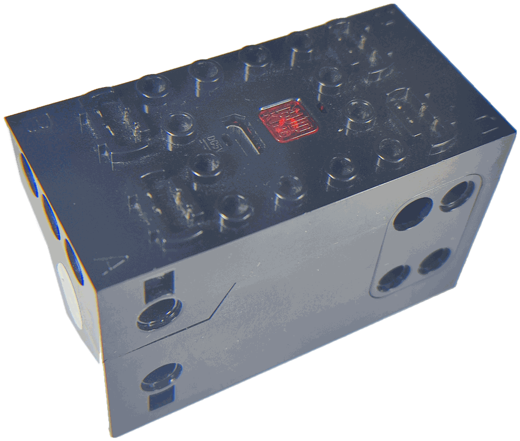
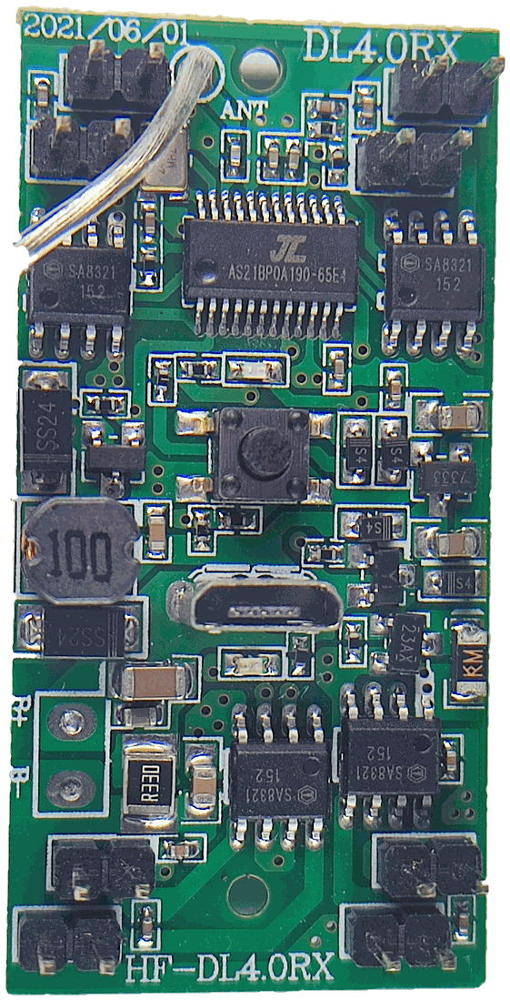
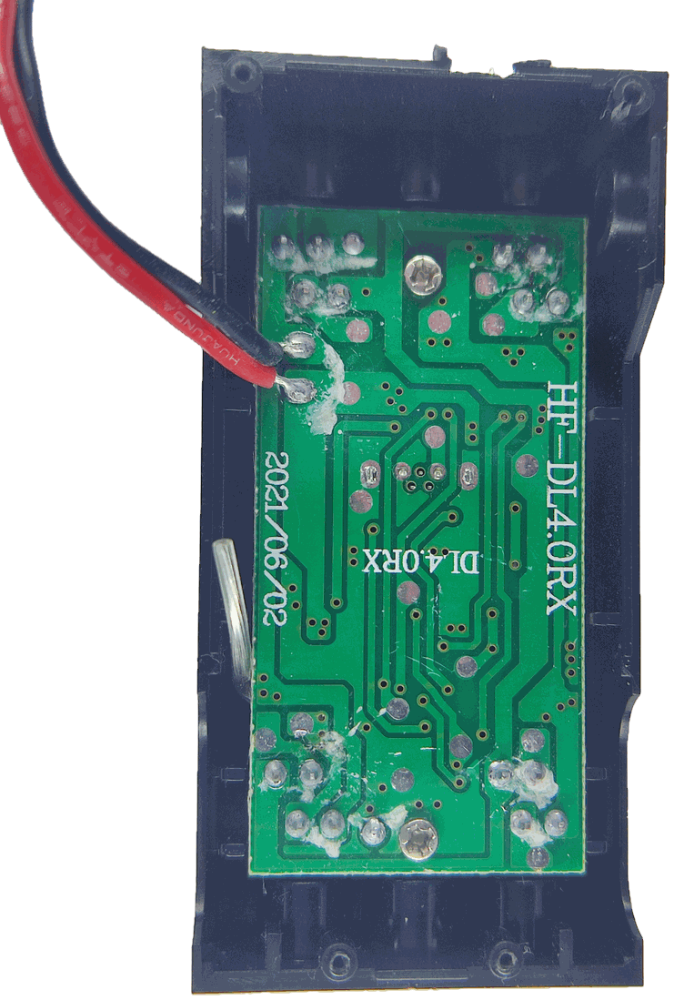
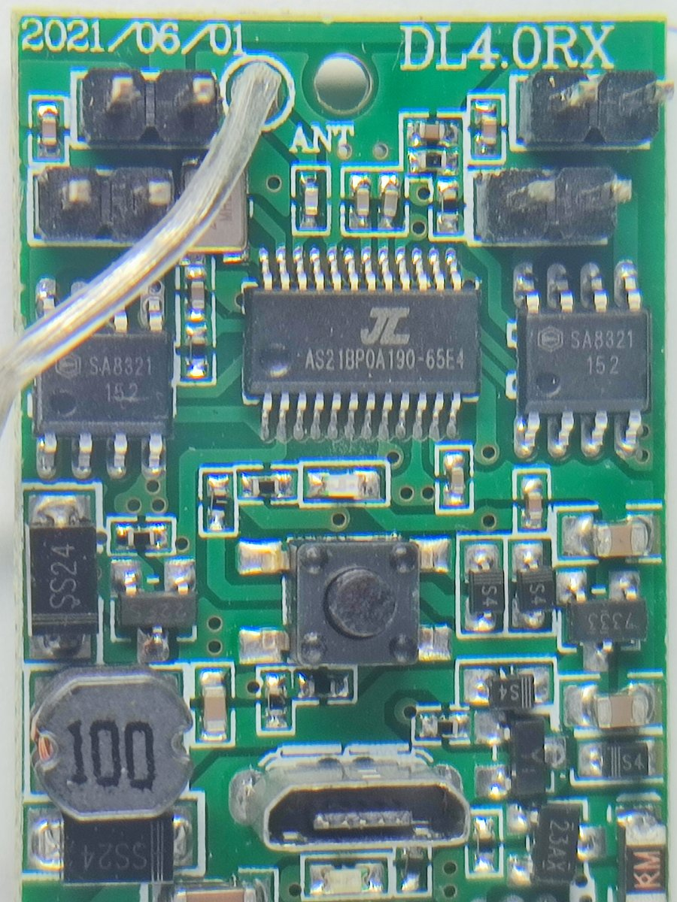
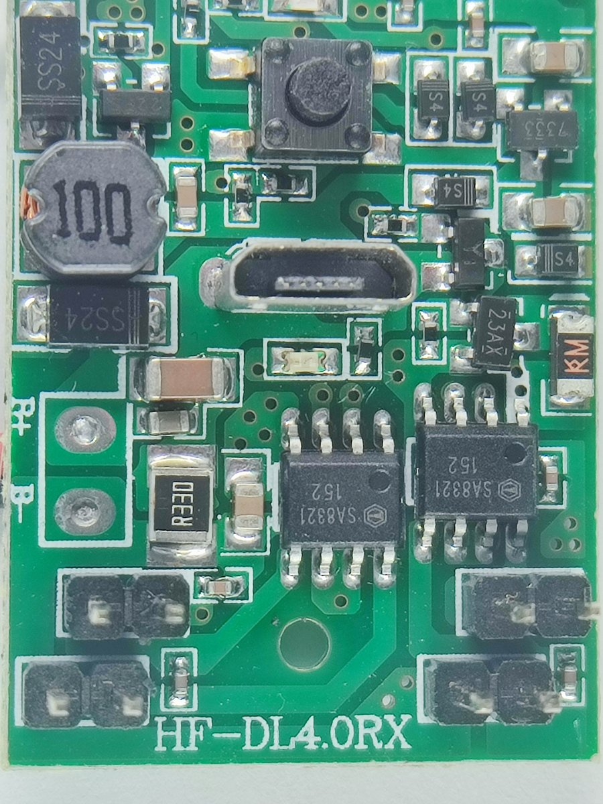
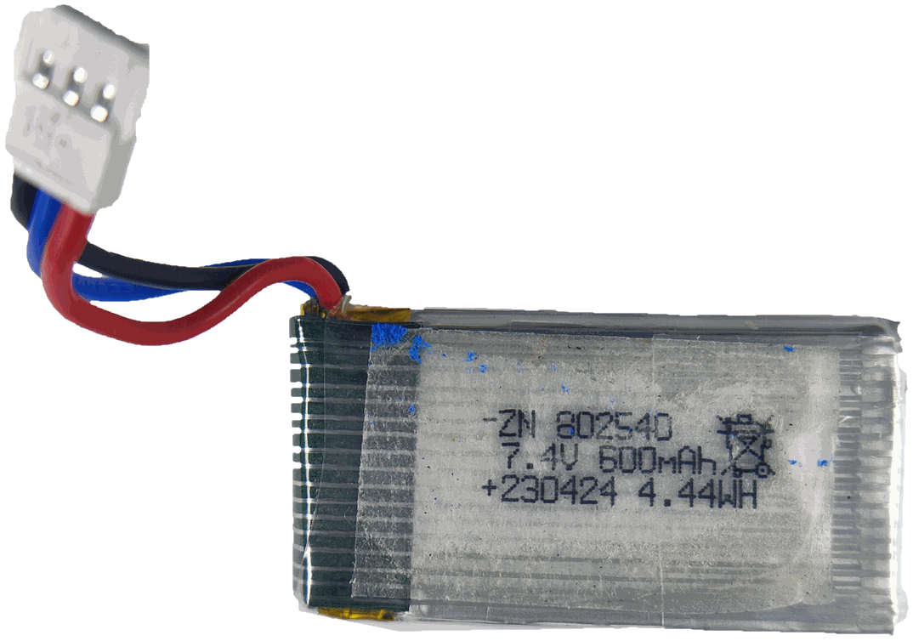

# Mould King DIY Module – Hardware and Bluetooth Protocol

> Source: own photos of the module (section 1); chip research of 2026-11-17 (datasheets, vendor pages, see the links in section 1); [J0EK3R/brickcontroller2](https://github.com/J0EK3R/brickcontroller2) – `DeviceManagement/MouldKing/MK_DIY.cs` and `MouldKingDeviceManager.cs` (current `main`) as well as the first draft `DeviceManagement/MouldKing_DIY.cs` (commit `793064a`, 2024-08-10), which contains the sniffed frames.
> Last updated: 2026-11-17
> No public description of the DIY protocol was found; everything in section 2 comes from BrickController2 (BC2). Items marked *likely* or *unverified* are inferences.




*Own photos (cropped, background removed); see "Image credits" in the [main README](../README.md#image-credits).*

## Overview

| Property | Value |
|---|---|
| Device | Mould King DIY module (battery box with 4 motor ports, board `HF-DL4.0RX` / `DL4.0RX`) |
| Transport | **BLE GATT connection** (real BLE peripheral, not advertising control) |
| Detection | manufacturer-specific data with company ID **`0xAC33`** (bytes `33 AC` on air) |
| GATT | service `0xAE3A`: write `0xAE3B`, notify `0xAE3C` (like the [MKH4.0](MKH4.0.md#1-gatt-layout)) |
| Command | binary frame of **18 bytes** `CC AA BB 01 …` with checksum, 4 motor speeds (one byte each) |
| Ports | 4 (A, B, C, D), brushed DC motors, bidirectional speed |
| MCU | JieLi AC6965E (*likely*) |
| Power | 2S LiPo 7.4 V / 600 mAh, charged via Micro USB (`DC5V`) |

---

## 1. Hardware

Board dates `2021/06/01` (front) and `2021/06/02` (back). Part identifications are best guesses
unless stated otherwise; confidence levels: **confirmed** (datasheet, vendor document or
calculation), **likely** (marking scheme or circuit context), **unknown**.

### 1.1 Housing


*Own photo. Housing with a red window showing the Mould King logo, a Micro-USB socket labelled
`DC5V` and the four ports labelled A to D.*

### 1.2 Board




*Left: front (silkscreen date `2021/06/01`). Right: back in the case (`2021/06/02`). Own photos.*

| Property | Value |
|---|---|
| Board name | `HF-DL4.0RX` / `DL4.0RX` (similar to the `HF-XKL4.0RX` of the [MK4.0](MK4.0.md#8-hardware-receiver-board)) |
| MCU | JieLi AC6965E, 24 pins, with crystal (MHz value not readable) and wire antenna `ANT` |
| Motor drivers | 4 × Sytatek SA8321 (SOP-8), one per port A to D |
| Power | Micro-USB, 2 × Schottky `SS24`, 10 µH inductor, battery pads `B+` / `B-` |
| User interface | 1 push button, 2 LEDs |

### 1.3 Components




*Left: upper part with the MCU, crystal and antenna. Right: lower part with Micro-USB, inductor, Schottky diodes and the small SOT-23 parts. Own photos.*

| Marking | Package | Identification | Confidence |
|---|---|---|---|
| JL logo, `AS21BP0A190-65E4` | 24-pin (QSOP24) | **JieLi AC6965E**, 4 Mbit flash, made 2021 (section 1.4) | likely (high) |
| `SA8321` (4 ×), date `152` | SOP-8 | **Sytatek SA8321** single-channel H-bridge motor driver (section 1.5) | confirmed (part), pinout unknown |
| `SS24` (2 ×) | SMA | Schottky rectifier, 2 A / 40 V | confirmed (generic marking) |
| `100` | inductor | 10 µH (3-digit code 10 × 10^0 µH) | confirmed (code convention) |
| `7333` | SOT-23 | 3.3 V LDO of the HT7333 type (a bare `7333` fits a clone) | likely |
| `23AX` | SOT-23-6 (?) | possibly the boost converter for charging the 2S pack | unknown |
| `223` / `2N2?` | SOT-23 | unknown; could be a MOSFET (load switch / charger path) next to `SS24` | unknown |
| `Y1` | SOT-23 | either BZX84C11 (11 V Zener) or an SS8050-type NPN | unknown |
| `S4` (several) | SOD-323 / SOT-23 (?) | small-signal diode or Schottky | unknown |
| `KM` | ? | unknown (fuse, TVS or transistor code) | unknown |
| `R33D` / `R330` | resistor | `R33` = 0.33 Ω (R as decimal point): current-sense or charge-current resistor; `D` probably a tolerance / series letter | likely (value), unknown (role) |

Expected power architecture (inference, *likely*, not verified by measurement):

```
Micro-USB 5 V -> boost charger ("23AX"?, 10 uH, SS24) -> 2S LiPo 7.4 V (B+ / B-)
                                                              |
              +-----------------------------------------------+
              v                                               v
      LDO "7333" 3.3 V -> AC6965E (VBAT / VDDIO)       4 x SA8321 (VM) -> ports A to D
```

### 1.4 MCU: JieLi AC6965E

The MCU is made by Zhuhai JieLi Technology (珠海杰理). Its marking is `AS21BP0A190-65E4`.

**How the marking decodes.** JieLi chips do not show the part number directly. The marking has two
halves separated by a dash (scheme documented by kagaimiq "jielie" and a DEV Community article):

| Field | Meaning | Here |
|---|---|---|
| A (letters) | prefix, e.g. `AB`, `AC`, `AD`, `AS` | `AS` |
| B | manufacturing year (last two digits) | `21` = 2021 |
| C | week (often omitted on newer chips) | – |
| D | letters, probably part of the lot | `BP` |
| E | lot number | `0A190` |
| f (after dash) | series variant: `AC69` + digits | `65` → AC69**65** |
| g | variant / body letter | `E` → AC6965**E** |
| h | extra info, mostly flash size in Mbit | `4` = 4 Mbit (512 KiB) |

Reference markings with the same prefix and year from the kagaimiq chip list: `AS21BP0B847-65A4`
= AC6965A (2021, 4 Mbit), `AS21BP03721-55F4` = AC6955F, `AS21BP0A909-5A8` = AC6905A. Result:
**AC6965E, 4 Mbit flash, produced 2021**, which fits the board dates. Confidence **likely (high)**:
the exact string `65E4` is not in any public list, but the scheme is consistent across many
examples, and the AC6965E is a 24-pin QSOP24 part, matching the observed package. The BLE-only
JieLi families (AC632N, AC6321, AC6328, …) do not fit: none comes in a 24-pin small-outline package.

**AC6965E specifications** (datasheet V1.0, 2020-06-01):

| Item | Value |
|---|---|
| Series / family | AC696N series, silicon family BR25 |
| CPU | 32-bit DSP with hardware FPU, up to 160 MHz |
| Flash | 4 Mbit (512 KiB), in package |
| Bluetooth | V5.1, BR + EDR + BLE (dual mode), +6 dBm TX, -90 dBm RX sensitivity |
| Peripherals | USB 2.0 FS OTG, 6 × 32-bit timers (capture / PWM), 3 × UART, I2C, SPI, SD, 10-bit ADC |
| Supply | VBAT 2.2–5.5 V, VDDIO 2.2–3.6 V (internal 3.3 V LDO) |
| Charger | built-in single-cell Li-ion charger, 4.2 V, 20–300 mA |
| Package | QSOP24 |
| Typical use | Bluetooth speaker SoC |

Consequences for this board (inference, *likely*): the chip cannot run directly from the 2S LiPo
(VBAT max 5.5 V), so the `7333` LDO probably supplies it with 3.3 V; the internal charger is
single-cell only, so the 2S pack needs the external boost charger; the PWM for the four drivers
can come from the timer PWM outputs or software PWM (pin mapping *unverified*). The crystal is
probably 24 MHz as on typical BR25 designs (*unverified*, value not readable). The USB data pins
are probably not connected (charge-only socket, *unverified*).

The GATT layout of the module (section 2.2) is byte for byte the default profile of the
`spp_and_le/trans_data` example of JieLi's BLE SDK, which supports the identification
independently. The MKH4.0 hub uses the same profile and is therefore *likely* JieLi-based too.

Pinout (QSOP24, datasheet table 1-1) of the pins relevant for this board: pin 22 `BT_RF` is the
Bluetooth antenna (should lead to the `ANT` wire), pins 23 / 24 `BT_OSCI` / `BT_OSCO` are the
crystal, pin 17 `VBAT`, pin 18 `VDDIO`, pin 19 `PB1` long-press reset. Whether the button uses
`PB1` is unverified. The full pin table is in the datasheet below.

Sources:
[kagaimiq: JieLi chip marks](https://kagaimiq.github.io/jielie/chips/chip-marks.html),
[kagaimiq: BR25 family](https://kagaimiq.github.io/jielie/chips/br25/),
[DEV Community: interpretation of JieLi silkscreen](https://dev.to/ble_voice/interpretation-of-jl-jieli-chip-silk-printing-how-to-judge-the-true-model-through-silk--2omf),
[EEVblog: JL Bluetooth IC ID](https://www.eevblog.com/forum/projects/jl-bluetooth-ic-id/10),
[AC6965E datasheet V1.0](https://atta.szlcsc.com/upload/public/pdf/source/20230403/94AFDB4F8DD7738F4370C2E4F4805B4D.pdf),
[LCSC AC6965E4](https://www.lcsc.com/product-detail/Microcontroller-Units-MCUs-MPUs-SOCs_JieLi-Tech-AC6965E4_C5440132.html),
[JieLi AC63 SDK](https://github.com/Jieli-Tech/fw-AC63_BT_SDK),
[trans_data GATT profile](https://github.com/Jieli-Tech/fw-AC63_BT_SDK/blob/master/apps/spp_and_le/examples/trans_data/ble_trans_profile.h).

### 1.5 Motor driver: Sytatek SA8321

Four `SA8321` in SOP-8 (date code `152`, format undocumented, *unknown*) drive the ports A to D.
The part is made by Shenzhen Sytatek (矽塔科技, [sytatek.com](https://www.sytatek.com/motor/direct/)),
confirmed by the vendor brief "SA8321 Ver1.1" listed on sytatek.cn. The SA8317E on the
[JIESTAR SCM8](../JieStar/SCM8.md) is from the same vendor (the matching hexagon logo is *likely* the
Sytatek logo). A teardown of the Mould King 4.0 V2 battery box also reports four SA8321, so
Mould King reuses this driver.

| Item | SA8321 | Confidence |
|---|---|---|
| Function | single-channel brushed-DC H-bridge: forward / reverse / coast / brake, PWM speed input | confirmed |
| Supply VM | 2.5–12.0 V (other distributors: 2.7–12 V or 2.5–15 V) | confirmed (brief) |
| Continuous current | 3.0 A | confirmed |
| Peak current | 5.5 A | likely (search snippet of the brief) |
| Protections | under-voltage lockout, over-temperature; over-current some distributors | likely |
| Package | SOP-8 | confirmed |

The 2S LiPo (8.4 V full) is within the supply range. The **pinout is unknown** until the datasheet
or a continuity check confirms it. Sister parts (SA8311, SA8317E) are described by third-party
write-ups with INA / INB inputs (low / low: coast, high / low: forward, low / high: reverse,
high / high: brake) and internal pull-downs; another Sytatek SOP-8 driver (SA6208) has a different
pinout, so this is *not verified* for the SA8321.

Sources:
[SA8321 brief V1.1](https://www.sytatek.cn/uploads/soft/%E4%B8%AD%E5%8E%8B%E9%A9%AC%E8%BE%BE%E9%A9%B1%E5%8A%A8/SA8321-Brief-V1.1.pdf) (site certificate expired at research time, PDF not read directly),
[Sytatek DC motor drivers](https://www.sytatek.com/motor/direct/),
[element14 forum](https://community.element14.com/technologies/experts/f/forum/54435/smd-motor-driver-ic),
[Mould King 4.0 V2 battery box teardown](https://reluctantcitydwellers2.wordpress.com/2025/01/30/mould-king-4-0-v2-battery-box-teardown-lego-alternative/),
[SA8311 description (CSDN)](https://damodev.csdn.net/6a7c635d10ee7a33f299edcf.html).

### 1.6 Battery



*Own photo of the battery pack.*

| Property | Value |
|---|---|
| Type | LiPo, `ZN 802540` |
| Capacity / voltage | 7.4 V (2S), 600 mAh, 4.44 Wh |
| Date | `230424` |
| Cable | 3 wires red / blue / black; *interpretation:* middle tap between the two cells (balancing), unverified |

---

## 2. Protocol

Source: BrickController2 (see above). The frames in section 2.3 were sniffed from the original
app by the BC2 author; the checksum was verified on all seven frames (and recalculated below).

### 2.1 Discovery

BC2 detects the module by manufacturer-specific advertising data with company ID `0xAC33`. This
is not an assigned Bluetooth SIG company ID, so it is a vendor-chosen value. The meaning of the
payload after the ID is unknown. The module is then used through a GATT connection.

### 2.2 GATT services

All 16-bit UUIDs on the Bluetooth base UUID; the properties are those of JieLi's SDK default
profile.

| Service | Characteristic | Properties | Use on the DIY module |
|---|---|---|---|
| `0x1800` | `0x2A00` | read / write | device name |
| `0xAE30` | `0xAE01` | write without response | not used |
| | `0xAE02` | notify | not used |
| | `0xAE03` | write without response | not used |
| | `0xAE04` | notify | not used |
| | `0xAE05` | indicate | not used |
| | `0xAE10` | read / write | not used |
| `0xAE3A` | `0xAE3B` | write without response | **motor command** (18-byte frame) |
| | `0xAE3C` | notify | status notifications (content unknown) |

The same service pair is used by the [MKH4.0 hub](MKH4.0.md#1-gatt-layout), but with an ASCII
protocol; the DIY module uses the binary frame below.

### 2.3 Command frame (`0xAE3B`, write without response)

18 bytes:

| Offset | Value | Meaning |
|---|---|---|
| 0–2 | `CC AA BB` | header / magic |
| 3 | `01` | constant; meaning unknown (frame type / version?) |
| 4 | speed | port A |
| 5 | speed | port B |
| 6 | speed | port C |
| 7 | speed | port D |
| 8–15 | `80` × 8 | always `0x80` (the "stop" value); unknown, possibly 8 reserved channels |
| 16 | checksum | see below |
| 17 | `33` | footer |

**Speed byte:** offset binary. `0x80` = stop, `0x81…0xFF` one direction, `0x7F…0x00` the other
direction. BC2 maps a value v in −1…1 to `0x80 + round(v × 0x80)`, clipped to `0x00…0xFF`. Which
direction is "forward" depends on the motor wiring (not documented). The original app was seen
using `0x01` (not `0x00`) as the extreme of the lower range.

**Checksum:** `cs = (sum(byte[0..15]) + 0x34) & 0xFF` (BC2 writes this as
`0x01 + sum(byte[0..15]) + 0x33`, i.e. footer plus 1).

Sniffed frames (checksum correct for all):

```
cc aa bb 01 80 80 80 80 80 80 80 80 80 80 80 80 66 33   all stop
cc aa bb 01 6f 80 80 80 80 80 80 80 80 80 80 80 55 33   A = 0x6F
cc aa bb 01 ff 80 80 80 80 80 80 80 80 80 80 80 e5 33   A = full (0xFF)
cc aa bb 01 80 73 80 80 80 80 80 80 80 80 80 80 59 33   B = 0x73
cc aa bb 01 80 80 01 80 80 80 80 80 80 80 80 80 e7 33   C = 0x01 (full, other direction)
cc aa bb 01 80 80 80 ff 80 80 80 80 80 80 80 80 e5 33   D = full
cc aa bb 01 80 80 80 01 80 80 80 80 80 80 80 80 e7 33   D = 0x01
```

**Worked example** (all stop): `CC + AA + BB + 01 = 0x232`, plus 12 × `0x80` = `0x600` gives
`0x832`; plus `0x34` = `0x866`; `& 0xFF` = **`0x66`**, as in the first frame. For `A = 0xFF` the
sum rises by `0x7F` to `0x8B1`, plus `0x34` = `0x8E5`, so the checksum is **`0xE5`**, matching the
third frame. (Both calculations were also checked with a small script.)

### 2.4 Notifications (`0xAE3C`)

The first BC2 draft subscribed to `0xAE3C` and stored the data as a hex string in its
`BatteryVoltage` field; the content is **unknown** (battery voltage? acknowledgement?).

### 2.5 Timing (BC2 implementation, not necessarily the original app)

- Frames are written only on change, retried up to 10 times, 10 ms pacing.
- The current driver re-sends the last values after 1 s without change (first draft: 100 ms).
- Whether the module stops the motors on its own when no frame arrives (failsafe) is unknown.

---

## Open questions

- Meaning of byte 3 (`0x01`) and of bytes 8–15 (always `0x80`; reserved channels?).
- Content of the `0xAE3C` notifications (battery voltage? acknowledgement?).
- Payload of the manufacturer data `0xAC33` in the advertisement (device ID, app pairing?).
- Name of the original app; does it send an init / handshake before the first frame?
- Failsafe behaviour on BLE link loss.
- Which direction (sign of the speed byte) is forward?
- Chips: confirm AC6965E by reading the package marking again or by a firmware / BLE name check; crystal frequency; SA8321 pinout; role of `23AX`, `223`, `Y1`, `S4`, `KM`, `R33D`.
- Does the 3-wire battery cable carry a balance tap that the charger evaluates?
