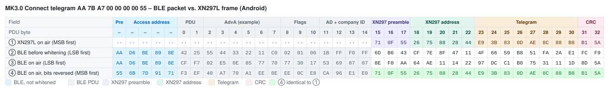
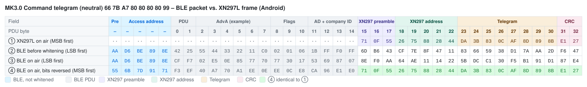

# Mould King MK3.0 – Bluetooth Protocol

> Source: [J0EK3R/brickcontroller2](https://github.com/J0EK3R/brickcontroller2) – `DeviceManagement/MouldKing/MK3.cs`, `MKBaseByte.cs`, `MouldKing.cs`, `Protocols/MKProtocol.cs`, `Protocols/CryptTools.cs`, `UI/Controls/Devices/MK3ChannelSelectorView.xaml` and `MouldKingMK3DatagramTests.cs`.
> Last updated: 2026-11-06


*Image: BrickController2 (`UI/Images/mk3_image.png`, MIT License).*

## Overview

| Property | Value |
|---|---|
| Device | Mould King MK3.0 module |
| Transport | **BLE advertising** (broadcast), no GATT connection |
| Direction | app → receiver only (no back channel, no battery voltage) |
| Manufacturer ID | `0xFFF0` |
| Devices | 1 (no device slots) |
| Channels | 4: port A and B analog (one **byte** each), port C and D **on/off functions** |
| Raw telegrams | Connect (8 bytes), Command (**8 bytes**) |
| Encoding | XN297L-compatible frame + BLE whitening compensation, identical to [MK4.0](MK4.0.md#5-encoding-into-ble-advertising-data) (see [XN297L](../Chips/XN297L.md)) |

The MK3.0 uses the same radio layer as the other MK modules: the phone builds the advertising data so that, after BLE whitening, an XN297L frame (preamble `71 0F 55`, address `C1 … C5`, CRC16, scrambler) appears on air. Only the raw telegrams differ.

### Differences to MK4.0 / MK6.0 at a glance

| Topic | MK4.0 | MK6.0 | MK3.0 |
|---|---|---|---|
| Channels | 4 per device | 6 per device | **2 analog + 2 functions** |
| Channel resolution | nibble | byte | **byte** (analog), **on/off** (functions) |
| Neutral value | `0x8` | `0x80` | `0x80` |
| Device slots | 3 (shared telegram) | 3 (telegram per device) | **none** |
| Command telegram length | 10 bytes | 10 bytes | **8 bytes** |
| Connect telegram | `AD … 80 80 80 4F 52` | `6D … 80 80 80 80 92` | `AA … 00 00 00 00 55` |
| Command identifiers | `7D` / `82` | `61…63` / `9E…9C` | `66` / `99` |

---

## 1. Sequence

```
App starts advertising
        │
        ▼
 Send Connect telegram        → receiver (freshly powered on) selects Bluetooth mode
        │
        ▼
 Send Command telegram(s)     → channel values for ports A … D
        │
        ▼
 Stop: end advertising
```

- When advertising starts, the **Connect telegram** is sent first. It puts the receiver into **Bluetooth mode** (app control). There is **no pairing** (see section 4).
- Afterwards the **Command telegram** carries the channel values (section 3).
- The sender has to transmit continuously; BLE advertising repeats the current data at every advertising interval.

Mode selection (first telegram after power-on wins) and a failsafe timeout are documented for the [MK4.0](MK4.0.md#1-sequence). The same behaviour is **expected but not verified** for the MK3.0 (see section 9).

### 1.1 Implementation notes (BrickController2, not part of the protocol)

- The MK3.0 is registered as a single device `MK 3.0` (device address string `Device`, no real BLE address).
- It gets its own `BluetoothAdvertisingDeviceHandler` (comment in `MK3.cs`: *MK3.0 needs a BluetoothAdvertiser per module*).
- If all channels stay at 0 for longer than `ReconnectTimeSpan` = **3 s**, BC2 sends the Connect telegram again.
- Advertising parameters: minimum interval, maximum TX power. Data is updated immediately on every change and refreshed at least every 2 s.
- In the BC2 channel selector the ports are shown with icons: A = rotate left/right, B = arrow up/down, C = rocket, D = directions. This suggests A = steering/rotation, B = drive, C and D = special functions (not verified on hardware).

---

## 2. Connect telegram (8 bytes, raw)

| Offset | Value | Meaning |
|---|---|---|
| 0 | `0xAA` | telegram identifier (start) |
| 1 | `AppId[0]` | app identifier byte 0 (ignored by the receiver) |
| 2 | `AppId[1]` | app identifier byte 1 (ignored by the receiver) |
| 3 | `0x00` | constant (meaning unknown) |
| 4 | `0x00` | constant (meaning unknown) |
| 5 | `0x00` | constant (meaning unknown) |
| 6 | `0x00` | constant (meaning unknown) |
| 7 | `0x55` | telegram identifier (end) |

Start and end identifier are bitwise complements: `0xAA + 0x55 = 0xFF`. Unlike MK4.0/MK6.0 the constant bytes are `0x00`, not `0x80`.

---

## 3. Command telegram (8 bytes, raw)

| Offset | Content | Meaning |
|---|---|---|
| 0 | `0x66` | telegram identifier (start) |
| 1 | `AppId[0]` | app identifier byte 0 (ignored by the receiver) |
| 2 | `AppId[1]` | app identifier byte 1 (ignored by the receiver) |
| 3 | `CH0` | channel 0 / port A, analog byte |
| 4 | `CH1` | channel 1 / port B, analog byte |
| 5 | `F` | function byte (ports C and D) |
| 6 | `F` | function byte, **same value as offset 5** |
| 7 | `0x99` | telegram identifier (end) |

Start and end identifier are bitwise complements: `0x66 + 0x99 = 0xFF`.

### 3.1 Analog channels (port A, B)

Identical to the [MK6.0 channel byte](MK6.0.md#31-channel-value-byte):

| Byte | Meaning |
|---|---|
| `0x00` | full reverse |
| `0x01` … `0x7F` | reverse, decreasing speed |
| `0x80` | **stop / neutral** (default) |
| `0x81` … `0xFE` | forward, increasing speed |
| `0xFF` | full forward |

```
v > 0   →  byte = min(0xFF, 0x80 + v * 0x80)     // 0x80 … 0xFF
v < 0   →  byte = max(0x00, 0x80 - (-v) * 0x80)  // 0x00 … 0x80
v = 0   →  byte = 0x80                           // stop
```

### 3.2 Function channels (port C, D)

Ports C and D are **on/off** functions. In BC2 they are *virtual* channels: they do not have a byte of their own, but together form one function byte, which is written to **both** offset 5 and offset 6.

| Port C (function 1) | Port D (function 2) | Function byte |
|---|---|---|
| off | off | `0x80` (neutral) |
| on | off | `0xF0` |
| off | on | `0x0F` |
| on | on | `0xFF` |

- Any value ≠ 0 switches the function on – the sign is ignored (`+1` and `−1` both give `0xF0` / `0x0F`).
- Function 1 sets the high nibble to `0xF`, function 2 the low nibble.
- Why the byte is sent twice is unknown (see section 9).

### 3.3 Examples (AppId = `7B A7`)

| Channels (A, B, C, D) | Raw telegram |
|---|---|
| 0, 0, 0, 0 | `66 7B A7 80 80 80 80 99` |
| +1, 0, 0, 0 | `66 7B A7 FF 80 80 80 99` |
| 0, −1, 0, 0 | `66 7B A7 80 00 80 80 99` |
| +0.5, −0.5, 0, 0 | `66 7B A7 C0 40 80 80 99` |
| 0, 0, on, 0 | `66 7B A7 80 80 F0 F0 99` |
| 0, 0, 0, on | `66 7B A7 80 80 0F 0F 99` |
| 0, 0, on, on | `66 7B A7 80 80 FF FF 99` |

---

## 4. App identifier

- Bytes 1 and 2 of both telegrams contain the same **2-byte app identifier** as for the other MK modules (random, generated on first launch, stored in the app settings).
- **The receiver ignores these bytes.** There is no pairing between app and receiver: any app ID is accepted, and a receiver reacts to every MK3.0 telegram in range.
- Consequence: two phones controlling MK3.0 receivers nearby will interfere with each other.

---

## 5. Encoding into BLE advertising data

Identical to the MK4.0 – see [MK4.0 §5](MK4.0.md#5-encoding-into-ble-advertising-data) and [XN297L §6](../Chips/XN297L.md#6-emulation-with-other-radios).

| Item | Value |
|---|---|
| Preamble | `71 0F 55` |
| RF address (`TX_ADDR`) | `C1 C2 C3 C4 C5` (on air `C5 … C1`) |
| CRC | CRC-16/CCITT, init `0xFFFF`, over address + telegram (bit-reversed), little endian in the buffer |
| Scrambling 1 | `CTX = 0x3F` (XN297L scrambler) over address + telegram + CRC |
| Scrambling 2 | `CTX = 0x25` (BLE whitening, channel 37) over the whole buffer |
| `headerOffset` / length | Android 15 / 24 bytes (padding `index + 1`), iOS 13 / 26 bytes (padding `0x12, 0x13, …`), Windows 15 / 27 bytes |

Result length before padding: Connect 18 bytes, Command **18 bytes** (the Command telegram has only 8 bytes).

### 5.1 Byte-by-byte comparison: BLE packet vs. XN297L frame (Android)

AppId = `7B A7`, `headerOffset` = 15. Same layout as [MK4.0 §5.5](MK4.0.md#55-byte-by-byte-comparison-ble-packet-vs-xn297l-frame-android).

**How to read the tables:** each column is one byte in transmission order, each row is one view of the same packet. The coloured image shows the table with field colours (legend below each image; light and dark mode); the Markdown table under it contains the same bytes as text, with bold marking the bytes that match.

| Row | Meaning |
|---|---|
| ① | What an XN297L (the original handset chip) would transmit for this telegram with `TX_ADDR = C1 … C5`: preamble, address, telegram, CRC – scrambled, MSB first. `··` = the XN297L sends nothing there. |
| ② | The BLE advertising packet as the phone's BLE stack assembles it, before whitening (LSB first). From PDU byte 15 on this is the manufacturer data from `GetRfPayload()` – it looks completely different from ①, because it is scrambled twice (XN297 scrambler + pre-compensated BLE whitening). |
| ③ | The same packet after BLE whitening (channel 37) – the bytes the radio actually sends, LSB first. Preamble and access address are not whitened. The XN297 preamble shows up as `8E F0 AA` = `71 0F 55` with reversed bit order. |
| ④ | Row ③ with every byte bit-reversed, i.e. read MSB first like an XN297L receiver does. **Bold** bytes are identical to row ①. |
| ④ = ① | ✓ = byte matches the XN297L frame. |

Field abbreviations: `Pre` BLE preamble, `AA` access address, `Hdr` PDU header, `AdvA` advertiser address, `Flg` Flags AD, `AD` AD length/type, `CID` company ID `0xFFF0`; **Pre** XN297 preamble, **Adr** XN297 address, **T0 …** raw telegram bytes, **CRC** XN297 CRC.

The BLE part (PDU bytes 0 … 14) does not match – there is nothing to match: for the XN297L receiver it is just noise in front of its preamble `71 0F 55`. Only the *length* of this part (`headerOffset` = 15) matters for the encoding, not its content; the header values are examples (see [XN297L §6.1](../Chips/XN297L.md#61-example-ble-advertising-packet-vs-xn297l-frame)). Padding and the 3-byte BLE CRC after the XN297 CRC are omitted; the receiver stops reading after its CRC.

#### Connect telegram `AA 7B A7 00 00 00 00 55`



| PDU byte | – | – | – | – | – | 0 | 1 | 2 | 3 | 4 | 5 | 6 | 7 | 8 | 9 | 10 | 11 | 12 | 13 | 14 | 15 | 16 | 17 | 18 | 19 | 20 | 21 | 22 | 23 | 24 | 25 | 26 | 27 | 28 | 29 | 30 | 31 | 32 |
|---|:-:|:-:|:-:|:-:|:-:|:-:|:-:|:-:|:-:|:-:|:-:|:-:|:-:|:-:|:-:|:-:|:-:|:-:|:-:|:-:|:-:|:-:|:-:|:-:|:-:|:-:|:-:|:-:|:-:|:-:|:-:|:-:|:-:|:-:|:-:|:-:|:-:|:-:|
| Field | Pre | AA | AA | AA | AA | Hdr | Hdr | AdvA | AdvA | AdvA | AdvA | AdvA | AdvA | Flg | Flg | Flg | AD | AD | CID | CID | **Pre** | **Pre** | **Pre** | **Adr** | **Adr** | **Adr** | **Adr** | **Adr** | **T0** | **T1** | **T2** | **T3** | **T4** | **T5** | **T6** | **T7** | **CRC** | **CRC** |
| ① XN297L on air (MSB first) | ·· | ·· | ·· | ·· | ·· | ·· | ·· | ·· | ·· | ·· | ·· | ·· | ·· | ·· | ·· | ·· | ·· | ·· | ·· | ·· | `71` | `0F` | `55` | `26` | `75` | `88` | `28` | `44` | `E9` | `3B` | `83` | `0D` | `AE` | `8C` | `88` | `B8` | `B1` | `5A` |
| ② BLE before whitening (LSB first) | `AA` | `D6` | `BE` | `89` | `8E` | `42` | `25` | `55` | `44` | `33` | `22` | `11` | `C0` | `02` | `01` | `06` | `1B` | `FF` | `F0` | `FF` | `6D` | `B6` | `43` | `CF` | `7E` | `8F` | `47` | `11` | `4F` | `66` | `59` | `B8` | `51` | `FA` | `2A` | `E1` | `FC` | `F9` |
| ③ BLE on air (LSB first) | `AA` | `D6` | `BE` | `89` | `8E` | `CF` | `F7` | `02` | `E5` | `0E` | `85` | `77` | `70` | `77` | `30` | `17` | `53` | `69` | `87` | `07` | `8E` | `F0` | `AA` | `64` | `AE` | `11` | `14` | `22` | `97` | `DC` | `C1` | `B0` | `75` | `31` | `11` | `1D` | `8D` | `5A` |
| ④ BLE on air, bits reversed (MSB first) | `55` | `6B` | `7D` | `91` | `71` | `F3` | `EF` | `40` | `A7` | `70` | `A1` | `EE` | `0E` | `EE` | `0C` | `E8` | `CA` | `96` | `E1` | `E0` | **`71`** | **`0F`** | **`55`** | **`26`** | **`75`** | **`88`** | **`28`** | **`44`** | **`E9`** | **`3B`** | **`83`** | **`0D`** | **`AE`** | **`8C`** | **`88`** | **`B8`** | **`B1`** | **`5A`** |
| ④ = ① |  |  |  |  |  |  |  |  |  |  |  |  |  |  |  |  |  |  |  |  | ✓ | ✓ | ✓ | ✓ | ✓ | ✓ | ✓ | ✓ | ✓ | ✓ | ✓ | ✓ | ✓ | ✓ | ✓ | ✓ | ✓ | ✓ |

#### Command telegram, neutral `66 7B A7 80 80 80 80 99`



| PDU byte | – | – | – | – | – | 0 | 1 | 2 | 3 | 4 | 5 | 6 | 7 | 8 | 9 | 10 | 11 | 12 | 13 | 14 | 15 | 16 | 17 | 18 | 19 | 20 | 21 | 22 | 23 | 24 | 25 | 26 | 27 | 28 | 29 | 30 | 31 | 32 |
|---|:-:|:-:|:-:|:-:|:-:|:-:|:-:|:-:|:-:|:-:|:-:|:-:|:-:|:-:|:-:|:-:|:-:|:-:|:-:|:-:|:-:|:-:|:-:|:-:|:-:|:-:|:-:|:-:|:-:|:-:|:-:|:-:|:-:|:-:|:-:|:-:|:-:|:-:|
| Field | Pre | AA | AA | AA | AA | Hdr | Hdr | AdvA | AdvA | AdvA | AdvA | AdvA | AdvA | Flg | Flg | Flg | AD | AD | CID | CID | **Pre** | **Pre** | **Pre** | **Adr** | **Adr** | **Adr** | **Adr** | **Adr** | **T0** | **T1** | **T2** | **T3** | **T4** | **T5** | **T6** | **T7** | **CRC** | **CRC** |
| ① XN297L on air (MSB first) | ·· | ·· | ·· | ·· | ·· | ·· | ·· | ·· | ·· | ·· | ·· | ·· | ·· | ·· | ·· | ·· | ·· | ·· | ·· | ·· | `71` | `0F` | `55` | `26` | `75` | `88` | `28` | `44` | `DA` | `3B` | `83` | `0C` | `AF` | `8D` | `89` | `8B` | `E1` | `27` |
| ② BLE before whitening (LSB first) | `AA` | `D6` | `BE` | `89` | `8E` | `42` | `25` | `55` | `44` | `33` | `22` | `11` | `C0` | `02` | `01` | `06` | `1B` | `FF` | `F0` | `FF` | `6D` | `B6` | `43` | `CF` | `7E` | `8F` | `47` | `11` | `83` | `66` | `59` | `38` | `D1` | `7A` | `AA` | `2D` | `F6` | `47` |
| ③ BLE on air (LSB first) | `AA` | `D6` | `BE` | `89` | `8E` | `CF` | `F7` | `02` | `E5` | `0E` | `85` | `77` | `70` | `77` | `30` | `17` | `53` | `69` | `87` | `07` | `8E` | `F0` | `AA` | `64` | `AE` | `11` | `14` | `22` | `5B` | `DC` | `C1` | `30` | `F5` | `B1` | `91` | `D1` | `87` | `E4` |
| ④ BLE on air, bits reversed (MSB first) | `55` | `6B` | `7D` | `91` | `71` | `F3` | `EF` | `40` | `A7` | `70` | `A1` | `EE` | `0E` | `EE` | `0C` | `E8` | `CA` | `96` | `E1` | `E0` | **`71`** | **`0F`** | **`55`** | **`26`** | **`75`** | **`88`** | **`28`** | **`44`** | **`DA`** | **`3B`** | **`83`** | **`0C`** | **`AF`** | **`8D`** | **`89`** | **`8B`** | **`E1`** | **`27`** |
| ④ = ① |  |  |  |  |  |  |  |  |  |  |  |  |  |  |  |  |  |  |  |  | ✓ | ✓ | ✓ | ✓ | ✓ | ✓ | ✓ | ✓ | ✓ | ✓ | ✓ | ✓ | ✓ | ✓ | ✓ | ✓ | ✓ | ✓ |

---

## 6. Reference implementation (Python)

Encoder part identical to the MK4.0/MK6.0 reference (verified against the MK4.0 test vectors from `CryptToolsTests.cs`). The telegram builder is verified against all cases of `MouldKingMK3DatagramTests.cs`.

```python
# Mould King MK3.0 - reference encoder for BLE advertising payloads.
# Re-implementation of BrickController2 CryptTools.GetRfPayload()
# plus the MK3.0 telegram builder.

# --- Protocol constants (MKProtocol.cs) --------------------------------------
MANUFACTURER_ID = 0xFFF0                    # company ID used for advertising
SEED   = [0xC1, 0xC2, 0xC3, 0xC4, 0xC5]     # 5-byte RF address
HEADER = [0x71, 0x0F, 0x55]                 # XN297L preamble
CTX1   = 0x3F                               # scrambler seed (address+data+CRC)
CTX2   = 0x25                               # BLE whitening seed (channel 37)


def rev8(b: int) -> int:
    """Reverse the bit order of one byte (0b00000001 -> 0b10000000)."""
    return int(f"{b:08b}"[::-1], 2)


def rev16(w: int) -> int:
    """Reverse the bit order of a 16-bit word."""
    return int(f"{w:016b}"[::-1], 2)


def crc16(seed: list[int], data: list[int]) -> int:
    """CRC16-CCITT as used by the MK protocol.

    - seed is processed in reverse order, bytes as-is
    - data is processed in forward order, each byte bit-reversed
    - result is bit-reversed and inverted
    """
    crc = 0xFFFF
    for b in list(reversed(seed)) + [rev8(x) for x in data]:
        crc ^= b << 8
        for _ in range(8):
            # shift left, apply polynomial 0x1021 when the MSB falls out
            crc = ((crc << 1) ^ 0x1021) if crc & 0x8000 else (crc << 1)
            crc &= 0xFFFF
    return rev16(crc) ^ 0xFFFF


def whitening_init(value: int) -> list[int]:
    """7-bit LFSR state: fixed 1 followed by bits 5..0 of value."""
    return [1] + [(value >> s) & 1 for s in (5, 4, 3, 2, 1, 0)]


def whitening_next(ctx: list[int]) -> int:
    """Advance the LFSR by one step and return the output bit."""
    v3, v6 = ctx[3], ctx[6]
    ctx[3], ctx[2], ctx[1], ctx[0] = ctx[2], ctx[1], ctx[0], ctx[6]
    ctx[6], ctx[5] = ctx[5], ctx[4]
    ctx[4] = v3 ^ v6
    return ctx[0]


def whitening(buf: list[int], start: int, length: int, value: int) -> None:
    """XOR buf[start:start+length] in place with the LFSR bit stream (LSB first)."""
    ctx = whitening_init(value)
    for i in range(start, start + length):
        out = 0
        for bit in range(8):
            out |= (whitening_next(ctx) ^ ((buf[i] >> bit) & 1)) << bit
        buf[i] = out


def get_rf_payload(data: list[int], platform: str = "android") -> list[int]:
    """Convert a raw MK telegram into advertising data.

    platform "android": header_offset 15, 24 bytes, padding index + 1
    platform "ios":     header_offset 13, 26 bytes, padding 0x12, 0x13, ...
    """
    header_offset, total_len = (13, 26) if platform == "ios" else (15, 24)

    # leading dummy bytes keep the whitening stream aligned with the real BLE PDU
    buf = [0] * header_offset
    # preamble + address (reversed order), every byte bit-reversed
    buf += [rev8(b) for b in HEADER + SEED[::-1]]
    # raw telegram unchanged
    buf += list(data)
    # CRC16, little endian
    crc = crc16(SEED, data)
    buf += [crc & 0xFF, crc >> 8]

    # scrambling 1: address + data + CRC (skips the 3 preamble bytes)
    whitening(buf, header_offset + len(HEADER), len(SEED) + len(data) + 2, CTX1)
    # scrambling 2: pre-compensates the BLE whitening over the whole PDU
    whitening(buf, 0, len(buf), CTX2)

    out = buf[header_offset:]
    # fill up to the platform specific length
    if platform == "ios":
        return out + [0x12 + i for i in range(total_len - len(out))]
    return out + [i + 1 for i in range(len(out), total_len)]

# --- MK3.0 telegram builder --------------------------------------------------
def channel_byte(value: float) -> int:
    """Map -1.0..+1.0 to the MK3.0 analog channel byte (0x00 full reverse, 0x80 stop, 0xFF full forward).

    Mirrors MKBaseByte.SetOutput_AnalogChannel() including the float->byte truncation.
    """
    value = max(-1.0, min(1.0, value))          # CutOutputValue()
    if value < 0:
        return int(max(0x00, 0x80 - min(0x80, -value * 0x80)))
    if value > 0:
        return int(min(0xFF, 0x80 + min(0x80, value * 0x80)))
    return 0x80


def function_byte(function1: float, function2: float) -> int:
    """Build the shared function byte (sent twice, at offsets 5 and 6).

    function1 (port C) -> high nibble 0xF0, function2 (port D) -> low nibble 0x0F.
    Any value != 0 switches the function on; both off -> 0x80 (neutral).
    """
    f1, f2 = function1 != 0, function2 != 0
    if not (f1 or f2):
        return 0x80
    return (0xF0 if f1 else 0x00) | (0x0F if f2 else 0x00)


def connect_telegram(app_id: tuple[int, int]) -> list[int]:
    """Connect telegram: selects Bluetooth mode on a freshly powered-on receiver."""
    return [0xAA, app_id[0], app_id[1], 0x00, 0x00, 0x00, 0x00, 0x55]


def command_telegram(app_id: tuple[int, int], channels: list[float]) -> list[int]:
    """Command telegram (8 bytes).

    channels: 4 values (-1.0..+1.0) for ports A, B (analog) and C, D (on/off functions)
    """
    func = function_byte(channels[2], channels[3])
    return [0x66, app_id[0], app_id[1],
            channel_byte(channels[0]),      # offset 3: port A
            channel_byte(channels[1]),      # offset 4: port B
            func, func,                     # offset 5 + 6: functions C / D (same value twice)
            0x99]


if __name__ == "__main__":
    hexs = lambda a: " ".join(f"{x:02X}" for x in a)
    app = (0x7B, 0xA7)
    print(hexs(get_rf_payload(connect_telegram(app))))
    # -> 6D B6 43 CF 7E 8F 47 11 4F 66 59 B8 51 FA 2A E1 FC F9 13 14 15 16 17 18
    print(hexs(get_rf_payload(command_telegram(app, [0, 0, 0, 0]))))
    # -> 6D B6 43 CF 7E 8F 47 11 83 66 59 38 D1 7A AA 2D F6 47 13 14 15 16 17 18
```

---

## 7. Test vectors

AppId = `7B A7`. Generated with the reference implementation above; BC2 has no encoded MK3.0 vectors in `CryptToolsTests.cs`.

| Raw telegram | CRC16 | Platform | Encoded data (`0xFFF0`) |
|---|---|---|---|
| `AA 7B A7 00 00 00 00 55` (Connect) | `0x2D1B` | Android | `6D B6 43 CF 7E 8F 47 11 4F 66 59 B8 51 FA 2A E1 FC F9` + padding `13 14 15 16 17 18` |
| | | iOS | `F9 08 49 22 47 BA C4 BC C4 EF 19 0A ED 39 35 D6 B6 A6` + padding `12 13 14 15 16 17 18 19` |
| `66 7B A7 80 80 80 80 99` (Command, neutral) | `0x9311` | Android | `6D B6 43 CF 7E 8F 47 11 83 66 59 38 D1 7A AA 2D F6 47` + padding `13 14 15 16 17 18` |
| | | iOS | `F9 08 49 22 47 BA C4 BC 08 EF 19 8A 6D B9 B5 1A BC 18` + padding `12 13 14 15 16 17 18 19` |

The first 8 encoded bytes (preamble + address) are identical for all MK telegrams of one platform.

---

## 8. Hardware

No board analysis yet. The BC2 image shows a small brick-built module with a push button and a USB socket.


---

## 9. Open questions

- Meaning of the constant bytes `00 00 00 00` in the Connect telegram.
- Why the function byte is sent twice (offsets 5 and 6), and whether the receiver evaluates both bytes.
- Whether the function outputs are real on/off outputs or could also be driven proportionally.
- Physical meaning of ports A … D (BC2 icons suggest steering, drive and two functions).
- Whether mode selection and the failsafe timeout behave as on the MK4.0.
- Whether the original 2.4 GHz handset uses the same RF address `C1 … C5` and telegram format (no capture yet).
- Hardware details (section 8).
