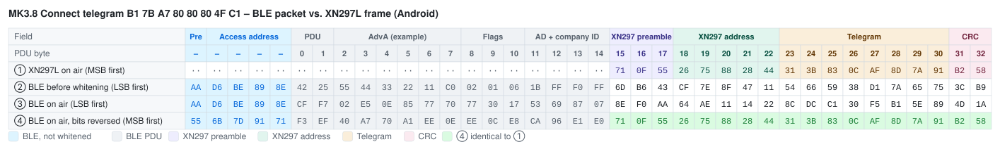
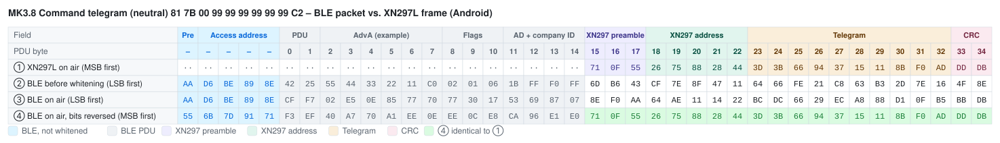

# Mould King MK3.8 – Bluetooth Protocol

> Source: [J0EK3R/brickcontroller2](https://github.com/J0EK3R/brickcontroller2) – `DeviceManagement/MouldKing/MK3_8.cs`, `MKBaseNibble.cs`, `MouldKing.cs`, `Protocols/MKProtocol.cs`, `Protocols/CryptTools.cs`, `UI/Controls/Devices/MK3_8ChannelSelectorView.xaml` and `MouldKingMK3_8DatagramTests.cs`.
> Last updated: 2026-11-06


*Image: BrickController2 (`UI/Images/mk3_8_image.png`, MIT License).*

## Overview

| Property | Value |
|---|---|
| Device | Mould King MK3.8 module |
| Transport | **BLE advertising** (broadcast), no GATT connection |
| Direction | app → receiver only (no back channel, no battery voltage) |
| Manufacturer ID | `0xFFF0` |
| Devices | 1 (no device slots) |
| Channels | 5: port A … D analog (one **nibble** each), port E **left/right** |
| Raw telegrams | Connect (8 bytes), Command (10 bytes) |
| Encoding | XN297L-compatible frame + BLE whitening compensation, identical to [MK4.0](MK4.0.md#5-encoding-into-ble-advertising-data) (see [XN297L](../Chips/XN297L.md)) |

The MK3.8 uses the same radio layer as the other MK modules: the phone builds the advertising data so that, after BLE whitening, an XN297L frame (preamble `71 0F 55`, address `C1 … C5`, CRC16, scrambler) appears on air. Only the raw telegrams differ.

### Differences to MK4.0 at a glance

| Topic | MK4.0 | MK3.8 |
|---|---|---|
| Channels | 4 per device, 3 devices | **4 analog + 1 left/right**, 1 device |
| Channel resolution | nibble, 7 steps per direction | nibble, **7 reverse / 6 forward** steps |
| Neutral nibble | `0x8` | **`0x9`** |
| App identifier | 2 bytes | **only 1 byte** in the Command telegram (offset 2 = port E) |
| Connect telegram | `AD … 80 80 80 4F 52` | `B1 … 80 80 80 4F C1` |
| Command identifiers | `7D` / `82` | `81` / `C2` |
| Start/end complement | yes (`+ = 0xFF`) | **no** (`0xB1`/`0xC1`, `0x81`/`0xC2`) |

---

## 1. Sequence

```
App starts advertising
        │
        ▼
 Send Connect telegram        → receiver (freshly powered on) selects Bluetooth mode
        │
        ▼
 Send Command telegram(s)     → channel values for ports A … E
        │
        ▼
 Stop: end advertising
```

- When advertising starts, the **Connect telegram** is sent first. It puts the receiver into **Bluetooth mode** (app control). There is **no pairing** (see section 4).
- Afterwards the **Command telegram** carries the channel values (section 3).
- The sender has to transmit continuously; BLE advertising repeats the current data at every advertising interval.

Mode selection (first telegram after power-on wins) and a failsafe timeout are documented for the [MK4.0](MK4.0.md#1-sequence). The same behaviour is **expected but not verified** for the MK3.8 (see section 9).

### 1.1 Implementation notes (BrickController2, not part of the protocol)

- The MK3.8 is registered as a single device `MK 3.8` (device address string `Device`, no real BLE address); comment in `MK3_8.cs`: *there is only one MK3.8 module*.
- If all channels stay at 0 for longer than `ReconnectTimeSpan` = **3 s**, BC2 sends the Connect telegram again.
- Advertising parameters: minimum interval, maximum TX power. Data is updated immediately on every change and refreshed at least every 2 s.
- In the BC2 channel selector ports A/B are on the right, C/D on the left side of the module image (bottom to top), port E above the module.
- The class comment in `MK3_8.cs` still reads *MK 4.0 Module*, and the channel comments are copied from the MK5.0 (tracks, turret, shot) – they do not describe the MK3.8.

---

## 2. Connect telegram (8 bytes, raw)

| Offset | Value | Meaning |
|---|---|---|
| 0 | `0xB1` | telegram identifier (start) |
| 1 | `AppId[0]` | app identifier byte 0 |
| 2 | `AppId[1]` | app identifier byte 1 |
| 3 | `0x80` | constant (meaning unknown) |
| 4 | `0x80` | constant (meaning unknown) |
| 5 | `0x80` | constant (meaning unknown) |
| 6 | `0x4F` | constant (meaning unknown) |
| 7 | `0xC1` | telegram identifier (end) |

Bytes 3 … 6 are the same as in the MK4.0/MK5.0 Connect telegram (`80 80 80 4F`). Unlike all other MK modules, start and end identifier are **not** bitwise complements (`0xB1 + 0xC1 = 0x172`).

---

## 3. Command telegram (10 bytes, raw)

| Offset | Content | Meaning |
|---|---|---|
| 0 | `0x81` | telegram identifier (start) |
| 1 | `AppId[0]` | app identifier byte 0 |
| 2 | `0 │ E` | **port E** (left/right) in the low nibble, high nibble `0` – replaces `AppId[1]` |
| 3 | `A │ B` | channel 0 / port A (high nibble), channel 1 / port B (low nibble) |
| 4 | `C │ D` | channel 2 / port C (high nibble), channel 3 / port D (low nibble) |
| 5 … 8 | `0x99` | unused, neutral (constant) |
| 9 | `0xC2` | telegram identifier (end) |

Bytes 5 … 8 correspond to the device 2/3 positions of the MK4.0 telegram layout; BC2 always sends them as `0x99` (= both nibbles neutral).

### 3.1 Analog channels (port A … D, nibble)

| Nibble | Meaning |
|---|---|
| `0x0`, `0x8` | not used by BC2 |
| `0x1` … `0x7` | reverse, `0x1` = slowest, `0x7` = full |
| `0x9` | **stop / neutral** (default) |
| `0xA` … `0xF` | forward, `0xA` = slowest, `0xF` = full |

Conversion from the app value `v` ∈ [-1.0 … +1.0] (`MK3_8.ProcessChannelValue_AnalogChannel`, 7 reverse steps, 6 forward steps):

```
v ≤ -1/7  →  nibble = min(0x7, (int)(-v * 7))        // 0x1 … 0x7
v ≥ +1/6  →  nibble = min(0xF, (int)(v * 6) + 9)     // 0xA … 0xF
else      →  nibble = 0x9                            // stop
```

| `v` | +1.0 | +0.5 | +0.17 | 0 | −0.15 | −0.5 | −1.0 |
|---|---|---|---|---|---|---|---|
| nibble | `F` | `C` | `A` | `9` | `1` | `3` | `7` |

### 3.2 Left/right channel (port E)

| Value | Nibble at offset 2 | Meaning |
|---|---|---|
| `v ≤ −1/7` | `0x1` | left |
| otherwise | `0x0` | off |
| `v ≥ +1/7` | `0x2` | right |

Port E is not proportional – there are only three states.

### 3.3 Examples (AppId = `7B A7`)

| Channels (A, B, C, D, E) | Raw telegram |
|---|---|
| 0, 0, 0, 0, 0 | `81 7B 00 99 99 99 99 99 99 C2` |
| +1, 0, 0, 0, 0 | `81 7B 00 F9 99 99 99 99 99 C2` |
| 0, −1, 0, 0, 0 | `81 7B 00 97 99 99 99 99 99 C2` |
| +0.5, 0, 0, 0, 0 | `81 7B 00 C9 99 99 99 99 99 C2` |
| +1, +1, +1, +1, 0 | `81 7B 00 FF FF 99 99 99 99 C2` |
| 0, 0, 0, 0, −1 (left) | `81 7B 01 99 99 99 99 99 99 C2` |
| 0, 0, 0, 0, +1 (right) | `81 7B 02 99 99 99 99 99 99 C2` |

---

## 4. App identifier

- The Connect telegram contains the full **2-byte app identifier** (bytes 1 and 2).
- In the Command telegram only `AppId[0]` is sent (byte 1); byte 2 carries port E. BC2 explicitly overwrites `AppId[1]` with `0x00` in the constructor (*This is an exception – the second byte of the AppIdentifier is used as setvalue for channel 5*).
- Whether the MK3.8 evaluates the app identifier is **not known**.

---

## 5. Encoding into BLE advertising data

Identical to the MK4.0 – see [MK4.0 §5](MK4.0.md#5-encoding-into-ble-advertising-data) and [XN297L §6](../Chips/XN297L.md#6-emulation-with-other-radios).

| Item | Value |
|---|---|
| Preamble | `71 0F 55` |
| RF address (`TX_ADDR`) | `C1 C2 C3 C4 C5` (on air `C5 … C1`) |
| CRC | CRC-16/CCITT, init `0xFFFF`, over address + telegram (bit-reversed), little endian in the buffer |
| Scrambling 1 | `CTX = 0x3F` (XN297L scrambler) over address + telegram + CRC |
| Scrambling 2 | `CTX = 0x25` (BLE whitening, channel 37) over the whole buffer |
| `headerOffset` / length | Android 15 / 24 bytes (padding `index + 1`), iOS 13 / 26 bytes (padding `0x12, 0x13, …`), Windows 15 / 27 bytes |

Result length before padding: Connect 18 bytes, Command 20 bytes.

### 5.1 Byte-by-byte comparison: BLE packet vs. XN297L frame (Android)

AppId = `7B A7`, `headerOffset` = 15. Same layout as [MK4.0 §5.5](MK4.0.md#55-byte-by-byte-comparison-ble-packet-vs-xn297l-frame-android).

**How to read the tables:** each column is one byte in transmission order, each row is one view of the same packet. The coloured image shows the table with field colours (legend below each image; light and dark mode); the Markdown table under it contains the same bytes as text, with bold marking the bytes that match.

| Row | Meaning |
|---|---|
| ① | What an XN297L (the original handset chip) would transmit for this telegram with `TX_ADDR = C1 … C5`: preamble, address, telegram, CRC – scrambled, MSB first. `··` = the XN297L sends nothing there. |
| ② | The BLE advertising packet as the phone's BLE stack assembles it, before whitening (LSB first). From PDU byte 15 on this is the manufacturer data from `GetRfPayload()` – it looks completely different from ①, because it is scrambled twice (XN297 scrambler + pre-compensated BLE whitening). |
| ③ | The same packet after BLE whitening (channel 37) – the bytes the radio actually sends, LSB first. Preamble and access address are not whitened. The XN297 preamble shows up as `8E F0 AA` = `71 0F 55` with reversed bit order. |
| ④ | Row ③ with every byte bit-reversed, i.e. read MSB first like an XN297L receiver does. **Bold** bytes are identical to row ①. |
| ④ = ① | ✓ = byte matches the XN297L frame. |

Field abbreviations: `Pre` BLE preamble, `AA` access address, `Hdr` PDU header, `AdvA` advertiser address, `Flg` Flags AD, `AD` AD length/type, `CID` company ID `0xFFF0`; **Pre** XN297 preamble, **Adr** XN297 address, **T0 …** raw telegram bytes, **CRC** XN297 CRC.

The BLE part (PDU bytes 0 … 14) does not match – there is nothing to match: for the XN297L receiver it is just noise in front of its preamble `71 0F 55`. Only the *length* of this part (`headerOffset` = 15) matters for the encoding, not its content; the header values are examples (see [XN297L §6.1](../Chips/XN297L.md#61-example-ble-advertising-packet-vs-xn297l-frame)). Padding and the 3-byte BLE CRC after the XN297 CRC are omitted; the receiver stops reading after its CRC.

#### Connect telegram `B1 7B A7 80 80 80 4F C1`



| PDU byte | – | – | – | – | – | 0 | 1 | 2 | 3 | 4 | 5 | 6 | 7 | 8 | 9 | 10 | 11 | 12 | 13 | 14 | 15 | 16 | 17 | 18 | 19 | 20 | 21 | 22 | 23 | 24 | 25 | 26 | 27 | 28 | 29 | 30 | 31 | 32 |
|---|:-:|:-:|:-:|:-:|:-:|:-:|:-:|:-:|:-:|:-:|:-:|:-:|:-:|:-:|:-:|:-:|:-:|:-:|:-:|:-:|:-:|:-:|:-:|:-:|:-:|:-:|:-:|:-:|:-:|:-:|:-:|:-:|:-:|:-:|:-:|:-:|:-:|:-:|
| Field | Pre | AA | AA | AA | AA | Hdr | Hdr | AdvA | AdvA | AdvA | AdvA | AdvA | AdvA | Flg | Flg | Flg | AD | AD | CID | CID | **Pre** | **Pre** | **Pre** | **Adr** | **Adr** | **Adr** | **Adr** | **Adr** | **T0** | **T1** | **T2** | **T3** | **T4** | **T5** | **T6** | **T7** | **CRC** | **CRC** |
| ① XN297L on air (MSB first) | ·· | ·· | ·· | ·· | ·· | ·· | ·· | ·· | ·· | ·· | ·· | ·· | ·· | ·· | ·· | ·· | ·· | ·· | ·· | ·· | `71` | `0F` | `55` | `26` | `75` | `88` | `28` | `44` | `31` | `3B` | `83` | `0C` | `AF` | `8D` | `7A` | `91` | `B2` | `58` |
| ② BLE before whitening (LSB first) | `AA` | `D6` | `BE` | `89` | `8E` | `42` | `25` | `55` | `44` | `33` | `22` | `11` | `C0` | `02` | `01` | `06` | `1B` | `FF` | `F0` | `FF` | `6D` | `B6` | `43` | `CF` | `7E` | `8F` | `47` | `11` | `54` | `66` | `59` | `38` | `D1` | `7A` | `65` | `75` | `3C` | `B9` |
| ③ BLE on air (LSB first) | `AA` | `D6` | `BE` | `89` | `8E` | `CF` | `F7` | `02` | `E5` | `0E` | `85` | `77` | `70` | `77` | `30` | `17` | `53` | `69` | `87` | `07` | `8E` | `F0` | `AA` | `64` | `AE` | `11` | `14` | `22` | `8C` | `DC` | `C1` | `30` | `F5` | `B1` | `5E` | `89` | `4D` | `1A` |
| ④ BLE on air, bits reversed (MSB first) | `55` | `6B` | `7D` | `91` | `71` | `F3` | `EF` | `40` | `A7` | `70` | `A1` | `EE` | `0E` | `EE` | `0C` | `E8` | `CA` | `96` | `E1` | `E0` | **`71`** | **`0F`** | **`55`** | **`26`** | **`75`** | **`88`** | **`28`** | **`44`** | **`31`** | **`3B`** | **`83`** | **`0C`** | **`AF`** | **`8D`** | **`7A`** | **`91`** | **`B2`** | **`58`** |
| ④ = ① |  |  |  |  |  |  |  |  |  |  |  |  |  |  |  |  |  |  |  |  | ✓ | ✓ | ✓ | ✓ | ✓ | ✓ | ✓ | ✓ | ✓ | ✓ | ✓ | ✓ | ✓ | ✓ | ✓ | ✓ | ✓ | ✓ |

#### Command telegram, neutral `81 7B 00 99 99 99 99 99 99 C2`



| PDU byte | – | – | – | – | – | 0 | 1 | 2 | 3 | 4 | 5 | 6 | 7 | 8 | 9 | 10 | 11 | 12 | 13 | 14 | 15 | 16 | 17 | 18 | 19 | 20 | 21 | 22 | 23 | 24 | 25 | 26 | 27 | 28 | 29 | 30 | 31 | 32 | 33 | 34 |
|---|:-:|:-:|:-:|:-:|:-:|:-:|:-:|:-:|:-:|:-:|:-:|:-:|:-:|:-:|:-:|:-:|:-:|:-:|:-:|:-:|:-:|:-:|:-:|:-:|:-:|:-:|:-:|:-:|:-:|:-:|:-:|:-:|:-:|:-:|:-:|:-:|:-:|:-:|:-:|:-:|
| Field | Pre | AA | AA | AA | AA | Hdr | Hdr | AdvA | AdvA | AdvA | AdvA | AdvA | AdvA | Flg | Flg | Flg | AD | AD | CID | CID | **Pre** | **Pre** | **Pre** | **Adr** | **Adr** | **Adr** | **Adr** | **Adr** | **T0** | **T1** | **T2** | **T3** | **T4** | **T5** | **T6** | **T7** | **T8** | **T9** | **CRC** | **CRC** |
| ① XN297L on air (MSB first) | ·· | ·· | ·· | ·· | ·· | ·· | ·· | ·· | ·· | ·· | ·· | ·· | ·· | ·· | ·· | ·· | ·· | ·· | ·· | ·· | `71` | `0F` | `55` | `26` | `75` | `88` | `28` | `44` | `3D` | `3B` | `66` | `94` | `37` | `15` | `11` | `8B` | `F0` | `AD` | `DD` | `DB` |
| ② BLE before whitening (LSB first) | `AA` | `D6` | `BE` | `89` | `8E` | `42` | `25` | `55` | `44` | `33` | `22` | `11` | `C0` | `02` | `01` | `06` | `1B` | `FF` | `F0` | `FF` | `6D` | `B6` | `43` | `CF` | `7E` | `8F` | `47` | `11` | `64` | `66` | `FE` | `21` | `C8` | `63` | `B3` | `2D` | `7E` | `16` | `4F` | `8E` |
| ③ BLE on air (LSB first) | `AA` | `D6` | `BE` | `89` | `8E` | `CF` | `F7` | `02` | `E5` | `0E` | `85` | `77` | `70` | `77` | `30` | `17` | `53` | `69` | `87` | `07` | `8E` | `F0` | `AA` | `64` | `AE` | `11` | `14` | `22` | `BC` | `DC` | `66` | `29` | `EC` | `A8` | `88` | `D1` | `0F` | `B5` | `BB` | `DB` |
| ④ BLE on air, bits reversed (MSB first) | `55` | `6B` | `7D` | `91` | `71` | `F3` | `EF` | `40` | `A7` | `70` | `A1` | `EE` | `0E` | `EE` | `0C` | `E8` | `CA` | `96` | `E1` | `E0` | **`71`** | **`0F`** | **`55`** | **`26`** | **`75`** | **`88`** | **`28`** | **`44`** | **`3D`** | **`3B`** | **`66`** | **`94`** | **`37`** | **`15`** | **`11`** | **`8B`** | **`F0`** | **`AD`** | **`DD`** | **`DB`** |
| ④ = ① |  |  |  |  |  |  |  |  |  |  |  |  |  |  |  |  |  |  |  |  | ✓ | ✓ | ✓ | ✓ | ✓ | ✓ | ✓ | ✓ | ✓ | ✓ | ✓ | ✓ | ✓ | ✓ | ✓ | ✓ | ✓ | ✓ | ✓ | ✓ |

---

## 6. Reference implementation (Python)

Encoder part identical to the MK4.0/MK6.0 reference (verified against the MK4.0 test vectors from `CryptToolsTests.cs`). The telegram builder is verified against all cases of `MouldKingMK3_8DatagramTests.cs`.

```python
# Mould King MK3.8 - reference encoder for BLE advertising payloads.
# Re-implementation of BrickController2 CryptTools.GetRfPayload()
# plus the MK3.8 telegram builder.

# --- Protocol constants (MKProtocol.cs) --------------------------------------
MANUFACTURER_ID = 0xFFF0                    # company ID used for advertising
SEED   = [0xC1, 0xC2, 0xC3, 0xC4, 0xC5]     # 5-byte RF address
HEADER = [0x71, 0x0F, 0x55]                 # XN297L preamble
CTX1   = 0x3F                               # scrambler seed (address+data+CRC)
CTX2   = 0x25                               # BLE whitening seed (channel 37)


def rev8(b: int) -> int:
    """Reverse the bit order of one byte (0b00000001 -> 0b10000000)."""
    return int(f"{b:08b}"[::-1], 2)


def rev16(w: int) -> int:
    """Reverse the bit order of a 16-bit word."""
    return int(f"{w:016b}"[::-1], 2)


def crc16(seed: list[int], data: list[int]) -> int:
    """CRC16-CCITT as used by the MK protocol.

    - seed is processed in reverse order, bytes as-is
    - data is processed in forward order, each byte bit-reversed
    - result is bit-reversed and inverted
    """
    crc = 0xFFFF
    for b in list(reversed(seed)) + [rev8(x) for x in data]:
        crc ^= b << 8
        for _ in range(8):
            # shift left, apply polynomial 0x1021 when the MSB falls out
            crc = ((crc << 1) ^ 0x1021) if crc & 0x8000 else (crc << 1)
            crc &= 0xFFFF
    return rev16(crc) ^ 0xFFFF


def whitening_init(value: int) -> list[int]:
    """7-bit LFSR state: fixed 1 followed by bits 5..0 of value."""
    return [1] + [(value >> s) & 1 for s in (5, 4, 3, 2, 1, 0)]


def whitening_next(ctx: list[int]) -> int:
    """Advance the LFSR by one step and return the output bit."""
    v3, v6 = ctx[3], ctx[6]
    ctx[3], ctx[2], ctx[1], ctx[0] = ctx[2], ctx[1], ctx[0], ctx[6]
    ctx[6], ctx[5] = ctx[5], ctx[4]
    ctx[4] = v3 ^ v6
    return ctx[0]


def whitening(buf: list[int], start: int, length: int, value: int) -> None:
    """XOR buf[start:start+length] in place with the LFSR bit stream (LSB first)."""
    ctx = whitening_init(value)
    for i in range(start, start + length):
        out = 0
        for bit in range(8):
            out |= (whitening_next(ctx) ^ ((buf[i] >> bit) & 1)) << bit
        buf[i] = out


def get_rf_payload(data: list[int], platform: str = "android") -> list[int]:
    """Convert a raw MK telegram into advertising data.

    platform "android": header_offset 15, 24 bytes, padding index + 1
    platform "ios":     header_offset 13, 26 bytes, padding 0x12, 0x13, ...
    """
    header_offset, total_len = (13, 26) if platform == "ios" else (15, 24)

    # leading dummy bytes keep the whitening stream aligned with the real BLE PDU
    buf = [0] * header_offset
    # preamble + address (reversed order), every byte bit-reversed
    buf += [rev8(b) for b in HEADER + SEED[::-1]]
    # raw telegram unchanged
    buf += list(data)
    # CRC16, little endian
    crc = crc16(SEED, data)
    buf += [crc & 0xFF, crc >> 8]

    # scrambling 1: address + data + CRC (skips the 3 preamble bytes)
    whitening(buf, header_offset + len(HEADER), len(SEED) + len(data) + 2, CTX1)
    # scrambling 2: pre-compensates the BLE whitening over the whole PDU
    whitening(buf, 0, len(buf), CTX2)

    out = buf[header_offset:]
    # fill up to the platform specific length
    if platform == "ios":
        return out + [0x12 + i for i in range(total_len - len(out))]
    return out + [i + 1 for i in range(len(out), total_len)]

# --- MK3.8 telegram builder --------------------------------------------------
def nibble(value: float) -> int:
    """Map -1.0..+1.0 to the MK3.8 nibble.

    0x1..0x7 reverse (0x7 = full), 0x9 = stop, 0xA..0xF forward (0xF = full).
    Mirrors MK3_8.ProcessChannelValue_AnalogChannel() (7 reverse steps, 6 forward steps).
    """
    value = max(-1.0, min(1.0, value))          # CutOutputValue()
    if value <= -1 / 7:
        return int(min(0x7, -value * 7))
    if value >= 1 / 6:
        return int(min(0xF, value * 6 + 9))
    return 0x9


def direction_nibble(value: float) -> int:
    """Left/right channel (port E): 0x1 = left (negative), 0x2 = right (positive), 0x0 = off."""
    if value <= -1 / 7:
        return 0x1
    if value >= 1 / 7:
        return 0x2
    return 0x0


def connect_telegram(app_id: tuple[int, int]) -> list[int]:
    """Connect telegram: selects Bluetooth mode on a freshly powered-on receiver."""
    return [0xB1, app_id[0], app_id[1], 0x80, 0x80, 0x80, 0x4F, 0xC1]


def command_telegram(app_id: tuple[int, int], channels: list[float]) -> list[int]:
    """Command telegram (10 bytes).

    channels: 5 values (-1.0..+1.0) for ports A..D (analog) and E (left/right)
    Note: only the FIRST app identifier byte is sent; offset 2 carries port E.
    """
    return [0x81, app_id[0],
            direction_nibble(channels[4]),                         # offset 2: port E (low nibble)
            (nibble(channels[0]) << 4) | nibble(channels[1]),      # offset 3: port A | port B
            (nibble(channels[2]) << 4) | nibble(channels[3]),      # offset 4: port C | port D
            0x99, 0x99, 0x99, 0x99,                                # offsets 5..8: unused, neutral
            0xC2]


if __name__ == "__main__":
    hexs = lambda a: " ".join(f"{x:02X}" for x in a)
    app = (0x7B, 0xA7)
    print(hexs(get_rf_payload(connect_telegram(app))))
    # -> 6D B6 43 CF 7E 8F 47 11 54 66 59 38 D1 7A 65 75 3C B9 13 14 15 16 17 18
    print(hexs(get_rf_payload(command_telegram(app, [0, 0, 0, 0, 0]))))
    # -> 6D B6 43 CF 7E 8F 47 11 64 66 FE 21 C8 63 B3 2D 7E 16 4F 8E 15 16 17 18
```

---

## 7. Test vectors

AppId = `7B A7`. Generated with the reference implementation above; BC2 has no encoded MK3.8 vectors in `CryptToolsTests.cs`.

| Raw telegram | CRC16 | Platform | Encoded data (`0xFFF0`) |
|---|---|---|---|
| `B1 7B A7 80 80 80 4F C1` (Connect) | `0x6DDB` | Android | `6D B6 43 CF 7E 8F 47 11 54 66 59 38 D1 7A 65 75 3C B9` + padding `13 14 15 16 17 18` |
| | | iOS | `F9 08 49 22 47 BA C4 BC DF EF 19 8A 6D B9 7A 42 76 E6` + padding `12 13 14 15 16 17 18 19` |
| `81 7B 00 99 99 99 99 99 99 C2` (Command, neutral) | `0x3843` | Android | `6D B6 43 CF 7E 8F 47 11 64 66 FE 21 C8 63 B3 2D 7E 16 4F 8E` + padding `15 16 17 18` |
| | | iOS | `F9 08 49 22 47 BA C4 BC EF EF BE 93 74 A0 AC 1A 34 49 CA 78` + padding `12 13 14 15 16 17` |

The first 8 encoded bytes (preamble + address) are identical for all MK telegrams of one platform.

---

## 8. Hardware

No board analysis yet. The BC2 image shows a small brick-built module with a push button and a USB socket, similar in shape to the [MK3.0](MK3.0.md).


---

## 9. Open questions

- Meaning of the constant bytes `80 80 80 4F` in the Connect telegram and why the identifiers are not complements as on the other MK modules.
- Whether the receiver evaluates bytes 5 … 8 of the Command telegram (always `0x99`).
- Why the neutral nibble is `0x9` and the forward range has only 6 steps; whether `0x8` means anything to the receiver.
- Physical meaning of port E (left/right) – e.g. steering or indicators.
- Whether mode selection and the failsafe timeout behave as on the MK4.0.
- Whether the receiver evaluates the app identifier byte(s).
- Whether the original 2.4 GHz handset uses the same RF address `C1 … C5` and telegram format (no capture yet).
- Hardware details (section 8).
