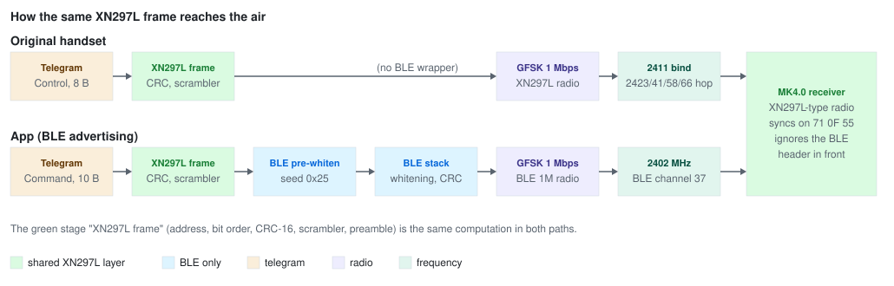
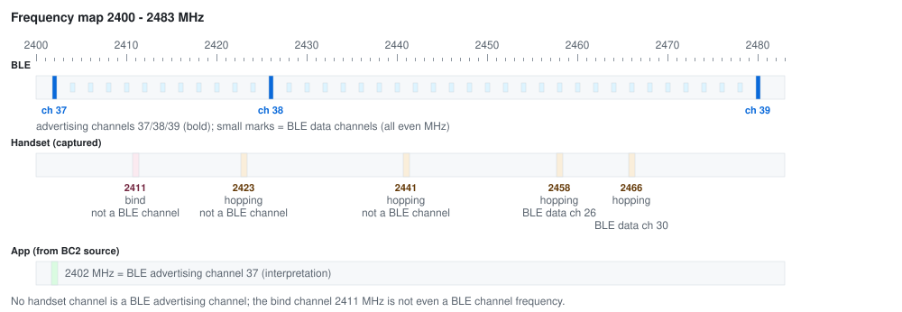
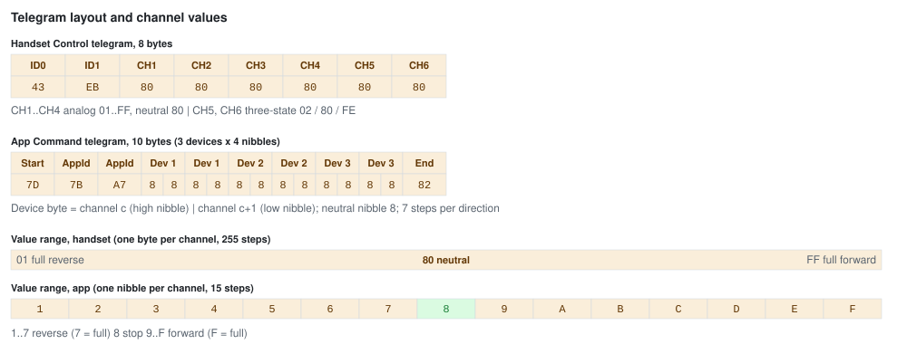
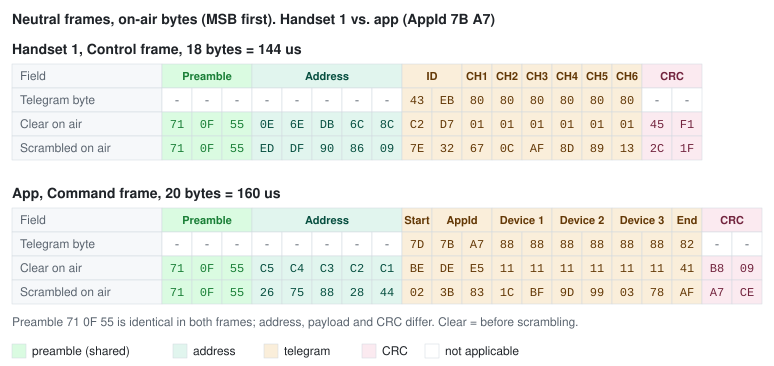

# Mould King MK4.0 – Original Handset vs. App (BLE): Layer Comparison

> Sources: [MK4.0 Remote](MK4.0-Remote.md) (own captures with the [XN297L sniffer](../Tools/xn297l-sniffer/README.md), 2026-11-11), [MK4.0](MK4.0.md) (BrickController2 source code and unit tests), [XN297L](../Chips/XN297L.md) (frame format and reference model). Byte sequences of the examples were computed with the XN297L reference model, not typed by hand.
> Last updated: 2026-11-11

**Evidence markers.** Every statement and every table row carries one of these markers:

| Marker | Meaning |
|---|---|
| **[C]** | **captured** with the XN297L sniffer – exists for the **handset only** |
| **[S]** | taken from the BrickController2 **source code / unit tests** – the **app** side; there is **no on-air capture of the app** in this repository |
| **[D]** | **derived** by computation with the XN297L reference model ([XN297L §7](../Chips/XN297L.md#7-reference-implementation-python)) |
| **[I]** | **interpretation**, no direct evidence |

Nothing on the app side is called "measured" in this document.

## 1. Summary

The original 2.4 GHz handset and the app put **the same kind of frame** on the air: an XN297L normal-mode frame at 1 Mbps GFSK with the preamble `71 0F 55`, a scrambled address, payload and CRC-16/GENIBUS. The handset produces it natively with an XN297L-compatible chip. The phone cannot, so the app pre-computes the frame and hides it in BLE manufacturer data, pre-whitened so that the BLE whitening of the phone's stack cancels out. The receiver ignores everything in front of its preamble.

Everything above and below this frame layer is different: **frequency**, **address**, **telegram format**, **channel resolution** and **identity handling**.



*Diagram A: the green "XN297L frame" stage is the same computation in both paths; the blue stages exist only in the app path.*

Main consequences (all **[I]**, see section 5): a phone **cannot emulate the handset** (its frequencies are not BLE advertising channels), whereas an nRF24 / XN297L **could send the app frame natively** on 2402 MHz without BLE.

## 2. Layer overview

| Layer | Handset | App (BLE advertising) | Same? | Evidence |
|---|---|---|---|---|
| Modulation | 1 Mbps GFSK | 1 Mbps GFSK (BLE 1M PHY) | yes (nominal) | handset **[C]**, app **[I]** |
| Frequency | bind 2411 MHz; operation hopping 2423 / 2441 / 2458 / 2466 MHz | fixed 2402 MHz (BLE channel 37) | **no** | handset **[C]**, app **[S]** + **[I]** |
| Preamble | `71 0F 55` | `71 0F 55` | yes | handset **[C]**, app **[S]** |
| Address (on air) | bind `48 44 4B 03 8C`, operation `0E 6E DB 6C 8C` (last byte = handset identity byte) | `C5 C4 C3 C2 C1` | **no** | handset **[C]**, app **[S]** |
| Scrambler / whitening | XN297L scrambler: 7-bit LFSR, x^7 + x^4 + 1, init `0x7F` | the same scrambler, plus BLE whitening (seed `0x25`) pre-compensated by the app | yes (frame layer) | handset **[C]**, app **[S]** + **[D]** |
| CRC | CRC-16/GENIBUS over address + payload | the same | yes (different input) | handset **[C]**, app **[S]** + **[D]** |
| Bit / byte order | address MSByte first, payload LSB first, CRC big endian | the same on air | yes | handset **[C]**, app **[D]** |
| Telegram layout | Bind 5 B, Control 8 B; identity first, no start/end marker | Connect 8 B, Command 10 B; start/end identifiers `AD…52`, `7D…82`; AppId second | **no** (similar position of the identity bytes, different function) | handset **[C]**, app **[S]** |
| Channel value encoding | 6 channels × 1 byte (4 analog `01…FF`, neutral `80`; 2 three-state `02 / 80 / FE`), 1 receiver | 4 channels × 3 devices, 1 nibble each (`1…F`, neutral `8`) | **no** | handset **[C]**, app **[S]** |
| Identity / pairing | 3-byte identity per handset; receiver binds to the first handset until power-cycled | 2-byte AppId, ignored by the receiver; no pairing | **no** | handset **[C]** + **[I]**, app **[S]** |
| Back channel | receiver answers during binding only (not captured) | none | **no** | handset **[I]**, app **[S]** |



*Diagram B: the handset channels and the app channel on the 2.4 GHz band. BLE channel centres are even MHz; the advertising channels are 2402, 2426 and 2480 MHz.*

## 3. Layer details

### 3.1 Modulation

- Both paths use 1 Mbps GFSK. The handset signal was received with the nRF52840 in `Nrf_1Mbit` mode **[C]**. BLE legacy advertising is always on the LE 1M PHY **[I]**.
- The frequency deviation is not necessarily identical: the XN297L deviation is configurable (160 - 250 kHz, see [XN297L](../Chips/XN297L.md)), BLE 1M uses a nominal deviation of 250 kHz. About 6 - 10 % of the handset bind telegrams fail the CRC in the sniffer, systematically, which points to a demodulation mismatch ([MK4.0 Remote §2.1](MK4.0-Remote.md#21-timing)) **[C]**. Whether this is related to deviation differences is **not verified [I]**.

### 3.2 Frequency

| | Handset **[C]** | App **[S]** |
|---|---|---|
| Bind / connect | 2411 MHz | – |
| Operation | 2423, 2441, 2458, 2466 MHz, hopping (order and dwell not determined) | 2402 MHz |

- The app frequency follows from the BLE whitening seed `0x25` (= 37) in BC2; "advertising channel 37 = 2402 MHz" is an **interpretation [I]** (the code does not say so, but it explains all constants, see [MK4.0 §5.1](MK4.0.md#51-constants-mkprotocol)). Which of the three advertising channels the phone uses is not under the app's control; only channel 37 carries a frame that decodes (section 3.12).
- BLE channel centres are **even** MHz (2402 + 2n). Of the handset channels, **2411, 2423 and 2441 MHz are not BLE channel frequencies at all**; 2458 and 2466 MHz are BLE **data** channels (26 and 30), which a phone cannot use for legacy advertising. The handset bind channel is odd (2411 MHz). So no handset channel is an advertising channel, see conclusion 2 in section 5 **[I]**.
- Weak copies of the handset frames on 2442, 2450, 2474 and 2482 MHz are most likely adjacent-channel / image reception **[C]** (interpretation in [MK4.0 Remote §2](MK4.0-Remote.md#2-radio-parameters)); they are not drawn in diagram B.

### 3.3 Preamble

`71 0F 55` in both paths, not scrambled, MSB first **[C]** (handset) / **[S]** (app, in the BC2 buffer bit-reversed to `8E F0 AA`). The BLE preamble and access address in front of the app frame are a different thing and play no role for the receiver (section 3.12).

### 3.4 Address

| | On air (MSByte first) | `TX_ADDR` (SPI order) |
|---|---|---|
| Handset bind **[C]** | `48 44 4B 03 8C` | `8C 03 4B 44 48` |
| Handset operation **[C]** | `0E 6E DB 6C 8C` | `8C 6C DB 6E 0E` |
| App **[S]** | `C5 C4 C3 C2 C1` | `C1 C2 C3 C4 C5` |

Handset 1 is shown; the other two handsets differ only in the last on-air byte (`1C`, `92`), see [MK4.0 Remote §3](MK4.0-Remote.md#3-address-and-identity). The first four on-air bytes of the handset address are the same for all handsets in each phase; the bind prefix `48 44 4B` reads `HDK` in ASCII.

The **address length is not certain** for the handset **[I]**: the CRC covers address and payload together, so a capture cannot tell where the address ends. Interpretation A (5-byte address + 2-byte ID, used here) and B (4-byte address + 3 identity bytes in the payload) give identical frames on air. For the app the 5-byte address is a constant in BC2 **[S]**.

In this document all addresses are written **in on-air order**; `TX_ADDR` appears only where labelled.

### 3.5 Scrambler / whitening

- **Shared (XN297L frame layer):** both paths scramble address, payload and CRC with the same 7-bit LFSR (x^7 + x^4 + 1, initial state all ones = `0x7F`, BC2 notation `CTXValue1 = 0x3F`); the preamble is not scrambled. The scrambler is a pure XOR stream, see section 4.5. Handset **[C]** (frames reproduced bit-exactly), app **[S]** + **[D]**.
- **App only:** the phone's BLE stack whitens the whole PDU with the same LFSR type, seeded with the advertising channel number. The app XORs the manufacturer data with the BLE whitening stream of channel 37 in advance (`CTXValue2 = 0x25`), so that the stack's whitening cancels it **[S]**. The handset has nothing of this.

### 3.6 CRC

CRC-16/GENIBUS (polynomial `0x1021`, init `0xFFFF`, final XOR `0xFFFF`) over the **unscrambled** address and payload in on-air form, sent big endian and then scrambled with the frame. The function is identical in both paths; only its input (address + telegram) differs **[D]**. The BLE packet of the app carries an additional 3-byte BLE CRC after the XN297L frame, which the receiver never reads (section 3.12).

### 3.7 Bit and byte order

| Field | Order on air | Handset | App |
|---|---|---|---|
| Address | reversed `TX_ADDR`, MSB first | native | BC2 reverses the seed and bit-reverses each byte |
| Payload | as written, **LSB first** | native | BC2 copies the telegram unchanged |
| CRC | high byte first | native | BC2 appends it little endian in the LSB-first buffer |

The BLE radio sends every byte LSB first, and an XN297L sends its payload LSB first as well. This is why the **payload of the app telegram can be copied unchanged** into the BLE buffer, while preamble and address (MSB first on an XN297L) have to be bit-reversed **[S]** + **[D]** (see [XN297L §7.1](../Chips/XN297L.md#71-mapping-to-brickcontroller2-crypttools)).

### 3.8 Telegram layout

| Offset | Handset Bind (5 B) **[C]** | Handset Control (8 B) **[C]** | App Connect (8 B) **[S]** | App Command (10 B) **[S]** |
|---|---|---|---|---|
| 0 | `ID0` | `ID0` | `AD` start | `7D` start |
| 1 | `ID1` | `ID1` | AppId[0] | AppId[0] |
| 2 | `00` | CH1 | AppId[1] | AppId[1] |
| 3 | `00` | CH2 | `80` | Device 1: C0 / C1 |
| 4 | `00` | CH3 | `80` | Device 1: C2 / C3 |
| 5 | | CH4 | `80` | Device 2: C0 / C1 |
| 6 | | CH5 | `4F` | Device 2: C2 / C3 |
| 7 | | CH6 | `52` end | Device 3: C0 / C1 |
| 8 | | | | Device 3: C2 / C3 |
| 9 | | | | `82` end |

Similar position, **different function**: in the handset telegram the first two bytes are an identity that the receiver evaluates (together with the address byte, section 3.10); in the app telegram the AppId is **ignored** by the receiver **[S]**. The app telegrams have start and end identifiers (bitwise complements), the handset telegrams have none. Connect has a purpose of its own (mode selection), Bind has one too (binding); they are not equivalent.



*Diagram D: the telegrams side by side, with the value ranges of one channel.*

### 3.9 Channel value encoding

| | Handset **[C]** | App **[S]** |
|---|---|---|
| Channels | CH1 … CH6 (4 analog, 2 three-state) | 4 channels (ports A … D) × 3 devices |
| Size per channel | 1 byte | 1 nibble |
| Neutral | `0x80` | `0x8` |
| Range | `01 … FF` (analog), `02 / 80 / FE` (three-state) | `1 … 7` reverse, `8` stop, `9 … F` forward (`0` unused) |
| Steps | 255 | 15 (7 per direction + stop) |
| Receivers per telegram | 1 | 3 (device slots, selected on the receiver by its button) |

Channel-to-port mapping of the handset (which stick axis is CH1, which port reacts) is not determined **[C]**, see section 6.

### 3.10 Identity, pairing and mode selection

- **Handset:** 3 identity bytes per handset (identity byte in the address, 2-byte ID in the payload). The receiver binds to the **first handset** it accepts after power-on and ignores other handsets until it is power-cycled **[C]**. That it must therefore store the identity is an **interpretation [I]**.
- **App:** the AppId is random per installation and **ignored**; every receiver reacts to every matching telegram. There is no pairing **[S]**.
- **Mode selection:** after power-on the receiver locks to the mode of the first source it hears: handset (Bind telegram) or app (Connect telegram) and stays there until the next power cycle ([MK4.0 §1](MK4.0.md#1-sequence), [MK4.0 Remote §1](MK4.0-Remote.md#1-sequence)).

### 3.11 Back channel

- **Handset:** the handset changes from blinking to constant when the receiver is switched on, but does not notice when the receiver is switched off; this suggests that the receiver transmits **only during binding** **[I]**. No receiver frame has been captured; a frame on 2411 MHz at 1 Mbps and an acknowledgement within 1.2 ms after the bind telegram are ruled out **[C]** ([MK4.0 Remote §2.2](MK4.0-Remote.md#22-search-for-the-receivers-response-2026-11-11)).
- **App:** none. The phone only advertises, the receiver cannot answer over BLE, and the module sends no telemetry **[S]**.

### 3.12 BLE wrapper (app only)

In front of the XN297L frame the BLE packet carries the BLE preamble `AA`, the advertising access address `D6 BE 89 8E` (LSB first), a 2-byte PDU header, the advertiser address (AdvA, 6 B), a Flags AD structure (3 B), the AD length/type (2 B) and the company ID `0xFFF0` (2 B); the manufacturer data after it is the pre-whitened XN297L frame. `headerOffset` = 15 on Android is the number of PDU bytes in front of the manufacturer data. The 3-byte BLE CRC follows the frame. For the XN297L receiver this is **noise in front of its preamble `71 0F 55`**; only the length of the header matters for the pre-whitening, not its content **[S]** + **[D]** (full tables: [MK4.0 §5.5](MK4.0.md#55-byte-by-byte-comparison-ble-packet-vs-xn297l-frame-android)).

BLE advertises on channels 37, 38 and 39, and the whitening sequence differs per channel. The pre-whitening is computed for channel 37 only; on the other two channels the receiver would see a different bit pattern that is not a valid frame **[I]**.

## 4. Side-by-side example: neutral handset Control frame vs. neutral app Command frame

### 4.1 Inputs

| | Handset | App |
|---|---|---|
| Frame | Control, neutral (handset 1) | Command, neutral (AppId `7B A7`, Android, `headerOffset` 15) |
| Telegram | `43 EB 80 80 80 80 80 80` | `7D 7B A7 88 88 88 88 88 88 82` |
| `TX_ADDR` | `8C 6C DB 6E 0E` (operation, interpretation A) | `C1 C2 C3 C4 C5` |
| Address on air | `0E 6E DB 6C 8C` | `C5 C4 C3 C2 C1` |

The numbers are the same as in [MK4.0 Remote §6](MK4.0-Remote.md#6-example-frames-handset-1) and [MK4.0 §5.5](MK4.0.md#55-byte-by-byte-comparison-ble-packet-vs-xn297l-frame-android), so they can be cross-checked there.

Evidence of the example frames:

- The **handset frame** is a frame that the sniffer received from handset 1 (neutral sticks) **[C]**; its bytes below are reproduced with the reference model **[D]** and agree bit-exactly with the capture.
- The **app frame** is **[D]** only (computed from the BC2 algorithm and the telegram); it equals the frame in [XN297L §5.6](../Chips/XN297L.md#56-example-mould-king-mk40-connect-telegram) and the BLE view in [MK4.0 §5.5](MK4.0.md#55-byte-by-byte-comparison-ble-packet-vs-xn297l-frame-android). It was not captured on air **[S]**.
- The frames with one changed channel (section 4.5) are **[D]** only.

### 4.2 Step by step

All values are in on-air order, MSB first.

| Step | Handset 1 (Control, neutral) | App (Command, neutral) |
|---|---|---|
| 1. Telegram | `43 EB 80 80 80 80 80 80` | `7D 7B A7 88 88 88 88 88 88 82` |
| 2. `TX_ADDR` (SPI order) | `8C 6C DB 6E 0E` | `C1 C2 C3 C4 C5` |
| 3. Address on air (reversed `TX_ADDR`), clear | `0E 6E DB 6C 8C` | `C5 C4 C3 C2 C1` |
| 4. Payload on air, clear (every byte bit-reversed) | `C2 D7 01 01 01 01 01 01` | `BE DE E5 11 11 11 11 11 11 41` |
| 5. CRC-16/GENIBUS over 3 + 4 (big endian), clear | `45 F1` | `B8 09` |
| 6. Scrambler stream (address, payload, CRC) | `E3 B1 4B EA 85 BC E5 66 0D AE 8C 88 12 69 EE` | `E3 B1 4B EA 85 BC E5 66 0D AE 8C 88 12 69 EE 1F C7` |
| 7. Address, scrambled (3 XOR 6) | `ED DF 90 86 09` | `26 75 88 28 44` |
| 8. Payload, scrambled | `7E 32 67 0C AF 8D 89 13` | `02 3B 83 1C BF 9D 99 03 78 AF` |
| 9. CRC, scrambled | `2C 1F` | `A7 CE` |
| 10. **Complete frame** = preamble + 7 + 8 + 9 | `71 0F 55 ED DF 90 86 09 7E 32 67 0C AF 8D 89 13 2C 1F` | `71 0F 55 26 75 88 28 44 02 3B 83 1C BF 9D 99 03 78 AF A7 CE` |
| 11. Length / airtime at 1 Mbps | 18 B / 144 us | 20 B / 160 us |

### 4.3 The two frames



*Diagram C: both frames byte by byte. Preamble in the same green, everything after it differs.*

**Handset, Control frame (18 bytes, 144 us):**

| | Pre | Pre | Pre | Adr | Adr | Adr | Adr | Adr | ID0 | ID1 | CH1 | CH2 | CH3 | CH4 | CH5 | CH6 | CRC | CRC |
|---|:-:|:-:|:-:|:-:|:-:|:-:|:-:|:-:|:-:|:-:|:-:|:-:|:-:|:-:|:-:|:-:|:-:|:-:|
| Telegram byte (as written) | -- | -- | -- | -- | -- | -- | -- | -- | `43` | `EB` | `80` | `80` | `80` | `80` | `80` | `80` | -- | -- |
| Clear on air (MSB first) | `71` | `0F` | `55` | `0E` | `6E` | `DB` | `6C` | `8C` | `C2` | `D7` | `01` | `01` | `01` | `01` | `01` | `01` | `45` | `F1` |
| Scrambler stream | -- | -- | -- | `E3` | `B1` | `4B` | `EA` | `85` | `BC` | `E5` | `66` | `0D` | `AE` | `8C` | `88` | `12` | `69` | `EE` |
| **Scrambled on air** | `71` | `0F` | `55` | `ED` | `DF` | `90` | `86` | `09` | `7E` | `32` | `67` | `0C` | `AF` | `8D` | `89` | `13` | `2C` | `1F` |

**App, Command frame (20 bytes, 160 us):**

| | Pre | Pre | Pre | Adr | Adr | Adr | Adr | Adr | Start | AppId | AppId | D1 C0/C1 | D1 C2/C3 | D2 C0/C1 | D2 C2/C3 | D3 C0/C1 | D3 C2/C3 | End | CRC | CRC |
|---|:-:|:-:|:-:|:-:|:-:|:-:|:-:|:-:|:-:|:-:|:-:|:-:|:-:|:-:|:-:|:-:|:-:|:-:|:-:|:-:|
| Telegram byte (as written) | -- | -- | -- | -- | -- | -- | -- | -- | `7D` | `7B` | `A7` | `88` | `88` | `88` | `88` | `88` | `88` | `82` | -- | -- |
| Clear on air (MSB first) | `71` | `0F` | `55` | `C5` | `C4` | `C3` | `C2` | `C1` | `BE` | `DE` | `E5` | `11` | `11` | `11` | `11` | `11` | `11` | `41` | `B8` | `09` |
| Scrambler stream | -- | -- | -- | `E3` | `B1` | `4B` | `EA` | `85` | `BC` | `E5` | `66` | `0D` | `AE` | `8C` | `88` | `12` | `69` | `EE` | `1F` | `C7` |
| **Scrambled on air** | `71` | `0F` | `55` | `26` | `75` | `88` | `28` | `44` | `02` | `3B` | `83` | `1C` | `BF` | `9D` | `99` | `03` | `78` | `AF` | `A7` | `CE` |

### 4.4 What the receiver sees after descrambling

| Field seen by the receiver | Handset | App |
|---|---|---|
| Preamble | `71 0F 55` | `71 0F 55` |
| Address (descrambled, on air) | `0E 6E DB 6C 8C` | `C5 C4 C3 C2 C1` |
| Payload (descrambled, bit-reversed back) | `43 EB 80 80 80 80 80 80` | `7D 7B A7 88 88 88 88 88 88 82` |
| CRC (descrambled) | `45 F1` | `B8 09` |

The frame layer (preamble, scrambled body, CRC-16) is the same; the content differs completely: another address, another telegram format and another length (8 vs. 10 bytes).

### 4.5 Effect of one changed channel

The scrambler is a pure XOR stream, so changing one telegram byte changes only that frame byte and the CRC.

**Handset:** CH1 = `FF` (telegram `43 EB FF 80 80 80 80 80`), frame `71 0F 55 ED DF 90 86 09 7E 32 99 0C AF 8D 89 13 3D 00`. Changed: byte 10 (CH1), byte 16 (CRC), byte 17 (CRC).

| | Pre | Pre | Pre | Adr | Adr | Adr | Adr | Adr | ID0 | ID1 | CH1 | CH2 | CH3 | CH4 | CH5 | CH6 | CRC | CRC |
|---|:-:|:-:|:-:|:-:|:-:|:-:|:-:|:-:|:-:|:-:|:-:|:-:|:-:|:-:|:-:|:-:|:-:|:-:|
| Neutral frame | `71` | `0F` | `55` | `ED` | `DF` | `90` | `86` | `09` | `7E` | `32` | `67` | `0C` | `AF` | `8D` | `89` | `13` | `2C` | `1F` |
| Variant frame | `71` | `0F` | `55` | `ED` | `DF` | `90` | `86` | `09` | `7E` | `32` | `99` | `0C` | `AF` | `8D` | `89` | `13` | `3D` | `00` |
| XOR | `..` | `..` | `..` | `..` | `..` | `..` | `..` | `..` | `..` | `..` | `FE` | `..` | `..` | `..` | `..` | `..` | `11` | `1F` |

**App:** Device 1, channel 0 = +1 (telegram `7D 7B A7 F8 88 88 88 88 88 82`), frame `71 0F 55 26 75 88 28 44 02 3B 83 12 BF 9D 99 03 78 AF 95 46`. Changed: byte 11 (D1 C0/C1), byte 18 (CRC), byte 19 (CRC).

| | Pre | Pre | Pre | Adr | Adr | Adr | Adr | Adr | Start | AppId | AppId | D1 C0/C1 | D1 C2/C3 | D2 C0/C1 | D2 C2/C3 | D3 C0/C1 | D3 C2/C3 | End | CRC | CRC |
|---|:-:|:-:|:-:|:-:|:-:|:-:|:-:|:-:|:-:|:-:|:-:|:-:|:-:|:-:|:-:|:-:|:-:|:-:|:-:|:-:|
| Neutral frame | `71` | `0F` | `55` | `26` | `75` | `88` | `28` | `44` | `02` | `3B` | `83` | `1C` | `BF` | `9D` | `99` | `03` | `78` | `AF` | `A7` | `CE` |
| Variant frame | `71` | `0F` | `55` | `26` | `75` | `88` | `28` | `44` | `02` | `3B` | `83` | `12` | `BF` | `9D` | `99` | `03` | `78` | `AF` | `95` | `46` |
| XOR | `..` | `..` | `..` | `..` | `..` | `..` | `..` | `..` | `..` | `..` | `..` | `0E` | `..` | `..` | `..` | `..` | `..` | `..` | `32` | `88` |

### 4.6 How the app frame reaches the air

The BC2 function `GetRfPayload()` pre-whitens the XN297L frame. For the neutral Command telegram it returns the manufacturer data (first 20 bytes; the rest is padding) `6D B6 43 CF 7E 8F 47 11 98 66 59 30 D9 72 A2 3C 6F 56 11 26`. After the BLE stack has whitened the PDU with the channel-37 sequence, PDU bytes 0 … 14 (the BLE header, LSB first) go out as `CF F7 02 E5 0E 85 77 70 77 30 17 53 69 87 07`, and the bytes from PDU byte 15 on, bit-reversed, read `71 0F 55 26 75 88 28 44 02 3B 83 1C BF 9D 99 03 78 AF A7 CE` – the XN297L frame of step 10 **[D]**. The full byte-by-byte table is in [MK4.0 §5.5](MK4.0.md#55-byte-by-byte-comparison-ble-packet-vs-xn297l-frame-android).

The generator used for this document is not part of the repository. To reproduce the two main frames, copy the code block of [XN297L §7](../Chips/XN297L.md#7-reference-implementation-python) into `xn297l.py` and run:

```python
# Reproduces the two example frames of this document (needs only xn297l.py, see above).
from xn297l import build_frame

hexs = lambda a: " ".join(f"{x:02X}" for x in a)

# handset 1, Control, neutral: TX_ADDR in SPI order, telegram as in MK4.0-Remote.md
print(hexs(build_frame([0x8C, 0x6C, 0xDB, 0x6E, 0x0E], [0x43, 0xEB] + [0x80] * 6)))
# -> 71 0F 55 ED DF 90 86 09 7E 32 67 0C AF 8D 89 13 2C 1F

# app, Command, neutral, AppId 7B A7
print(hexs(build_frame([0xC1, 0xC2, 0xC3, 0xC4, 0xC5], [0x7D, 0x7B, 0xA7] + [0x88] * 6 + [0x82])))
# -> 71 0F 55 26 75 88 28 44 02 3B 83 1C BF 9D 99 03 78 AF A7 CE
```

## 5. Receiver behaviour: what can be concluded

All conclusions are **interpretations [I]**; none was tested with a receiver.

1. **The receiver is dual-mode.** After power-on it must listen at least on 2402 MHz with the app address and on 2411 MHz with the bind address, and then locks its XN297L configuration to the first source it hears. *Evidence:* the two sources use different frequencies and addresses, yet either can start a freshly powered receiver ([MK4.0 §1](MK4.0.md#1-sequence)). *Would be refuted by:* a receiver that reacts to the app frame only after the handset frequencies have been scanned in a fixed order that never includes 2411 MHz (no such case known).
2. **A phone cannot emulate the handset.** BLE legacy advertising is limited to 2402, 2426 and 2480 MHz, and BLE channel centres are even MHz; the handset bind channel 2411 MHz and the operation channels 2423 and 2441 MHz are not BLE channel frequencies, 2458 and 2466 MHz are only BLE data channels. *Would be refuted by:* a receiver that also accepts the handset-format frame on 2402 MHz (cross test, section 6).
3. **An nRF24 / XN297L can send the app frame natively** on 2402 MHz without BLE, because the on-air frame is a plain XN297L frame **[D]** and the BLE header is not needed by the receiver. *Would be refuted by:* a receiver that checks for BLE structures in front of the preamble.
4. **The receiver decodes both value formats** – the handset's 255-step bytes in handset mode, the app's 15-step nibbles in app mode (in each mode it uses the format of the mode it locked to). The handset values are finer than the app values.

**Weak hint, not evidence:** the Connect telegram `AD <AppId> 80 80 80 4F 52` contains three `0x80`, which could be read as "neutral handset values". This is unsupported speculation: the MK6.0 Connect telegram has four `0x80` (`6D … 80 80 80 80 92`, [MK6.0](MK6.0.md)) and the MK3.8 one has the same three `80` plus `4F` ([MK3.8](MK3.8.md)). The meaning of these bytes is open in [MK4.0 §9](MK4.0.md#9-open-questions).

## 6. Open questions

- **Receiver response during binding:** channel, address, data rate and content of what the receiver sends to the handset ([MK4.0 Remote §2.2](MK4.0-Remote.md#22-search-for-the-receivers-response-2026-11-11), planned captures A - C).
- **Hopping:** order and dwell time of the four operating channels; channel-to-port mapping of CH1 … CH6.
- **Address length:** 5-byte address + 2-byte ID (A) or 4-byte address + 3 identity bytes in the payload (B)?
- **Does a searching receiver alternate between 2402 and 2411 MHz?** Experiment: handset and app switched on at the same time, who wins?
- **Cross tests:** does the receiver accept the handset-format frame sent at 2402 MHz, or the app frame at 2411 MHz (nRF24 / XN297L as transmitter)?
- **On-air confirmation of the app frame:** capture the app's advertising with `Tools/nrf-sniffer-ble` (BLE capture of the app side). Until then all app rows are **[S]** / **[D]**; "channel 37 = 2402 MHz" is an interpretation.
- **Modulation deviation:** do the deviation differences between XN297L and BLE 1M explain the CRC errors in the sniffer, and do they affect reception in the receiver?
