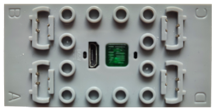
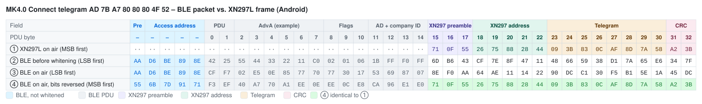
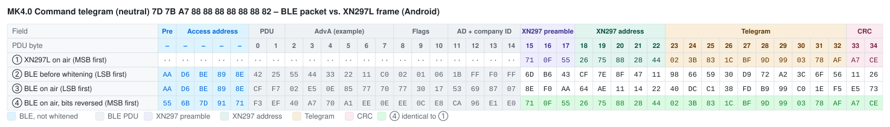
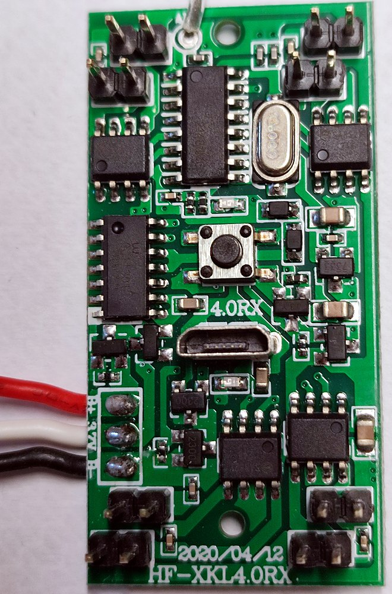
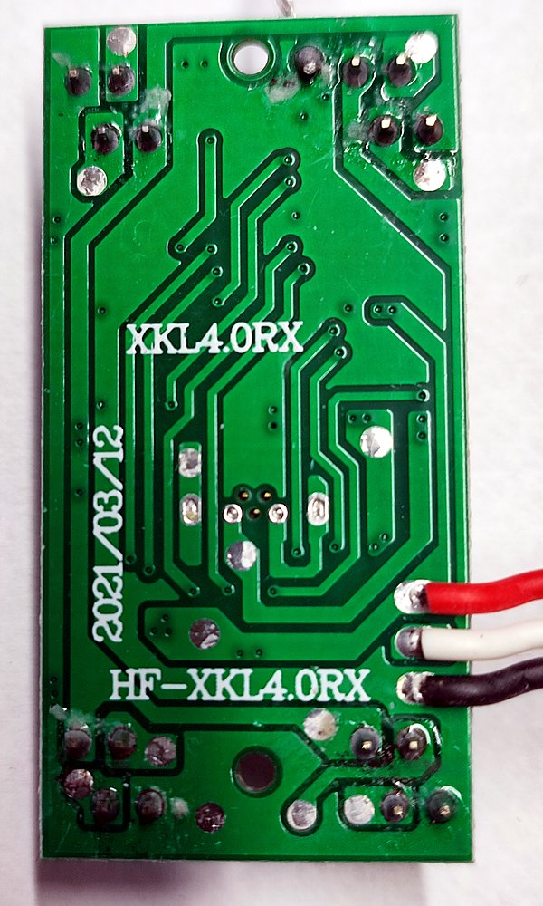
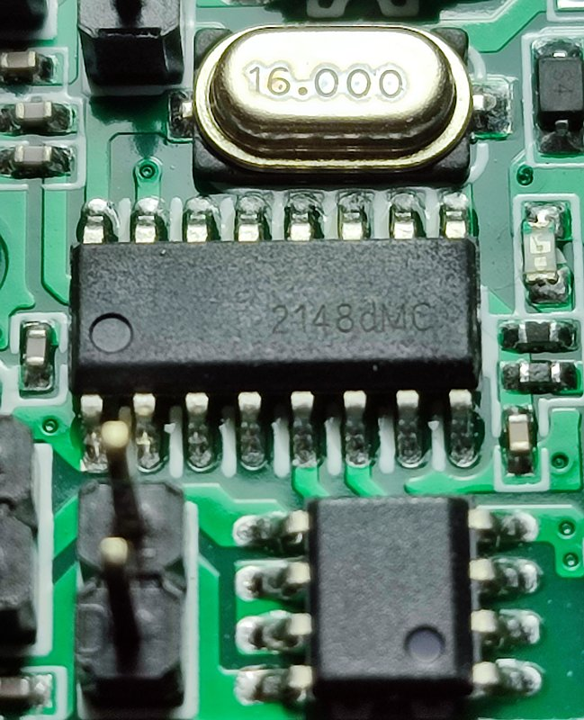
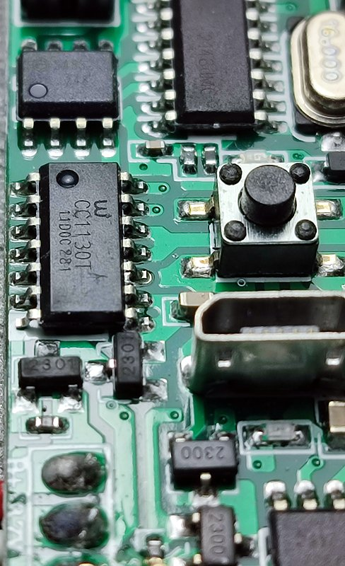

# Mould King MK4.0 – Bluetooth Protocol

> Source: [J0EK3R/brickcontroller2](https://github.com/J0EK3R/brickcontroller2) – `DeviceManagement/MouldKing/MK4.cs`, `MKBaseNibble.cs`, `Protocols/MKProtocol.cs`, `Protocols/CryptTools.cs`, `DeviceManagement/BluetoothAdvertisingDeviceHandler.cs` and the corresponding unit tests; own photos of the receiver board (section 8).
> Last updated: 2026-11-11



*Image: BrickController2 (`UI/Images/mk4_image.png`, MIT License).*

## Overview

| Property | Value |
|---|---|
| Device | Mould King MK4.0 receiver (e.g. board HF-XKL4.0RX) |
| Transport | **BLE advertising** (broadcast), no GATT connection |
| Direction | app → receiver only (no back channel, no battery voltage) |
| Manufacturer ID | `0xFFF0` |
| Devices per telegram | 3 (Device 1, 2, 3) |
| Channels per device | 4, one **nibble** (4 bits) each, bidirectional analog |
| Raw telegrams | Connect (8 bytes), Command (10 bytes) |
| Encoding | XN297L-compatible frame (preamble, address, CRC16, scrambling) + BLE whitening compensation |

The MK4.0 receiver is not a real BLE device but a 2.4 GHz radio receiver (XN297L-like). The phone therefore builds the advertising data so that, *after* BLE whitening, it looks exactly like an XN297L packet on air. This is why the raw telegrams from sections 2 and 3 are not visible directly; they are encoded as described in section 5.

---

## 1. Sequence

```
App starts advertising
        │
        ▼
 Send Connect telegram        → receiver (freshly powered on) selects Bluetooth mode
        │
        ▼
 Send Command telegram(s)     → channel values for Device 1…3
        │
        ▼
 Stop: end advertising
```

- When advertising starts, the **Connect telegram** is sent first. It puts the receiver into **Bluetooth mode** (app control) instead of **remote-control mode** (original 2.4 GHz handset). There is **no pairing** (see section 4).
- **Mode selection:** after power-on the receiver locks into the mode of the **first telegrams it receives**:
  - Connect telegram from the app → Bluetooth mode
  - telegrams from the original handset → remote-control mode (handset protocol: [MK4.0 Remote](MK4.0-Remote.md))
- The mode can only be changed again by a **power cycle**.
- Afterwards the **Command telegram** carries the channel values (section 3).
- **Failsafe timeout:** if the receiver gets no telegram for about **2 s**, it stops all outputs. The sender therefore has to transmit continuously (BLE advertising repeats the current data at every advertising interval, so this is satisfied as long as advertising is running).

### 1.1 Implementation notes (BrickController2, not part of the protocol)

The following behavior is a design decision in BrickController2 and is **not required by the receiver**:

- If all channels of all three devices stay at 0 for longer than `ReconnectTimeSpan` = **3 s**, BC2 sends the Connect telegram again. This lets receivers that were power-cycled in the meantime enter Bluetooth mode without restarting the app.
- Advertising parameters: minimum interval, maximum TX power.
- Data is updated immediately on every change (loop with at least 100 ms delay), and refreshed at least every 2 s without changes.

### 1.2 Device selection on the receiver

The device slot (Device 1, 2 or 3) of an MK4.0 receiver is selected with the **push button** on the receiver. The receiver then evaluates only its two bytes in the shared Command telegram (see section 3).

- After power-on the receiver always starts as **Device 1** (the selection is not stored).
- Each button press switches to the next device: 1 → 2 → 3 → 1 → …
- The LED shows the selected device by its blink pattern:

| Device | LED pattern |
|---|---|
| 1 | blinks once per cycle |
| 2 | blinks twice per cycle |
| 3 | blinks three times per cycle |

---

## 2. Connect telegram (8 bytes, raw)

| Offset | Value | Meaning |
|---|---|---|
| 0 | `0xAD` | telegram identifier (start) |
| 1 | `AppId[0]` | app identifier byte 0 (ignored by the receiver) |
| 2 | `AppId[1]` | app identifier byte 1 (ignored by the receiver) |
| 3 | `0x80` | constant (meaning unknown) |
| 4 | `0x80` | constant (meaning unknown) |
| 5 | `0x80` | constant (meaning unknown) |
| 6 | `0x4F` | constant (meaning unknown) |
| 7 | `0x52` | telegram identifier (end) |

**Purpose:** selects Bluetooth mode (app control) on a freshly powered-on receiver that has not yet received any telegrams. It does not pair the receiver with the app. Once a mode is selected, it only changes after a power cycle (see section 1).

The Connect telegram is identical to that of the [MK5.0](MK5.0.md#2-connect-telegram-8-bytes-raw). The MK5.0 also uses the same Command identifiers `7D` / `82` (see [MK5.0 §9](MK5.0.md#9-open-questions)).

## 3. Command telegram (10 bytes, raw)

| Offset | Content | Meaning |
|---|---|---|
| 0 | `0x7D` | telegram identifier (start) |
| 1 | `AppId[0]` | app identifier byte 0 (ignored by the receiver) |
| 2 | `AppId[1]` | app identifier byte 1 (ignored by the receiver) |
| 3 | `C0 │ C1` | Device 1: channel 0 / port A (high nibble), channel 1 / port B (low nibble) |
| 4 | `C2 │ C3` | Device 1: channel 2 / port C (high nibble), channel 3 / port D (low nibble) |
| 5 | `C0 │ C1` | Device 2: port A, port B |
| 6 | `C2 │ C3` | Device 2: port C, port D |
| 7 | `C0 │ C1` | Device 3: port A, port B |
| 8 | `C2 │ C3` | Device 3: port C, port D |
| 9 | `0x82` | telegram identifier (end) |

In general, for device `d` (0…2) and channel `c` (0…3):

```
byteOffset = 3 + d * 2 + (c / 2)
nibble     = (c even) ? high nibble : low nibble

channel 0 = port A, 1 = port B, 2 = port C, 3 = port D
```

All three devices share **one** telegram. In BrickController2 it is therefore static (`SharedTelegram`): whoever controls Device 2 always transmits the values of Device 1 and 3 as well.

Notably, the start and end identifiers are bitwise complements of each other: `0xAD + 0x52 = 0xFF`, `0x7D + 0x82 = 0xFF`. The same holds for most other MK modules (e.g. [MK6.0](MK6.0.md): `0x6D`/`0x92`, [MK3.0](MK3.0.md): `0xAA`/`0x55`), but not for the [MK3.8](MK3.8.md) (`0xB1`/`0xC1`).

### 3.1 Channel value (nibble)

| Nibble | Meaning |
|---|---|
| `0x0` | stop (not used by BC2) |
| `0x1` … `0x7` | reverse, `0x1` = slowest, `0x7` = full |
| `0x8` | **stop / neutral** (default) |
| `0x9` … `0xF` | forward, `0x9` = slowest, `0xF` = full |

Conversion from the app value `v` ∈ [-1.0 … +1.0] (7 steps per direction):

```
v ≥ +1/7  →  nibble = min(0xF, (int)(v * 7) + 8)     // 0x9 … 0xF
v ≤ -1/7  →  nibble = min(0x7, (int)(-v * 7))        // 0x1 … 0x7
else      →  nibble = 0x8                            // stop
```

Neutral Command telegram: `7D <AppId0> <AppId1> 88 88 88 88 88 88 82`.

### 3.2 Examples (AppId = `61 62`)

| Device | Channels (0, 1, 2, 3) | Raw telegram |
|---|---|---|
| 1 | 0, 0, 0, 0 | `7D 61 62 88 88 88 88 88 88 82` |
| 1 | +1, 0, 0, 0 | `7D 61 62 F8 88 88 88 88 88 82` |
| 1 | 0, +1, 0, 0 | `7D 61 62 8F 88 88 88 88 88 82` |
| 1 | -1, 0, 0, 0 | `7D 61 62 78 88 88 88 88 88 82` |
| 1 | 0, 0, 0, -1 | `7D 61 62 88 87 88 88 88 88 82` |
| 2 | +1, +1, +1, +1 | `7D 61 62 88 88 FF FF 88 88 82` |
| 3 | -1, -1, -1, -1 | `7D 61 62 88 88 88 88 77 77 82` |

---

## 4. App identifier

- Bytes 1 and 2 of both telegrams contain a **2-byte app identifier**.
- It is generated randomly on first launch and stored persistently in the app settings (`AppIdentifierService`).
- In the source code, the placeholder `APPID = 0x00` is used there initially and replaced when the device is created.
- **The receiver ignores these bytes.** There is no pairing between app and receiver: any app ID is accepted, and a receiver reacts to every MK4.0 telegram in range on its selected device slot (section 1.2).
- Consequence: two phones controlling MK4.0 receivers with the same device slot nearby will interfere with each other.

---

## 5. Encoding into BLE advertising data

The raw telegrams are converted into the actual manufacturer data by `CryptTools.GetRfPayload()`.

### 5.1 Constants (`MKProtocol`)

| Name | Value | Interpretation |
|---|---|---|
| `ManufacturerID` | `0xFFF0` | company ID in the advertisement |
| `HeaderArray` | `71 0F 55` | XN297L preamble |
| `SeedArray` | `C1 C2 C3 C4 C5` | 5-byte RF address |
| `CTXValue1` | `0x3F` | XN297L scrambler seed |
| `CTXValue2` | `0x25` (= 37) | BLE whitening seed for advertising channel 37 |

The interpretation (XN297L, BLE channel 37) is derived and not documented in the code. It does, however, explain all constants consistently.

### 5.2 Buffer layout

```
[ headerOffset × 0x00 ][ preamble 3 ][ address 5 ][ raw telegram n ][ CRC16 2 ]
                        bit-reversed  reversed      unchanged          little endian
                                      byte order,
                                      bit-reversed
```

`headerOffset` is the number of BLE PDU bytes preceding the payload. This keeps the whitening sequence in sync with the real position on air:

| Platform | `headerOffset` | Explanation | Payload |
|---|---|---|---|
| Android | 15 | PDU header 2 + AdvA 6 + Flags 3 + AD length/type 2 + company ID 2 | 24 bytes manufacturer data |
| iOS | 13 | PDU header 2 + AdvA 6 + Flags 3 + AD length/type 2 | 26 bytes, as 16-bit service UUIDs |
| Windows | 15 | like Android, payload starting at offset 3 | 27 bytes |

### 5.3 Steps

1. Insert the preamble `71 0F 55` and the address in reversed order (`C5 C4 C3 C2 C1`), then **bit-reverse every byte** → `8E F0 AA A3 23 C3 43 83`.
2. Append the raw telegram unchanged.
3. Compute **CRC16-CCITT** (polynomial `0x1021`, initial value `0xFFFF`):
   - over the address in order `C5 … C1`,
   - then over the raw telegram, each byte bit-reversed,
   - bit-reverse the 16-bit result and XOR with `0xFFFF`,
   - append little endian.
4. **Scrambling 1** (`CTX = 0x3F`) over address + telegram + CRC (excluding the preamble).
5. **Scrambling 2** (`CTX = 0x25`) over the entire buffer starting at index 0.
6. Cut out length `3 + 5 + n + 2` starting at `headerOffset`.
7. Pad to the platform length: Android/Windows with `index + 1`, iOS with `0x12, 0x13, …`.

Result length: Connect 18 bytes, Command 20 bytes (before padding).

### 5.4 Whitening LFSR (7 bits)

```
init(v):  ctx = [1, v5, v4, v3, v2, v1, v0]   // bits of v, MSB first

next():   t3, t6 = ctx[3], ctx[6]
          ctx[3], ctx[2], ctx[1], ctx[0] = ctx[2], ctx[1], ctx[0], ctx[6]
          ctx[6], ctx[5] = ctx[5], ctx[4]
          ctx[4] = t3 ^ t6
          return ctx[0]

encode:   for each byte, bit 0 → bit 7: bit ^= next()
```

### 5.5 Byte-by-byte comparison: BLE packet vs. XN297L frame (Android)

AppId = `7B A7`, `headerOffset` = 15.

**How to read the tables:** each column is one byte in transmission order, each row is one view of the same packet. The coloured image shows the table with field colours (legend below each image; light and dark mode); the Markdown table under it contains the same bytes as text, with bold marking the bytes that match.

| Row | Meaning |
|---|---|
| ① | What an XN297L (the original handset chip) would transmit for this telegram with `TX_ADDR = C1 … C5`: preamble, address, telegram, CRC – scrambled, MSB first. `··` = the XN297L sends nothing there. |
| ② | The BLE advertising packet as the phone's BLE stack assembles it, before whitening (LSB first). From PDU byte 15 on this is the manufacturer data from `GetRfPayload()` – it looks completely different from ①, because it is scrambled twice (XN297 scrambler + pre-compensated BLE whitening). |
| ③ | The same packet after BLE whitening (channel 37) – the bytes the radio actually sends, LSB first. Preamble and access address are not whitened. The XN297 preamble shows up as `8E F0 AA` = `71 0F 55` with reversed bit order. |
| ④ | Row ③ with every byte bit-reversed, i.e. read MSB first like an XN297L receiver does. **Bold** bytes are identical to row ①. |
| ④ = ① | ✓ = byte matches the XN297L frame. |

Field abbreviations: `Pre` BLE preamble, `AA` access address, `Hdr` PDU header, `AdvA` advertiser address, `Flg` Flags AD, `AD` AD length/type, `CID` company ID `0xFFF0`; **Pre** XN297 preamble, **Adr** XN297 address, **T0 …** raw telegram bytes, **CRC** XN297 CRC.

The BLE part (PDU bytes 0 … 14) does not match – there is nothing to match: for the XN297L receiver it is just noise in front of its preamble `71 0F 55`. Only the *length* of this part (`headerOffset` = 15) matters for the encoding, not its content; the header values are examples (see [XN297L §6.1](../Chips/XN297L.md#61-example-ble-advertising-packet-vs-xn297l-frame)). Padding and the 3-byte BLE CRC after the XN297 CRC are omitted; the receiver stops reading after its CRC.

#### Connect telegram `AD 7B A7 80 80 80 4F 52`



| PDU byte | – | – | – | – | – | 0 | 1 | 2 | 3 | 4 | 5 | 6 | 7 | 8 | 9 | 10 | 11 | 12 | 13 | 14 | 15 | 16 | 17 | 18 | 19 | 20 | 21 | 22 | 23 | 24 | 25 | 26 | 27 | 28 | 29 | 30 | 31 | 32 |
|---|:-:|:-:|:-:|:-:|:-:|:-:|:-:|:-:|:-:|:-:|:-:|:-:|:-:|:-:|:-:|:-:|:-:|:-:|:-:|:-:|:-:|:-:|:-:|:-:|:-:|:-:|:-:|:-:|:-:|:-:|:-:|:-:|:-:|:-:|:-:|:-:|:-:|:-:|
| Field | Pre | AA | AA | AA | AA | Hdr | Hdr | AdvA | AdvA | AdvA | AdvA | AdvA | AdvA | Flg | Flg | Flg | AD | AD | CID | CID | **Pre** | **Pre** | **Pre** | **Adr** | **Adr** | **Adr** | **Adr** | **Adr** | **T0** | **T1** | **T2** | **T3** | **T4** | **T5** | **T6** | **T7** | **CRC** | **CRC** |
| ① XN297L on air (MSB first) | ·· | ·· | ·· | ·· | ·· | ·· | ·· | ·· | ·· | ·· | ·· | ·· | ·· | ·· | ·· | ·· | ·· | ·· | ·· | ·· | `71` | `0F` | `55` | `26` | `75` | `88` | `28` | `44` | `09` | `3B` | `83` | `0C` | `AF` | `8D` | `7A` | `58` | `A2` | `3B` |
| ② BLE before whitening (LSB first) | `AA` | `D6` | `BE` | `89` | `8E` | `42` | `25` | `55` | `44` | `33` | `22` | `11` | `C0` | `02` | `01` | `06` | `1B` | `FF` | `F0` | `FF` | `6D` | `B6` | `43` | `CF` | `7E` | `8F` | `47` | `11` | `48` | `66` | `59` | `38` | `D1` | `7A` | `65` | `E6` | `34` | `7F` |
| ③ BLE on air (LSB first) | `AA` | `D6` | `BE` | `89` | `8E` | `CF` | `F7` | `02` | `E5` | `0E` | `85` | `77` | `70` | `77` | `30` | `17` | `53` | `69` | `87` | `07` | `8E` | `F0` | `AA` | `64` | `AE` | `11` | `14` | `22` | `90` | `DC` | `C1` | `30` | `F5` | `B1` | `5E` | `1A` | `45` | `DC` |
| ④ BLE on air, bits reversed (MSB first) | `55` | `6B` | `7D` | `91` | `71` | `F3` | `EF` | `40` | `A7` | `70` | `A1` | `EE` | `0E` | `EE` | `0C` | `E8` | `CA` | `96` | `E1` | `E0` | **`71`** | **`0F`** | **`55`** | **`26`** | **`75`** | **`88`** | **`28`** | **`44`** | **`09`** | **`3B`** | **`83`** | **`0C`** | **`AF`** | **`8D`** | **`7A`** | **`58`** | **`A2`** | **`3B`** |
| ④ = ① |  |  |  |  |  |  |  |  |  |  |  |  |  |  |  |  |  |  |  |  | ✓ | ✓ | ✓ | ✓ | ✓ | ✓ | ✓ | ✓ | ✓ | ✓ | ✓ | ✓ | ✓ | ✓ | ✓ | ✓ | ✓ | ✓ |

#### Command telegram, neutral `7D 7B A7 88 88 88 88 88 88 82`



| PDU byte | – | – | – | – | – | 0 | 1 | 2 | 3 | 4 | 5 | 6 | 7 | 8 | 9 | 10 | 11 | 12 | 13 | 14 | 15 | 16 | 17 | 18 | 19 | 20 | 21 | 22 | 23 | 24 | 25 | 26 | 27 | 28 | 29 | 30 | 31 | 32 | 33 | 34 |
|---|:-:|:-:|:-:|:-:|:-:|:-:|:-:|:-:|:-:|:-:|:-:|:-:|:-:|:-:|:-:|:-:|:-:|:-:|:-:|:-:|:-:|:-:|:-:|:-:|:-:|:-:|:-:|:-:|:-:|:-:|:-:|:-:|:-:|:-:|:-:|:-:|:-:|:-:|:-:|:-:|
| Field | Pre | AA | AA | AA | AA | Hdr | Hdr | AdvA | AdvA | AdvA | AdvA | AdvA | AdvA | Flg | Flg | Flg | AD | AD | CID | CID | **Pre** | **Pre** | **Pre** | **Adr** | **Adr** | **Adr** | **Adr** | **Adr** | **T0** | **T1** | **T2** | **T3** | **T4** | **T5** | **T6** | **T7** | **T8** | **T9** | **CRC** | **CRC** |
| ① XN297L on air (MSB first) | ·· | ·· | ·· | ·· | ·· | ·· | ·· | ·· | ·· | ·· | ·· | ·· | ·· | ·· | ·· | ·· | ·· | ·· | ·· | ·· | `71` | `0F` | `55` | `26` | `75` | `88` | `28` | `44` | `02` | `3B` | `83` | `1C` | `BF` | `9D` | `99` | `03` | `78` | `AF` | `A7` | `CE` |
| ② BLE before whitening (LSB first) | `AA` | `D6` | `BE` | `89` | `8E` | `42` | `25` | `55` | `44` | `33` | `22` | `11` | `C0` | `02` | `01` | `06` | `1B` | `FF` | `F0` | `FF` | `6D` | `B6` | `43` | `CF` | `7E` | `8F` | `47` | `11` | `98` | `66` | `59` | `30` | `D9` | `72` | `A2` | `3C` | `6F` | `56` | `11` | `26` |
| ③ BLE on air (LSB first) | `AA` | `D6` | `BE` | `89` | `8E` | `CF` | `F7` | `02` | `E5` | `0E` | `85` | `77` | `70` | `77` | `30` | `17` | `53` | `69` | `87` | `07` | `8E` | `F0` | `AA` | `64` | `AE` | `11` | `14` | `22` | `40` | `DC` | `C1` | `38` | `FD` | `B9` | `99` | `C0` | `1E` | `F5` | `E5` | `73` |
| ④ BLE on air, bits reversed (MSB first) | `55` | `6B` | `7D` | `91` | `71` | `F3` | `EF` | `40` | `A7` | `70` | `A1` | `EE` | `0E` | `EE` | `0C` | `E8` | `CA` | `96` | `E1` | `E0` | **`71`** | **`0F`** | **`55`** | **`26`** | **`75`** | **`88`** | **`28`** | **`44`** | **`02`** | **`3B`** | **`83`** | **`1C`** | **`BF`** | **`9D`** | **`99`** | **`03`** | **`78`** | **`AF`** | **`A7`** | **`CE`** |
| ④ = ① |  |  |  |  |  |  |  |  |  |  |  |  |  |  |  |  |  |  |  |  | ✓ | ✓ | ✓ | ✓ | ✓ | ✓ | ✓ | ✓ | ✓ | ✓ | ✓ | ✓ | ✓ | ✓ | ✓ | ✓ | ✓ | ✓ | ✓ | ✓ |

---

## 6. Reference implementation (Python)

Verified against the test vectors from `CryptToolsTests.cs` (Android, `headerOffset = 15`).

```python
# Mould King MK4.0 - reference encoder for BLE advertising payloads.
# Re-implementation of BrickController2 CryptTools.GetRfPayload()
# plus the MK4.0 telegram builder.

# --- Protocol constants (MKProtocol.cs) --------------------------------------
MANUFACTURER_ID = 0xFFF0                    # company ID used for advertising
SEED   = [0xC1, 0xC2, 0xC3, 0xC4, 0xC5]     # 5-byte RF address
HEADER = [0x71, 0x0F, 0x55]                 # XN297L preamble
CTX1   = 0x3F                               # scrambler seed (address+data+CRC)
CTX2   = 0x25                               # BLE whitening seed (channel 37)


def rev8(b: int) -> int:
    """Reverse the bit order of one byte (0b00000001 -> 0b10000000)."""
    return int(f"{b:08b}"[::-1], 2)


def rev16(w: int) -> int:
    """Reverse the bit order of a 16-bit word."""
    return int(f"{w:016b}"[::-1], 2)


def crc16(seed: list[int], data: list[int]) -> int:
    """CRC16-CCITT as used by the MK protocol.

    - seed is processed in reverse order, bytes as-is
    - data is processed in forward order, each byte bit-reversed
    - result is bit-reversed and inverted
    """
    crc = 0xFFFF
    for b in list(reversed(seed)) + [rev8(x) for x in data]:
        crc ^= b << 8
        for _ in range(8):
            # shift left, apply polynomial 0x1021 when the MSB falls out
            crc = ((crc << 1) ^ 0x1021) if crc & 0x8000 else (crc << 1)
            crc &= 0xFFFF
    return rev16(crc) ^ 0xFFFF


def whitening_init(value: int) -> list[int]:
    """7-bit LFSR state: fixed 1 followed by bits 5..0 of value."""
    return [1] + [(value >> s) & 1 for s in (5, 4, 3, 2, 1, 0)]


def whitening_next(ctx: list[int]) -> int:
    """Advance the LFSR by one step and return the output bit."""
    v3, v6 = ctx[3], ctx[6]
    ctx[3], ctx[2], ctx[1], ctx[0] = ctx[2], ctx[1], ctx[0], ctx[6]
    ctx[6], ctx[5] = ctx[5], ctx[4]
    ctx[4] = v3 ^ v6
    return ctx[0]


def whitening(buf: list[int], start: int, length: int, value: int) -> None:
    """XOR buf[start:start+length] in place with the LFSR bit stream (LSB first)."""
    ctx = whitening_init(value)
    for i in range(start, start + length):
        out = 0
        for bit in range(8):
            out |= (whitening_next(ctx) ^ ((buf[i] >> bit) & 1)) << bit
        buf[i] = out


def get_rf_payload(data: list[int], header_offset: int = 15, total_len: int = 24) -> list[int]:
    """Convert a raw MK telegram into advertising manufacturer data.

    header_offset: 15 for Android/Windows (manufacturer data), 13 for iOS (service UUIDs)
    total_len:     24 on Android; remaining bytes are filled with index + 1
    """
    # leading dummy bytes keep the whitening stream aligned with the real BLE PDU
    buf = [0] * header_offset
    # preamble + address (reversed order), every byte bit-reversed
    buf += [rev8(b) for b in HEADER + SEED[::-1]]
    # raw telegram unchanged
    buf += list(data)
    # CRC16, little endian
    crc = crc16(SEED, data)
    buf += [crc & 0xFF, crc >> 8]

    # scrambling 1: address + data + CRC (skips the 3 preamble bytes)
    whitening(buf, header_offset + len(HEADER), len(SEED) + len(data) + 2, CTX1)
    # scrambling 2: pre-compensates the BLE whitening over the whole PDU
    whitening(buf, 0, len(buf), CTX2)

    out = buf[header_offset:]
    # fill up to the platform specific length (Android scheme)
    return out + [i + 1 for i in range(len(out), total_len)]


# --- MK4.0 telegram builder --------------------------------------------------
def nibble(value: float) -> int:
    """Map -1.0..+1.0 to the MK4.0 nibble (0x1..0x7 reverse, 0x8 stop, 0x9..0xF forward)."""
    if value >= 1 / 7:
        return min(0xF, int(value * 7) + 8)
    if value <= -1 / 7:
        return min(0x7, int(-value * 7))
    return 0x8


def connect_telegram(app_id: tuple[int, int]) -> list[int]:
    """Connect telegram: selects Bluetooth mode on a freshly powered-on receiver."""
    return [0xAD, app_id[0], app_id[1], 0x80, 0x80, 0x80, 0x4F, 0x52]


def command_telegram(app_id: tuple[int, int], devices: list[list[float]]) -> list[int]:
    """Command telegram for all three devices.

    devices: 3 lists with 4 channel values each (-1.0..+1.0)
    """
    t = [0x7D, app_id[0], app_id[1]]
    for channels in devices:
        # two channels per byte: even channel -> high nibble, odd channel -> low nibble
        t.append((nibble(channels[0]) << 4) | nibble(channels[1]))
        t.append((nibble(channels[2]) << 4) | nibble(channels[3]))
    t.append(0x82)
    return t


if __name__ == "__main__":
    hexs = lambda a: " ".join(f"{x:02X}" for x in a)
    # test vectors from CryptToolsTests.cs (Android)
    print(hexs(get_rf_payload([0xAD, 0x7B, 0xA7, 0x80, 0x80, 0x80, 0x4F, 0x52])))
    # -> 6D B6 43 CF 7E 8F 47 11 48 66 59 38 D1 7A 65 E6 34 7F 13 14 15 16 17 18
    print(hexs(get_rf_payload([0x7D, 0x7B, 0xA7, 0x88, 0x88, 0x88, 0x88, 0x88, 0x88, 0x82])))
    # -> 6D B6 43 CF 7E 8F 47 11 98 66 59 30 D9 72 A2 3C 6F 56 11 26 15 16 17 18
```

## 7. Test vectors

| Raw telegram | Platform | Encoded manufacturer data (`0xFFF0`) |
|---|---|---|
| `AD 7B A7 80 80 80 4F 52` (Connect) | Android | `6D B6 43 CF 7E 8F 47 11 48 66 59 38 D1 7A 65 E6 34 7F` + padding |
| `7D 7B A7 88 88 88 88 88 88 82` (Command, neutral) | Android | `6D B6 43 CF 7E 8F 47 11 98 66 59 30 D9 72 A2 3C 6F 56 11 26` + padding |
| `AD 7B A7 80 80 80 4F 52` (Connect) | iOS | `F9 08 49 22 47 BA C4 BC C3 EF 19 8A 6D B9 7A D1 7E 20` |
| `7D 7B A7 88 88 88 88 88 88 82` (Command, neutral) | iOS | `F9 08 49 22 47 BA C4 BC 13 EF 19 82 65 B1 BD 0B 25 09 94 D0` |

CRC16 of the Connect telegram above: `0xABD3`.

---

## 8. Hardware (receiver board)


The BC2 image shows the module housing with the port labels **B** (top left), **C** (top right), **A** (bottom left) and **D** (bottom right), the four output connectors next to them and a Micro-USB socket in the center.

Part identifications from SMD markings (read from own photos of the receiver board) are best guesses unless stated otherwise.

### 8.1 Board




*Front (left) and back (right) of the receiver board. Front: antenna wire at the top edge, SOP-16 `2148dMC` with the 16.000 MHz crystal at the top, SOP-16 `CC1130T` at the left, push button and Micro-USB socket in the center, 2 SMD LEDs, four SOP-8 ICs, silkscreen `4.0RX` / `2020/04/12` / `HF-XKL4.0RX`, battery wires (red / white / black) at the left, 2-pin headers in the four corners. Back: silkscreen `XKL4.0RX` / `2021/03/12` / `HF-XKL4.0RX`, group of small test pads in the center. Own photos.*

| Property | Value |
|---|---|
| Board name | `HF-XKL4.0RX` (front), `XKL4.0RX` / `HF-XKL4.0RX` (back) |
| Date codes | `2020/04/12` (front), `2021/03/12` (back) |
| Antenna | single wire antenna at the top edge |
| Crystal | 16.000 MHz (HC-49/SMD) |
| User interface | 1 push button (device selection, see section 1.2), 2 SMD LEDs |
| Charging | Micro-USB socket |
| Battery | 3-wire cable red / white / black, silkscreen `B+` / `3.7V` / `B-` |
| Motor outputs | 8 × 2-pin headers: two side by side in each of the four corners (presumably one pair per output channel A–D) |
| Test pads | group of small pads in the center of the back side (possibly programming/debug); a cluster of tiny pads surrounded by a few larger solder pads |

The silkscreen suggests a 2-cell pack with a middle tap: red = `B+`, white = `3.7V` (mid tap), black = `B-` (unverified).

### 8.2 Components

| Marking | Package | Probable function |
|---|---|---|
| `2148dMC` | SOP-16, next to the 16 MHz crystal and the antenna | RF transceiver / RF SoC (XN297L-compatible 2.4 GHz). Marking looks like a date/lot code only; exact part unknown |
| `W` logo, `CC1130T`, `L1D0C281` | SOP-16, left of the push button, above the battery pads | unknown; MCU or charge/power management IC |
| (no readable marking) | 4 × SOP-8 | H-bridge motor drivers, one per output channel |
| `2301` | 2 × SOT-23 | P-channel MOSFET (e.g. SI2301), power switching |
| `2300` | 2 × SOT-23 | N-channel MOSFET (e.g. SI2300) |
| `J3Y` | SOT-23 | NPN transistor (S8050) |
| `7333` | SOT-23 | 3.3 V LDO regulator (e.g. HT7333) |




*Left: SOP-16 `2148dMC` below the 16.000 MHz crystal (an SOP-8 and a 2-pin header are visible at the bottom). Right: SOP-16 with `W` logo, `CC1130T` and `L1D0C281`, the push button and Micro-USB socket at the right, two `2301` SOT-23 parts below the IC, a `2300` at the bottom, the `2148dMC` and the crystal at the top right. Own photos.*

The 16 MHz crystal matches the reference clock of XN297L-class transceivers, which supports the protocol interpretation in section 5.1.

---

## 9. Open questions

- Meaning of the constant bytes `80 80 80 4F` in the Connect telegram.
- Whether the receiver also treats nibble value `0x0` as stop.
- Whether a Command telegram received first (without a preceding Connect telegram) also selects Bluetooth mode.
- Exact duration of the failsafe timeout (approx. 2 s).
- Exact part numbers of the RF chip (`2148dMC`) and the `CC1130T` IC.
- Function of the white battery wire (`3.7V` mid tap?) and the test pads on the back.
- Interference with the [MK5.0](MK5.0.md), which uses identical Connect and Command identifiers.
- ~~Whether the original 2.4 GHz handset uses the same RF address `C1 … C5` and telegram format~~ – answered: no, the handset uses its own frequencies, addresses and telegrams with binding, see [MK4.0 Remote](MK4.0-Remote.md).
