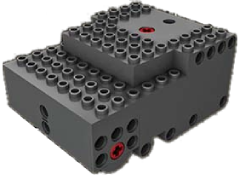
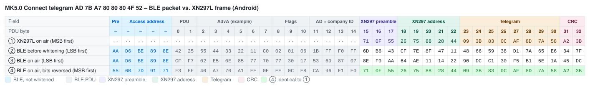
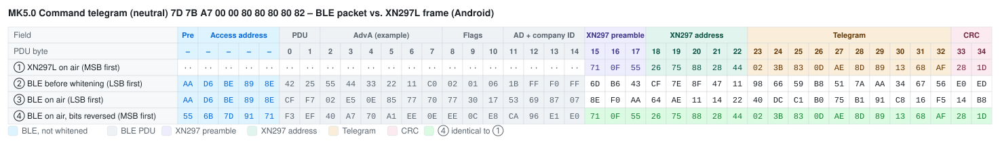

# Mould King MK5.0 – Bluetooth Protocol

> Source: [J0EK3R/brickcontroller2](https://github.com/J0EK3R/brickcontroller2) – `DeviceManagement/MouldKing/MK5.cs`, `MKBaseNibble.cs`, `MouldKing.cs`, `Protocols/MKProtocol.cs`, `Protocols/CryptTools.cs`, `UI/Controls/DeviceChannelLabel.cs`, `UI/Controls/Devices/MK5ChannelSelectorView.xaml` and `MouldKingMK5DatagramTests.cs`.
> Last updated: 2026-11-06



*Image: BrickController2 (`UI/Images/mk5_image.png`, MIT License).*

## Overview

| Property | Value |
|---|---|
| Device | Mould King MK5.0 module (tank receiver: tracks, turret, canon) |
| Transport | **BLE advertising** (broadcast), no GATT connection |
| Direction | app → receiver only (no back channel, no battery voltage) |
| Manufacturer ID | `0xFFF0` |
| Devices | 1 (no device slots) |
| Channels | 4 real channels (one **nibble** each) + 1 virtual channel (turret lock) |
| Raw telegrams | Connect (8 bytes), Command (10 bytes) |
| Encoding | XN297L-compatible frame + BLE whitening compensation, identical to [MK4.0](MK4.0.md#5-encoding-into-ble-advertising-data) (see [XN297L](../Chips/XN297L.md)) |

The MK5.0 uses the same radio layer as the other MK modules: the phone builds the advertising data so that, after BLE whitening, an XN297L frame (preamble `71 0F 55`, address `C1 … C5`, CRC16, scrambler) appears on air.

**The MK5.0 uses the same telegram identifiers as the MK4.0:** the Connect telegram is identical, and the Command telegram has the same start/end identifiers (`7D` … `82`) and layout. The MK5.0 only uses the two bytes of "Device 1" (offsets 3 and 4), with different channel functions and a different neutral nibble (see section 3 and the note in section 9).

### Differences to MK4.0 at a glance

| Topic | MK4.0 | MK5.0 |
|---|---|---|
| Connect telegram | `AD … 80 80 80 4F 52` | **identical** |
| Command identifiers | `7D` / `82` | **identical** |
| Channels | 4 per device, 3 devices | 4 + 1 virtual, 1 device (offsets 3, 4 only) |
| Neutral nibble | `0x8` | **`0x0`** (turret: `0x0` or `0x2`) |
| Bytes 5 … 8 | Device 2 and 3 (`0x88` neutral) | constant `0x80` |
| Special channels | – | turret rotation inverted, canon shot on/off, turret lock |

---

## 1. Sequence

```
App starts advertising
        │
        ▼
 Send Connect telegram        → receiver (freshly powered on) selects Bluetooth mode
        │
        ▼
 Send Command telegram(s)     → drive, turret, shot, turn values
        │
        ▼
 Stop: end advertising
```

- When advertising starts, the **Connect telegram** is sent first. It puts the receiver into **Bluetooth mode** (app control). There is **no pairing** (see section 4).
- Afterwards the **Command telegram** carries the channel values (section 3).
- The sender has to transmit continuously; BLE advertising repeats the current data at every advertising interval.

Mode selection (first telegram after power-on wins) and a failsafe timeout are documented for the [MK4.0](MK4.0.md#1-sequence). The same behaviour is **expected but not verified** for the MK5.0 (see section 9).

### 1.1 Implementation notes (BrickController2, not part of the protocol)

- The MK5.0 is registered as a single device `MK 5.0` (device address string `Device`, no real BLE address); comment in `MK5.cs`: *there is only one instance of MK5.0*.
- If all channels stay at 0 for longer than `ReconnectTimeSpan` = **3 s**, BC2 sends the Connect telegram again.
- The turret lock (channel 4) is reset to *unlocked* on every connect.
- Advertising parameters: minimum interval, maximum TX power. Data is updated immediately on every change and refreshed at least every 2 s.
- BC2 channel labels (`DeviceChannelLabel._mk5ChannelLetters`): `AB`, `T`, `C`, `AB+T`, `TL`. In the channel selector `C`/`AB` are on the left, `T`/`TL`/`AB+T` on the right side of the module image.

---

## 2. Connect telegram (8 bytes, raw)

| Offset | Value | Meaning |
|---|---|---|
| 0 | `0xAD` | telegram identifier (start) |
| 1 | `AppId[0]` | app identifier byte 0 |
| 2 | `AppId[1]` | app identifier byte 1 |
| 3 | `0x80` | constant (meaning unknown) |
| 4 | `0x80` | constant (meaning unknown) |
| 5 | `0x80` | constant (meaning unknown) |
| 6 | `0x4F` | constant (meaning unknown) |
| 7 | `0x52` | telegram identifier (end) |

Identical to the [MK4.0 Connect telegram](MK4.0.md#2-connect-telegram-8-bytes-raw). Start and end identifier are bitwise complements: `0xAD + 0x52 = 0xFF`.

---

## 3. Command telegram (10 bytes, raw)

| Offset | Content | Meaning |
|---|---|---|
| 0 | `0x7D` | telegram identifier (start) |
| 1 | `AppId[0]` | app identifier byte 0 |
| 2 | `AppId[1]` | app identifier byte 1 |
| 3 | `AB │ T` | channel 0 = drive (high nibble), channel 1 = turret rotation (low nibble) |
| 4 | `C │ AB+T` | channel 2 = canon shot (high nibble), channel 3 = turn on the spot (low nibble) |
| 5 … 8 | `0x80` | constant |
| 9 | `0x82` | telegram identifier (end) |

| Channel | Label | Function | Position | Type |
|---|---|---|---|---|
| 0 | `AB` | tracks A + B forward / backward | offset 3, high nibble | analog |
| 1 | `T` | turret rotation | offset 3, low nibble | analog, **inverted** |
| 2 | `C` | canon shot | offset 4, high nibble | on/off |
| 3 | `AB+T` | turn on the spot | offset 4, low nibble | analog |
| 4 | `TL` | turret lock | – (virtual) | on/off, changes the neutral value of channel 1 |

### 3.1 Analog channels (nibble)

| Nibble | Meaning |
|---|---|
| `0x0` | **stop / neutral** (default) |
| `0x1` … `0x7` | reverse, `0x1` = slowest, `0x7` = full |
| `0x8` | not used by BC2 |
| `0x9` … `0xF` | forward, `0x9` = slowest, `0xF` = full |

Conversion from the app value `v` ∈ [-1.0 … +1.0] (7 steps per direction, `MK5.ProcessChannelValue_AnalogChannel`):

```
v ≥ +1/7  →  nibble = min(0xF, (int)(v * 7) + 8)     // 0x9 … 0xF
v ≤ -1/7  →  nibble = min(0x7, (int)(-v * 7))        // 0x1 … 0x7
else      →  nibble = 0x0                            // stop
```

The ranges are the same as on the MK4.0, only the neutral value differs (`0x0` instead of `0x8`).

### 3.2 Turret rotation and turret lock (channel 1 and 4)

- The turret value is **inverted** before conversion: `+1` → nibble `0x7`, `−1` → nibble `0xF`.
- The neutral nibble of the turret depends on the virtual channel 4 (turret lock):

| Turret lock (channel 4) | Neutral turret nibble |
|---|---|
| 0 (unlocked) | `0x0` |
| ≠ 0 (locked) | `0x2` |

- When the turret is rotated (channel 1 ≠ 0), the lock has no effect; the nibble is the normal analog value.
- Changing channel 4 re-evaluates channel 1 so that the new neutral value is written immediately.

### 3.3 Canon shot (channel 2)

| Value | Nibble |
|---|---|
| 0 | `0x0` (idle) |
| ≠ 0 | `0xF` (fire) |

Any value ≠ 0 fires, the sign is ignored.

### 3.4 Examples (AppId = `7B A7`)

| Drive, turret, shot, turn, lock | Raw telegram |
|---|---|
| 0, 0, 0, 0, off | `7D 7B A7 00 00 80 80 80 80 82` |
| +1, 0, 0, 0, off | `7D 7B A7 F0 00 80 80 80 80 82` |
| −1, 0, 0, 0, off | `7D 7B A7 70 00 80 80 80 80 82` |
| 0, +1, 0, 0, off | `7D 7B A7 07 00 80 80 80 80 82` |
| 0, −1, 0, 0, off | `7D 7B A7 0F 00 80 80 80 80 82` |
| 0, 0, fire, 0, off | `7D 7B A7 00 F0 80 80 80 80 82` |
| 0, 0, 0, +1, off | `7D 7B A7 00 0F 80 80 80 80 82` |
| 0, 0, 0, 0, **on** | `7D 7B A7 02 00 80 80 80 80 82` |

---

## 4. App identifier

- Bytes 1 and 2 of both telegrams contain the same **2-byte app identifier** as for the other MK modules (random, generated on first launch, stored in the app settings).
- Whether the MK5.0 evaluates these bytes is **not known**. For the MK4.0 they are ignored.

---

## 5. Encoding into BLE advertising data

Identical to the MK4.0 – see [MK4.0 §5](MK4.0.md#5-encoding-into-ble-advertising-data) and [XN297L §6](../Chips/XN297L.md#6-emulation-with-other-radios).

| Item | Value |
|---|---|
| Preamble | `71 0F 55` |
| RF address (`TX_ADDR`) | `C1 C2 C3 C4 C5` (on air `C5 … C1`) |
| CRC | CRC-16/CCITT, init `0xFFFF`, over address + telegram (bit-reversed), little endian in the buffer |
| Scrambling 1 | `CTX = 0x3F` (XN297L scrambler) over address + telegram + CRC |
| Scrambling 2 | `CTX = 0x25` (BLE whitening, channel 37) over the whole buffer |
| `headerOffset` / length | Android 15 / 24 bytes (padding `index + 1`), iOS 13 / 26 bytes (padding `0x12, 0x13, …`), Windows 15 / 27 bytes |

Result length before padding: Connect 18 bytes, Command 20 bytes.

### 5.1 Byte-by-byte comparison: BLE packet vs. XN297L frame (Android)

AppId = `7B A7`, `headerOffset` = 15. Same layout as [MK4.0 §5.5](MK4.0.md#55-byte-by-byte-comparison-ble-packet-vs-xn297l-frame-android). The Connect telegram is identical to the MK4.0 one, so its table is the same as in the MK4.0 document.

**How to read the tables:** each column is one byte in transmission order, each row is one view of the same packet. The coloured image shows the table with field colours (legend below each image; light and dark mode); the Markdown table under it contains the same bytes as text, with bold marking the bytes that match.

| Row | Meaning |
|---|---|
| ① | What an XN297L (the original handset chip) would transmit for this telegram with `TX_ADDR = C1 … C5`: preamble, address, telegram, CRC – scrambled, MSB first. `··` = the XN297L sends nothing there. |
| ② | The BLE advertising packet as the phone's BLE stack assembles it, before whitening (LSB first). From PDU byte 15 on this is the manufacturer data from `GetRfPayload()` – it looks completely different from ①, because it is scrambled twice (XN297 scrambler + pre-compensated BLE whitening). |
| ③ | The same packet after BLE whitening (channel 37) – the bytes the radio actually sends, LSB first. Preamble and access address are not whitened. The XN297 preamble shows up as `8E F0 AA` = `71 0F 55` with reversed bit order. |
| ④ | Row ③ with every byte bit-reversed, i.e. read MSB first like an XN297L receiver does. **Bold** bytes are identical to row ①. |
| ④ = ① | ✓ = byte matches the XN297L frame. |

Field abbreviations: `Pre` BLE preamble, `AA` access address, `Hdr` PDU header, `AdvA` advertiser address, `Flg` Flags AD, `AD` AD length/type, `CID` company ID `0xFFF0`; **Pre** XN297 preamble, **Adr** XN297 address, **T0 …** raw telegram bytes, **CRC** XN297 CRC.

The BLE part (PDU bytes 0 … 14) does not match – there is nothing to match: for the XN297L receiver it is just noise in front of its preamble `71 0F 55`. Only the *length* of this part (`headerOffset` = 15) matters for the encoding, not its content; the header values are examples (see [XN297L §6.1](../Chips/XN297L.md#61-example-ble-advertising-packet-vs-xn297l-frame)). Padding and the 3-byte BLE CRC after the XN297 CRC are omitted; the receiver stops reading after its CRC.

#### Connect telegram `AD 7B A7 80 80 80 4F 52`



| PDU byte | – | – | – | – | – | 0 | 1 | 2 | 3 | 4 | 5 | 6 | 7 | 8 | 9 | 10 | 11 | 12 | 13 | 14 | 15 | 16 | 17 | 18 | 19 | 20 | 21 | 22 | 23 | 24 | 25 | 26 | 27 | 28 | 29 | 30 | 31 | 32 |
|---|:-:|:-:|:-:|:-:|:-:|:-:|:-:|:-:|:-:|:-:|:-:|:-:|:-:|:-:|:-:|:-:|:-:|:-:|:-:|:-:|:-:|:-:|:-:|:-:|:-:|:-:|:-:|:-:|:-:|:-:|:-:|:-:|:-:|:-:|:-:|:-:|:-:|:-:|
| Field | Pre | AA | AA | AA | AA | Hdr | Hdr | AdvA | AdvA | AdvA | AdvA | AdvA | AdvA | Flg | Flg | Flg | AD | AD | CID | CID | **Pre** | **Pre** | **Pre** | **Adr** | **Adr** | **Adr** | **Adr** | **Adr** | **T0** | **T1** | **T2** | **T3** | **T4** | **T5** | **T6** | **T7** | **CRC** | **CRC** |
| ① XN297L on air (MSB first) | ·· | ·· | ·· | ·· | ·· | ·· | ·· | ·· | ·· | ·· | ·· | ·· | ·· | ·· | ·· | ·· | ·· | ·· | ·· | ·· | `71` | `0F` | `55` | `26` | `75` | `88` | `28` | `44` | `09` | `3B` | `83` | `0C` | `AF` | `8D` | `7A` | `58` | `A2` | `3B` |
| ② BLE before whitening (LSB first) | `AA` | `D6` | `BE` | `89` | `8E` | `42` | `25` | `55` | `44` | `33` | `22` | `11` | `C0` | `02` | `01` | `06` | `1B` | `FF` | `F0` | `FF` | `6D` | `B6` | `43` | `CF` | `7E` | `8F` | `47` | `11` | `48` | `66` | `59` | `38` | `D1` | `7A` | `65` | `E6` | `34` | `7F` |
| ③ BLE on air (LSB first) | `AA` | `D6` | `BE` | `89` | `8E` | `CF` | `F7` | `02` | `E5` | `0E` | `85` | `77` | `70` | `77` | `30` | `17` | `53` | `69` | `87` | `07` | `8E` | `F0` | `AA` | `64` | `AE` | `11` | `14` | `22` | `90` | `DC` | `C1` | `30` | `F5` | `B1` | `5E` | `1A` | `45` | `DC` |
| ④ BLE on air, bits reversed (MSB first) | `55` | `6B` | `7D` | `91` | `71` | `F3` | `EF` | `40` | `A7` | `70` | `A1` | `EE` | `0E` | `EE` | `0C` | `E8` | `CA` | `96` | `E1` | `E0` | **`71`** | **`0F`** | **`55`** | **`26`** | **`75`** | **`88`** | **`28`** | **`44`** | **`09`** | **`3B`** | **`83`** | **`0C`** | **`AF`** | **`8D`** | **`7A`** | **`58`** | **`A2`** | **`3B`** |
| ④ = ① |  |  |  |  |  |  |  |  |  |  |  |  |  |  |  |  |  |  |  |  | ✓ | ✓ | ✓ | ✓ | ✓ | ✓ | ✓ | ✓ | ✓ | ✓ | ✓ | ✓ | ✓ | ✓ | ✓ | ✓ | ✓ | ✓ |

#### Command telegram, neutral `7D 7B A7 00 00 80 80 80 80 82`



| PDU byte | – | – | – | – | – | 0 | 1 | 2 | 3 | 4 | 5 | 6 | 7 | 8 | 9 | 10 | 11 | 12 | 13 | 14 | 15 | 16 | 17 | 18 | 19 | 20 | 21 | 22 | 23 | 24 | 25 | 26 | 27 | 28 | 29 | 30 | 31 | 32 | 33 | 34 |
|---|:-:|:-:|:-:|:-:|:-:|:-:|:-:|:-:|:-:|:-:|:-:|:-:|:-:|:-:|:-:|:-:|:-:|:-:|:-:|:-:|:-:|:-:|:-:|:-:|:-:|:-:|:-:|:-:|:-:|:-:|:-:|:-:|:-:|:-:|:-:|:-:|:-:|:-:|:-:|:-:|
| Field | Pre | AA | AA | AA | AA | Hdr | Hdr | AdvA | AdvA | AdvA | AdvA | AdvA | AdvA | Flg | Flg | Flg | AD | AD | CID | CID | **Pre** | **Pre** | **Pre** | **Adr** | **Adr** | **Adr** | **Adr** | **Adr** | **T0** | **T1** | **T2** | **T3** | **T4** | **T5** | **T6** | **T7** | **T8** | **T9** | **CRC** | **CRC** |
| ① XN297L on air (MSB first) | ·· | ·· | ·· | ·· | ·· | ·· | ·· | ·· | ·· | ·· | ·· | ·· | ·· | ·· | ·· | ·· | ·· | ·· | ·· | ·· | `71` | `0F` | `55` | `26` | `75` | `88` | `28` | `44` | `02` | `3B` | `83` | `0D` | `AE` | `8D` | `89` | `13` | `68` | `AF` | `28` | `1D` |
| ② BLE before whitening (LSB first) | `AA` | `D6` | `BE` | `89` | `8E` | `42` | `25` | `55` | `44` | `33` | `22` | `11` | `C0` | `02` | `01` | `06` | `1B` | `FF` | `F0` | `FF` | `6D` | `B6` | `43` | `CF` | `7E` | `8F` | `47` | `11` | `98` | `66` | `59` | `B8` | `51` | `7A` | `AA` | `34` | `67` | `56` | `E0` | `ED` |
| ③ BLE on air (LSB first) | `AA` | `D6` | `BE` | `89` | `8E` | `CF` | `F7` | `02` | `E5` | `0E` | `85` | `77` | `70` | `77` | `30` | `17` | `53` | `69` | `87` | `07` | `8E` | `F0` | `AA` | `64` | `AE` | `11` | `14` | `22` | `40` | `DC` | `C1` | `B0` | `75` | `B1` | `91` | `C8` | `16` | `F5` | `14` | `B8` |
| ④ BLE on air, bits reversed (MSB first) | `55` | `6B` | `7D` | `91` | `71` | `F3` | `EF` | `40` | `A7` | `70` | `A1` | `EE` | `0E` | `EE` | `0C` | `E8` | `CA` | `96` | `E1` | `E0` | **`71`** | **`0F`** | **`55`** | **`26`** | **`75`** | **`88`** | **`28`** | **`44`** | **`02`** | **`3B`** | **`83`** | **`0D`** | **`AE`** | **`8D`** | **`89`** | **`13`** | **`68`** | **`AF`** | **`28`** | **`1D`** |
| ④ = ① |  |  |  |  |  |  |  |  |  |  |  |  |  |  |  |  |  |  |  |  | ✓ | ✓ | ✓ | ✓ | ✓ | ✓ | ✓ | ✓ | ✓ | ✓ | ✓ | ✓ | ✓ | ✓ | ✓ | ✓ | ✓ | ✓ | ✓ | ✓ |

---

## 6. Reference implementation (Python)

Encoder part identical to the MK4.0/MK6.0 reference (verified against the MK4.0 test vectors from `CryptToolsTests.cs`). The telegram builder is verified against all cases of `MouldKingMK5DatagramTests.cs`.

```python
# Mould King MK5.0 - reference encoder for BLE advertising payloads.
# Re-implementation of BrickController2 CryptTools.GetRfPayload()
# plus the MK5.0 telegram builder.

# --- Protocol constants (MKProtocol.cs) --------------------------------------
MANUFACTURER_ID = 0xFFF0                    # company ID used for advertising
SEED   = [0xC1, 0xC2, 0xC3, 0xC4, 0xC5]     # 5-byte RF address
HEADER = [0x71, 0x0F, 0x55]                 # XN297L preamble
CTX1   = 0x3F                               # scrambler seed (address+data+CRC)
CTX2   = 0x25                               # BLE whitening seed (channel 37)


def rev8(b: int) -> int:
    """Reverse the bit order of one byte (0b00000001 -> 0b10000000)."""
    return int(f"{b:08b}"[::-1], 2)


def rev16(w: int) -> int:
    """Reverse the bit order of a 16-bit word."""
    return int(f"{w:016b}"[::-1], 2)


def crc16(seed: list[int], data: list[int]) -> int:
    """CRC16-CCITT as used by the MK protocol.

    - seed is processed in reverse order, bytes as-is
    - data is processed in forward order, each byte bit-reversed
    - result is bit-reversed and inverted
    """
    crc = 0xFFFF
    for b in list(reversed(seed)) + [rev8(x) for x in data]:
        crc ^= b << 8
        for _ in range(8):
            # shift left, apply polynomial 0x1021 when the MSB falls out
            crc = ((crc << 1) ^ 0x1021) if crc & 0x8000 else (crc << 1)
            crc &= 0xFFFF
    return rev16(crc) ^ 0xFFFF


def whitening_init(value: int) -> list[int]:
    """7-bit LFSR state: fixed 1 followed by bits 5..0 of value."""
    return [1] + [(value >> s) & 1 for s in (5, 4, 3, 2, 1, 0)]


def whitening_next(ctx: list[int]) -> int:
    """Advance the LFSR by one step and return the output bit."""
    v3, v6 = ctx[3], ctx[6]
    ctx[3], ctx[2], ctx[1], ctx[0] = ctx[2], ctx[1], ctx[0], ctx[6]
    ctx[6], ctx[5] = ctx[5], ctx[4]
    ctx[4] = v3 ^ v6
    return ctx[0]


def whitening(buf: list[int], start: int, length: int, value: int) -> None:
    """XOR buf[start:start+length] in place with the LFSR bit stream (LSB first)."""
    ctx = whitening_init(value)
    for i in range(start, start + length):
        out = 0
        for bit in range(8):
            out |= (whitening_next(ctx) ^ ((buf[i] >> bit) & 1)) << bit
        buf[i] = out


def get_rf_payload(data: list[int], platform: str = "android") -> list[int]:
    """Convert a raw MK telegram into advertising data.

    platform "android": header_offset 15, 24 bytes, padding index + 1
    platform "ios":     header_offset 13, 26 bytes, padding 0x12, 0x13, ...
    """
    header_offset, total_len = (13, 26) if platform == "ios" else (15, 24)

    # leading dummy bytes keep the whitening stream aligned with the real BLE PDU
    buf = [0] * header_offset
    # preamble + address (reversed order), every byte bit-reversed
    buf += [rev8(b) for b in HEADER + SEED[::-1]]
    # raw telegram unchanged
    buf += list(data)
    # CRC16, little endian
    crc = crc16(SEED, data)
    buf += [crc & 0xFF, crc >> 8]

    # scrambling 1: address + data + CRC (skips the 3 preamble bytes)
    whitening(buf, header_offset + len(HEADER), len(SEED) + len(data) + 2, CTX1)
    # scrambling 2: pre-compensates the BLE whitening over the whole PDU
    whitening(buf, 0, len(buf), CTX2)

    out = buf[header_offset:]
    # fill up to the platform specific length
    if platform == "ios":
        return out + [0x12 + i for i in range(total_len - len(out))]
    return out + [i + 1 for i in range(len(out), total_len)]

# --- MK5.0 telegram builder --------------------------------------------------
TURRET_UNLOCKED = 0x0       # neutral turret nibble, turret free
TURRET_LOCKED = 0x2         # neutral turret nibble, turret locked


def nibble(value: float, zero: int = 0x0) -> int:
    """Map -1.0..+1.0 to the MK5.0 nibble.

    0x1..0x7 reverse (0x7 = full), `zero` = stop (0x0), 0x9..0xF forward (0xF = full).
    Mirrors MK5.ProcessChannelValue_AnalogChannel().
    """
    value = max(-1.0, min(1.0, value))          # CutOutputValue()
    if value <= -1 / 7:
        return int(min(0x7, -value * 7))
    if value >= 1 / 7:
        return int(min(0xF, value * 7 + 8))
    return zero


def connect_telegram(app_id: tuple[int, int]) -> list[int]:
    """Connect telegram: identical to the MK4.0 Connect telegram."""
    return [0xAD, app_id[0], app_id[1], 0x80, 0x80, 0x80, 0x4F, 0x52]


def command_telegram(app_id: tuple[int, int], drive: float, turret: float,
                     shot: float, turn: float, turret_lock: bool = False) -> list[int]:
    """Command telegram (10 bytes).

    drive:       tracks A + B forward / backward   (channel 0, "AB")
    turret:      turret rotation                   (channel 1, "T", inverted)
    shot:        canon shot, any value != 0 fires  (channel 2, "C")
    turn:        turn on the spot                  (channel 3, "AB+T")
    turret_lock: virtual channel 4 ("TL"), changes the neutral turret nibble
    """
    turret_zero = TURRET_LOCKED if turret_lock else TURRET_UNLOCKED
    shot_nibble = 0xF if shot != 0 else 0x0
    return [0x7D, app_id[0], app_id[1],
            (nibble(drive) << 4) | nibble(-turret, turret_zero),   # offset 3: drive | turret
            (shot_nibble << 4) | nibble(turn),                      # offset 4: shot  | turn
            0x80, 0x80, 0x80, 0x80,                                 # offsets 5..8: constant
            0x82]


if __name__ == "__main__":
    hexs = lambda a: " ".join(f"{x:02X}" for x in a)
    app = (0x7B, 0xA7)
    print(hexs(get_rf_payload(connect_telegram(app))))
    # -> 6D B6 43 CF 7E 8F 47 11 48 66 59 38 D1 7A 65 E6 34 7F 13 14 15 16 17 18
    print(hexs(get_rf_payload(command_telegram(app, 0, 0, 0, 0))))
    # -> 6D B6 43 CF 7E 8F 47 11 98 66 59 B8 51 7A AA 34 67 56 E0 ED 15 16 17 18
```

---

## 7. Test vectors

AppId = `7B A7`. Generated with the reference implementation above; the Connect vectors are identical to the MK4.0 vectors from `CryptToolsTests.cs`.

| Raw telegram | CRC16 | Platform | Encoded data (`0xFFF0`) |
|---|---|---|---|
| `AD 7B A7 80 80 80 4F 52` (Connect) | `0xABD3` | Android | `6D B6 43 CF 7E 8F 47 11 48 66 59 38 D1 7A 65 E6 34 7F` + padding `13 14 15 16 17 18` |
| | | iOS | `F9 08 49 22 47 BA C4 BC C3 EF 19 8A 6D B9 7A D1 7E 20` + padding `12 13 14 15 16 17 18 19` |
| `7D 7B A7 00 00 80 80 80 80 82` (Command, neutral) | `0x5BEC` | Android | `6D B6 43 CF 7E 8F 47 11 98 66 59 B8 51 7A AA 34 67 56 E0 ED` + padding `15 16 17 18` |
| | | iOS | `F9 08 49 22 47 BA C4 BC 13 EF 19 0A ED B9 B5 03 2D 09 65 1B` + padding `12 13 14 15 16 17` |

The first 8 encoded bytes (preamble + address) are identical for all MK telegrams of one platform.

---

## 8. Hardware

No board analysis yet. The BC2 image shows a brick-built battery/receiver box with studs on top and pin holes for the outputs, as used in Mould King tank models.


---

## 9. Open questions

- **Interference with MK4.0:** because Connect and Command identifiers are identical, an MK4.0 receiver on slot Device 1 will probably react to MK5.0 telegrams (and an MK5.0 to MK4.0 telegrams). The MK5.0 neutral nibble `0x0` is not used by BC2 for the MK4.0 – its meaning for an MK4.0 receiver is unknown. Not verified on hardware.
- Meaning of the constant bytes `80 80 80 80` (offsets 5 … 8) and whether the receiver evaluates them.
- Why the turret lock is encoded as nibble `0x2` – this value is "reverse, step 2" on the analog scale.
- Whether the canon shot is triggered on the edge (`0x0` → `0xF`) or as long as `0xF` is sent.
- Whether mode selection and the failsafe timeout behave as on the MK4.0.
- Whether the receiver evaluates the app identifier bytes.
- Whether the original 2.4 GHz handset uses the same RF address `C1 … C5` and telegram format (no capture yet).
- Hardware details (section 8).
