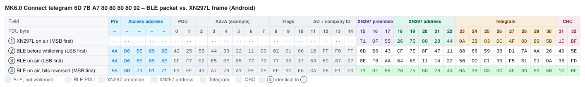
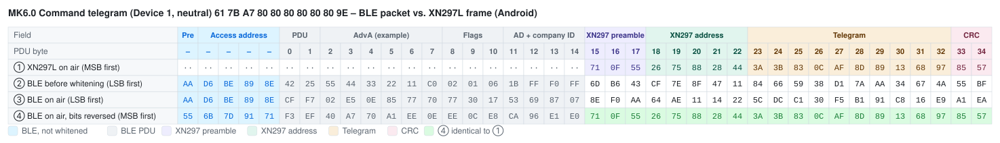

# Mould King MK6.0 – Bluetooth Protocol

> Source: [J0EK3R/brickcontroller2](https://github.com/J0EK3R/brickcontroller2) – `DeviceManagement/MouldKing/MK6.cs`, `MKBaseByte.cs`, `MouldKing.cs`, `Protocols/MKProtocol.cs`, `Protocols/CryptTools.cs`, `DeviceManagement/BluetoothAdvertisingDeviceHandler.cs`, the platform `MKPlatformService.cs` files and `MouldKingMK6DatagramTests.cs`.
> Last updated: 2026-11-01

## Overview

| Property | Value |
|---|---|
| Device | Mould King MK6.0 module (6-port receiver) |
| Transport | **BLE advertising** (broadcast), no GATT connection |
| Direction | app → receiver only (no back channel, no battery voltage) |
| Manufacturer ID | `0xFFF0` |
| Devices | 3 slots (Device 1, 2, 3), **one telegram per device** |
| Channels per device | 6 (port A … F), one **byte** each, bidirectional analog |
| Raw telegrams | Connect (8 bytes), Command (10 bytes) |
| Encoding | XN297L-compatible frame + BLE whitening compensation, identical to [MK4.0](MK4.0.md#5-encoding-into-ble-advertising-data) (see [XN297L](../Chips/XN297L.md)) |

The MK6.0 uses the same radio layer as the MK4.0: the phone builds the advertising data so that, after BLE whitening, an XN297L frame (preamble `71 0F 55`, address `C1 … C5`, CRC16, scrambler) appears on air. Only the raw telegrams differ.

### Differences to MK4.0 at a glance

| Topic | MK4.0 | MK6.0 |
|---|---|---|
| Channels per device | 4 | **6** |
| Channel resolution | 4-bit nibble, 7 steps per direction | **8-bit byte**, 128 steps per direction |
| Neutral value | `0x8` | `0x80` |
| Telegram per device | one **shared** telegram for all 3 devices | **separate** telegram per device |
| Device in telegram | byte position | **telegram identifier** (`0x61` / `0x62` / `0x63`) |
| Connect telegram | `AD … 80 80 80 4F 52` | `6D … 80 80 80 80 92` |
| Advertisers in BC2 | one shared | **one per device** |

---

## 1. Sequence

```
App starts advertising
        │
        ▼
 Send Connect telegram        → receiver (freshly powered on) selects Bluetooth mode
        │
        ▼
 Send Command telegram(s)     → channel values for ONE device (1, 2 or 3)
        │
        ▼
 Stop: end advertising
```

- When advertising starts, the **Connect telegram** is sent first. It puts the receiver into **Bluetooth mode** (app control) instead of remote-control mode. There is **no pairing** (see section 4).
- Afterwards the **Command telegram** of the respective device carries its six channel values (section 3).
- The sender has to transmit continuously; BLE advertising repeats the current data at every advertising interval.

The mode selection behaviour (first telegram after power-on wins, change only by power cycle) and the failsafe timeout (≈ 2 s) are documented for the MK4.0. Since the MK6.0 shares the radio layer and the Connect/Command concept, the same behaviour is **expected but not verified** (see section 9).

### 1.1 Implementation notes (BrickController2, not part of the protocol)

The following behaviour is a design decision in BrickController2 and is **not required by the receiver**:

- Each MK6.0 device (Device 1, 2, 3) gets its **own** `BluetoothAdvertisingDeviceHandler` and therefore its own advertising set (comment in `MK6.cs`: *needs a BluetoothAdvertiser per module*). Controlling three MK6.0 devices means three advertisers running in parallel.
- If all channels of a device stay at 0 for longer than `ReconnectTimeSpan` = **3 s**, BC2 sends the Connect telegram again (lets a receiver that was power-cycled re-enter Bluetooth mode).
- Advertising parameters: minimum interval, maximum TX power.
- Data is updated immediately on every change (loop with at least 100 ms delay) and refreshed at least every 2 s without changes.
- In the app the devices appear as `MK 6.0 Device 1` … `MK 6.0 Device 3`; device addresses are the strings `Device1`, `Device2`, `Device3` (no real BLE address).

### 1.2 Device selection on the receiver

The device slot (Device 1, 2 or 3) of an MK6.0 receiver is selected with the **push button** on the receiver, the same way as on the [MK4.0](MK4.0.md#12-device-selection-on-the-receiver). The receiver then evaluates only the Command telegram with the matching identifier (`0x61`, `0x62` or `0x63`).

- After power-on the receiver always starts as **Device 1** (the selection is not stored).
- Each button press switches to the next device: 1 → 2 → 3 → 1 → …
- The LED shows the selected device by its blink pattern:

| Device | Telegram identifier | LED pattern |
|---|---|---|
| 1 | `0x61` | blinks once per cycle |
| 2 | `0x62` | blinks twice per cycle |
| 3 | `0x63` | blinks three times per cycle |

---

## 2. Connect telegram (8 bytes, raw)

| Offset | Value | Meaning |
|---|---|---|
| 0 | `0x6D` | telegram identifier (start) |
| 1 | `AppId[0]` | app identifier byte 0 |
| 2 | `AppId[1]` | app identifier byte 1 |
| 3 | `0x80` | constant (meaning unknown) |
| 4 | `0x80` | constant (meaning unknown) |
| 5 | `0x80` | constant (meaning unknown) |
| 6 | `0x80` | constant (meaning unknown) |
| 7 | `0x92` | telegram identifier (end) |

The Connect telegram is the same for all three device slots. Start and end identifier are bitwise complements: `0x6D + 0x92 = 0xFF`.

Compared to the MK4.0 (`AD … 80 80 80 4F 52`) the bytes 3 … 6 are all `0x80` – which looks like the neutral value of four channels. Whether this is a coincidence is unknown.

---

## 3. Command telegram (10 bytes, raw)

| Offset | Content | Meaning |
|---|---|---|
| 0 | `0x61` / `0x62` / `0x63` | telegram identifier (start) = Device 1 / 2 / 3 |
| 1 | `AppId[0]` | app identifier byte 0 |
| 2 | `AppId[1]` | app identifier byte 1 |
| 3 | `CH0` | channel 0 / port A |
| 4 | `CH1` | channel 1 / port B |
| 5 | `CH2` | channel 2 / port C |
| 6 | `CH3` | channel 3 / port D |
| 7 | `CH4` | channel 4 / port E |
| 8 | `CH5` | channel 5 / port F |
| 9 | `0x9E` / `0x9D` / `0x9C` | telegram identifier (end) = `0xFF − start` |

In general, for device `d` (1 … 3) and channel `c` (0 … 5):

```
start      = 0x60 + d          // 0x61, 0x62, 0x63
end        = 0xFF - start      // 0x9E, 0x9D, 0x9C
byteOffset = 3 + c
```

Unlike the MK4.0 there is **no shared telegram**: each device sends only its own values, so controlling Device 2 does not touch Device 1 or 3 (verified by the unit test `TryGetTelegram_CommandDatagram_InstanceInteraction`).

Port letters A … F are the default MK channel letters in BC2 (`DeviceChannelLabel._mkDefaultChannelLetters`). In the BC2 channel selector the ports are arranged as 1/3/5 on the left side and 0/2/4 on the right side of the module image (bottom to top).

### 3.1 Channel value (byte)

| Byte | Meaning |
|---|---|
| `0x00` | full reverse |
| `0x01` … `0x7F` | reverse, decreasing speed |
| `0x80` | **stop / neutral** (default) |
| `0x81` … `0xFE` | forward, increasing speed |
| `0xFF` | full forward |

Conversion from the app value `v` ∈ [-1.0 … +1.0] (`MKBaseByte.SetOutput_AnalogChannel`, float → byte by truncation):

```
v > 0   →  byte = min(0xFF, 0x80 + v * 0x80)     // 0x80 … 0xFF
v < 0   →  byte = max(0x00, 0x80 - (-v) * 0x80)  // 0x00 … 0x80
v = 0   →  byte = 0x80                           // stop
```

Values outside [-1.0 … +1.0] are clamped before conversion. Because of the truncation the mapping is slightly asymmetric for small values (e.g. `+0.01` → `0x81`, `-0.01` → `0x7E`). The forward range ends at `0xFF` (= 127 steps), the reverse range at `0x00` (= 128 steps).

| `v` | +1.0 | +0.5 | +0.25 | 0 | −0.5 | −1.0 |
|---|---|---|---|---|---|---|
| byte | `FF` | `C0` | `A0` | `80` | `40` | `00` |

Neutral Command telegram for Device 1: `61 <AppId0> <AppId1> 80 80 80 80 80 80 9E`.

### 3.2 Examples (AppId = `7B A7`)

| Device | Channels (A … F) | Raw telegram |
|---|---|---|
| 1 | 0, 0, 0, 0, 0, 0 | `61 7B A7 80 80 80 80 80 80 9E` |
| 1 | +1, 0, 0, 0, 0, 0 | `61 7B A7 FF 80 80 80 80 80 9E` |
| 1 | 0, 0, 0, 0, 0, −1 | `61 7B A7 80 80 80 80 80 00 9E` |
| 1 | +0.5, −0.5, 0, 0, 0, 0 | `61 7B A7 C0 40 80 80 80 80 9E` |
| 2 | +1, +1, +1, +1, +1, +1 | `62 7B A7 FF FF FF FF FF FF 9D` |
| 3 | −1, −1, −1, −1, −1, −1 | `63 7B A7 00 00 00 00 00 00 9C` |

---

## 4. App identifier

- Bytes 1 and 2 of both telegrams contain the same **2-byte app identifier** as for the MK4.0 (random, generated on first launch, stored in the app settings; placeholder `APPID = 0x00` in the source code is replaced when the device is created).
- Whether the MK6.0 evaluates these bytes is **not known**. For the MK4.0 they are ignored. If the MK6.0 behaves the same, two phones controlling the same device slot nearby will interfere with each other.

---

## 5. Encoding into BLE advertising data

Identical to the MK4.0 – see [MK4.0 §5](MK4.0.md#5-encoding-into-ble-advertising-data) and [XN297L §6](../Chips/XN297L.md#6-emulation-with-other-radios). Summary:

| Item | Value |
|---|---|
| Preamble | `71 0F 55` |
| RF address (`TX_ADDR`) | `C1 C2 C3 C4 C5` (on air `C5 … C1`) |
| CRC | CRC-16/CCITT, init `0xFFFF`, over address + telegram (bit-reversed), little endian in the buffer |
| Scrambling 1 | `CTX = 0x3F` (XN297L scrambler) over address + telegram + CRC |
| Scrambling 2 | `CTX = 0x25` (BLE whitening, channel 37) over the whole buffer |
| `headerOffset` / length | Android 15 / 24 bytes (padding `index + 1`), iOS 13 / 26 bytes (padding `0x12, 0x13, …`), Windows 15 / 27 bytes |

Result length before padding: Connect 18 bytes, Command 20 bytes – the same as for the MK4.0, so all MK6.0 telegrams fit into one advertisement.

### 5.1 Byte-by-byte comparison: BLE packet vs. XN297L frame (Android)

AppId = `7B A7`, `headerOffset` = 15. Same layout as [MK4.0 §5.5](MK4.0.md#55-byte-by-byte-comparison-ble-packet-vs-xn297l-frame-android).

**How to read the tables:** each column is one byte in transmission order, each row is one view of the same packet. The coloured image shows the table with field colours (legend below each image; light and dark mode); the Markdown table under it contains the same bytes as text, with bold marking the bytes that match.

| Row | Meaning |
|---|---|
| ① | What an XN297L (the original handset chip) would transmit for this telegram with `TX_ADDR = C1 … C5`: preamble, address, telegram, CRC – scrambled, MSB first. `··` = the XN297L sends nothing there. |
| ② | The BLE advertising packet as the phone's BLE stack assembles it, before whitening (LSB first). From PDU byte 15 on this is the manufacturer data from `GetRfPayload()` – it looks completely different from ①, because it is scrambled twice (XN297 scrambler + pre-compensated BLE whitening). |
| ③ | The same packet after BLE whitening (channel 37) – the bytes the radio actually sends, LSB first. Preamble and access address are not whitened. The XN297 preamble shows up as `8E F0 AA` = `71 0F 55` with reversed bit order. |
| ④ | Row ③ with every byte bit-reversed, i.e. read MSB first like an XN297L receiver does. **Bold** bytes are identical to row ①. |
| ④ = ① | ✓ = byte matches the XN297L frame. |

Field abbreviations: `Pre` BLE preamble, `AA` access address, `Hdr` PDU header, `AdvA` advertiser address, `Flg` Flags AD, `AD` AD length/type, `CID` company ID `0xFFF0`; **Pre** XN297 preamble, **Adr** XN297 address, **T0 …** raw telegram bytes, **CRC** XN297 CRC.

The BLE part (PDU bytes 0 … 14) does not match – there is nothing to match: for the XN297L receiver it is just noise in front of its preamble `71 0F 55`. Only the *length* of this part (`headerOffset` = 15) matters for the encoding, not its content; the header values are examples (see [XN297L §6.1](../Chips/XN297L.md#61-example-ble-advertising-packet-vs-xn297l-frame)). Padding and the 3-byte BLE CRC after the XN297 CRC are omitted; the receiver stops reading after its CRC.

#### Connect telegram `6D 7B A7 80 80 80 80 92`



| PDU byte | – | – | – | – | – | 0 | 1 | 2 | 3 | 4 | 5 | 6 | 7 | 8 | 9 | 10 | 11 | 12 | 13 | 14 | 15 | 16 | 17 | 18 | 19 | 20 | 21 | 22 | 23 | 24 | 25 | 26 | 27 | 28 | 29 | 30 | 31 | 32 |
|---|:-:|:-:|:-:|:-:|:-:|:-:|:-:|:-:|:-:|:-:|:-:|:-:|:-:|:-:|:-:|:-:|:-:|:-:|:-:|:-:|:-:|:-:|:-:|:-:|:-:|:-:|:-:|:-:|:-:|:-:|:-:|:-:|:-:|:-:|:-:|:-:|:-:|:-:|
| Field | Pre | AA | AA | AA | AA | Hdr | Hdr | AdvA | AdvA | AdvA | AdvA | AdvA | AdvA | Flg | Flg | Flg | AD | AD | CID | CID | **Pre** | **Pre** | **Pre** | **Adr** | **Adr** | **Adr** | **Adr** | **Adr** | **T0** | **T1** | **T2** | **T3** | **T4** | **T5** | **T6** | **T7** | **CRC** | **CRC** |
| ① XN297L on air (MSB first) | ·· | ·· | ·· | ·· | ·· | ·· | ·· | ·· | ·· | ·· | ·· | ·· | ·· | ·· | ·· | ·· | ·· | ·· | ·· | ·· | `71` | `0F` | `55` | `26` | `75` | `88` | `28` | `44` | `0A` | `3B` | `83` | `0C` | `AF` | `8D` | `89` | `5B` | `1C` | `BF` |
| ② BLE before whitening (LSB first) | `AA` | `D6` | `BE` | `89` | `8E` | `42` | `25` | `55` | `44` | `33` | `22` | `11` | `C0` | `02` | `01` | `06` | `1B` | `FF` | `F0` | `FF` | `6D` | `B6` | `43` | `CF` | `7E` | `8F` | `47` | `11` | `88` | `66` | `59` | `38` | `D1` | `7A` | `AA` | `26` | `49` | `5E` |
| ③ BLE on air (LSB first) | `AA` | `D6` | `BE` | `89` | `8E` | `CF` | `F7` | `02` | `E5` | `0E` | `85` | `77` | `70` | `77` | `30` | `17` | `53` | `69` | `87` | `07` | `8E` | `F0` | `AA` | `64` | `AE` | `11` | `14` | `22` | `50` | `DC` | `C1` | `30` | `F5` | `B1` | `91` | `DA` | `38` | `FD` |
| ④ BLE on air, bits reversed (MSB first) | `55` | `6B` | `7D` | `91` | `71` | `F3` | `EF` | `40` | `A7` | `70` | `A1` | `EE` | `0E` | `EE` | `0C` | `E8` | `CA` | `96` | `E1` | `E0` | **`71`** | **`0F`** | **`55`** | **`26`** | **`75`** | **`88`** | **`28`** | **`44`** | **`0A`** | **`3B`** | **`83`** | **`0C`** | **`AF`** | **`8D`** | **`89`** | **`5B`** | **`1C`** | **`BF`** |
| ④ = ① |  |  |  |  |  |  |  |  |  |  |  |  |  |  |  |  |  |  |  |  | ✓ | ✓ | ✓ | ✓ | ✓ | ✓ | ✓ | ✓ | ✓ | ✓ | ✓ | ✓ | ✓ | ✓ | ✓ | ✓ | ✓ | ✓ |

#### Command telegram, Device 1 neutral `61 7B A7 80 80 80 80 80 80 9E`



| PDU byte | – | – | – | – | – | 0 | 1 | 2 | 3 | 4 | 5 | 6 | 7 | 8 | 9 | 10 | 11 | 12 | 13 | 14 | 15 | 16 | 17 | 18 | 19 | 20 | 21 | 22 | 23 | 24 | 25 | 26 | 27 | 28 | 29 | 30 | 31 | 32 | 33 | 34 |
|---|:-:|:-:|:-:|:-:|:-:|:-:|:-:|:-:|:-:|:-:|:-:|:-:|:-:|:-:|:-:|:-:|:-:|:-:|:-:|:-:|:-:|:-:|:-:|:-:|:-:|:-:|:-:|:-:|:-:|:-:|:-:|:-:|:-:|:-:|:-:|:-:|:-:|:-:|:-:|:-:|
| Field | Pre | AA | AA | AA | AA | Hdr | Hdr | AdvA | AdvA | AdvA | AdvA | AdvA | AdvA | Flg | Flg | Flg | AD | AD | CID | CID | **Pre** | **Pre** | **Pre** | **Adr** | **Adr** | **Adr** | **Adr** | **Adr** | **T0** | **T1** | **T2** | **T3** | **T4** | **T5** | **T6** | **T7** | **T8** | **T9** | **CRC** | **CRC** |
| ① XN297L on air (MSB first) | ·· | ·· | ·· | ·· | ·· | ·· | ·· | ·· | ·· | ·· | ·· | ·· | ·· | ·· | ·· | ·· | ·· | ·· | ·· | ·· | `71` | `0F` | `55` | `26` | `75` | `88` | `28` | `44` | `3A` | `3B` | `83` | `0C` | `AF` | `8D` | `89` | `13` | `68` | `97` | `85` | `57` |
| ② BLE before whitening (LSB first) | `AA` | `D6` | `BE` | `89` | `8E` | `42` | `25` | `55` | `44` | `33` | `22` | `11` | `C0` | `02` | `01` | `06` | `1B` | `FF` | `F0` | `FF` | `6D` | `B6` | `43` | `CF` | `7E` | `8F` | `47` | `11` | `84` | `66` | `59` | `38` | `D1` | `7A` | `AA` | `34` | `67` | `4A` | `55` | `BF` |
| ③ BLE on air (LSB first) | `AA` | `D6` | `BE` | `89` | `8E` | `CF` | `F7` | `02` | `E5` | `0E` | `85` | `77` | `70` | `77` | `30` | `17` | `53` | `69` | `87` | `07` | `8E` | `F0` | `AA` | `64` | `AE` | `11` | `14` | `22` | `5C` | `DC` | `C1` | `30` | `F5` | `B1` | `91` | `C8` | `16` | `E9` | `A1` | `EA` |
| ④ BLE on air, bits reversed (MSB first) | `55` | `6B` | `7D` | `91` | `71` | `F3` | `EF` | `40` | `A7` | `70` | `A1` | `EE` | `0E` | `EE` | `0C` | `E8` | `CA` | `96` | `E1` | `E0` | **`71`** | **`0F`** | **`55`** | **`26`** | **`75`** | **`88`** | **`28`** | **`44`** | **`3A`** | **`3B`** | **`83`** | **`0C`** | **`AF`** | **`8D`** | **`89`** | **`13`** | **`68`** | **`97`** | **`85`** | **`57`** |
| ④ = ① |  |  |  |  |  |  |  |  |  |  |  |  |  |  |  |  |  |  |  |  | ✓ | ✓ | ✓ | ✓ | ✓ | ✓ | ✓ | ✓ | ✓ | ✓ | ✓ | ✓ | ✓ | ✓ | ✓ | ✓ | ✓ | ✓ | ✓ | ✓ |

Compared to the MK4.0 tables, PDU bytes 0 … 22 (BLE header, XN297 preamble and address) are identical; only the telegram bytes and the CRC differ.

---

## 6. Reference implementation (Python)

Encoder part identical to the MK4.0 reference; verified against the MK4.0 test vectors from `CryptToolsTests.cs` (Android and iOS) before generating the MK6.0 vectors in section 7.

```python
# Mould King MK6.0 - reference encoder for BLE advertising payloads.
# Re-implementation of BrickController2 CryptTools.GetRfPayload()
# plus the MK6.0 telegram builder.

# --- Protocol constants (MKProtocol.cs) --------------------------------------
MANUFACTURER_ID = 0xFFF0                    # company ID used for advertising
SEED   = [0xC1, 0xC2, 0xC3, 0xC4, 0xC5]     # 5-byte RF address
HEADER = [0x71, 0x0F, 0x55]                 # XN297L preamble
CTX1   = 0x3F                               # scrambler seed (address+data+CRC)
CTX2   = 0x25                               # BLE whitening seed (channel 37)


def rev8(b: int) -> int:
    """Reverse the bit order of one byte (0b00000001 -> 0b10000000)."""
    return int(f"{b:08b}"[::-1], 2)


def rev16(w: int) -> int:
    """Reverse the bit order of a 16-bit word."""
    return int(f"{w:016b}"[::-1], 2)


def crc16(seed: list[int], data: list[int]) -> int:
    """CRC16-CCITT as used by the MK protocol.

    - seed is processed in reverse order, bytes as-is
    - data is processed in forward order, each byte bit-reversed
    - result is bit-reversed and inverted
    """
    crc = 0xFFFF
    for b in list(reversed(seed)) + [rev8(x) for x in data]:
        crc ^= b << 8
        for _ in range(8):
            # shift left, apply polynomial 0x1021 when the MSB falls out
            crc = ((crc << 1) ^ 0x1021) if crc & 0x8000 else (crc << 1)
            crc &= 0xFFFF
    return rev16(crc) ^ 0xFFFF


def whitening_init(value: int) -> list[int]:
    """7-bit LFSR state: fixed 1 followed by bits 5..0 of value."""
    return [1] + [(value >> s) & 1 for s in (5, 4, 3, 2, 1, 0)]


def whitening_next(ctx: list[int]) -> int:
    """Advance the LFSR by one step and return the output bit."""
    v3, v6 = ctx[3], ctx[6]
    ctx[3], ctx[2], ctx[1], ctx[0] = ctx[2], ctx[1], ctx[0], ctx[6]
    ctx[6], ctx[5] = ctx[5], ctx[4]
    ctx[4] = v3 ^ v6
    return ctx[0]


def whitening(buf: list[int], start: int, length: int, value: int) -> None:
    """XOR buf[start:start+length] in place with the LFSR bit stream (LSB first)."""
    ctx = whitening_init(value)
    for i in range(start, start + length):
        out = 0
        for bit in range(8):
            out |= (whitening_next(ctx) ^ ((buf[i] >> bit) & 1)) << bit
        buf[i] = out


def get_rf_payload(data: list[int], platform: str = "android") -> list[int]:
    """Convert a raw MK telegram into advertising data.

    platform "android": header_offset 15, 24 bytes, padding index + 1
    platform "ios":     header_offset 13, 26 bytes, padding 0x12, 0x13, ...
    """
    header_offset, total_len = (13, 26) if platform == "ios" else (15, 24)

    # leading dummy bytes keep the whitening stream aligned with the real BLE PDU
    buf = [0] * header_offset
    # preamble + address (reversed order), every byte bit-reversed
    buf += [rev8(b) for b in HEADER + SEED[::-1]]
    # raw telegram unchanged
    buf += list(data)
    # CRC16, little endian
    crc = crc16(SEED, data)
    buf += [crc & 0xFF, crc >> 8]

    # scrambling 1: address + data + CRC (skips the 3 preamble bytes)
    whitening(buf, header_offset + len(HEADER), len(SEED) + len(data) + 2, CTX1)
    # scrambling 2: pre-compensates the BLE whitening over the whole PDU
    whitening(buf, 0, len(buf), CTX2)

    out = buf[header_offset:]
    # fill up to the platform specific length
    if platform == "ios":
        return out + [0x12 + i for i in range(total_len - len(out))]
    return out + [i + 1 for i in range(len(out), total_len)]


# --- MK6.0 telegram builder --------------------------------------------------
def channel_byte(value: float) -> int:
    """Map -1.0..+1.0 to the MK6.0 channel byte (0x00 full reverse, 0x80 stop, 0xFF full forward).

    Mirrors MKBaseByte.SetOutput_AnalogChannel() including the float->byte truncation.
    """
    value = max(-1.0, min(1.0, value))          # CutOutputValue()
    if value < 0:
        return int(max(0x00, 0x80 - min(0x80, -value * 0x80)))
    if value > 0:
        return int(min(0xFF, 0x80 + min(0x80, value * 0x80)))
    return 0x80


def connect_telegram(app_id: tuple[int, int]) -> list[int]:
    """Connect telegram: selects Bluetooth mode on a freshly powered-on receiver."""
    return [0x6D, app_id[0], app_id[1], 0x80, 0x80, 0x80, 0x80, 0x92]


def command_telegram(app_id: tuple[int, int], device: int, channels: list[float]) -> list[int]:
    """Command telegram for ONE device.

    device:   1, 2 or 3 (receiver slot)
    channels: 6 channel values (-1.0..+1.0) for ports A..F
    """
    start = 0x60 + device           # 0x61 / 0x62 / 0x63
    end = 0xFF - start              # 0x9E / 0x9D / 0x9C (bitwise complement)
    return [start, app_id[0], app_id[1]] + [channel_byte(v) for v in channels] + [end]


if __name__ == "__main__":
    hexs = lambda a: " ".join(f"{x:02X}" for x in a)
    app = (0x7B, 0xA7)
    print(hexs(get_rf_payload(connect_telegram(app))))
    # -> 6D B6 43 CF 7E 8F 47 11 88 66 59 38 D1 7A AA 26 49 5E 13 14 15 16 17 18
    print(hexs(get_rf_payload(command_telegram(app, 1, [0] * 6))))
    # -> 6D B6 43 CF 7E 8F 47 11 84 66 59 38 D1 7A AA 34 67 4A 55 BF 15 16 17 18
```

---

## 7. Test vectors

AppId = `7B A7` (same as the MK4.0 vectors). Generated with the reference implementation above; BC2 has no encoded MK6.0 vectors in `CryptToolsTests.cs`.

| Raw telegram | CRC16 | Platform | Encoded data (`0xFFF0`) |
|---|---|---|---|
| `6D 7B A7 80 80 80 80 92` (Connect) | `0x8AAE` | Android | `6D B6 43 CF 7E 8F 47 11 88 66 59 38 D1 7A AA 26 49 5E` + padding |
| | | iOS | `F9 08 49 22 47 BA C4 BC 03 EF 19 8A 6D B9 B5 11 03 01` + padding |
| `61 7B A7 80 80 80 80 80 80 9E` (Device 1, neutral) | `0x0959` | Android | `6D B6 43 CF 7E 8F 47 11 84 66 59 38 D1 7A AA 34 67 4A 55 BF` + padding |
| | | iOS | `F9 08 49 22 47 BA C4 BC 0F EF 19 8A 6D B9 B5 03 2D 15 D0 49` + padding |
| `62 7B A7 80 80 80 80 80 80 9D` (Device 2, neutral) | `0x4FAB` | Android | `6D B6 43 CF 7E 8F 47 11 87 66 59 38 D1 7A AA 34 67 49 A7 F9` + padding |
| | | iOS | `F9 08 49 22 47 BA C4 BC 0C EF 19 8A 6D B9 B5 03 2D 16 22 0F` + padding |
| `63 7B A7 80 80 80 80 80 80 9C` (Device 3, neutral) | `0x7205` | Android | `6D B6 43 CF 7E 8F 47 11 86 66 59 38 D1 7A AA 34 67 48 09 C4` + padding |
| | | iOS | `F9 08 49 22 47 BA C4 BC 0D EF 19 8A 6D B9 B5 03 2D 17 8C 32` + padding |

Padding: Android `13 14 15 …` (Connect) / `15 16 17 18` (Command); iOS `12 13 14 …`.

The first 8 encoded bytes (preamble + address) are identical for all MK telegrams of one platform, since they do not depend on the telegram.

---

## 8. Hardware

No board analysis yet. To be added (board name, RF chip, motor drivers, power supply). The push button and LED are used for device selection (see section 1.2).

---

## 9. Open questions

- Meaning of the constant bytes `80 80 80 80` in the Connect telegram.
- Whether mode selection (first telegram after power-on) and the failsafe timeout (≈ 2 s) behave as on the MK4.0.
- Whether the receiver evaluates the app identifier bytes.
- Whether the receiver uses the full 8-bit resolution or quantises internally (e.g. dead band around `0x80`).
- Hardware details (section 8).
- Whether the original 2.4 GHz handset uses the same RF address `C1 … C5` and telegram format (no capture yet).
