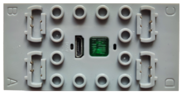

# Mould King MKH4.0 – Bluetooth Protocol

> Source: [J0EK3R/brickcontroller2](https://github.com/J0EK3R/brickcontroller2) (branch `feature/MKH4.0`) – `DeviceManagement/MouldKing/MKH4.cs`, `MouldKingDeviceManager.cs` and the commit history of `MKH4.cs` (the comments there quote BLE captures of the original Mould King app).
> Last updated: 2026-11-07



*Image: BrickController2 (`UI/Images/mkh4_image.png`, MIT License).*

## Overview

| Property | Value |
|---|---|
| Device | Mould King MKH4.0 hub (e.g. from the 2D plotter set), shown as hardware `H4.0` in the original app |
| Transport | **BLE GATT connection** – unlike all other Mould King modules in this repository, no advertising telegrams |
| Direction | bidirectional: commands on `0xAE3B`, responses / notifications on `0xAE3C` |
| Scan identification | 16-bit service UUID `0xAF30` in the advertisement + non-empty device name |
| Ports | 4 (A, B, C, D) |
| Port modes | normal motor (speed, command `4`) or servo (absolute position, command `3`, needs a motor with encoder, e.g. MK+ motor) |
| Message format | ASCII text `T` + length + command + payload + `W` |
| Max. write size | 20 bytes (default ATT MTU 23), longer messages are split |
| Back channel | version, motor connection status, motor position, "position reached", "port running" |

The protocol is a plain ASCII command protocol on top of a "serial port" style GATT service. All numbers inside a message are hexadecimal digits.

### Sets with the MKH4.0

The following models can be selected in the **MK+ app** (Mould King app for the MKH motors) and contain the MKH4.0. Names and piece counts come from the Mould King online store and from the [Merlins Bricks SetDB](https://www.merlinsbricks.com/setdb/eol/brand/mouldking/) (as of 2026-11).

| Model | Name | Pieces | Mould King | SetDB / other |
|---|---|---|---|---|
| 10159 | Cyberpunk Mechanical Clock | 3,181 | [mouldkingcorp.com](https://mouldkingcorp.com/products/10159-cyberpunk-mechanical-clock) | [Merlins Bricks](https://www.merlinsbricks.com/sets/mou-10159/) |
| 10160 | Motorized Mechanical Gear Clock | 3,675 | [mouldkingcorp.com](https://mouldkingcorp.com/products/10160-motorized-mechanical-gear-clock-building-set) | [Merlins Bricks](https://www.merlinsbricks.com/sets/mou-10160) |
| 17007 | Liebherr LTM 11200 mobile crane (white) | 8,506 | [mouldkingcorp.com](https://mouldkingcorp.com/products/mould-king-17007-liebherr-11200-mobile-crane) | – |
| 17008 | Liebherr LTM 11200 mobile crane (red) | 8,506 | [mouldkingcorp.com](https://mouldkingcorp.com/products/mould-king-17007-liebherr-11200-mobile-crane) (same page as 17007) | – |
| 17025 | *unknown* | – | listed only in the [FAQ](https://mouldkingcorp.com/pages/help) as a model that requires MK Plus | – |
| 17047 | Mechanical Crane C+ (mobile crane) | 2,688 | [Cranes collection](https://mouldkingcorp.com/collections/cranes) | [brickmo](https://www.brickmo.com/en/thematic-world/vehicles/64164/mould-king-remote-control-crane-c-17047?c=6089) |
| 17048 | Liebherr R 9800 mining excavator, 2023 | 4,468 | [mouldkingcorp.com](https://mouldkingcorp.com/products/mould-king-17048-ultimate-edition-excavator) (currently shows the 17070 content) | [Merlins Bricks](https://www.merlinsbricks.com/sets/mou-17048/) |
| 17049 | Liebherr PR766 bulldozer | 3,568 | [mouldkingcorp.com](https://mouldkingcorp.com/products/mould-king-17049-ultimate-edition-bulldozer) | [Merlins Bricks](https://www.merlinsbricks.com/sets/mou-17049/) |
| 17062 | Demolition excavator | 4,195 | [mouldkingcorp.com](https://mouldkingcorp.com/products/17062-rc-demolition-excavator-building-set) | [Merlins Bricks](https://www.merlinsbricks.com/sets/mou-17062) |
| 17070 | Liebherr R 9800 mining excavator / heavy-duty excavator, 2024 (variant of 17048) | 4,767 | [mouldkingcorp.com](https://mouldkingcorp.com/products/liebherr-r-9800-mining-excavator) | [Merlins Bricks](https://www.merlinsbricks.com/sets/mou-17070/) |
| 17071 | Heavy-duty excavator, 2024 (variant of 17048 / 17070) | 4,767 | – | [Merlins Bricks](https://www.merlinsbricks.com/sets/mou-17071/) |
| 17075 | LTM 1110 crane truck (white) | 3,248 | [mouldkingcorp.com](https://mouldkingcorp.com/products/17075-remote-controlled-ltm-1110-crane-truck-building-set) | [Merlins Bricks](https://www.merlinsbricks.com/sets/mou-17075/) |

Notes:

- The Mould King [FAQ](https://mouldkingcorp.com/pages/help) lists the models that require the MK Plus app as 17007, 17008, 17025, 17036, 17044, 17047, 17048, 17049 and 13181. 17036 (backhoe loader), 17044 (forklift) and 13181 (plotter) are not in the app's model list above. 13181 is presumably the "2D plotter set" mentioned in the BC2 source.
- The store page of 10160 calls the included hub "**BH4.0** Power Module" (with a "BH L Motor"). This is presumably a different name for the MKH4.0.

---

## 1. GATT layout

All UUIDs are 16-bit UUIDs on the Bluetooth base UUID (`0000xxxx-0000-1000-8000-00805f9b34fb`).

| Service | Characteristic | Properties (as known) | Use |
|---|---|---|---|
| `0xAF30` | – | – | only seen in the **advertisement** (complete or incomplete list of 16-bit service UUIDs); BC2 uses it for device detection |
| `0xAE30` | `0xAE01` | no notify | not used by the original app |
| | `0xAE02` | notify | not used by the original app |
| | `0xAE03` | no notify | not used by the original app |
| | `0xAE04` | notify | not used by the original app |
| | `0xAE05` | no notify | not used by the original app |
| | `0xAE10` | no notify | not used by the original app |
| `0xAE3A` | `0xAE3B` | write without response | **commands** app → hub (and the ACK byte) |
| | `0xAE3C` | notify | **responses / notifications** hub → app |

- The original app writes the CCCD of `0xAE3C` (enable notifications) right after service discovery. It does not enable notifications on `0xAE02` / `0xAE04` and never reads any `0xAE30` characteristic in the captured sessions.
- Service `0xAE3A` / characteristic `0xAE3B` are also used by the Mould King **DIY** module, but with a different (binary) payload `CC AA BB 01 …`. The first BC2 draft of the MKH4 driver used that binary packet; it was replaced by the text protocol described here.

---

## 2. Sequence

```
Scan: advertisement with service UUID 0xAF30 + device name
        │
        ▼
GATT connect, service discovery
        │
        ▼
Enable notifications on 0xAE3C (CCCD)
        │
        ▼
Init requests (each repeated until answered):
   T041AABBW → T01711W         handshake / ready
   T00EW     → T067E410012W    version
   T00CW     → T027C02W        motor connection status
   T006W     → T1576…W         stored value
   T01F1W    → T017F1W         unknown
        │
        ▼
Control: T144…W (speed) and/or T303…W (position)
         hub → T0274xxW (port running), T027300W (position reached)
         app → 0x01 after every notification (ACK)
        │
        ▼
Stop: T14400000000000000000000W, disconnect
```

- **Requests and retries:** a request with command `X` is answered by a notification with command `7X`. The original app repeats a request about every **30 ms** until the answer arrives (9 to 11 times in the captures).
- **ACK:** the original app writes a single byte **`0x01`** (not a `T…W` message) to `0xAE3B` after **every** notification it receives. Whether the hub requires it is unknown.
- **No failsafe known:** the hub keeps the last speed values. The original app does not resend them, and no timeout has been observed. A lost "stop" message therefore leaves a motor running.
- **Position counter:** the encoder position counter of each port is **volatile**. After a power cycle it starts at 0 at the current shaft position (verified by test: the same target moves the motor again after a power cycle). Command `8` resets it to 0 at the current position.

### 2.1 Implementation notes (BrickController2, not part of the protocol)

- Requests are repeated up to 20 times every 40 ms.
- The output loop runs every 10 ms and sends speed (`4`) and position (`3`) messages only when values changed. As a safety net the last speed values are resent after 1 s without a change (with servo ports only while a motor is running, because a `4` message may cancel a running position move).
- Speeds are scaled from −1…1 to −`0x7FFF`…`0x7FFF`; servo positions use **1650 units per degree** (594000 per revolution, measured with an MK+ motor) and a move speed of 0.625 (`0x4FFF`, the value of the original app).
- Servo center = zero of the volatile counter + configured base angle. "Center here" (auto calibration) sends `T028XXW` and makes the current shaft position the center.
- Before disconnecting, BC2 sends an all-zero speed message (best effort, 500 ms timeout).
- Writes to `0xAE3B` (messages and ACK bytes) are serialized so that the 20-byte packets of one message are never interleaved.

---

## 3. Message format

### 3.1 App → hub (request / command)

```
'T'  LL  C  payload…  'W'
```

| Field | Size | Content |
|---|---|---|
| `T` | 1 char | start character |
| `LL` | 2 hex digits | **number of payload characters** (not bytes), uppercase, e.g. `14` = 20 characters |
| `C` | 1 char | command, one hex digit (`1`, `3`, `4`, `5`, `6`, `8`, `A`, `b`, `C`, `E`, `F`) |
| payload | `LL` chars | hex digits (and `+` / `-` for signed values) |
| `W` | 1 char | end character |

The whole message is sent as ASCII. If it is longer than 20 characters, it is split into several writes of at most 20 bytes; the hub reassembles them up to the `W`.

### 3.2 Hub → app (response / notification)

```
'T'  LL  7C  payload…  'W'
```

Same format, but the command has **two** characters: `7` followed by the command it belongs to (`7E` answers `E`). The length field again counts payload characters only.

- A notification may contain a **fragment** of a message, or **several** messages at once (e.g. `T017b1WT027300W`). Receivers collect characters until `W` and discard anything before the next `T`.
- The command character keeps the case seen on the wire (`7b`, lowercase, in the captures), so parsers should not assume uppercase.

### 3.3 Common fields

| Field | Format | Notes |
|---|---|---|
| Motor bitmask `XX` | 2 hex digits | bit 0 = A, bit 1 = B, bit 2 = C, bit 3 = D (`01`, `02`, `04`, `08`) |
| Motor digit `X` | 1 digit | `1` = A … `4` = D (in responses) |
| Speed `SSSS` | 4 hex digits | **sign-magnitude**: bits 0–14 = magnitude `0x0000`…`0x7FFF`, bit 15 = direction flag |
| Position `PPPPPPPP` | 8 hex digits | unsigned magnitude in encoder units; the sign is given separately (`+`/`-` or the direction bit) |

---

## 4. Command reference

### 4.1 Overview of all known commands

| Cmd | Request (app → hub) | Response (hub → app) | Function | Status |
|---|---|---|---|---|
| `1` | `T041AABBW` | `T01711W` | handshake / init, answer = "ready" | used, meaning of `AABB` unknown |
| `3` | `T303` + 4 × `SSSSPPPPPPPP` + `W` | `T027300W` when the target is reached | move to absolute position (servo) | used |
| `4` | `T144` + 4 × `FSSSS` + `W` | none directly; `T0274xxW` every ~90 ms while a motor runs | set speed of all 4 ports | used |
| `5` | `T155` + 21 chars + `W` | unknown | write the stored value (see `6`) | seen in the original app (end of calibration), not used by BC2 |
| `6` | `T006W` | `T1576` + 21 chars + `W` | read the stored value | used (logged only) |
| `8` | `T028XXW` | `T027800W` | set the position counter of the ports in `XX` to 0 | used |
| `A` | `T02AXXW` | `T0A7AX±PPPPPPPPW` | read the position of one port | used |
| `b` | `T02b…W` | probably `T017b1W` | sent by the original app before an "auto calibration" run | meaning unknown, not used by BC2 |
| `C` | `T00CW` | `T027CXXW` | motor connection status | used |
| `E` | `T00EW` | `T067EVVVVVVW` | hardware / firmware version | used |
| `F` | `T01F1W` | `T017F1W` | unknown, last step of the init sequence | used, meaning unknown |
| – | `01` (single raw byte) | – | ACK after every notification | used |

### 4.2 `1` – handshake

```
→ T041AABBW
← T01711W
```

First message after enabling notifications. Payload `AABB` (4 characters). The answer payload `1` is interpreted as "ready". Whether other payloads are accepted is unknown.

### 4.3 `E` – version

```
→ T00EW
← T067E410012W          payload 41 00 12
```

Three bytes as six hex digits. Layout derived from a single sample (shown as **H4.0 / V1.1.2** in the original app):

| Byte | Example | Meaning (derived) |
|---|---|---|
| 0 | `41` | high nibble = hardware major (`4`), low nibble = firmware major (`1`) |
| 1 | `00` | hardware minor (`0`) |
| 2 | `12` | high nibble = firmware minor (`1`), low nibble = firmware patch (`2`) |

### 4.4 `C` – motor connection status

```
→ T00CW
← T027C02W              02 = port B not connected
```

Payload = motor bitmask (section 3.3), **bit set = no motor connected** at that port. `00` = all four ports connected, `0F` = none.

### 4.5 `6` – read stored value

```
→ T006W
← T15760B0100030003+0279E999W
```

Payload (21 characters): fixed prefix `0B0100030003` (12 hex digits) + sign + 8 hex digits (here `+0x0279E999`; an earlier capture showed `+0x02AD4AEC`).

- The hub keeps this value between connections, and it is not reset on its own like the position counter.
- The original app updates it with command `5` at the end of a calibration: *new value = old value + position of motor A*.
- Meaning unknown (possibly a calibration offset of the plotter). The prefix may be a separate field.

### 4.6 `5` – write stored value

```
→ T155 0B0100030003±PPPPPPPP W      (spaces only for readability)
```

Payload in the same 21-character format as the answer to `6`. Only seen in the original app; the answer was not documented.

### 4.7 `F` – unknown

```
→ T01F1W
← T017F1W
```

Last request of the init sequence, payload `1` is echoed back. Meaning unknown (possibly "enable status reports" or a mode selection).

### 4.8 `4` – set speed (normal motor)

```
T 14 4 [F SSSS]A [F SSSS]B [F SSSS]C [F SSSS]D W
```

Payload: 4 × 5 characters = 20 (`0x14`), always all four ports.

| Field | Content |
|---|---|
| `F` | flag digit, meaning unknown. A protocol README uses `0` for all ports; the original app sent `1` for port A and `0` for ports C and D (port B not documented). BC2 sends `0` everywhere. |
| `SSSS` | speed, sign-magnitude: `0x0000`…`0x7FFF` = forward, bit 15 set = reverse (`0x8000`…`0xFFFF`) |

Examples:

| Message | Meaning |
|---|---|
| `T14400000000000000000000W` | all ports stop |
| `T14407FFF000000000000000W` | A full forward |
| `T1440FFFF000000000000000W` | A full reverse |
| `T14403FFF000000BFFF00000W` | A half forward, C half reverse |

- While a port is driven, the hub sends `T0274xxW` about every **90 ms** (section 4.13).
- The hub keeps the values until the next `4` message. A `4` message may cancel a running position move (`3`).

### 4.9 `3` – move to position (servo)

```
T 30 3 [SSSS PPPPPPPP]A [SSSS PPPPPPPP]B [SSSS PPPPPPPP]C [SSSS PPPPPPPP]D W
```

Payload: 4 × 12 characters = 48 (`0x30`), always all four ports. Total message length 53 characters → 3 writes (20 + 20 + 13).

| Field | Content |
|---|---|
| `SSSS` | move speed `0x0000`…`0x7FFF` (original app: `0x4FFF`); **bit 15 set = target position is positive (≥ 0)**, cleared = negative |
| `PPPPPPPP` | absolute target position (magnitude) in encoder units, relative to the zero of the volatile counter |
| idle port | `8000` + `00000000` (as sent by the original app) |

Note that the direction bit has the opposite sense to command `4` (here: set = positive).

When the target is reached, the hub sends **`T027300W`**.

Examples (BC2 scale 1650 units/degree, i.e. 90° = 148500 = `0x00024414`):

| Message | Meaning |
|---|---|
| `T303CFFF00024414800000000000800000000000800000000000W` | A → +90°, speed `0x4FFF` |
| `T3038000000000004FFF00024414800000000000800000000000W` | B → −90°, speed `0x4FFF` |

Split into writes: `T303CFFF000244148000` · `00000000800000000000` · `800000000000W`.

### 4.10 `A` – read position

```
→ T02AXXW               XX = motor bitmask, e.g. T02A01W for port A
← T0A7AX±PPPPPPPPW      e.g. T0A7A1-00336153W
```

Answer payload (10 characters): motor digit (`1` = A … `4` = D), sign, 8 hex digits. The example means port A at −`0x00336153` = −3367251 units (≈ −2040° with 1650 units/degree). Whether more than one bit may be set in `XX` is unknown.

### 4.11 `8` – reset position counter

```
→ T028XXW               XX = motor bitmask, e.g. T02804W for port C
← T027800W
```

Sets the position counter of the selected port(s) to 0 at the current shaft position. Seen in the calibration capture of the original app (`T02804W` for port C).

### 4.12 `b` – calibration preparation (unknown)

The original app sends a message starting with `T02b` (payload of 2 characters, lowercase command `b`) before it starts an auto-calibration run that searches for mechanical end stops. The payload and the exact meaning are not documented; `T017b1W` seen together with `T027300W` in one notification is presumably its answer.

### 4.13 Unsolicited notifications

| Notification | Meaning |
|---|---|
| `T027300W` | position move of a `3` command finished ("position reached"). Payload `00`; whether it encodes the port is unknown. |
| `T0274xxW` | a port is being driven; sent about every 90 ms while a motor runs after a `4` command. Example `T027408W`; the payload is presumably a port bitmask (derived). |
| `T017b1W` | see section 4.12. |

---

## 5. Reference implementation (Python)

```python
# Mould King MKH4.0 - reference builder/parser for the ASCII "T...W" protocol.
# Re-implementation of BrickController2 MKH4.BuildMessage(), BuildSpeedPayload(),
# BuildPositionPayload() and the notification parser.

CHANNELS = 4
MAX_PACKET = 20          # default ATT MTU 23 - 3 bytes header


def build_message(command: str, payload: str = "") -> str:
    """'T' + payload length (2 hex digits) + command (1 char) + payload + 'W'"""
    return f"T{len(payload):02X}{command}{payload}W"


def split_packets(message: str) -> list[bytes]:
    data = message.encode("ascii")
    return [data[i:i + MAX_PACKET] for i in range(0, len(data), MAX_PACKET)]


def speed_field(value: int, flag: str = "0") -> str:
    """value -0x7FFF..0x7FFF -> flag digit + 4 hex digits (bit 15 = reverse)"""
    speed = min(abs(value), 0x7FFF)
    if value < 0:
        speed |= 0x8000
    return f"{flag}{speed:04X}"


def speed_message(values, flags="0000") -> str:
    """command '4': speed of all four channels"""
    return build_message("4", "".join(speed_field(v, f) for v, f in zip(values, flags)))


def position_message(targets, speed: float = 0.625) -> str:
    """command '3': target positions, None = idle channel"""
    speed_value = int(min(abs(speed), 1.0) * 0x7FFF)
    payload = ""
    for target in targets:
        if target is None:
            payload += "8000" + "00000000"
        else:
            payload += f"{speed_value | (0x8000 if target >= 0 else 0):04X}{abs(target):08X}"
    return build_message("3", payload)


def mask(channel: int) -> str:
    """motor bitmask (bit 0 = A ... bit 3 = D) as two hex digits"""
    return f"{1 << channel:02X}"


def parse(message: str):
    """'T' + length (2) + command (2, '7X' answers request X) + payload + 'W'"""
    assert message[0] == "T" and message[-1] == "W"
    length = int(message[1:3], 16)
    command, payload = message[3:5], message[5:-1]
    assert len(payload) == length, "length field mismatch"
    return command, payload


if __name__ == "__main__":
    print(speed_message([0x7FFF, 0, 0, 0]))                    # T14407FFF000000000000000W
    print(position_message([round(90 * 1650.0), None, None, None]))
    print(build_message("A", mask(0)), build_message("8", mask(2)))  # T02A01W T02804W
    print(parse("T0A7A1-00336153W"))                           # ('7A', '1-00336153')
```

---

## 6. Test vectors

| Message | Direction | Parsed (command, payload) |
|---|---|---|
| `T041AABBW` | app → hub | `1`, `AABB` |
| `T01711W` | hub → app | `71`, `1` |
| `T00EW` / `T067E410012W` | request / response | `7E`, `410012` → H4.0, V1.1.2 |
| `T00CW` / `T027C02W` | request / response | `7C`, `02` → port B not connected |
| `T006W` / `T15760B0100030003+0279E999W` | request / response | `76`, `0B0100030003+0279E999` |
| `T01F1W` / `T017F1W` | request / response | `7F`, `1` |
| `T02A01W` / `T0A7A1-00336153W` | request / response | `7A`, `1-00336153` → A at −3367251 |
| `T02804W` / `T027800W` | request / response | `78`, `00` |
| `T14400000000000000000000W` | app → hub | `4`, all stop |
| `T303CFFF00024414800000000000800000000000800000000000W` | app → hub | `3`, A → +148500 at speed `0x4FFF` |
| `T027300W` | hub → app | `73`, `00` → position reached |
| `T027408W` | hub → app | `74`, `08` → port running |

All length fields above were checked with the reference implementation.

---

## 7. Hardware

No board analysis yet. Four motor ports (A–D) with encoder support for Mould King MK+ motors.

---

## 8. Open questions

- Name of model 17025, and whether 17036, 17044 and 13181 (MK Plus models according to the Mould King FAQ) also contain the MKH4.0.
- Meaning of the handshake payload `AABB` (command `1`) and whether it acts as an app identifier.
- Meaning of command `F` (payload `1`).
- Meaning of the flag digit in front of each speed in command `4` (`0` vs. `1`).
- Meaning of the stored value (commands `5` / `6`), of its prefix `0B0100030003`, and the response to `5`.
- Payload and meaning of command `b` and of its answer `T017b1W`.
- Whether the payload of `T0273…W` (position reached) and `T0274…W` (port running) encodes the port.
- Whether commands `8` and `A` accept a bitmask with more than one port.
- Whether the hub needs the `0x01` ACK byte, and whether it has a failsafe timeout at all.
- Purpose of service `0xAE30` (`0xAE01` … `0xAE10`) and of the advertised service `0xAF30`.
- Encoder resolution of other motor types (1650 units/degree was measured with an MK+ motor).
- Whether higher ATT MTUs are supported (messages longer than 20 bytes in one write).
