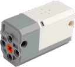
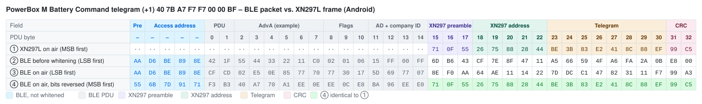

# PowerBox M Battery – Bluetooth Protocol

> Source: [J0EK3R/brickcontroller2](https://github.com/J0EK3R/brickcontroller2) – `DeviceManagement/PowerBox/PowerBoxMBattery.cs`, `PowerBoxBaseByte.cs`, `PowerBox.cs`, `PowerBoxDeviceManager.cs`, `Protocols/PowerBoxProtocol.cs`, `Protocols/CryptTools.cs`, the platform `PowerBoxPlatformService.cs` files, `UI/Controls/Devices/PowerBoxMBatteryChannelSelectorView.xaml` and `PowerBoxMBatteryDatagramTests.cs`.
> Last updated: 2026-11-06



*Image: BrickController2 (`UI/Images/powerboxmbattery_image.png`, MIT License).*

## Overview

| Property | Value |
|---|---|
| Device | PowerBox M Battery – battery box with 1 output channel |
| Transport | **BLE advertising** (broadcast), no GATT connection |
| Direction | app → receiver only (no back channel, no battery voltage) |
| Manufacturer ID | **`0xFF00`** |
| Devices | 1 (no device slots) |
| Channels | 1, one **byte** (sent twice), bidirectional analog with 7 steps per direction |
| Raw telegrams | Connect (8 bytes), Command (8 bytes) |
| Encoding | identical to the [PowerBox A Series](A-Series.md#5-encoding-into-ble-advertising-data) |

The M Battery shares the Connect telegram, the Command identifiers, the manufacturer ID and the encoding with the [A Series](A-Series.md). Only the content of the Command telegram differs: one channel, encoded as a special byte that is written to **two** positions.

---

## 1. Sequence

Same as the [A Series](A-Series.md#1-sequence): Connect telegram first, then Command telegrams, sent continuously while advertising.

### 1.1 Implementation notes (BrickController2, not part of the protocol)

- Vendor `PowerBox`, device type `M Battery` (device address string `Device`, no real BLE address), registered with the image `powerboxmbattery_image.png`.
- The device gets its own `BluetoothAdvertisingDeviceHandler`.
- If the channel stays at 0 for longer than `ReconnectTimeSpan` = **3 s**, BC2 sends the Connect telegram again.
- The app identifier is the same 2-byte PowerBox app identifier as for the A Series (`PowerBoxDeviceManager`).

---

## 2. Connect telegram (8 bytes, raw)

Identical to the [A Series Connect telegram](A-Series.md#2-connect-telegram-8-bytes-raw): `A4 <AppId0> <AppId1> 80 80 80 00 5B`.

---

## 3. Command telegram (8 bytes, raw)

| Offset | Content | Meaning |
|---|---|---|
| 0 | `0x40` | telegram identifier (start) |
| 1 | `AppId[0]` | app identifier byte 0 (ignored by the receiver) |
| 2 | `AppId[1]` | app identifier byte 1 (ignored by the receiver) |
| 3 | `M` | channel 0 / output, see 3.1 |
| 4 | `M` | **same value as offset 3** |
| 5 | `0x00` | constant |
| 6 | `0x00` | constant |
| 7 | `0xBF` | telegram identifier (end) |

BC2 comment in `PowerBoxMBattery.SetChannelValue`: *very special: bytes are duplicated in the datagram*. Offsets 3 and 4 correspond to the positions of ports A/B and C/D of the A Series.

### 3.1 Channel value (byte)

The byte consists of the normal PowerBox nibble `n` (see [A Series §3.1](A-Series.md#31-channel-value-nibble)) in the high half and `n XOR 0x8` in the low half:

```
n    = nibble(v)                    // 0x1..0x7 reverse, 0x0 stop, 0x9..0xF forward
byte = 0x00                         if n == 0x0
byte = (n << 4) | (n ^ 0x8)         otherwise
```

| Direction | Steps 1 … 7 |
|---|---|
| reverse | `19` `2A` `3B` `4C` `5D` `6E` `7F` |
| stop | `00` |
| forward | `91` `A2` `B3` `C4` `D5` `E6` `F7` |

In other words: the low nibble is the "opposite direction" code of the same step (reverse 3 = `0x3B`: high `3`, low `B` = forward 3). Why the receiver needs this redundancy is unknown.

### 3.2 Examples (AppId = `7B A7`)

| Value | Raw telegram |
|---|---|
| 0 | `40 7B A7 00 00 00 00 BF` |
| +1 | `40 7B A7 F7 F7 00 00 BF` |
| +0.5 | `40 7B A7 B3 B3 00 00 BF` |
| −0.5 | `40 7B A7 3B 3B 00 00 BF` |
| −1 | `40 7B A7 7F 7F 00 00 BF` |

The neutral Command telegram is identical to the neutral A Series Command telegram.

---

## 4. App identifier

Same as the [A Series](A-Series.md#4-app-identifier).

---

## 5. Encoding into BLE advertising data

Identical to the [A Series](A-Series.md#5-encoding-into-ble-advertising-data) (manufacturer ID `0xFF00`, Android 18 bytes, iOS 20 bytes).

### 5.1 Byte-by-byte comparison: BLE packet vs. XN297L frame (Android)

The Connect telegram and the neutral Command telegram are identical to the A Series, so are their tables – see [A Series §5.1](A-Series.md#51-byte-by-byte-comparison-ble-packet-vs-xn297l-frame-android). Below: the Command telegram with full forward (`+1`).

**How to read the tables:** each column is one byte in transmission order, each row is one view of the same packet. The coloured image shows the table with field colours (legend below each image; light and dark mode); the Markdown table under it contains the same bytes as text, with bold marking the bytes that match.

| Row | Meaning |
|---|---|
| ① | What an XN297L (the original handset chip) would transmit for this telegram with `TX_ADDR = C1 … C5`: preamble, address, telegram, CRC – scrambled, MSB first. `··` = the XN297L sends nothing there. |
| ② | The BLE advertising packet as the phone's BLE stack assembles it, before whitening (LSB first). From PDU byte 15 on this is the manufacturer data from `GetRfPayload()` – it looks completely different from ①, because it is scrambled twice (XN297 scrambler + pre-compensated BLE whitening). |
| ③ | The same packet after BLE whitening (channel 37) – the bytes the radio actually sends, LSB first. Preamble and access address are not whitened. The XN297 preamble shows up as `8E F0 AA` = `71 0F 55` with reversed bit order. |
| ④ | Row ③ with every byte bit-reversed, i.e. read MSB first like an XN297L receiver does. **Bold** bytes are identical to row ①. |
| ④ = ① | ✓ = byte matches the XN297L frame. |

Field abbreviations: `Pre` BLE preamble, `AA` access address, `Hdr` PDU header, `AdvA` advertiser address, `Flg` Flags AD, `AD` AD length/type, `CID` company ID `0xFF00`; **Pre** XN297 preamble, **Adr** XN297 address, **T0 …** raw telegram bytes, **CRC** XN297 CRC.

The BLE part (PDU bytes 0 … 14) does not match – there is nothing to match: for the XN297L receiver it is just noise in front of its preamble `71 0F 55`. Only the *length* of this part (`headerOffset` = 15) matters for the encoding, not its content; the header values are examples (see [XN297L §6.1](../Chips/XN297L.md#61-example-ble-advertising-packet-vs-xn297l-frame)). Padding and the 3-byte BLE CRC after the XN297 CRC are omitted; the receiver stops reading after its CRC.

#### Command telegram, full forward `40 7B A7 F7 F7 00 00 BF`



| PDU byte | – | – | – | – | – | 0 | 1 | 2 | 3 | 4 | 5 | 6 | 7 | 8 | 9 | 10 | 11 | 12 | 13 | 14 | 15 | 16 | 17 | 18 | 19 | 20 | 21 | 22 | 23 | 24 | 25 | 26 | 27 | 28 | 29 | 30 | 31 | 32 |
|---|:-:|:-:|:-:|:-:|:-:|:-:|:-:|:-:|:-:|:-:|:-:|:-:|:-:|:-:|:-:|:-:|:-:|:-:|:-:|:-:|:-:|:-:|:-:|:-:|:-:|:-:|:-:|:-:|:-:|:-:|:-:|:-:|:-:|:-:|:-:|:-:|:-:|:-:|
| Field | Pre | AA | AA | AA | AA | Hdr | Hdr | AdvA | AdvA | AdvA | AdvA | AdvA | AdvA | Flg | Flg | Flg | AD | AD | CID | CID | **Pre** | **Pre** | **Pre** | **Adr** | **Adr** | **Adr** | **Adr** | **Adr** | **T0** | **T1** | **T2** | **T3** | **T4** | **T5** | **T6** | **T7** | **CRC** | **CRC** |
| ① XN297L on air (MSB first) | ·· | ·· | ·· | ·· | ·· | ·· | ·· | ·· | ·· | ·· | ·· | ·· | ·· | ·· | ·· | ·· | ·· | ·· | ·· | ·· | `71` | `0F` | `55` | `26` | `75` | `88` | `28` | `44` | `BE` | `3B` | `83` | `E2` | `41` | `8C` | `88` | `EF` | `99` | `C5` |
| ② BLE before whitening (LSB first) | `AA` | `D6` | `BE` | `89` | `8E` | `42` | `1F` | `55` | `44` | `33` | `22` | `11` | `C0` | `02` | `01` | `06` | `15` | `FF` | `00` | `FF` | `6D` | `B6` | `43` | `CF` | `7E` | `8F` | `47` | `11` | `A5` | `66` | `59` | `4F` | `A6` | `FA` | `2A` | `0B` | `E8` | `00` |
| ③ BLE on air (LSB first) | `AA` | `D6` | `BE` | `89` | `8E` | `CF` | `CD` | `02` | `E5` | `0E` | `85` | `77` | `70` | `77` | `30` | `17` | `5D` | `69` | `77` | `07` | `8E` | `F0` | `AA` | `64` | `AE` | `11` | `14` | `22` | `7D` | `DC` | `C1` | `47` | `82` | `31` | `11` | `F7` | `99` | `A3` |
| ④ BLE on air, bits reversed (MSB first) | `55` | `6B` | `7D` | `91` | `71` | `F3` | `B3` | `40` | `A7` | `70` | `A1` | `EE` | `0E` | `EE` | `0C` | `E8` | `BA` | `96` | `EE` | `E0` | **`71`** | **`0F`** | **`55`** | **`26`** | **`75`** | **`88`** | **`28`** | **`44`** | **`BE`** | **`3B`** | **`83`** | **`E2`** | **`41`** | **`8C`** | **`88`** | **`EF`** | **`99`** | **`C5`** |
| ④ = ① |  |  |  |  |  |  |  |  |  |  |  |  |  |  |  |  |  |  |  |  | ✓ | ✓ | ✓ | ✓ | ✓ | ✓ | ✓ | ✓ | ✓ | ✓ | ✓ | ✓ | ✓ | ✓ | ✓ | ✓ | ✓ | ✓ |

---

## 6. Reference implementation (Python)

Encoder identical to the Mould King reference, extended by the parameters `total_len` and `ctx2` (verified against the MK4.0 test vectors from `CryptToolsTests.cs`). The telegram builder is verified against all cases of `PowerBoxMBatteryDatagramTests.cs`.

```python
# PowerBox M Battery - reference encoder for BLE advertising payloads.
# Re-implementation of BrickController2 CryptTools.GetRfPayload()
# plus the M Battery telegram builder.

MANUFACTURER_ID = 0xFF00                    # company ID used for advertising

# --- Protocol constants (JieStarProtocol.cs / PowerBoxProtocol.cs) ------------
SEED   = [0xC1, 0xC2, 0xC3, 0xC4, 0xC5]     # 5-byte RF address
HEADER = [0x71, 0x0F, 0x55]                 # XN297L preamble
CTX1   = 0x3F                               # scrambler seed (address+data+CRC)
CTX2   = 0x25                               # BLE whitening seed (channel 37)


def rev8(b: int) -> int:
    """Reverse the bit order of one byte (0b00000001 -> 0b10000000)."""
    return int(f"{b:08b}"[::-1], 2)


def rev16(w: int) -> int:
    """Reverse the bit order of a 16-bit word."""
    return int(f"{w:016b}"[::-1], 2)


def crc16(seed: list[int], data: list[int]) -> int:
    """CRC16-CCITT as used by the protocol.

    - seed is processed in reverse order, bytes as-is
    - data is processed in forward order, each byte bit-reversed
    - result is bit-reversed and inverted
    """
    crc = 0xFFFF
    for b in list(reversed(seed)) + [rev8(x) for x in data]:
        crc ^= b << 8
        for _ in range(8):
            # shift left, apply polynomial 0x1021 when the MSB falls out
            crc = ((crc << 1) ^ 0x1021) if crc & 0x8000 else (crc << 1)
            crc &= 0xFFFF
    return rev16(crc) ^ 0xFFFF


def whitening_init(value: int) -> list[int]:
    """7-bit LFSR state: fixed 1 followed by bits 5..0 of value."""
    return [1] + [(value >> s) & 1 for s in (5, 4, 3, 2, 1, 0)]


def whitening_next(ctx: list[int]) -> int:
    """Advance the LFSR by one step and return the output bit."""
    v3, v6 = ctx[3], ctx[6]
    ctx[3], ctx[2], ctx[1], ctx[0] = ctx[2], ctx[1], ctx[0], ctx[6]
    ctx[6], ctx[5] = ctx[5], ctx[4]
    ctx[4] = v3 ^ v6
    return ctx[0]


def whitening(buf: list[int], start: int, length: int, value: int) -> None:
    """XOR buf[start:start+length] in place with the LFSR bit stream (LSB first)."""
    ctx = whitening_init(value)
    for i in range(start, start + length):
        out = 0
        for bit in range(8):
            out |= (whitening_next(ctx) ^ ((buf[i] >> bit) & 1)) << bit
        buf[i] = out


def get_rf_payload(data: list[int], platform: str = "android", total_len: int | None = None,
                   ctx2: int = CTX2) -> list[int]:
    """Convert a raw telegram into advertising manufacturer data.

    platform "android": header_offset 15, padding index + 1
    platform "ios":     header_offset 13, padding 0x12, 0x13, ...
    total_len:          payload length of the platform (see section 5)
    ctx2:               BLE whitening seed = BLE advertising channel index (0x25 = 37)
    """
    header_offset = 13 if platform == "ios" else 15

    # leading dummy bytes keep the whitening stream aligned with the real BLE PDU
    buf = [0] * header_offset
    # preamble + address (reversed order), every byte bit-reversed
    buf += [rev8(b) for b in HEADER + SEED[::-1]]
    # raw telegram unchanged
    buf += list(data)
    # CRC16, little endian
    crc = crc16(SEED, data)
    buf += [crc & 0xFF, crc >> 8]

    # scrambling 1: address + data + CRC (skips the 3 preamble bytes)
    whitening(buf, header_offset + len(HEADER), len(SEED) + len(data) + 2, CTX1)
    # scrambling 2: pre-compensates the BLE whitening over the whole PDU
    whitening(buf, 0, len(buf), ctx2)

    out = buf[header_offset:]
    if total_len is None:
        return out
    # fill up to the platform specific length
    if platform == "ios":
        return out + [0x12 + i for i in range(total_len - len(out))]
    return out + [i + 1 for i in range(len(out), total_len)]

# --- PowerBox M Battery telegram builder -----------------------------------------------
APP_LEN_ANDROID, APP_LEN_IOS = 18, 20      # manufacturer data length (PowerBoxPlatformService)


def nibble(value: float) -> int:
    """Map -1.0..+1.0 to the PowerBox nibble (0x1..0x7 reverse, 0x0 stop, 0x9..0xF forward).

    Mirrors PowerBoxBaseNibble.SetOutput_AnalogChannel().
    """
    value = max(-1.0, min(1.0, value))          # CutOutputValue()
    if value <= -1 / 7:
        return int(min(0x7, -value * 7))
    if value >= 1 / 7:
        return int(min(0xF, value * 7 + 8))
    return 0x0


def mbattery_byte(value: float) -> int:
    """Map -1.0..+1.0 to the M Battery byte: nibble n in the high half, n XOR 8 in the low half.

    Mirrors PowerBoxMBattery.SetOutput_AnalogChannel():
    reverse 0x19, 0x2A, ... 0x7F / stop 0x00 / forward 0x91, 0xA2, ... 0xF7
    """
    n = nibble(value)
    return 0x00 if n == 0 else (n << 4) | (n ^ 0x8)


def connect_telegram(app_id: tuple[int, int]) -> list[int]:
    """Connect telegram (A Series and M Battery)."""
    return [0xA4, app_id[0], app_id[1], 0x80, 0x80, 0x80, 0x00, 0x5B]


def mbattery_command_telegram(app_id: tuple[int, int], value: float) -> list[int]:
    """M Battery Command telegram: the channel byte is sent twice (offsets 3 and 4)."""
    b = mbattery_byte(value)
    return [0x40, app_id[0], app_id[1], b, b, 0x00, 0x00, 0xBF]


if __name__ == "__main__":
    hexs = lambda a: " ".join(f"{x:02X}" for x in a)
    app = (0x7B, 0xA7)
    print(hexs(get_rf_payload(mbattery_command_telegram(app, 1.0), "android", APP_LEN_ANDROID)))
    # -> 6D B6 43 CF 7E 8F 47 11 A5 66 59 4F A6 FA 2A 0B E8 00
    print(hexs(get_rf_payload(mbattery_command_telegram(app, -1.0), "android", APP_LEN_ANDROID)))
    # -> 6D B6 43 CF 7E 8F 47 11 A5 66 59 C7 2E FA 2A 0B 2B 18
```

---

## 7. Test vectors

AppId = `7B A7`. Generated with the reference implementation above; BC2 has no encoded PowerBox vectors in `CryptToolsTests.cs`. Connect and neutral Command: see [A Series §7](A-Series.md#7-test-vectors).

| Raw telegram | CRC16 | `CTXValue2` | Platform | Encoded data |
|---|---|---|---|---|
| `40 7B A7 F7 F7 00 00 BF` (Command +1) | `0xD40F` | `0x25` | Android | `6D B6 43 CF 7E 8F 47 11 A5 66 59 4F A6 FA 2A 0B E8 00` (no padding) |
| | | | iOS | `F9 08 49 22 47 BA C4 BC 2E EF 19 FD 1A 39 35 3C A2 5F` + padding `12 13` |
| `40 7B A7 7F 7F 00 00 BF` (Command −1) | `0xCCCC` | `0x25` | Android | `6D B6 43 CF 7E 8F 47 11 A5 66 59 C7 2E FA 2A 0B 2B 18` (no padding) |
| | | | iOS | `F9 08 49 22 47 BA C4 BC 2E EF 19 75 92 39 35 3C 61 47` + padding `12 13` |

---

## 8. Hardware

No board analysis yet. The BC2 image shows a white and grey box whose front face carries a rotating cross-axle output (similar to a motor face), i.e. battery and output in one housing.


---

## 9. Open questions

- Why the channel byte is sent twice and why the low nibble carries the inverted direction code.
- Whether the receiver also accepts the plain A Series nibble encoding.
- Meaning of the constant bytes `80 80 80 00` (Connect) and `00 00` (Command, offsets 5 and 6).
- How an M Battery and an A Series in range are kept apart (identical identifiers).
- Whether mode selection and a failsafe timeout exist as on the MK4.0.
- Hardware details (section 8).
