# Bluetooth Protocols

Descriptions of the radio / Bluetooth protocols of remote-controlled building-block modules and receivers.

Two kinds of protocols are covered:

- **BLE advertising** – the protocols used by smartphone apps (e.g. BrickController2): the phone sends the control telegrams as BLE advertising packets.
- **Original 2.4 GHz remote controls** – the protocols of the vendors' own handsets, which transmit natively with an XN297L-compatible chip ([MK4.0 handset](MouldKing/MK4.0-Remote.md), [SCM8 handset](JieStar/SCM8-Remote.md)), captured with the [XN297L sniffer](Tools/xn297l-sniffer/README.md).

**Key finding:** on air both paths produce the same bytes. The app pre-computes a complete XN297L frame (preamble `71 0F 55`, scrambled address, payload and CRC-16) and pre-compensates the BLE whitening, so the bytes the phone transmits are exactly the bytes of a native XN297L frame – the same frame format the original handsets send. The receiver cannot tell the two apart at the frame layer; only frequency, address and telegram content differ. Details: [MK4.0 handset vs. app](MouldKing/MK4.0-Remote-vs-BLE.md), [XN297L](Chips/XN297L.md).

All documents are written in Markdown and in English. Protocol details are derived from the BrickController2 source code and unit tests, datasheets and own analysis; derived (not documented) interpretations are marked as such in the documents.

All devices described here except the Mould King **MKH4.0** are controlled via BLE advertising (the MK4.0 handset is the radio source, not a controlled device); the MKH4.0 uses a GATT connection with an ASCII command protocol. The Mould King, JIESTAR and PowerBox telegrams contain a 2-byte app identifier, which **none of these receivers evaluates** – there is no pairing, any receiver in range reacts to every matching telegram. The **CaDA** RaceCar is the exception: it is paired with the app identifier during discovery.

## Contents

### Mould King

The Mould King modules in the first table (except the MK4.0 handset, which transmits native XN297L frames) are controlled via **BLE advertising**: the app encodes its telegrams so that an XN297L-compatible 2.4 GHz frame appears on air (see [XN297L](Chips/XN297L.md)).

| Image | Document | Device | Channels | Connect / Command identifiers |
|---|---|---|---|---|
| 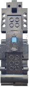 | [MouldKing/MK3.0.md](MouldKing/MK3.0.md) | MK3.0 module | 2 analog (byte) + 2 on/off functions | `AA…55` / `66…99` |
| 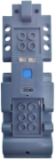 | [MouldKing/MK3.8.md](MouldKing/MK3.8.md) | MK3.8 module | 4 analog (nibble) + left/right | `B1…C1` / `81…C2` |
| 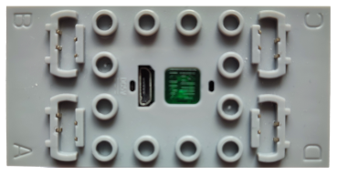 | [MouldKing/MK4.0.md](MouldKing/MK4.0.md) | MK4.0 receiver | 4 analog (nibble) × 3 devices, shared telegram | `AD…52` / `7D…82` |
|  | [MouldKing/MK4.0-Remote.md](MouldKing/MK4.0-Remote.md) | MK4.0 original 2.4 GHz handset (native XN297L, captured with the XN297L sniffer) | 4 analog (byte) + 2 three-state, 1 receiver, binding | bind on 2411 MHz, hopping 2423/2441/2458/2466 MHz; [capture plan](MouldKing/MK4.0-Capture-Plan.md) for the open questions |
| 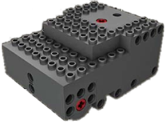 | [MouldKing/MK5.0.md](MouldKing/MK5.0.md) | MK5.0 tank module | drive, turret, shot, turn + turret lock | `AD…52` / `7D…82` (same as MK4.0) |
| 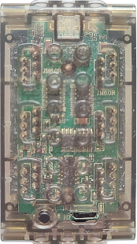 | [MouldKing/MK6.0.md](MouldKing/MK6.0.md) | MK6.0 module | 6 analog (byte) × 3 devices, telegram per device | `6D…92` / `61…63` |

Comparison of the original MK4.0 handset and the app: [MouldKing/MK4.0-Remote-vs-BLE.md](MouldKing/MK4.0-Remote-vs-BLE.md) – layer-by-layer comparison with side-by-side on-air example frames (shared XN297L frame layer, different frequency, address and telegram format).

The MKH4.0 hub is a real BLE peripheral and is controlled via a **GATT connection**:

| Image | Document | Device | Channels | Transport / commands |
|---|---|---|---|---|
|  | [MouldKing/MKH4.0.md](MouldKing/MKH4.0.md) | MKH4.0 hub | 4 ports, normal motor (speed) or servo (absolute position, encoder motor) | GATT service `0xAE3A` (write `0xAE3B`, notify `0xAE3C`), ASCII messages `T…W`, all known commands listed |

### JIESTAR

Same radio layer as Mould King (BLE advertising → XN297L frame, manufacturer ID `0xFFF0`).

| Image | Document | Device | Channels | Connect / Command identifiers |
|---|---|---|---|---|
| 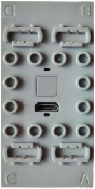 | [JieStar/SCM4.md](JieStar/SCM4.md) | SCM4 Smart Creative Module | 4 analog (nibble) × 3 devices, slot = BLE channel 37/38/39 | `A4…5B` / `40…BF` |
| 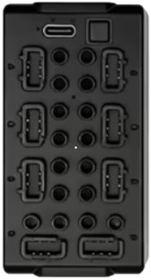 | [JieStar/SCM8.md](JieStar/SCM8.md) | SCM8 Smart Creative Module | 8 analog (nibble) × 3 devices, telegram per device | `A4…5B` / `41…43` |
| 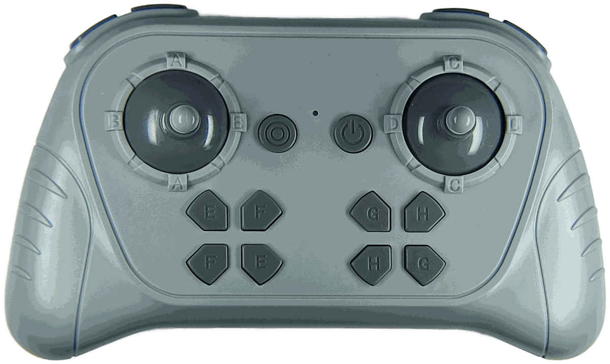 | [JieStar/SCM8-Remote.md](JieStar/SCM8-Remote.md) | SCM8 original 2.4 GHz handset (native XN297L, captured with the XN297L sniffer) | 4 analog (byte) + 2 further bytes, 1 receiver, binding | bind on 2411 MHz, hopping 2416/2433/2450/2469 MHz; [capture plan](JieStar/SCM8-Capture-Plan.md) for the open questions |

### PowerBox

Same radio layer as Mould King, manufacturer ID `0xFF00`.

| Image | Document | Device | Channels | Connect / Command identifiers |
|---|---|---|---|---|
| 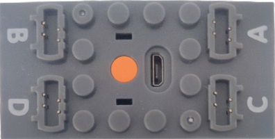 | [PowerBox/A-Series.md](PowerBox/A-Series.md) | A Series | 4 analog (nibble) | `A4…5B` / `40…BF` |
| 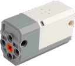 | [PowerBox/M-Battery.md](PowerBox/M-Battery.md) | M Battery | 1 analog (special byte, sent twice) | `A4…5B` / `40…BF` |

### CaDA

| Image | Document | Device | Channels | Notes |
|---|---|---|---|---|
| 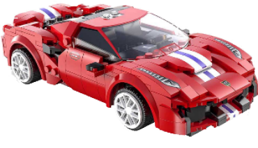 | [CaDA/RaceCar.md](CaDA/RaceCar.md) | RaceCar (Rev1 and Rev2) | throttle, steering (byte), front/rear lights | Rev1: CaDA encryption + XN297L frame (address "CAR") on BLE channel 38; Rev2: plain manufacturer data; pairing via app identifier |
| 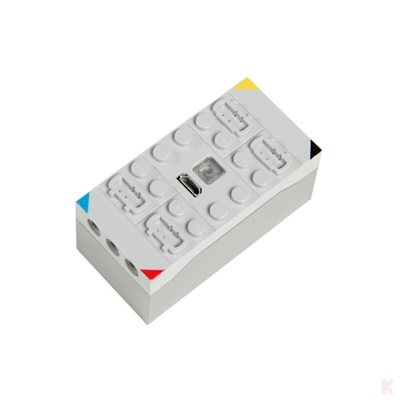 | [CaDA/CJV1010.md](CaDA/CJV1010.md) | CJV1010 4-channel 2.4 GHz receiver / battery box | 4 ports (1 red, 2 blue, 3 black, 4 yellow), three states each: neutral / plus / minus | original 2.4 GHz handset CJV8011 only, pairing mode; protocol not yet captured |
| 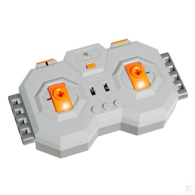 | [CaDA/CJV8011.md](CaDA/CJV8011.md) | CJV8011 original 4-channel 2.4 GHz handset | 4 channels (2 levers + 2 pairs of shoulder buttons), three states each, direction-reversal switch per channel; steering-wheel variant | for the CJV1010, pairing mode; protocol not yet captured |

### Chips

| Document | Chip |
|---|---|
| [Chips/XN297L.md](Chips/XN297L.md) | Panchip XN297L 2.4 GHz GFSK transceiver (frame format, scrambler, CRC, BLE emulation) |

### Tools

| Folder | Tool |
|---|---|
| [Tools/nrf-sniffer-ble](Tools/nrf-sniffer-ble/README.md) | nRF Sniffer for Bluetooth LE on the nRF52840 MDK USB Dongle: firmware backup and installation of the Wireshark capture tool – for BLE advertising and GATT connections |
| [Tools/xn297l-sniffer](Tools/xn297l-sniffer/README.md) | XN297L sniffer: firmware for the nRF52840 MDK USB Dongle, Wireshark extcap and Lua dissector – receives XN297L frames (e.g. from original remote controls) and decodes address, payload and CRC |

## Repository layout

```
.
├── README.md
├── CaDA/
│   ├── RaceCar.md
│   ├── CJV1010.md
│   ├── CJV8011.md
│   └── img/
├── Chips/
│   └── XN297L.md
├── JieStar/
│   ├── SCM4.md
│   ├── SCM8.md
│   ├── SCM8-Remote.md
│   ├── SCM8-Capture-Plan.md
│   └── img/
├── PowerBox/
│   ├── A-Series.md
│   ├── M-Battery.md
│   └── img/
├── Tools/
│   ├── nrf-sniffer-ble/ # nRF Sniffer for Bluetooth LE: firmware backup, installation notes
│   └── xn297l-sniffer/  # nRF52840 dongle firmware, Wireshark extcap + Lua dissector
└── MouldKing/
    ├── MK3.0.md
    ├── MK3.8.md
    ├── MK4.0.md
    ├── MK4.0-Remote.md
    ├── MK4.0-Capture-Plan.md
    ├── MK4.0-Remote-vs-BLE.md
    ├── MK5.0.md
    ├── MK6.0.md
    ├── MKH4.0.md
    └── img/            # device images (PNG), board photos (JPEG) and SVG comparison tables (BLE packet vs. XN297L frame)
```

## Conventions

- One folder per vendor, one Markdown file per device or chip, named after the device (`MouldKing/MK4.0.md`, `JieStar/SCM4.md`, `Chips/XN297L.md`).
- Byte sequences are written as hex bytes in transmission order (`71 0F 55`), multi-byte values as `0x…`.
- Every document starts with its sources and a "Last updated" date and ends with a list of open questions.
- Images live in an `img/` folder next to the document that uses them.
- Every folder contains a `README.md` that lists and describes its content.

## Image credits

The device images in `*/img/*_image.png` (Mould King, JIESTAR, PowerBox, CaDA) are taken from [BrickController2](https://github.com/J0EK3R/brickcontroller2) (`BrickController2/UI/Images`), © István Murvai, Vít Německý and Contributors, MIT License.

The set images in `MouldKing/img/mkh4_set_*.png` are product photos from the Mould King online store ([mouldkingcorp.com](https://mouldkingcorp.com)), © Mould King, scaled down to 240 × 240 px. The image of 17025 is taken from the Mould King MK+ app.

The board photos `MouldKing/img/mk4_board_*.jpg` and `MouldKing/img/mk4_chip_*.jpg` the housing photos `MouldKing/img/mk4_housing_*.jpg` and the MK6.0 housing photos `MouldKing/img/mk6_housing_*.jpg`, and the CaDA CJV1010 / CJV8011 photos `CaDA/img/cjv1010_{housing,board,chip}_*`, `CaDA/img/cjv1010_battery.png` and `CaDA/img/cjv8011_{housing,board,chip}_*` are own photos of the repository author (cropped, scaled down, metadata removed; free-standing objects with the background removed).

The product photos `CaDA/img/cjv1010_receiver_*.jpg` and `CaDA/img/cjv8011_remote_*.jpg` are taken from the klemmshop.de product pages ([CJV1010](https://www.klemmshop.de/CaDA-CJV1010-Klemmbaustein-4-Kanal-Empfaenger-/-Akkubox-24-GHz), [CJV8011](https://www.klemmshop.de/CaDA-CJV8011-Klemmbaustein-4-Kanal-Fernsteuerung-24-GHz_2?lang=eng)), © CaDA / klemmshop.de, scaled down to 400 × 400 px.
