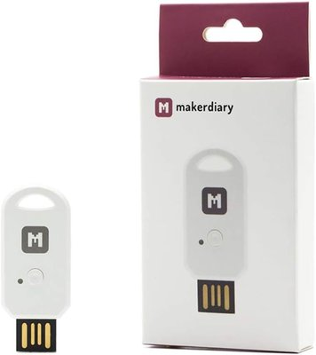
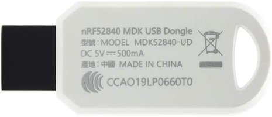

# nRF52840 MDK USB Dongle (makerdiary)

> Sources: [makerdiary/nrf52840-mdk-usb-dongle](https://github.com/makerdiary/nrf52840-mdk-usb-dongle) (hardware description, schematic, pinout) and the product page
> [GeeekPi nRF52840 MDK USB-Dongle mit Gehäuse](https://www.amazon.de/GeeekPi-nRF52840-MDK-USB-Dongle-Geh%C3%A4use/dp/B07TSJHTSY) (amazon.de, retrieved 2026-11-15).
> Last updated: 2026-11-15

<table>
<tr><td align="center" valign="top"></td><td align="center" valign="top"></td></tr>
</table>

*Images: product photos from the amazon.de product page, scaled down; see "Image credits" in the
[main README](../README.md#image-credits).*

The small USB stick that runs both capture tools of this repository. Its nRF52840 has a freely
programmable 2.4 GHz radio, so the same stick works as a BLE sniffer and as a receiver for
proprietary 2.4 GHz frames (XN297L, raw mode for unknown chips).

## Overview

| Property | Value |
|---|---|
| Name | nRF52840 MDK USB Dongle (makerdiary), model `MDK52840-UD` (label on the case) |
| Variant used | **with case** (white plastic case, sold e.g. by GeeekPi; price on amazon.de 2026-11-15: 24.99 €) |
| SoC | Nordic **nRF52840**: Arm Cortex-M4F, 1 MB flash, 256 kB RAM, USB 2.0 full speed, NFC-A, CryptoCell 310 |
| Radio | Bluetooth 5 / Bluetooth Mesh, Thread, IEEE 802.15.4, ANT, **2.4 GHz proprietary** (1 and 2 Mbps); on-board chip antenna |
| Controls | one user button, one RGB LED |
| I/O | up to 12 GPIOs on two 10-pin header rows (not populated) |
| Power | from USB, 3.3 V regulator (1 A peak); label: DC 5 V, 500 mA |
| Size | 42 × 18 × 4 mm without headers |
| Bootloader | UF2 bootloader: with the dongle plugged in, **press the button once** → LED green, drive `UF2BOOT` appears, copy a `.uf2` file onto it (bootloader 0.2.13) |

## Use in this repository

| Firmware | Tool | Used for |
|---|---|---|
| nRF Sniffer for Bluetooth LE 4.1.1 | [nrf-sniffer-ble](nrf-sniffer-ble/README.md) | BLE advertising and GATT connections, e.g. [MKH4.0](../MouldKing/MKH4.0.md) |
| own Zephyr firmware | [xn297l-sniffer](xn297l-sniffer/README.md) | XN297L frames of the original handsets ([MK4.0](../MouldKing/MK4.0-Remote.md), [SCM8](../JieStar/SCM8-Remote.md)); raw mode for unknown chips ([CaDA CJV8011](../CaDA/CJV8011.md)) |

Both firmwares can be swapped at any time via the UF2 drive. How the stick is used to decode a new
device: [Reverse-Engineering-Guide.md](Reverse-Engineering-Guide.md).

Limits that matter for the captures:

- The nRF52840 receives proprietary GFSK at **1 and 2 Mbps** only – no 250 kbps (XN297L slow
  mode, LT8910 low rates) and no DSSS despreading; DSSS signals at 1 Mchip/s are received as raw
  chips (CaDA).
- One packet holds at most 250 bytes after a 3 … 5-byte sync word in the sniffer firmware.
- The small chip antenna is sufficient at 0.1 … 1 m from the device under test.
